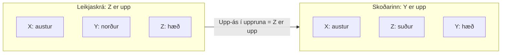

# Ásar, einingar og tími

Leikir og kort eru ekki sammála um hvaða átt er upp, hversu löng eining er, eða hvernig tími er skrifaður. Þessi síða sýnir stillingarnar þrjár sem láta gögnin þín standa, stærðast og spilast rétt.

Ef kortið þitt stendur eins og veggur í stað þess að liggja eins og gólf, skiptu um **Upp-ás í uppruna**.

Með röngum **Upp-ás í uppruna** stendur kortið eins og veggur; með réttum liggur það eins og gólf.

## Heimurinn sem skoðarinn teiknar í {#the-world-the-viewer-draws-in}

Heimur skoðarans er **Y-upp**: X og Z eru jarðflöturinn, Y er hæð. Flestar leikjavélar eru **Z-upp**: fyrir þær eru X og Y jörðin og Z er hæð. Sumar vélar eru líka speglaðar (vinstrihentar). Varpið segir til um hvernig snúa skal ásum skráarinnar yfir í ása skoðarans. (Tæknilega séð er skoðarinn réttihentur, sem er venja three.js.)

### Upp-ás {#up-axis}

**Upp-ás í uppruna** í [Dálkatengingar](column-mapping.md):

| Stilling | Skrá (x, y, z) verður heimur (X, Y, Z) |
|---|---|
| *Z er upp (flestar leikjavélar)* - sjálfgefið | (x, **z**, **y**): Z skrárinnar verður hæð og Y skrárinnar verður Z heimsins |
| *Y er upp (venja í myndvinnslu)* | (x, y, z) óbreytt |

Fyrir Z-upp gögn eru fylkin þrjú endurmerkt í stað þess að vera afrituð ([`remapAxesInPlace`](https://github.com/Holdi601/3DHeat/blob/main/src/data/ingest.ts)), sem sparar hundruð megabæta við stór inn-lestur. Ágiskunin er gerð út frá sýninu: hvor sem er af dálkunum Y og Z með minni dreifingu er upp.

### Speglanir {#flips}

**Snúa X**, **Snúa Y**, **Snúa Z** snúa við *ás skrárinnar* með því nafni, áður en endurmerkingin fer fram - svo með Z-upp snýr *Snúa Y* við því sem endar sem Z heimsins. Speglun breytir hleðslugögnunum: hnit sem sýnd eru á [mælistikunni](measure.md), sneiðinni og stöðu myndavélarinnar eru þau speglaðu.

Til að teikna speglaðan heim rétt við **án þess að breyta gögnunum**, notaðu **Myndavél og sena → Snúa heimsás við** í staðinn ([Myndavél](camera.md#invert-world-axis)). Það er betra val fyrir leiki þar sem heimurinn er vinstrihentur, því hvert hnit sem verkfærin sýna helst leiksins eigið.

### Einingakvarði {#unit-scale}

**Einingakvarði** margfaldar sérhverja staðsetningu. *1 (m)* setur 1, *0,01 (cm→m)* setur 0,01 (einingar Unreal Engine eru sentimetrar, svo notaðu 0,01; einingar Source-vélarinnar eru tommur, svo notaðu 0,0254; hvorugt eru metrar), og reiturinn tekur við hvaða gildi sem er. Slegið 0 eða gildi sem er ekki tala er skipt út fyrir 1.

Skoðarinn merkir fjarlægðir í metrum (radíus sprites, útilokunarfjarlægðir, mælistikuna, flughraða), og það er aðeins satt þegar kvarðaða heimseiningin er metri. Ekkert brotnar þegar svo er ekki; merkimiðarnir segja bara „m“ fyrir hver sem einingin er.

## Tími {#time}

### Tímaeiningar {#time-units}

Þumalputtaregla: gildi eins og 17000000000 (tíu tölustafir eða fleiri) eru Unix-tímastimpill; gildi eins og 0, 0,25, 0,5 eru sekúndur frá upphafi.

| Tímaeining (valmyndarmerki) | Lesin sem | Veggklukka sýnd |
|---|---|---|
| *Sekúndur (afstæðar)* | gildi × 1 s | nei |
| *Millisekúndur (afstæðar)* | gildi × 0,001 s | nei |
| *Míkrósekúndur (afstæðar)* | gildi × 10^-6 s | nei |
| *Nanósekúndur (afstæðar)* | gildi × 10^-9 s | nei |
| *Unix-tímastimpill (s)* | sekúndur frá 1970-01-01 UTC | já |
| *Unix-tímastimpill (ms)* | millisekúndur frá 1970-01-01 UTC | já |
| *ISO-8601 dagsetningarstrengur* | texti eins og `2026-03-14T18:02:11.250Z`, þáttaður með `Date.parse` í vafranum | já |

Með algildri einingu (þær þrjár síðustu) geymir gagnasafnið veggklukkutímann á fyrstu röðinni sinni, og tímalínan sýnir núverandi UTC-tíma dagsins (`HH:MM:SSZ`) við hlið spilhaussins.

**`TIMESTAMP`- og `DATE`-dálkar í Parquet** afkóðast í raunverulega augnablik, svo einingarstillingin þeirra er hunsuð og spjaldið segir það. `DATE`-dálkur er heill dagur: allar raðir dags deila einu augnabliki og spilun stekkur um einn dag í einu, sem spjaldið varar við.

**ISO-8601-strengir virka bæði í CSV og Parquet.** Textadálkur fyrir tíma með ISO-einingunni er þáttaður einu sinni fyrir hvern aðgreindan streng; ef enginn þáttast mistekst innlesturinn með *Engir þáttanlegir ISO-8601-tímastimplar í tímadálkinum sem var varpað.* - og varpið neitar nú þegar að byrja ef enginn sýnishornsgildanna þáttast. Parquet-dálkur af gerðinni `TIMESTAMP` er lesinn sem tímastimpill, sama hvaða eining er stillt, og talnadálkur í Parquet með ISO-einingunni er lesinn sem Unix-millisekúndur. Textadálkur fyrir tíma með tölueiningu er hafnaður áður en hann er lesinn: sérhvert gildi myndi lesast sem NaN.

### Hvernig tíminn er geymdur {#how-time-is-stored}

Meðan skrár eru sameinaðar eru tímarnir 64 bita sekúndur, svo algildur tímabúnaður geymir undirsekúndu-nákvæmnina sína. Þegar allar skrár eru komnar inn verður fyrsti tími alls valsins 0 og sérhver röð geymir 32 bita sekúndur frá honum. 32 bita float hefur 24 bita mantissu: bil allt að um einn og hálfur dagur leysast upp í betra en 1/100 s, bil í hálft ár upp í um eina sekúndu. Röð þar sem tíminn vantar eða er ekki tala er sett á 0, upphafið.

Raðirnar eru síðan raðaðar eftir tíma, sem gerir tímalínuna ódýra: tímagluggi finnst með tveimur tvíundarleitum (sjá [Úrtak og mörk](sampling-and-budgets.md)).

### Liðinn tími á móti veggklukku {#elapsed-time-versus-wall-clock}

Tímadálkur eins og `match_time` eða `round_time` telur frá upphafi hvers leiks. Með því að velja hann er hverjum leik komið á sameiginlegan ás - gott til að bera saman hvað gerist á 3. mínútu hvers leiks - og spjaldið bendir á það. Veggklukkudálkur sýnir leikina í þeirri röð sem þeir gerðust í raun, og skarast þar sem þeir skarast.

## Stefna sjónar {#look-direction}

Stefna sjónar er aðeins notuð af [Fígúruyfirlögn](box-replay.md) (geislarnir frá hverjum kassa). Hún er geymd sem tvö horn, stefnuhorn (yaw) og hallahorn (pitch), í radíönum.

- **Dálkar fyrir stefnuhorn / hallahorn** eru lesnir eins og þeir eru, umreiknaðir úr gráðum þegar *Gráður* er valið. Þeir eru ekki lagfærðir fyrir upp-ásinn eða speglanirnar.
- **Dálkar fyrir stefnuvigur** fara í gegnum sömu endurmerkingu og speglanir og staðsetningarnar, og verða síðan stefnuhorn = atan2(x, -z) og hallahorn = atan2(y, √(x² + z²)) í heimsásum, svo geislinn bendir þangað sem kassinn snýr líka í heimi með speglaðan uppruna.

Ef stefnuhorn/hallahorn-dálkar snúa vitlaust eftir speglun, stefnuvigur eða lagfærð horn, er lagfæringin sú.
