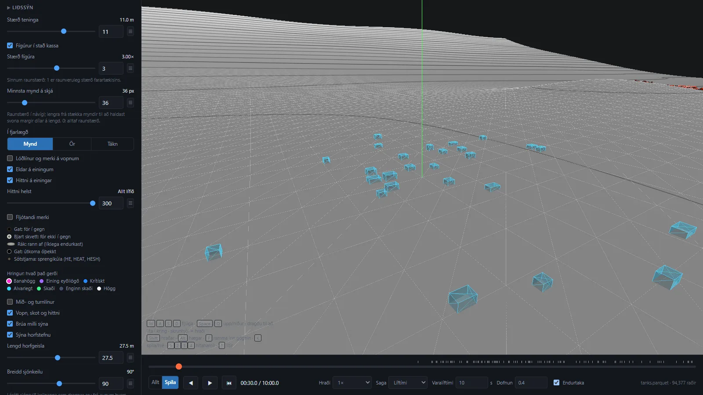

# Fígúruyfirlögn (kassaendurspilun)

Lítil kvikmynd: ein fígúra fyrir hverja manneskju, sem hreyfist þegar tíminn líður, með slóð á eftir sér.

Hamurinn heitir **Fígúruyfirlögn** í valstikunni. Þessi síða hét áður „kassaendurspilun“, því áður en fígúrur komu voru hver manneskja kassi; „fígúruendurspilun“ og „kassaendurspilun“ merkja það sama. **Fígúruyfirlögn** hefur engan talnalykil: veldu hana í valstikunni. Hún teiknar eina fígúru (eða kassa) fyrir hverja [manneskju](glossary.md), sem hreyfist eftir [tímalínunni](timeline.md), með valfrjálsum horfgeislum og slóðum. Þetta er spilun en ekki þéttleiki: *hver var hvar, og hvenær*. Hún þarfnast dálks fyrir manneskju; án tímadálks er hvert sýni teiknað í einu.

## Hvernig á að nota hana {#how-to-use-it}

1. Hladdu gögnum með dálki fyrir manneskju og tímadálki.
2. Veldu **Fígúruyfirlögn** í valstikunni.
3. Settu tímalínuna á **Spila** og ýttu á spilun (`K`).
4. Opnaðu **Liðssýn** til að breyta **Lengd slóðar**, stærð fígúra eða horfgeislunum.

Enginn hiti er teiknaður í þessum ham, og aðlögunarhæfi spritekvótinn er óvirkur.

Sjálfgefið er hver manneskja teiknuð sem fígúran af því sem hún er, ekki sem kassi - sjá [Fígúrur](figures.md) fyrir hvaða fígúru eining fær, og [Endurspilun leiks](match-replay.md) fyrir merkingar, eftirfylgnimyndavélina, mælingar milli tveggja eininga og atburðalistann.

## Liðssýn-spjaldið {#the-team-viewer-panel}

Birt í stað hitaspjaldanna í þessum ham.

| Stilling | Sjálfgefið | Svið (sleði) | Merking |
|---|---|---|---|
| **Fígúrur í stað kassa** | á | | Hver manneskja sem fígúran af því sem hún er: hermaður á fæti, skriðdrekinn eða loftfarið sem gögnin nefna. Það sem gögnin segja ekkert um helst kassi. |
| **Stærð fígúra** | 1× | | 1× er raunstærð. |
| **Minnsta mynd á skjá** | 36 px | 0 = alltaf raunstærð | Raunstærð nálægt; fjær stækka fígúrur til að vera þetta marga pixla langar. |
| **Vopn, skot og hittni** | á | | Vopn á flugi með reyk, rekjur, högg, hittni og dráp. Rekjur sem eru ályktaðar út frá hittni eru strikaðar. |
| **Stærð teninga** | stærð einingar, eða útbreiðsla / 500, við hleðslu | 0,05-200 m, lógaritmískt (5000) | Lengd brúnar hvers kassa. Sjá [stærð einingar](sessions-persons-groups.md#entity-size). |
| **Brúa milli sýna** | á | | Milli tveggja sýna sömu manneskju í sömu setu er kassinn settur hlutfallslega á milli þeirra. Aldrei yfir mörk setu. |
| **Sýna horfstefnu** | á | | Geisli frá hverjum kassa í horfstefnu manneskjunnar (þarfnast [horfdálka](axes-units-and-time.md#look-direction)). |
| **Lengd horfgeisla** | stærð einingar × 4, eða útbreiðsla / 200, við hleðslu | 0,5-500 m, lógaritmískt (20.000) | Birt meðan horfstefna er á. |
| **Lengd slóðar** | 8 s | 0-300 s (86.400); 0 = slökkt | Sekúndur sögu sem eru teiknaðar á eftir hverri manneskju. |
| **Teikna öll hrá sýni** | slökkt | | Kassi fyrir hvert geymt sýni í glugganum í stað eins brúaðs kassa á hverja manneskju. Undirúrtak svo það sé áfram gagnvirkt. |

Skýringar í spjaldinu útskýra að brúun og slóðir tengja sýni aðeins innan einnar setu og, þegar gögnin hafa [sameiginleg nöfn](sessions-persons-groups.md#names-worn-by-several-things-at-once), hversu mörg nöfn eru teiknuð sem stök sýni.

## Setan sem er spiluð {#the-session-being-played}

Með setudálki ákveður **Seta**-valið efst á hliðarstikunni ([Setur](sessions-persons-groups.md#the-session-picker)) hvaða leikur er spilaður. Sú annasamasta er valin við hleðslu. Aðeins raðir þeirrar setu verða kassar og slóðir, og tímalínan keyrir yfir bil þeirrar setu í stað allra gagnanna. *Allar setur* spilar allar setur í einu, og tengir samt aldrei sýni yfir setur.

## Hvað er teiknað hvenær {#what-is-drawn-when}

Úr [`TrackCursor`](https://github.com/Holdi601/3DHeat/blob/main/src/data/tracks.ts):

**Lifandi kassar** (spilunarhamur, hrá sýni slökkt). Fyrir hverja sýnilega manneskju, nýjasta sýni hennar við eða fyrir spilunarhausinn:

- Ef manneskjan á næsta sýni, það er í sömu setu, og nafnið er ekki sameiginlegt, er kassinn settur á milli sýnanna tveggja í hlutfalli við tímann, með stefnuhorninu brúuðu styttri leiðina og hallahorninu línulega (þegar *Brúa* er á).
- Annars helst kassinn á síðasta sýninu í **Varalíftíma** tímalínunnar (sjálfgefið 10 s) og er síðan fjarlægður, svo leikmenn sem hafa verið útilokaðir dvelja ekki.

**Allt-hamur** hunsar spilunarhausinn og teiknar hvert sýni á bilinu sem kassa.

**Hrá sýni** teikna kassa fyrir hvert geymt sýni í glugganum: *Bilið* með *Glugga*-sögunni, annars allt upp að spilunarhausnum. Mest 65.536 kassar; með fleiri sýnum er hvert k-ta teiknað.

**Slóðir** (þegar lengd slóðar er yfir 0 og hrá sýni eru ekki teiknuð): lína milli hvers pars af samliggjandi sýnum manneskju innan síðustu *lengdar slóðar* sekúndnanna upp að spilunarhausnum, sem dofnar úr 80% ógegnsæi í gegnsætt eftir aldri. Slóð stoppar við setuskil og er ekki teiknuð fyrir sameiginleg nöfn. Mest 131.072 hnútar; með fleiri eru raðir sleppt jafnt.

**Hver er sýnilegur:** manneskja er falin þegar hópur hennar er afhakaður í [Liðalistanum](teams-list.md) (hópur hennar er hópur fyrstu raðar hennar), þegar hópsía útilokar hana, eða þegar [Einingar-spjaldið](entities.md) hefur val sem nær ekki yfir hana. [Síur](filters.md) á dálkum gilda ekki um kassa.

## Litir {#colours}

Ein litafjölskylda á hvern hóp og einn litbrigði á hvern meðlim, svo eitt augnakast segir þér hvorum megin einhver er ([`teamMemberColor`](https://github.com/Holdi601/3DHeat/blob/main/src/render/colors.ts)). Hópalitir ganga í hring í fastri tíu-lista - blár, rauður, grænn, rafgulur, fjólublár, blágrænn, magenta, lime, appelsínugulur, indígó - og meðlimir hóps dreifast á birtu 42-76% og mettun 90-65%.

## Athugasemdir {#notes}

- Fígúruyfirlögnin endurbyggir fígúrur sínar aðeins þegar eitthvað breytist; rammi í hvíld teiknar þær síðustu aftur.
- Línan *Kubbar* í [tölfræðiyfirlaginu](performance-and-stats.md) telur kassana á skjánum.
- Fígúruyfirlögnin teiknast í sömu senu og borðið, svo [dýptarskerpa](camera.md#depth-of-field) gerir kassana óskýra en aldrei hitann.
