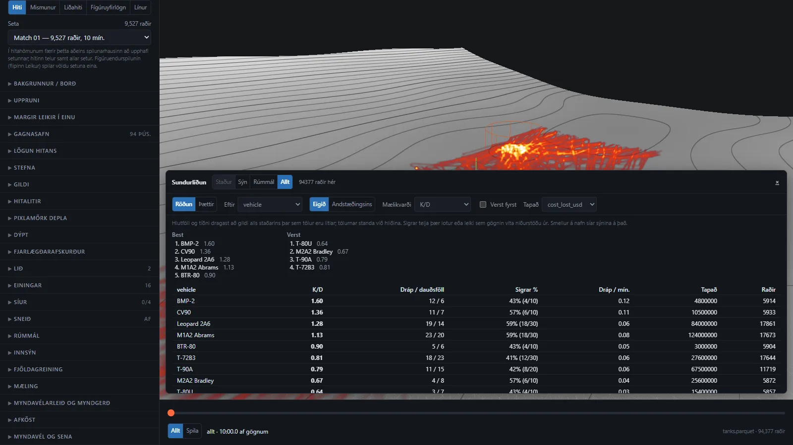
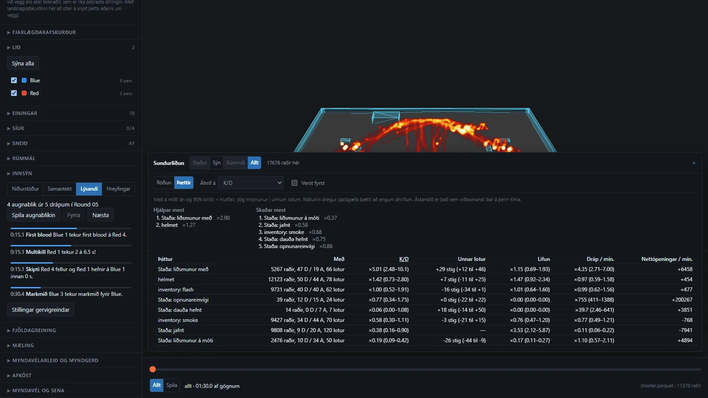

# Sundurliðun: hver og hvað gerir best hvar

**Sundurliðunin** svarar einni spurningu: á þessum stað, hvaða farartæki, leikmaður eða vopn gerir best? Notaðu hana til að finna skriðdrekann sem vinnur við brúna, eða til að sjá hvort það hjálpi raunverulega að vera með hjálm.

Hún raðar því sem gerist á einum stað (völdum punkti, sýninni, rúmmáli eða öllu sem er sýnt) eftir hvaða flokki sem er, og mælir hvern ástandsþátt með og án.

## Prófaðu það {#try-it}

1. Hladdu leik með drápum og dauðsföllum, og opnaðu **Rúmmál**.
2. Teiknaðu rúmmál utan um staðinn sem þú hefur áhuga á og veldu það.
3. Ýttu á **Sundurliðun...** undir Tölfræði.
4. Undir **Eftir** veldu *Farartæki*, og veldu mælinguna *K/D* (dráp á dauðsfall).
5. Lestu listann, þann besta fyrst. Ýttu á **Verst fyrst** til að snúa honum við. Smelltu á nafn til að sía sýnina að því; smelltu aftur til að sleppa því.

## Opna hana {#open-it}

| Frá | Svæðið sem hún byrjar með |
| --- | --- |
| **Sundurliðun...** í [Rúmmál](volumes.md) (Tölfræði) | valda rúmmálið |
| **Sundurliðun hér** á valspjaldinu, eftir að smellt er á punkt | kúla utan um þann punkt (**Radíus**, sjálfgefið 3% af stærð gagnanna) |
| **Mismunur** skiptispjaldið | sýnina |

Hausinn skiptir um svæði: **Staður**, **Sýn** (það sem myndavélin sá við síðustu talningu; **Telja aftur** eftir að hafa fært hana), **Rúmmál** (veldu eitt) eða **Allt**. Hún telur í bakgrunni; stöðulínan segir hversu margar raðir eru á svæðinu.

## Röðun {#ranking}

Veldu hvað á að raða eftir og mælingu:

| Mæling | Hvað hún er |
| --- | --- |
| A, B | raðir hvorum megin við mismunakortið, skiptar eins og hitinn skiptir þeim |
| A / B, A - B, A / (A + B) | lögin tvö hvort gegn öðru |
| K/D | dráp gegn dauðsföllum |
| Sigurhlutfall | umferðir (eða leikir) unnir, þar sem gögnin segja hver vann |
| Dráp / mín | dráp á hverja mínútu sem eru til staðar (eyður í hreyfisýnum) |
| Unnið, Tapað, Hreint fé | summur af dálkunum `earn_*` og `cost_*`; veljari velur gjaldmiðilinn |

Dráp, dauðsföll, viðvera, sigrar og peningar telja hverja röð sem sýnin sýnir á staðnum, hvoru megin við skiptinguna sem er eða engum megin.

Hlutföll og hraðar eru dregnir að gildi alls staðarins þar sem talningarnar eru litlar, svo 2 dráp í 1 lífi komast ekki á toppinn. Talningarnar eru sýndar við hliðina á þeim.

Þú getur raðað eftir hópum, leikmönnum og leikjum, hvaða flokksdálki sem er (farartæki, vopni, hlið, kaupgerð, umboðsmanni eða búnaðarpakka), hvaða talnadálki sem er í bilum (brynju, gildi búnaðar), **flokki** vopnadálks (riffill, leyniskytta, SMG, skammbyssa...) og hversu mörg stykki af **búnaði** lista-dálkur eins og `inventory` geymir.

**Eigið** raðar eftir eigin gildi raðarinnar. **Andstæðingsins** raðar eftir gildi hins aðilans: vopni fórnarlambsins í drápi, vopni banamannsins í dauðsfalli (þarfnast dálks `other` / `victim` sem nefnir þá).

## Ástandið á þeim tíma {#state-at-the-time}

Gildi raðar er hennar eigið nema röðin skráir ekkert (atburðarröð án búnaðar) eða hún er dauðsfall (þar sem vopndálkurinn gæti nefnt vopn banamannsins); þá er það það sem sama manneskja bar síðast fyrr í leiknum.

## Þættir: með gegn án {#factors-with-against-without}

Skiptu úr **Röðun** yfir í **Þættir**, veldu **Áhrif á**, og lestu *Hjálpar mest* og *Skaðar mest*:

Áhrif hvers þáttar á K/D, unnar umferðir, lifun (mínútur á dauðsfall), dráp á mínútu og hreint fé á mínútu, með 95% bili: hlutföll sem x, unnar umferðir sem mismunur í stigum. Röðunin dregur hvert mat að engum áhrifum eftir eigin óvissu, svo sjaldgæfur þáttur þarf skýr áhrif til að komast hátt; bilið sem sýnt er er það ódregna.

Gögn með umferðum bæta við **aðstæðunum** úr návígi ([Návígi og lotur](close-quarters.md)), reiknuðum einu sinni fyrir hvert gagnasafn: *blindaður* (`state_flashed` raðarinnar, eða blossi óvinar innan 15 m á síðustu 3 s), *dauðsfall skipt*, *opnunareinvígi*, og *fleiri en*, *jafnir* eða *færri en* (leikmenn á lífi í hlið raðarinnar gegn óvininum). Dauðsfall telst í aðstæðunum sem fórnarlambið var í rétt áður.

Mest 256 þættir eru mældir í einni umferð.

## Fyrir forritara {#for-developers}

### Að draga smá úrtök {#pulling-small-samples}

Gildið sem raðað er eftir er `(n + m*r0) / (d + m)`: `n` og `d` eru talningarnar, `r0` hlutfall alls staðarins og `m` vægi þess fyrirfram gefna gildis.

### Fyrir höfunda breytira: nefna þáttadálka {#for-converter-authors-naming-factor-columns}

Breytir bætir við þætti með því að nefna dálkinn sinn:

| Dálkur | Þáttur |
| --- | --- |
| `state_<name>` tala | á meðan hún er ekki núll (`state_scoped`, `state_suppressor`) |
| `state_<name>` flokkur | einn þáttur fyrir hvert gildi (`state_ammo` = AP, HE...) |
| `active_<name>` | það sama, fyrir eitthvað sem er kveikt á eða notað nýlega: hæfileiki, ultimate, græja, uppörvun (`active_ult`, `active_stim`) |
| lista-dálkur (`inventory`, `loadout`, `perks`, `abilities`, `attachments`, `modules`, `buffs`, `debuffs`, `upgrades`, eða `state_`/`active_` nafn sem endar á `s`) | einn þáttur fyrir hvern hlut í `a\|b\|c`-gildi |
| búnaðarmerki sem eru þegar algeng (`helmet`, `defuser`, `armor`, `scoped`, `airborne`, `duck`, `flashed`...) | á meðan þau eru ekki núll |
| `ammoType`, `shellType`, `ammoName` | umferðin sem síðast var skotin |

Niðurstöður: dálkur `won` með 0/1 (hlið raðarinnar vann umferðina eða leikinn) og dálkurinn `round`. Peningar: `earn_<currency>` og `cost_<kind>_<currency>`; tekjur eftir tegund einni saman (`earn_round_cs2`, nákvæmar umferðargreiðslur breytis) koma í stað aðeins tekna kostnaðarlíkansins af þeirri tegund (`round` nær líka yfir sprengjuplöntun og afvopnun), og líkanið verðleggur afganginn.

Varpið hleður þessum dálkum sjálft, við hlið eigin lista skráarinnar: sérhvern `state_*`, `active_*`, `won`, `round` og lista-dálk, nema þá sem tölfræði Parquet-skráar sýnir að hafi eitt gildi allan tímann (hver hlaðinn dálkur tekur 4 bæti á röð).
