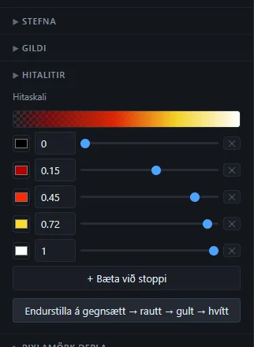

# Litir og lýsing

Þessar stillingar ráða því hvaða litur fær hvaða magn af hita. **Mettunarpunktur** er hversu mikill hiti telst vera hvítglóandi.

## Skyndilausnir {#quick-fixes}

- Allt er hvítt: hækkaðu **Mettunarpunkt**, eða ýttu á **Sjálfvirk lýsing út frá sviðinu**.
- Ekkert sést: lækkaðu **Mettunarpunkt**, eða ýttu á **Sjálfvirk lýsing út frá sviðinu**.
- Aðeins fáeinir stakir punktar sjást: hækkaðu **Lágmarkshita**.

Allar stillingar á þessari síðu verka þegar hitinn er gerður að lit, svo að það að draga hvaða þeirra sem er teiknar strax upp aftur og **endurræsir aldrei uppsöfnunina**.

## Mettunarpunktur {#saturation-point}

**Mettunarpunktur** (hluti *Lögun hitans*): uppsafnaður hiti sem samsvarar toppi litaskalans (með *Línulegri* svörun; sjá neðar um hinar). Lógaritmískur sleði 0,1–4000, og handfangið dregst upp í 10.000.000, því uppsafnaður hiti vex með fjölda raða. Sjálfgefið gildi er 24; við hverja hleðslu er fyrst notað **greiningarmat**, og síðan **mælt** út frá myndinni.

Að hafa þetta rangt er munurinn á hitakorti og auðum (eða hvítum) skjá, og ekki er hægt að reikna það áreiðanlega út: fjarmælingar safnast svo þétt saman - fæðingarstaður, dyr, þrengsli - að hlutfallið milli hámarksþéttleika og meðalþéttleika getur breyst um heila stærðargráðu milli gagnasafna og milli sjónarhorna myndavélarinnar.

## Sjálfvirk lýsing {#auto-exposure}

**Sjálfvirk lýsing út frá sviðinu** mælir sviðið sem skyggingin raunverulega skilaði. Hún hunsar tóma pixla, tekur 98. hundraðshlutamarkið af þeim lýstu og setur það í 85% leiðarinnar að mettunarpunktinum, svo að toppur skalans sé varðveittur fyrir raunverulegu hámarkin.

Spjaldið sýnir þá *mælt X% af rammanum; 98. hundraðshluti R settur nálægt toppi skalans*. Með *Mettandi* svörun lendir gildi við 85% af mettunarpunktinum í um 69% af skalanum í stað 85%.

Hún keyrir líka **sjálfkrafa**:

- 8 teiknaða ramma eftir að gagnasafn hleðst;
- 8 ramma eftir að [síurnar](filters.md) breytast (að sía hverja staðsetningu niður í hundrað atburði breytir þéttleikanum um heila stærðargráðu);
- 8 ramma eftir að skipt er á milli punkthita og [línuhita](line-heat.md), eða þegar breytt er hvaða leiðir línuhitinn teiknar, því lína skilur eftir miklu minni hita á hvert sýni en sprite.

Þegar ekkert er lýst lætur sjálfvirka keyrslan mettunina í friði; hnappurinn fellur þá aftur á greiningarmatið og segir *ekkert lýst til að mæla - notaði greiningarmatið*.

### Fylgja sjónarhorninu {#follow-the-view}

**Fylgja sjónarhorninu** (hluti *Lögun hitans*, sjálfgefið á) mælir aftur í hvert sinn sem myndavélin stöðvast, svo að svæði sem þú flýgur inn á noti allan litaskalann í stað skalans sem var mældur fyrir allt kortið. Litlar breytingar eru hunsaðar og skalinn rennur í stað þess að stökkva. Það gildir í hitastillingunum fjórum, en ekki í figúruyfirlögninni.

Taktu hakið af til að læsa skalanum og bera saman staði á einum skala. Að draga **Mettunarpunkt** með höndunum læsir honum líka.

## Þéttleikasvörun {#density-response}

**Þéttleikasvörun** - hvernig *k* (hiti / mettunarpunktur) varpast á skalann:

| Svörun | Formúla | Notkun |
|---|---|---|
| **Mettandi** (sjálfgefið) | t = 1 - e^(-k) | Nálgast topp skalans aðfellt, eins og staflaðir hálfgegnsæir deplar gera. Ekkert verður nokkurn tíma flatt hvítt, sem gerir það að öruggu sjálfgefnu gildi fyrir ókunnug gögn. |
| **Línuleg** | t = k | Eina varpið þar sem jafn litur þýðir jafnan fjölda. Notaðu það til að bera saman tvö gagnasöfn eða tvo tímaglugga. |
| **Lógaritmísk** | t = log₂(1 + 7k) / 3 | Þjappar löngum hala, svo að einn öfgaheitur blettur hætti að fletja allt annað niður á botn skalans. Lyftir strjálum svæðum. |

## Lágmarkshiti {#minimum-heat}

**Lágmarkshiti** (sjálfgefið slökkt, 0-100%): sérhver pixel sem ber einhvern hita er hækkaður í að minnsta kosti þetta hlutfall af skalanum. Hækkaðu hann, og minnkaðu radíus spritesins, til að sjá *hvar eitthvað gerðist nokkurn tímann* - stakir gagnapunktar verða greinilega sýnilegir í stað þess að sitja rétt fyrir ofan gegnsætt. Hafðu hann slökkt þegar þéttleiki er metinn, því hann flatar botn skalans viljandi. Þröskuldurinn (k > 0,0001) heldur raunverulega tómum pixlum tómum.

## Litaskalinn {#the-ramp-editor}

Í hlutanum **Hitalitir**. Heitið segir til um hvað skalinn er fyrir: *Hitaskali* í Hiti og Línur, *Jákvæður (samlögð lið)* í Mismunur, *Ógegnsæisskali (liturinn kemur frá hópnum)* í [Liðahiti](team-heat.md), þar sem aðeins alfan er notuð.



Stikan efst sýnir forskoðun skalans. Fyrir neðan er ein röð fyrir hvert stopp:

| Hluti | Merking |
|---|---|
| Litasýnishorn | Lit stoppsins (litavali vafrans). |
| Tala | Staða stoppsins á skalanum, 0 til 1 (0 = enginn hiti). |
| Sleði | Ógegnsæi stoppsins, 0-100%. |
| ✕ | Fjarlægir stoppið; óvirkt þegar aðeins tvö eru eftir. |

**+ Bæta við stoppi** bætir við stoppi hálfa leið milli síðustu tveggja stoppanna, með lit og ógegnsæi síðasta stoppsins. **Endurstilla á gegnsætt → rautt → gult → hvítt** setur sjálfgefna gildið aftur.

Stoppin mega koma í hvaða röð sem er; þau eru raðað þegar skalinn er byggður. **Alfan** er það sem blandar hitanum yfir sviðið, og þess vegna er núllendinn á sjálfgefna skalanum alveg gegnsær.

### Sjálfgefnu skalarnir {#the-default-ramps}

| Staða | Jákvæður (Hiti, Línur, Mismunur +) | Neikvæður (Mismunur −) |
|---|---|---|
| 0,00 | svartur, alfa 0 | svartur, alfa 0 |
| 0,15 | rgb(180, 0, 0), alfa 0,55 | rgb(0, 170, 60), alfa 0,55 |
| 0,45 | rgb(255, 40, 0), alfa 0,85 | rgb(0, 190, 200), alfa 0,85 |
| 0,72 | rgb(255, 220, 40), alfa 0,95 | rgb(40, 80, 255), alfa 0,95 |
| 1,00 | hvítur, alfa 1 | rgb(170, 60, 255), alfa 1 |

## Á meðan myndavélin hreyfist {#while-the-camera-moves}

Þegar myndavélin hreyfist byrjar uppsöfnunin upp á nýtt í hverjum ramma. Með **Teikna allar raðir í hverjum ramma** á (sjálfgefið) er hver hreyfður rammi enn réttur; með því af fær hreyfður rammi eitt sýnishornsmat - bjartari, vigtaðar klessur - sem leitar að sléttari réttri mynd þegar þú stöðvast. Það er eðlilegt; sjá [Söfnun](accumulation.md).

## Fyrir forritara {#for-developers}

### Samsetningarskrefið {#the-composite-pass}

Eftir að hitinn hefur verið safnaður er gildi hvers pixels breytt í lit í einu samsetningarskrefi ([`COMPOSITE_FS`](https://github.com/Holdi601/3DHeat/blob/main/src/render/webgl2/shaders.ts)). Skrefin eru:

```
k = |heat| / saturation point
t = response(k)                         clamped to 0..1
if minimum heat > 0 and k > 0.0001:  t = minimum + (1 - minimum) × t
colour, alpha = ramp(t)                  (the negative ramp when heat < 0, Difference only)
pixel = mix(scene, colour, alpha)
```

### Greiningarmatið {#the-analytic-estimate}

**Greiningarmatið** ([`estimateSaturation`](https://github.com/Holdi601/3DHeat/blob/main/src/data/calibrate.ts)) gerir ráð fyrir að raðirnar dreifist yfir X-Z-fótspor gagnanna: meðalhiti = raðir × (π r² / flatarmál fótspors) × 1/3 × miðjustyrkur (1/3 er meðaltal skífunnar af línulegum halla), margfaldað með gefnu hámarks/meðal-hlutfalli upp á 25, takmarkað við 0,1-1.000.000. Það þarf aðeins að vera innan stærðargráðu rétt.

### Mæling {#metering}

[`exposure.ts`](https://github.com/Holdi601/3DHeat/blob/main/src/render/exposure.ts):

1. hitamarkið er lesið til baka úr skjákortinu, undirúrtak í mest 40.000 gildi;
2. tómir pixlar (hiti ≤ 0,0001) eru fleygðir - mestallt hitasvið er tómt, og ef þeir væru meðaltaldir myndi allt vanlýsast, eins og ljósmælir sem beint er að svörtum bakgrunni;
3. 98. hundraðshlutamarkið af lýstu pixlunum er viðmiðið;
4. mettunarpunkturinn verður viðmiðið / 0,85, svo viðmiðið sitji í 85% leiðarinnar að mettunarpunktinum og toppur skalans sé varðveittur fyrir raunverulegu hámörkin.

### Litatafla {#the-colour-table}

Skalinn er brenndur inn í 256 × 2 RGBA-töflu (jákvæði skalinn í fyrstu röðinni, sá neikvæði í annarri) ([`buildColorLut`](https://github.com/Holdi601/3DHeat/blob/main/src/render/colors.ts)). Litir eru innskotnir í línulegu ljósi og geymdir sem sRGB; ógegnsæi er innskotið línulega.
