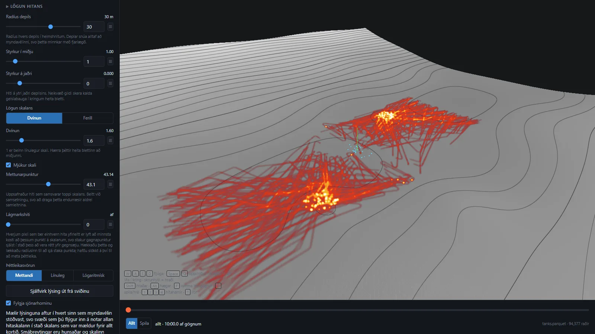
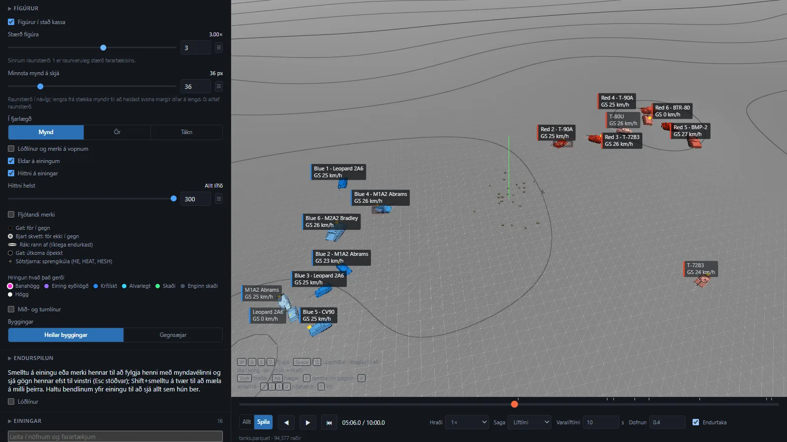

# Sýnigögn: prófaðu skoðarann á fimm mínútum



Engin eigin gögn enn? Geymslan býr þau til. Allt í henni er uppspunnið: dalur, garður og leikir af þremur tilbúnum leikjastílum með leikmönnum sem heita *Blue 1* eða *Red 3*. Myndirnar á þessari síðu voru allar teknar með þeim.

## Búðu þau til {#make-it}

```bash
node tools/demo-data.mjs
```

Þetta skrifar í `tools/.shots/demo/`:

| Skrá | Hvað hún er |
|---|---|
| `demo-valley.glb` | 12 km dalur með tveimur hæðum og þorpi, sem þrívítt borð |
| `demo-yard.glb` | 160 m múraður garður með byggingum, sem þrívítt borð |
| `tanks.parquet` | 10 skriðdrekaleikir, 8 á móti 8: hreyfing, skot, högg með staðnum á skrokknum, eldar, dráp, flök, miðun turns, sigurvegarar |
| `tanks/match-NN.parquet` | sömu leikir, ein skrá hver, fyrir [marga leiki í einu](many-matches.md) |
| `air.parquet` | loftorrusta 4 á móti 4 með flaugum, blysum, drápum og misskotum |
| `shooter.parquet` | 12 umferðir af 5 á móti 5 fótgangandi: skot, dráp, sprengja, inneignir unnar og eyddar, hjálmar og hjálpartæki |
| `mass/` | mappa af litlum `.3dheat`-leikjum, fyrir [fjöldagreiningu](mass-analysis.md) |
| hringjasett fyrir kappakstur | tveir hringir af einum bíl á uppspunnri braut, fyrir [Kappakstursgreiningu](race-analysis.md) |

Hver tafla nefnir dálka sína í fótnótunni sinni, svo hún hleðst án nokkurrar tengingar.

## Prófaðu það {#try-it}

1. Ræstu skoðarann (`start.bat` á Windows, eða `npm install` einu sinni og síðan `npm run dev` á hvaða kerfi sem er) og opnaðu `http://127.0.0.1:5273/`.
2. **Bakgrunnur / borð → Þrívíddarlíkan…** og veldu `demo-valley.glb`.
3. **Uppruni → Skrár…** og veldu `tanks.parquet`.
4. Ýttu á `F` til að ramma gögnin inn. Þú sérð [hitann](heat.md) af tíu leikjum.
5. Prófaðu mótastikuna: **Mismunur** (Blue á móti Red), **Liðahiti**, **Línur**.
6. Opnaðu **Innsýn** (í hliðarstiku Hitakorts): þar finnur hún staðina þar sem miklu meira var skotið, hitt og eyðilagt en annars staðar - um hæðirnar tvær.
7. Opnaðu flipann **Leikur**; undir **Leikir í endurspiluninni** veldu *Match 01*; ýttu á **Spila** á tímalínunni: [endurspilunin](match-replay.md).



Fyrir skotleikinn hleður þú `demo-yard.glb` og `shooter.parquet`; fyrir loftorrustuna `air.parquet` (fígúrurnar sjást betur við **Stærð fígúra** 4, sleði í spjaldinu **Liðssýn** í hliðarstiku Hitakorts).

## Skjámyndirnar {#the-screenshots}

Myndir síðunnar eru búnar til úr þessum gögnum með skriptu, á hvaða tungumáli skoðarans sem er:

```bash
node tools/demo-data.mjs
HEAT3D_FIGURE_PACK=none npx vite --port 5321 --strictPort --host 127.0.0.1   # PowerShell: $env:HEAT3D_FIGURE_PACK="none"; npx vite ...
node tools/docs-shots.mjs --lang en
```

Skjámyndaþjónninn keyrir án staðbundins fígúrupakka, svo aðeins opinbera fígúrusafnið birtist. Myndirnar fara í `docs/assets/img/<lang>/`. Sjá [Viðhald skjalanna](maintaining.md).
