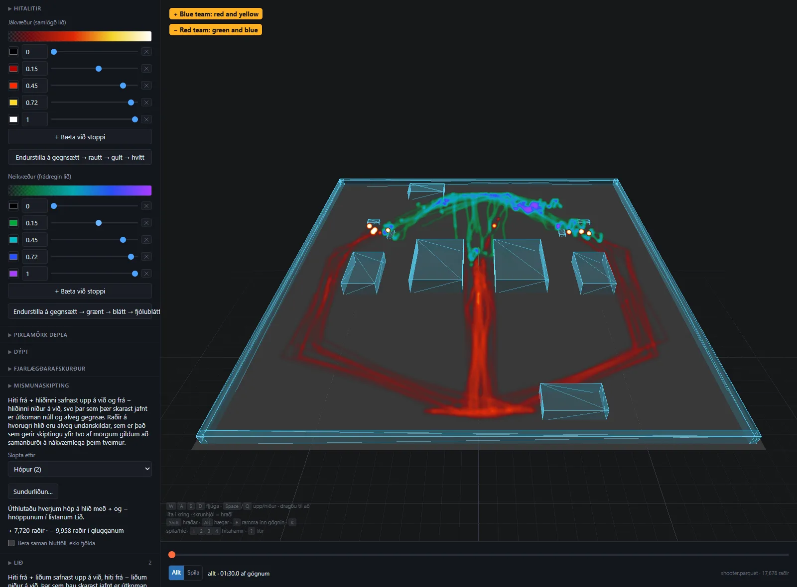

# Mismunur

Rautt þar sem lið A var meira, grænblátt þar sem lið B var, og ekkert þar sem þau voru jöfn.

**Mismunur** (takki 2) er hiti með formerki. Raðir úr einum hópi bæta við hita; raðir úr öðrum draga hann frá. Þar sem hóparnir tveir skarast jafnt er útkoman núll og alveg gegnsæ; þar sem annar ræður birtist hún í litum þeirrar hliðar - sjálfgefið heitir litir (gegnsætt → rautt → gult → hvítt) fyrir **+**-hliðina og köldu litirnir (gegnsætt → grænt → blátt → fjólublátt) fyrir **−**-hliðina.

## Hvernig á að nota hann {#how-to-use-it}

1. Ýttu á `2` (eða veldu **Mismunur** í hamastikunni).
2. Opnaðu **Mismunaskipting** í hliðarstikunni.
3. Veldu hvað á að **Skipta eftir**: venjulega *Hópar*.
4. Settu einn hóp (eða gildi) á **+** og annan á **−**.
5. Lestu litina: heitir litir þýða +-hliðina, kaldir litir þýða −-hliðina. Spjaldið varar við ef önnur hliðin hefur engar raðir (sjá [Skilaboð sem þú gætir séð](#messages-you-may-see)).

*Hvaða* tvær þyrpingar eru spurningin, svo skiptingin getur verið hvaða geymdi dálkur sem er, ekki aðeins hópar. Raðir sem lenda á **hvorugri** hliðinni eru **sleppt**, ekki taldar sem núll: það gerir að skipting á tveimur af mörgum gildum ber saman nákvæmlega þessi tvö, og hún virkar með [síunum](filters.md) - sía niður á eitt kort, skiptu síðan því eftir útgáfu.

Hamurinn þarf tvær hliðar: flokksdálk með að minnsta kosti tveimur hópum, eða skiptingu eftir dálki sem er geymdur til síunar. Á gögnum með færri en tvo hópa byrjar hleðsla með dálkaskiptingu - *Source file*-dálkurinn úr hleðslu margra skráa fyrst, annars fyrsti flokksdálkurinn með tvö gildi, annars fyrsti tölu-dálkurinn með bili - svo *bera saman tvær hleðslur* virkar á gögnum án hópa. Aðeins gögn án hvors tveggja gera haminn óaðgengilegan; það gerir líka dálkaskipting sem skilur eftir ekkert á annarri hliðinni.

## Mismunaskiptingarspjaldið {#the-difference-split-panel}

Birtist í Mismunar-ham, undir hitaspjöldunum.

**Skipta eftir** býður:

| Valkostur | Birtist sem | Skiptireglan |
|---|---|---|
| Hópar | *Hópur (N)* (þegar flokksdálkur er til) | Hver hópur á +, − eða hvorugri, stillt í [Liðalistanum](teams-list.md) |
| Flokksdálkur | *dálkur (N gildi)* | Gildi á +, − eða hvorugri |
| Tölu-dálkur | *dálkur (tala)* | Gildabil fyrir hvora hlið |
| Upprunaskráin | *Source file - bera saman tvær hleðslur* (þegar margar skrár voru hlaðnar) | Skrár á +, − eða hvorugri |

Aðeins dálkar sem eru geymdir undir *Halda fyrir síun* við hleðslu eru boðnir.

### Bera saman hlutföll, ekki fjölda {#compare-shares-not-counts}

**Bera saman hlutföll, ekki fjölda** (sjálfgefið slökkt) vegur hvora hlið með einum deilt með eigin raðafjölda, svo hlið með fimmfalt fleiri raðir vinnur ekki á tölunum einum saman. Liturinn sýnir þá hvar hvor hlið er hlutfallslega algengari en hin. Notaðu það þegar hliðarnar tvær hafa mjög ólíkt magn gagna, til dæmis tvær lotur af mismunandi lengd.

### Skilaboð sem þú gætir séð {#messages-you-may-see}

Spjaldið varar við þegar myndin er ekki raunverulegur mismunur:

| Skilaboð | Merking |
|---|---|
| *N + / M −* (eða *N + / M − / K ónotuð*) | Hversu mörg gildi eru á hvorri hlið (og á hvorugri). |
| Engin röð í glugganum er á **+**-hliðinni | Aðeins **−**-hliðin er teiknuð. Færðu tímalínugluggann eða breyttu skiptingunni. |
| Engin röð í glugganum er á **−**-hliðinni | Aðeins **+**-hliðin er teiknuð. |
| Ekkert gildi er á annarri hvorri hliðinni | Mismunurinn teiknar ekkert. Settu að minnsta kosti eitt gildi á **+** eða **−**. |
| *dálkur* er ekki hægt að skipta svona | Valdi dálkurinn passar ekki við skiptinguna. Veldu dálkinn aftur. |
| Skiptidálkurinn komst ekki í skjáminni fyrir N af M hlutum | Þær raðir eru ekki teiknaðar. Hækkaðu skjákortskvótann undir Afköst → Auðlindakvótar, eða hladdu færri röðum. |

### Eftir hópum {#by-group}

Spjaldið vísar aðeins á [Liðalistann](teams-list.md), þar sem hver hópur hefur **+**- og **−**-hnapp. Við hverja hleðslu er fyrri helmingur hópanna (námundaður upp) settur á +, hinir á −; **Skipta jafnt** í Liðalistanum gerir það sama aftur. Hópur sem er á hvorugri hlið, eða falinn með gátreitnum sínum, leggur ekkert til.

### Eftir flokksgildum {#by-category-values}

| Hluti | Merking |
|---|---|
| `a + / b − / c ónotuð` | Hversu mörg gildi eru á hvorri hlið og á hvorugri. |
| **Hreinsa** | Setur hvert gildi á hvorugri hlið. |
| Gildalisti | Hvert gildi með **+**- og **−**-hnappi (smelltu á það virka aftur til að taka það af þeirri hlið). Tómt gildi er skráð sem *(vantar)*. |
| Athugasemd um hámark | Aðeins fyrstu 200 gildin eru skráð: *Sýni fyrstu 200 af N gildum. Svona breiðan dálk er betra að þrengja fyrst með síu, eða skipta eftir bili ef gildin eru í röð.* |

Þegar dálkurinn er valinn fer fyrsta gildi hans á + og annað á −. Þegar hvorug hliðin hefur gildi fellur skiptingin aftur á hópa í stað þess að sýna tóman ramma. *Source file* virkar eins, eitt gildi á hverja skrá - þannig eru tveir útflutningar, tvær prófunarkeyrslur eða tvær útgáfur bornar saman.

### Eftir bili {#by-range}

| Hluti | Merking |
|---|---|
| Vísbending | Lágmark og hámark dálksins. |
| **Jákvætt bil (+)**, **frá** / **til** | Raðir með gildi í þessu bili, með báðum endum meðtöldum, bætast við. |
| **Neikvætt bil (−)**, **frá** / **til** | Raðir í þessu bili draga frá. |
| **Skipta við miðpunktinn** | Setur + á [lágmark, miðju] og − á [miðju, hámark] - það sem valið dálksins gerir líka. |

Gildi í báðum bilum telst +. Bilin þurfa ekki að þekja dálkinn; gildi í hvorugu eru sleppt. *Fyrstu tvær mínúturnar gegn síðustu tveimur* er bilaskipting á tímalíkum dálki.

## Hlutur +: sigurhlutfallskortið {#share-of--the-win-rate-map}

**Mismunur** / **Hlutur +** efst í spjaldinu velur hvað er teiknað. *Hlutur +* litar hvern stað eftir hlut +-hliðarinnar af röðunum á hvorri hlið þar, borið saman við þann hlut yfir allt sem er sýnt: heitt fyrir ofan hann, kalt fyrir neðan, ekkert þar sem hann er sá sami, og ekkert þar sem staður hefur of fáar raðir. Með unnu loturnar á + og þær töpuðu á − er þetta sigurhlutfallskort; **Sigurhlutfall í lotum** og **Sigurhlutfall í leikjum** setja það upp með einu ýti þar sem gögnin hafa [úrslitadálka](data-formats.md#outcome-columns). Sjá [Sigurhlutfall](win-rate.md).

## Litir {#colours}

Hlutinn **Hitalitir** sýnir tvo skalaritla í þessum ham: **Jákvæður (samlögð lið)** og **Neikvæður (frádregin lið)**, hvor með sinn endurstillihnapp (*Endurstilla í gegnsætt → rautt → gult → hvítt*, *Endurstilla í gegnsætt → grænt → blátt → fjólublátt*). Samsetningin tekur algildi nettóhitans í gegnum [mettunarmarkið og svörunina](colour-and-exposure.md), og velur neikvæða skalann þar sem nettóið er undir núlli. Sjá [Litir og lýsing](colour-and-exposure.md#the-ramp-editor).

Notaðu *Línulega* þéttleikasvörun þegar stærð mismunarins skiptir máli: hún er eina svörunin þar sem sami litur þýðir sama fjölda.

## Fyrir forritara {#for-developers}

Sérhver röð fær formerki +1, -1 eða 0 í hornpunktaskyggninum ([`POINT_HEAT_VS`](https://github.com/Holdi601/3DHeat/blob/main/src/render/webgl2/shaders.ts)); 0 hafnar röðinni áður en nokkurt brot er teiknað.

- Eftir hópum kemur formerkið úr 4.096 færslna hóptöflu sem er flokkuð eftir hópauðkenni raðarinnar (hópauðkennið situr í fjórðu rás staðsetningartexels raðarinnar).
- Eftir flokki kemur formerkið úr annarri 4.096 færslna töflu, fylltri fyrir hvert flokksgildi, og gildi raðarinnar er lesið úr síutexeli dálksins; gildi handan enda töflunnar er hafnað á báðum bakendum.
- Eftir bili er gildi raðarinnar borið saman við bilin tvö.

Breyting á skiptingu endurræsir uppsöfnunina.

**Faldir hópar haldast faldir við allar skiptingar.** Undir skiptingu eftir dálki ber hóptaflan ekki lengur formerki; hún geymir 1 fyrir sýndan hóp og 0 fyrir falinn ([`frameSignTables`](https://github.com/Holdi601/3DHeat/blob/main/src/render/filterTables.ts)), og báðar töflurnar ná skyggninum saman - tvær raðir af einum formerkjatexel í WebGL2, tveir helmingar af einum geymsluminni í WebGPU. Röð er aðeins teiknuð þegar hópur hennar er sýndur *og* gildi dálksins hennar er á annarri hliðinni. Hópur sem er afhakaður í [Liðalistanum](teams-list.md), eða sleppt með hliðarfókus Leikjaflipans, leggur því ekkert til, sama hvernig mismunurinn er skiptur.
