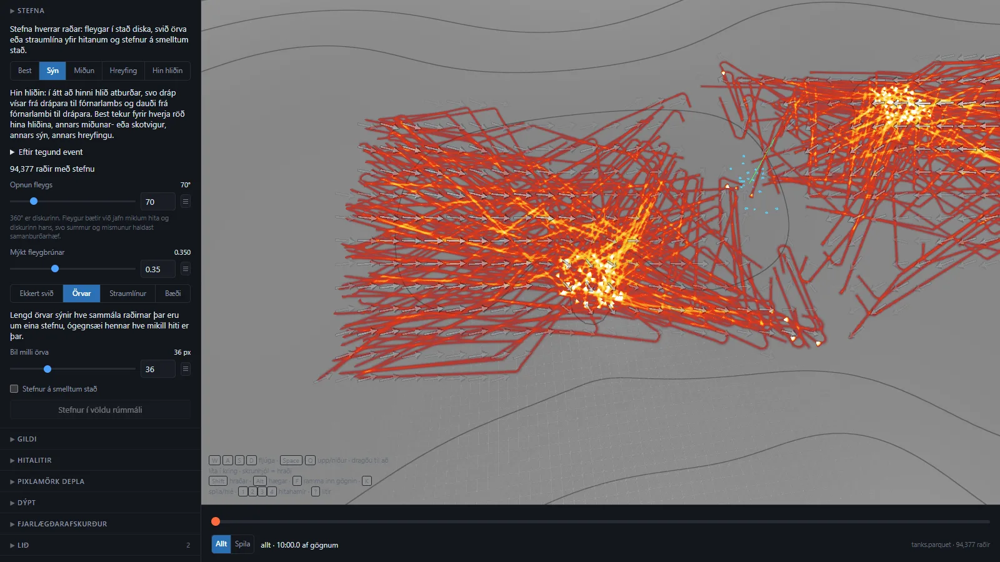

# Stefnuhiti

Venjulegur hiti segir **hvar** hlutirnir gerast. Stefnuhiti segir líka **í hvaða átt**: í hvaða átt fólk horfði, miðaði, hreyfðist, eða hvar hin hliðin í átökum var.

Venjulegur sprite er heill diskur (360 gráður). Með **Opnun fleygs** upp á 70 gráður verður sami sprite mjór fleygur sem bendir þá átt sem röðin sneri, og bætir sama heildarhita við.

## Hvernig á að nota hana {#how-to-use-it}

1. Hladdu gögnum sem hafa stefnu í sér (sjá [Hvað gefur röð stefnu](#what-gives-a-row-a-direction)).
2. Veldu **Hiti**, **Mismunur** eða **Liðahiti** í valstikunni.
3. Opnaðu hlutann **Stefna** á hliðarstikunni.
4. Veldu **uppsprettu** (hvaða stefnu á að nota), og kveiktu síðan á teikningunni:
   - lækkaðu **Opnun fleygs** undir 360° til að teikna hverja röð sem fleyg sem bendir sína leið í stað disks;
   - veldu **Svæði** til að teikna örvar eða straumlínur yfir hitann;
   - hakaðu við **Stefnur á smelltum stað** og smelltu á hitann til að fá pólrit af þeim stað.

Stöðulínan segir hversu margar raðir hafa stefnu frá völdu uppsprettunni.

## Stillingar {#settings}

| Stilling | Sjálfgefið | Hvað hún gerir |
|---|---|---|
| Uppspretta: **Best**, **Sýn**, **Miðun**, **Hreyfing**, **Hin hliðin** | Best | Hvaða stefnu hver röð fær. *Best* tekur, fyrir hverja röð, hina hliðina, annars miðunina, annars sýnina, annars hreyfinguna. |
| **Eftir tegund atburðar** | eins og að ofan | Mismunandi uppspretta fyrir hverja tegund atburðar, til dæmis *Hin hliðin* fyrir dráp og *Sýn* fyrir staðsetningar. Birt þegar gögnin hafa atburðadálk með mest 40 gildum. |
| **Opnun fleygs** | 360° | 360° er venjulegur diskur (slökkt). Minna er mjórri fleygur. Fleygur bætir eins miklum hita við og diskurinn hans, svo heildir og mismunir haldast sambærilegir. |
| **Mýkt fleygbrúnar** | 0,35 | 0 er fleygur með skarpri brún, 1 er mjúk vifta. |
| **Svæði**: Ekkert svæði, Örvar, Straumlínur, Bæði | Ekkert svæði | Örvar: lengd örvar er hversu mikið raðirnar þar eru sammála um eina átt, ógegnsæi hennar hversu mikill hiti er þar. Örvar sýna aðeins þar sem er hiti. |
| **Bil milli örva** | 28 px | Fjarlægð milli örva á skjánum. |
| **Hreyfa straumlínur** | á | Straumlínur flæða meðan kveikt er. |
| **Stefnur á smelltum stað** | slökkt | Smelltu á hitann til að sjá stefnurnar þar (hér að neðan). |
| **Stefnur í völdu rúmmáli** | | Sama rit fyrir allt innan valda [rúmmálsins](volumes.md). |

## Pólritið á tilteknum stað {#the-polar-chart-at-a-spot}

Með **Stefnur á smelltum stað** á, smelltu á hitann. Raðirnar nálægt þeim punkti (innan 1,5 sprite-radía) eru teknar saman í rós með 24 sneiðum af 15°:

- **appelsínugul** blöð: útgáfustefnur (þangað sem raðirnar benda);
- **blá** blöð: innkomustefnur (þaðan sem þær komu);
- **flatarmál** blaðs vex með fjölda þess; ör sýnir aðalstefnuna;
- línurnar undir ritinu gefa aðalstefnuna, hversu sterkt raðirnar eru sammála (R, 0 til 1), dreifinguna í gráðum og fjölda raðanna.

0° er upp á ritinu, sem er heimur −Z (norður fyrir Tacview-upptökur). Staðurinn er einnig merktur í þrívíðu sýninni með ör og hring.

## Hvað gefur röð stefnu {#what-gives-a-row-a-direction}

| Uppspretta | Þarf í gögnunum |
|---|---|
| Sýn | stefnuhornsdálk (varpaður sem sjónstefna): `yaw`, `heading`, `azimuth`, `view_yaw`, `rot_z` |
| Miðun | talnapör eins og `aim_x`/`aim_y`, `shot_x`/`shot_y`, `fire_x`/`fire_y`, `hit_dir_x`/`hit_dir_y` (valfrjálst `…_z`) |
| Hreyfing | ekkert aukalega: skrefið frá fyrra sýni sömu manneskju (mest 10 s fyrr, sama seta) |
| Hin hliðin | dálkur sem nefnir hina hlið atburðar (`other`, `victim`, `target`, `killer`, `attacker`, `shooter`, `other_player` ...) þar sem gildin eru nöfn manneskja; dráp vísar frá banamanni til fórnarlambs, dauðsfall frá fórnarlambi til banamanns |

## Ábendingar {#tips}

- Fleygar þurfa einhverja stærð á skjánum; undir nokkrum pixlum eru þeir teiknaðir sem diskar aftur.
- Notaðu *Hin hliðin* á drápsröðum til að sjá **frá hvaða stað** bardagar unnust, og *Sýn* á staðsetningarröðum til að sjá **hvar fólk horfir**.
- Með **Mismunur** vísa fleygar hliðanna tveggja í sínar eigin áttir, svo umdeildar skotlínur skera sig úr.
