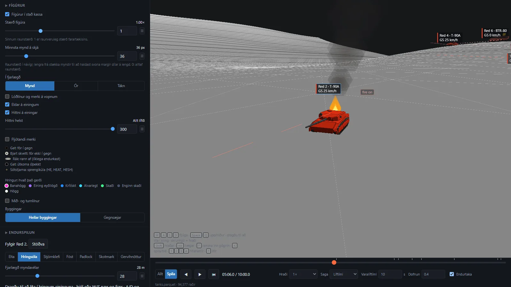

# Fígúrur

**Fígúra** er lítil þrívíð líking af því sem eining raunverulega er: skriðdreki, þota, skip, hermaður. [Endurspilunin](match-replay.md) teiknar sérhverja einingu sem fígúru sína í raunstærð, í stað einfalds kassa.

Það eru um 2.000 nefnd farartæki, loftför, skip, vopn og hermenn, öll smíðuð af skoðaranum sjálfum.

## Hvað er í safninu {#what-is-in-the-catalogue}

| Svið | Dæmi |
|---|---|
| Fólk | hermaður standandi, krjúpandi, liggjandi; leyniskytta, skriðdrekavarnir, sjúkraliði, áhöfn |
| Land | skriðdrekar, bardagabílar fótgönguliða, loftvarnir, stórskotalið, vöruflutningabílar og bílar, lestir og sporvagnar |
| Loft | orrustuflugvélar, árásarflugvélar, sprengjuflugvélar, flutningavélar, þyrlur, frá tvíþekjum til nútímaþota |
| Haf | herskip eftir flokkum, flugmóðurskip, kafbátar, bátar, kaupskip |
| Vopn | flaugar, eldflaugar, sprengjur, tundurskeyti, blys og flís |
| Merki | reykhandsprengjur, blossa- og íkveikjusprengjur, sprengjur sem hafa verið lagðar, fánar, upphafsstaðir, leiðarpunktar |

## Hvernig fígúrurnar eru gerðar {#how-the-figures-are-made}

- **Smíðaðar úr birtum málum.** Flestar fígúrur eru gerðar af eigin fígúrusmiði skoðarans úr opinberum tölum: lengd, breidd, hæð, hjól, turn og byssa, vængir og hali. Lögun þeirra er síðan stillt eftir opinberum ljósmyndum, teikningum og birtum málum. Módel úr engum leik eru notuð.
- **Frjáls módel.** Fáeinar fígúrur nota frjáls þrívíð módel (CC0 eða CC BY) þar sem þau eru sannari, stundum sameinuð smíðaða skrokknum. Höfundar CC BY-verka eru tilgreindir á [Heimildir fígúra](figure-credits.md); CC0-verk þurfa enga tilgreiningu og eru ekki skráð þar.
- Sérhver fígúra hefur fulla, grófa og fjarlæga útgáfu (smáatriðastig, LOD), svo þúsundir má teikna í einu.

## Hvaða fígúru eining fær {#which-figure-a-unit-gets}

Skoðarinn lítur á eigin dálka gagnanna:

1. **Nöfn** - dálkar sem heita *Name*, *Vehicle*, *Unit*, *Unit type*, *Model*, *Aircraft*, *Plane*, *Tank*, *Ship*, *Craft*, *Loadout*, *Kit* eða *Figure* - eru bornir saman við safnið: nákvæmlega, með um 4.000 gervinöfnum (einingaauðkenni nokkurra leikja), eftir lengsta þekkta upphafi (`F-16C_50` er F-16C), eða eftir stystu heiti fígúru sem byrjar á því.
2. Nafn þar sem fígúran passar ekki við **gerð** einingarinnar er ekki notað (vörubíll sem heitir *Typhoon* er ekki orrustuþotan).
3. **Gerðir** - dálkar sem heita *Type*, *Class*, *Kind*, *Category*, *Icon*, *Role* eða *Domain* - gefa flokksfígúru: Tacview-merki (`Air+FixedWing`, `Ground+Heavy+Armor+Vehicle+Tank`, `Sea+Watercraft+Warship`, `Weapon+Missile`), kortatákn, eða venjuleg orð (skriðdreki, þyrla, fótgöngulið).
4. Gögn með hvorugu eru gögn um fólk: allir eru hermenn.

Þannig fást réttu fígúrurnar auðveldast með `vehicle`-dálki með raunverulegum heitum, eða `type`-dálki með Tacview-merkjum.

**Eining mín birtist sem kassi eða hermaður.** Bættu við `vehicle`-dálki með raunverulegu heiti, eða `type`-dálki með Tacview-merki. Færðu bendilinn yfir einingina til að sjá hvaða heiti var borið saman. Gögn sem hafa slíka dálka en segja ekkert um eininguna skilja hana eftir sem kassa; gögn með hvorugu eru teiknuð sem hermenn.

## Stillingar {#settings}

Hlutinn **Fígúrur** í hliðarstiku endurspilunarinnar stillir stærðina, minnstu stærð á skjá, hvað einingar í fjarlægð verða (fígúra, ör, tákn), og áhrifin sem teiknuð eru á þær. Sjá [Endurspilun leiks](match-replay.md#figures). Reykur, eldur og önnur tímabundin áhrif: [Fígúrur í fígúruyfirlögninni](figure-replay.md).

## Valfrjáls staðbundin fígúrupakki {#an-optional-local-figure-pack}

Þú getur geymt valfrjálsan pakka með eigin fígúrum á þinni eigin vél. Fígúrur hans taka sæti fígúra úr safninu með sömu heitum. Hann er aldrei hluti af geymslunni eða birtri útgáfu; án hans breytist ekkert.
