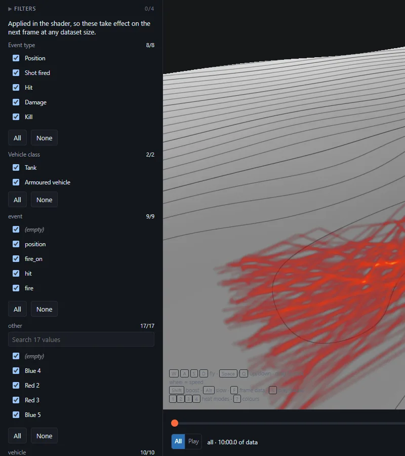

# Síur

**Síur** fela línur sem þú hefur ekki áhuga á, eins og einn flokk farartækis eða eina tegund atburðar, og myndin uppfærist samstundis. Spjaldið telur upp dálkana sem geymdir voru við hleðslu undir *Keep for filtering* ([Dálkatenging](column-mapping.md)), auk *Source file* þegar margar skrár voru hlaðnar.

## Prófaðu það {#try-it}

1. Hladdu gagnasafni og opnaðu **Síur** í hliðarstikunni.
2. Undir **Flokkur farartækis**, taktu hakið af *Tank*. Myndin breytist samstundis.
3. Ýttu á **Hreinsa allar síur** til að afturkalla.

Fyrstu línurnar eru dálkar forritsins (hér að neðan). Línurnar þar á eftir koma úr skránni þinni.

## Dálkar sem skoðarinn bætir við {#columns-the-viewer-adds}

Við hleðslu reiknar skoðarinn út fjóra eigin dálka og skráir þá **fyrst**, með heitum og gildum á þínu tungumáli, svo sama sían virkar fyrir alla leiki og gagnagjafa:

| Dálkur | Gildi | Reiknað út frá |
|---|---|---|
| **Tegund atburðar** | 23 tegundir: Staðsetning, Skot hleypt af, Skot (flaug, eldflaug, sprengja), Hitt, Misskot (vopn lauk nálægt engu skotmarki), Sprenging, Skaði, Dráp, Dauði, Eyðilagt, Brotlending, Útskot / neyðarútgangur, Birting, Hvarf, Flugtak, Lending, Snerting við jörð, Stöðvun á jörðu, Endurhleðsla / eldsneyti, Taka / markmið, Tálbeita, Skilaboð, Annað | dálk sem heitir `event`, `events`, `event_type` eða `event_name`; orð hvers leiks (`shot`, `burst`, `fired`, `struck`, `flare`, `plant` ...) eru tengd þessum tegundum. Allur listinn: [Tegundir og flokkar atburða](ref-event-types.md). |
| **Leikmaður eða gervigreind** | Leikmaður, AI | dálk `ai`, `is_ai`, `bot` eða `actor`; annars `is_player` / `human`; annars auðkenni reiknings (`user_id`, `steam_id`; tómt eða 0 er AI); fyrir Tacview-upptökur, hvort hluturinn hefur flugmann |
| **Flokkur farartækis** | 17 flokkar: Orrustuflugvél, Árásarflugvél, Sprengjuflugvél, Önnur loftfar, Þyrla, Skriðdreki, Brynvarið ökutæki, Loftvarnir, Stórskotalið, Vöruflutningabíll / bíll, Skip, Kafbátur, Fótgöngulið, Vopn, Tálbeita, Mannvirki, Annað | heiti farartækisins eða einingarinnar (borið saman við [fígúrusafnið](figures.md)) og gerðardálka |
| **Flokkur skotmarks** | sömu flokkar | farartæki hinnar hliðarinnar (`other_vehicle`, `target_vehicle`, `victim_type` ...) |

Aðeins þær tegundir sem koma fyrir eru skráðar. Gildisdálkar (`cost_*`, `earn_*`, `net_*` og *Cost source*, sjá [Gildisvigtun](value-weighting.md)) eru síanlegir eins og hver talnadálkur: til dæmis, taktu hakið af *estimate* undir *Cost source* til að halda aðeins línum með verðlagningu.

Listi flokka með fleiri en 12 gildi fær leitarreit (*Leita í n gildum*) og hnappinn **Aðeins þessi**, sem leyfir nákvæmlega þau gildi sem passa.

Hvaða dálka má sía er ákveðið við hleðslu, því þá þarf að lesa þá. Án geymds dálks segir spjaldið það og vísar á *Keep for filtering*.

## Talnadálkar (bil) {#numeric-columns-range}

| Hluti | Merking |
|---|---|
| Heiti, og `min ... max` | Dálkurinn, og núverandi bil (allt bil dálksins meðan engin sía er sett). |
| Fyrsta röð: talnareitur og sleði | Neðri mörkin. Ef sleðinn er dreginn yfir efri mörkin ýtir hann efri mörkunum með sér. |
| Önnur röð: talnareitur og sleði | Efri mörkin. Ef dregið er undir neðri mörkin ýtir það þeim líka. |
| **Endurstilla *dálk***| Fjarlægir þessa síu. |

Sleðarnir ná yfir lágmark til hámarks dálksins í 1.000 þrepum; talnareitirnir taka við hvaða gildi sem er. Lína stenst þegar gildi hennar liggur innan bilsins, báðir endapunktar meðtaldir. Stór gildi birtast með veldisformi (`1.23e6`).

## Flokkadálkar {#category-columns}

| Hluti | Merking |
|---|---|
| Heiti, og `leyft/alls` | Dálkurinn, og hversu mörg af gildum hans eru leyfð. |
| Gildalisti | Gátreitur fyrir hvert gildi; tómt gildi er sýnt sem *(tómt)*. |
| **Allt** / **Ekkert** | Leyfa sérhvert gildi / ekkert gildi. |

Að leyfa sérhvert gildi fjarlægir síuna.

## Reglur {#rules}

- **Fjórar síur í einu.** Hausinn sýnir `active/4`. Fimmta síun er ekki beitt, og spjaldið segir það. Val í [Einingar](entities.md) (eða leikmannaval flipans Leikur) notar líka eina af fjórum. Sía sem nær yfir allan dálkinn notar enga.
- **Flokkadálkur hefur mest 4.096 gildi**; breiðari dálkur er ekki geymdur við hleðslu.
- **Síur sameinast með OG**, og með sýnileika liða, mismunaskiptingunni, tímagluggnum, útilokun eftir fjarlægð og [sneiðinni](slice.md).
- **Breyting á síu endurræsir söfnunina og mælir lýsinguna aftur nokkrum römmum síðar**, því síun getur breytt þéttleikanum mikið ([Litir og lýsing](colour-and-exposure.md#auto-exposure)).
- **Hreinsa allar síur** fjarlægir allar dálksíur. Sýnileiki liða og valið á leikmönnum sem er stillt annars staðar helst.
- Dálkasíur breyta hitastillingunum. Þær breyta ekki fígúrunum í [fígúruendurspilun](box-replay.md), sem fylgja sýnileika liða og valinu í Einingar. Valið í Einingar breytir hvoru tveggja.
- Í [línuhita](line-heat.md) er síun prófuð á þeirri línu sem hver hluti *endar* á.
- Við hvert nýtt gagnasafn eru allar síur hreinsaðar.

## Fyrir forritara {#for-developers}

**Raufar.** Hver virk sía tekur eina af fjórum skjákortsraufum ([`MAX_FILTER_SLOTS`](https://github.com/Holdi601/3DHeat/blob/main/src/render/types.ts)), áferð með 4 bætum á línu. Raufar fara til sía í þeirri röð sem þær voru síðast breyttar ([`filterSlots`](https://github.com/Holdi601/3DHeat/blob/main/src/render/filterTables.ts), deilt af skyggingunni og báðum spjöldunum). Fram yfir fjórar birtist villa: *Only the first 4 filters are applied. Clear one - the rest are being ignored, not silently combined*, og heiti auka síanna lesast *column (not applied)*. Síur keyra á hverja línu í hnútaskyggingunni, svo breyting á þröskuldi þarfnast hvorki endurþáttunar né upphleðslu.

**Síur sem spjaldið sýnir ekki.** Tvær tegundir til viðbótar eru til í forritsástandinu ([`FilterSpec`](https://github.com/Holdi601/3DHeat/blob/main/src/state/types.ts)):

- **hópasía**, sett af flipanum Leikur þegar hann einbeitir sér að annarri hliðinni. Hún felur hina hópana í öllum stillingum, líka [mismunur](difference.md) sem skiptist eftir dálki.
- **persónusía**, sett af spjaldinu [Einingar](entities.md) og af flipanum Leikur þegar hann einbeitir sér að einum leikmanni. Hún takmarkar fígúruendurspilunina og hitastillingarnar. Í hitanum er hún flokkasía yfir auðkenni manneskjanna og tekur eina af fjórum raufum. Gríma hennar heldur 65.536 auðkennum ([`FILTER_MASK_CAPACITY`](https://github.com/Holdi601/3DHeat/blob/main/src/render/types.ts)); manneskja umfram það er ekki teiknuð í hitanum meðan síun er virk, jafnvel þótt hún sé valin. Fígúruendurspilunin sýnir þær enn.
