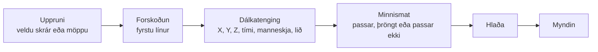

# Hvernig gögn eru sett inn

Áður en 3DHeat getur teiknað nokkuð þarf það töflu: hver lína segir hvar eitthvað var og, ef þú hefur það, hvenær og hver. Þessi hluti sýnir hvernig skrá verður að mynd. Engin gögn enn? Prófaðu [sýnigögnin](demo-data.md).

**Gerðu þetta núna:**

1. Opnaðu **Uppruni** í hliðarstiku Hitakorts og ýttu á **Skrár…** (eða slepptu skrá eða möppu á svæðið).
2. Skoðaðu **Dálkatenging**: reitirnir eru yfirleitt þegar fylltir út.
3. Athugaðu að **Minnismat** segir *passar*.
4. Ýttu á **Hlaða**.

Allt sem flipinn Hitakort sýnir kemur úr einu **gagnasafni**: töflu af línum, hver með staðsetningu og, ef vill, tíma, manneskju, hóp, lotu, sjónarátt og hvaða fjölda sem er af aukadálkum sem geymdir eru til síunar. Þessi hluti útskýrir hvernig gagnasafn verður til.

## Leiðin frá skrám til myndar {#the-path-from-files-to-picture}

1. **Veldu skrár** í spjaldinu **Uppruni** - eina, nokkrar, tré af möppum, eða með því að sleppa þeim. Parquet, CSV, Tacview, GPS-ferlar og fleira er tekið við; heildarlistinn er í [Gagnasnið](data-formats.md#files). Sjá [Hleðsla skráa](loading-files.md).
2. **Forskoðun.** Fyrsta skrá valsins er opnuð: dálkaheiti hennar, fyrstu 50 línurnar, hvaða dálkar líta út fyrir að vera tölur, og (Parquet) rökræn gerð hvers dálks og lestrarleiðbeiningar skrárinnar sjálfrar, `heat3d`-færslan í fótnótunni.
3. **Sjálfvirk tenging.** Dálkar fá hlutverk - X, Y, Z, tími, manneskja, lota, hópur, sjónarátt - og nokkrir eru geymdir til síunar. Sérhver ágiskun er sýnd í spjaldinu **Dálkatenging** og má breyta henni. Sjá [Dálkatenging](column-mapping.md) og [Ásar, einingar og tími](axes-units-and-time.md).
4. **Talning.** Línufjöldi hverrar skrár er lesinn (nákvæmlega úr Parquet-fótnótum, áætlaður fyrir CSV), svo spjaldið getur sagt áður en nokkuð er hlaðið hversu mikið minni hleðslan þarf og hvort það passar. Ef ekki, leggur það til að hlaða hverri *N*-tu línu. Sjá [Minni og mörk](memory-and-budgets.md).
5. **Hlaða.** Bakgrunnsvinnsluferli þáttar aðeins úr tengdu dálkunum í hverri skrá - nokkrum skrám í einu, allt að fjárhagsáætlun [þáttunarþráða](memory-and-budgets.md#parser-threads) - og sameinar þær, í röð valsins, í eitt gagnasafn: eina sameiginlega orðabók yfir manneskjur, hópa og lotur í öllum skrám, einn sameiginlegan tímauppruna, allar línur raðaðar eftir tíma. Sjá [Lotur, persónur og hópar](sessions-persons-groups.md).
6. **Hleðsla upp.** Aðalþráðurinn tilkynnir "Uploading N rows to the GPU" í einn ramma, og pakkar síðan línunum í minni skjákortsins innan fjárhagsáætlunar þess. Sjá [Minnisdvöl skjákorts](gpu-memory.md).
7. **Fyrsta myndin.** Myndavélin rammar gögnin inn, radíus depilsins og mettun eru stillt út frá umfangi gagnanna og fjölda lína, og eftir 8 teiknaða ramma er mettunin mæld út frá myndinni sjálfri ([Litir og lýsing](colour-and-exposure.md)).

## Kröfur, athugaðar fyrir hleðslu {#requirements-checked-before-a-load}

| Þörf | Hvað gerist án hennar |
|---|---|
| **Að minnsta kosti tveir af X / Y / Z** | Hleðslan er neitað. Með nákvæmlega tveimur er þriðji ásinn 0 og gögnin teiknuð sem flatur flötur í þrívíðu senunni - sem er það sem ofanfrá-hitakort vill. |
| Tímadálkur | Valfrjálst. Án hans er tímalínan óvirk, sýnin helst í stillingunni **Allt**, og hliðarstikan segir það. |
| Dálkur fyrir manneskju | Valfrjálst. Þarf fyrir [fígúruyfirlögnina](box-replay.md) (fígúra fyrir hverja manneskju), [línuhita](line-heat.md) (leiðina sem hver manneskja gekk), millifærslu, slóðir og söguna **Líftími**. |
| Dálkur fyrir hóp | Valfrjálst. Þarf fyrir [liðahita](team-heat.md) og stillingu [mismunar](difference.md) (að minnsta kosti tveir hópar). |

Stilling sem hleðsluðu gögnin styðja ekki er grá í mótastikunni; ef bendillinn er yfir henni segir það af hverju.

## Án þinna eigin gagna {#without-your-own-data}

Spjaldið **Gagnasafn** (undir **Uppruni**) hefur [gervigagnaframleiðanda](synthetic-generator.md) sem býr til gagnasafn í laginu eins og lifunarleikur af hvaða stærð sem er, nytsamlegt til að prófa skoðarann og til að prófa hvað vélin ræður við.

## Síður í þessum hluta {#pages-in-this-section}

- [Hleðsla skráa](loading-files.md) - valtól, möppur, draga og sleppa, sameining margra skráa, hreyfiskráreglan, framvinda og hætta við
- [Dálkatenging](column-mapping.md) - hver reitur í tengispjaldinu, hvernig sjálfvirk tenging giskar, `heat3d`-vísbendingarnar
- [Ásar, einingar og tími](axes-units-and-time.md) - lóðrétti ásinn, snúningar, kvarði eininga, tímaeiningar, sjónarátt
- [Lotur, persónur og hópar](sessions-persons-groups.md) - hvað hvert þeirra gerir, mörkin, sameiginleg heiti, stærð eininga, spjaldið Gagnasafn
- [Gervigagnaframleiðandi](synthetic-generator.md)
- [Minni og mörk](memory-and-budgets.md) - líkan af minnisnotkun, athugun á passa, grisjun, efri mörk röðunar, auðlindamörk
