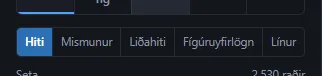

# Hitastillingar

Sérhver punktur bætir við smá glóandi ljósi, ljósin hlaðast upp, og hrúgan er máluð með litum. Stillingarnar eru fimm leiðir til að mála hann, og hver þeirra svarar einni spurningu.

Mótastikan efst í hliðarstiku flipans Hitakort ræður því hvernig [gagnasafnið](glossary.md) er teiknað. Takkarnir 1-4 velja Hiti, Mismunur, Liðahiti og Línur. Fígúruyfirlögn hefur engan takka.

| Stilling | Spurningin sem hún svarar |
|---|---|
| **Hiti** | Hvar gerðist það, og hversu mikið? |
| **Mismunur** | Hvor hliðin gerði það oftar? |
| **Liðahiti** | Hvers var það? |
| **Línur** | Hvaða leið fór fólk? |
| **Fígúruyfirlögn** | Hver var hvar, og hvenær? |

| Stilling (heiti á stiku) | Takki | Hvað hún teiknar | Þarfnast |
|---|---|---|---|
| **Hiti** | 1 | Samlagður þéttleiki: sérhver sýnileg lína bætir við geislóttum depli sem snýr að myndavélinni. [Hiti](heat.md) | gagnasafn |
| **Mismunur** | 2 | Þéttleiki með formerki: ein þýðing bætir við, önnur dregur frá. [Mismunur](difference.md) | tvær hliðar: að minnsta kosti tvo hópa, eða skiptingu yfir geymdan dálk |
| **Liðahiti** | 3 | Þéttleiki litaður eftir hópi: einn litatónn á hvern hóp, blandaður þar sem hópar skarast. [Liðahiti](team-heat.md) | hópdálk |
| **Fígúruyfirlögn** | - | Ein fígúra (eða kassi) á hverja manneskju, sem hreyfist eftir tímalínunni: endurspilunin. [Fígúruyfirlögn](box-replay.md), [Endurspilun leiks](match-replay.md) | dálk fyrir manneskju |
| **Línur** | 4 | Línuhiti: lína frá hverju sýni einnar manneskju til þess næsta, hitinn dvínar til hliðanna. [Línuhiti](line-heat.md) | dálk fyrir manneskju og tíma |

Stilling sem gögnin styðja ekki er grá, og bendillinn á henni segir ástæðuna, til dæmis *Ekki í boði — Mismunahamurinn þarf tvo hópa eða dálk sem er haldið fyrir síun til að skipta eftir; þessi gögn hafa einn hóp.* Þegar nýtt gagnasafn styður ekki núverandi stillingu fellur sýnin aftur í **Hiti**.

Takkarnir 1-4 eru athugaðir gagnvart gögnunum á sama hátt: takki fyrir gráa stillingu gerir ekkert.

## Hvaða spjöld hver stilling sýnir {#which-panels-each-mode-shows}

| Spjald | Hiti | Mismunur | Liðahiti | Fígúruyfirlögn | Línur |
|---|---|---|---|---|---|
| Leiðir ([línuhiti](line-heat.md)) | | | | | já |
| Lögun hitans (með **Fylgja sjónarhorninu** og **Sami þéttleiki við hvaða aðdrátt sem er**), Hitalitir, takmörk pixla á depli, Dýpt, útilokun eftir fjarlægð | já | já | já | | já |
| Stefna ([stefnuhiti](directional-heat.md)), Gildi ([gildisvigtun](value-weighting.md)) | já | já | já | | já |
| Liðssýn ([fígúruyfirlögn](box-replay.md)) | | | | já | |
| Mismunaskipting ([mismunur](difference.md)) | | já | | | |
| [Listi yfir lið](teams-list.md), [Einingar](entities.md), [Síur](filters.md), Bakgrunnur / borð, [Sneið](slice.md), [Mæling](measure.md), Myndavélarleið og myndvinnsla, Afköst, Myndavél og sena | já | já | já | já | já |

## Það sem allar hitastillingar eiga sameiginlegt {#what-every-heat-mode-shares}

Allar fjórar hitastillingarnar (allt nema fígúruyfirlögnin) eru sama vélin með mismunandi inntak ([`engine.ts`](https://github.com/Holdi601/3DHeat/blob/main/src/render/engine.ts)):

1. **Hvaða línur.** [Tímalínugluggi](timeline.md) velur samfellt svið af tímaröðuðum línum; [síur](filters.md), sýnileiki hópa, mismunaskiptingin, [útilokun eftir fjarlægð](depth-and-culling.md#distance-culling) og [sneiðin](slice.md) ákveða fyrir hverja línu, í hnútaskyggingunni, hvort og hversu sterkt hún leggur til.
2. **Dreifing (splatting).** Hver línu sem leggur til er teiknuð sem depill (eða, í stillingunni Línur, sem strengur) inn í **hitaflöt** með fleytitölum og bætir þar við gildi sínu á skalanum. Úrtak línanna er teiknað þegar þær eru fleiri en einn rammi ræður við, vegið til að bæta upp. Sjá [Úrtak og mörk](sampling-and-budgets.md).
3. **Söfnun.** Á meðan ekkert breytist eru rammar sameinaðir þar til sérhver lína hefur lagt til nákvæmlega einu sinni. Sjá [Söfnun](accumulation.md).
4. **Samsetning.** Söfnuðu gildið í hverjum pixli er deilt með **mettunarpunktinum**, mótað af **þéttleikasvöruninni**, hækkað um **lágmarkshitann** og flett upp í **litaskalanum**, en alfa hans blandar því yfir senuna. Sjá [Litir og lýsing](colour-and-exposure.md).

Allt í skrefi 4 er notað við samsetningu, svo að draga þær stillingar breytir aldrei söfnuninni; allt í skrefum 1-2 gerir það.

## Síður í þessum hluta {#pages-in-this-section}

- [Hiti](heat.md) - venjulega hitastillingin, og yfirlit yfir spjöld hennar
  - [Lögun sprite-mynda](sprite-shape.md) - radíus, styrkur, dvínun, feril-ritillinn, takmörk pixla, flötun
  - [Litir og lýsing](colour-and-exposure.md) - skalaritill, mettunarpunktur, sjálfvirk lýsing, lágmarkshiti, þéttleikasvörun
  - [Dýpt og útilokun](depth-and-culling.md) - hulning af borðinu, fela á bak við landslag, útilokun eftir fjarlægð
- [Mismunur](difference.md) - mismunaskiptingin
- [Liðahiti](team-heat.md)
- [Línuhiti](line-heat.md) - leiðir
- [Fígúruyfirlögn](box-replay.md) - endurspilunarstillingin (skráin heitir enn box replay)
- [Stefnuhiti](directional-heat.md)
- [Gildisvigtun](value-weighting.md)
