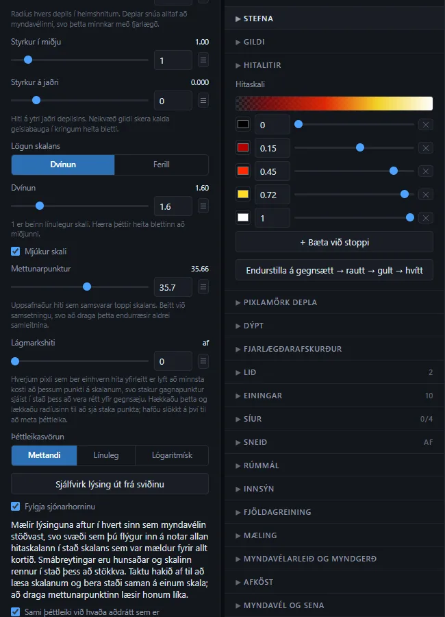

# Hiti

Hiti litar þá staði þar sem margt gerðist: rautt þar sem það gerðist svolítið, skjannahvítt þar sem það gerðist mikið. Hann svarar spurningunni „hvar gerist þetta, og hversu mikið“.

**Hiti** (lykill 1) er sjálfgefni hamurinn. Sérhver sýnileg [röð](glossary.md) leggur til kringlóttan [sprite](glossary.md) sem snýr að myndavélinni; sprite sem skarast leggjast saman í flotpunktabuffi; summan er varpað í gegnum litaskala - sjálfgefið gegnsætt → rautt → gult → hvítt - og teiknuð yfir sennuna.

Myndin sýnir hita úr skotleikjalotu á borði með byggingum: heitu blettirnir sitja í herbergjunum og á stigunum, ekki bara á jörðinni.

## Hvernig á að nota hann {#how-to-use-it}

1. Hladdu gögnum og ýttu á `1` (eða veldu **Hiti** í valstikunni).
2. Ef allt er hvítt eða autt, ýttu á **Sjálfvirk lýsing út frá sviðinu** í hlutanum **Lögun hitans**.
3. Breyttu **Radíus depils** þar til nærliggjandi deplar sameinast í bönd: minni sýnir stakar stöður, stærri sýnir svæði.
4. Opnaðu **Hitalitir** til að breyta litunum, eða **Dýpt** til að láta hæðir og veggi fela hitann á bak við sig.

Sömu spjöld móta [Mismun](difference.md), [Liðahita](team-heat.md) og [Línuhita](line-heat.md); þau eru ólík í því sem er lagt við (með formerki, litað, eða eftir línum), ekki í því hvernig það er gert.

## Spjöldin og sjálfgefin gildi þeirra {#the-panels-and-their-defaults}

Sérhver stilling er útskýrð á sinni eigin síðu; dálkurinn Nánar tengir á hana. Sleðar hafa skrifreit við hlið sér og dráttarhandfang (litla gripið hægra megin: dragðu upp eða niður, lengra er hraðara, Shift fyrir fínstillingu); þar sem braut sleðans endar áður en raunveruleg mörk eru, má handfangið fara lengra, upp að *sleðaþakinu* sem gefið er hér. Gildi merkt *við hleðslu* eru reiknuð upp aftur fyrir hvert nýtt gagnasafn.

### Lögun hitans (opið) {#heat-shape-open}

| Stilling | Sjálfgefið | Svið (sleðaþak) | Nánar |
|---|---|---|---|
| **Radíus depils** | 6 m; við hleðslu útbreiðsla / 120 | 0,05-2000 m, lógaritmískt (50.000) | [Lögun sprite-mynda](sprite-shape.md#sprite-radius) |
| **Styrkur í miðju** | 1 | 0-10 (1000) | [Lögun sprite-mynda](sprite-shape.md#centre-and-edge-intensity) |
| **Styrkur á jaðri** | 0 | -2-10 (1000) | [Lögun sprite-mynda](sprite-shape.md#centre-and-edge-intensity) |
| **Lögun skalans** | *Dvínun* | *Dvínun* / *Ferill* | [Lögun sprite-mynda](sprite-shape.md#ramp-shape-falloff-or-curve) |
| **Dvínun** (aðeins Dvínun) | 1,6 | 0,1-8 (64) | [Lögun sprite-mynda](sprite-shape.md#falloff) |
| **Mjúkur skali** (aðeins Dvínun) | á | | [Lögun sprite-mynda](sprite-shape.md#falloff) |
| Ferilritill (aðeins Ferill) | forstillingin *Mjúk* | | [Lögun sprite-mynda](sprite-shape.md#the-curve-editor) |
| **Mettunarpunktur** | 24; við hleðslu mat, síðan mælt | 0,1-4000, lógaritmískt (10.000.000) | [Litir og lýsing](colour-and-exposure.md#saturation-point) |
| **Lágmarkshiti** | slökkt (0) | 0-100% | [Litir og lýsing](colour-and-exposure.md#minimum-heat) |
| **Þéttleikasvörun** | *Mettandi* | *Mettandi* / *Línuleg* / *Lógaritmísk* | [Litir og lýsing](colour-and-exposure.md#density-response) |
| **Sjálfvirk lýsing út frá sviðinu** | | hnappur | [Litir og lýsing](colour-and-exposure.md#auto-exposure) |
| **Fylgja sjónarhorninu** | á | | Mælir lýsinguna aftur í hvert sinn sem myndavélin stöðvast, svo svæði sem þú flýgur inn á notar allan litaskalann. Smábreytingar eru hunsaðar og skalinn rennur. Taktu hakið af, eða dragðu **Mettunarpunkt**, til að læsa skalanum og bera staði saman á einum skala. [Litir og lýsing](colour-and-exposure.md#follow-the-view) |
| **Sami þéttleiki við hvaða aðdrátt sem er** | á | | Litur þýðir sama fjölda raða á hverja flatarmálseiningu jarðar, hversu nálægt sem þú ert. Sprite sem pixlamörkin stækka (langt í burtu) eða minnka (nálægt) heldur þeim hita sem raunveruleg stærð þess myndi bæta við, svo mynd sem er lýst úr fjarlægð dofnar ekki þegar þú flýgur inn í hana. Slökkt: takmarkaður sprite bætir við fullri þyngd sinni í takmarkaðri stærð. [Lögun sprite-mynda](sprite-shape.md#pixel-clamps) |
| **Fletja á jarðflöt** | slökkt | | [Lögun sprite-mynda](sprite-shape.md#flatten-onto-ground-plane) |

### Hitalitir (lokað) {#heat-colours-closed}

| Stilling | Sjálfgefið | Nánar |
|---|---|---|
| Hópasýnishorn og **Litaaðgreining** (aðeins Liðahiti) | 1,4 | [Liðahiti](team-heat.md) |
| **Hitaskali**-ritillinn (*Jákvæður (samlögð lið)* í Mismun, *Ógegnsæisskali* í Liðahita) | gegnsætt → rautt → gult → hvítt | [Litir og lýsing](colour-and-exposure.md#the-ramp-editor) |
| **Endurstilla á gegnsætt → rautt → gult → hvítt** | | |
| **Neikvæður (frádregin lið)** skali (aðeins Mismunur) | gegnsætt → grænt → blátt → fjólublátt | [Mismunur](difference.md#colours) |

### Pixlamörk depla (lokað) {#sprite-pixel-clamps-closed}

| Stilling | Sjálfgefið | Svið (sleðaþak) | Nánar |
|---|---|---|---|
| **Lágm. pixlaradíus** | 1 px | 0-16 (512) | [Lögun sprite-mynda](sprite-shape.md#pixel-clamps) |
| **Hám. pixlaradíus** | 96 px | 2-1024, lógaritmískt (8192) | [Lögun sprite-mynda](sprite-shape.md#pixel-clamps) |

### Dýpt (opið) {#depth-open}

| Stilling | Sjálfgefið | Nánar |
|---|---|---|
| **Fela á bak við landslag** | á | [Dýpt og útilokun](depth-and-culling.md#hide-behind-terrain) |
| **Falið á bak við rúmfræði** | 0,8 (*80% dekkra*) | [Dýpt og útilokun](depth-and-culling.md#hidden-behind-geometry) |

### Fjarlægðarafskurður (lokað) {#distance-culling-closed}

| Stilling | Sjálfgefið | Svið (sleðaþak) | Nánar |
|---|---|---|---|
| **Nær** | slökkt (0) | 0,5-5000 m, lógaritmískt, neðst á braut = slökkt (200.000) | [Dýpt og útilokun](depth-and-culling.md#distance-culling) |
| **Fjær** | slökkt (0) | 1-200.000 m, lógaritmískt, neðst = slökkt (10.000.000) | [Dýpt og útilokun](depth-and-culling.md#distance-culling) |
| **Skera við flöt** | á | | [Dýpt og útilokun](depth-and-culling.md#distance-culling) |
| **Skera borðið líka** | á | | [Dýpt og útilokun](depth-and-culling.md#distance-culling) |

Lyklar: `[` og `]` færa fjærmarkið inn og út, `\` skiptir á því ([Dýpt og útilokun](depth-and-culling.md#keyboard)).

### Stefna og Gildi {#direction-and-value}

Tveir hlutar til viðbótar eru fyrir neðan Lögun hitans. **Stefna** teiknar hverja röð sem fleyg og bætir við örvum: sjá [Stefnuhita](directional-heat.md). **Gildi** vegur hitann eftir því hvað hver röð kostaði eða skilaði: sjá [Gildisvigtun](value-weighting.md).

## Hvað er vistað {#what-is-saved}

Hitastillingarnar hér að ofan eru ekki geymdar milli lota: endurhleðsla síðunnar endurheimtir sjálfgefin gildi. Tvennt er geymt í vafranum: síðasti spilunarhraði (`heat3d.speed`, sjá [Tímalínu](timeline.md)) og stillingar fígúra í fjarlægð í [fígúruyfirlagninu](box-replay.md) (tákngerð, stærð, höggmerki og svo framvegis). Sömuleiðis tungumálið, [snúnir heimsásar](camera.md#invert-world-axis), nöfn bíla sem kappakstursflipinn man og [borðasafnið](level-library.md). Allur listinn er á [Geymdar stillingar](ref-settings-storage.md).
