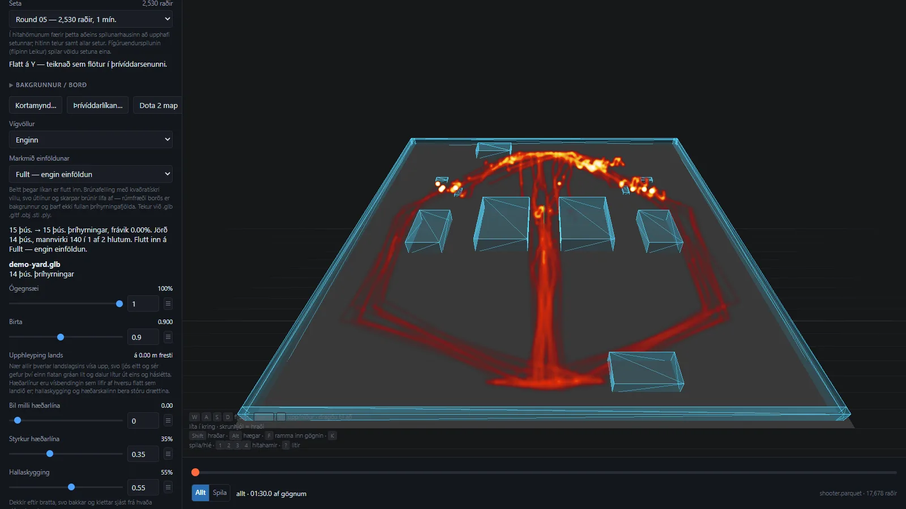

# Hiti

Hiti málar staðina þar sem margt gerðist: rautt þar sem það gerðist lítið, hvítglóandi þar sem það gerðist mikið. Hann svarar spurningunni "hvar gerist þetta, og hversu mikið".

**Hiti** (takki 1) er sjálfgefin stilling. Sérhver sýnileg [lína](glossary.md) leggur til kringlóttan [depil](glossary.md) sem snýr að myndavélinni; skarandi deplar leggjast saman í fleytibuffer; summan er færð í gegnum litaskala - sjálfgefið gegnsætt → rautt → gult → hvítt - og teiknuð yfir senuna.

Myndin sýnir hita úr skotleikjalotu á borði með byggingum: heitir blettir eru í herbergjunum og á stigunum, ekki bara á jörðinni.

## Hvernig á að nota hann {#how-to-use-it}

1. Hladdu inn gögnum og ýttu á `1` (eða veldu **Hiti** á mótastikunni).
2. Ef allt er hvítt eða autt, ýttu á **Sjálfvirk lýsing út frá sviðinu** í hlutanum **Lögun hitans**.
3. Breyttu **Radíus depils** þar til nálægir punktar renna saman í bönd: minna sýnir stakka bletti, stærra sýnir svæði.
4. Opnaðu **Hitalitir** til að breyta litunum, eða **Dýpt** til að láta hæðir og veggi fela hitann á bak við sig.

Sömu spjöldin móta [Mismun](difference.md), [Liðahita](team-heat.md) og [Línuhita](line-heat.md); þau eru ólík í því sem bætt er við (með formerki, litað eða eftir línum), ekki í því hvernig það er gert.

## Spjöldin og sjálfgildin þeirra {#the-panels-and-their-defaults}

Sérhver stjórn hér að neðan tengist breytu í skyggingu, svo breyting kostar ekkert nema endurteikningu. Sleðar hafa textareit við hliðina og dráttarhandfang (litla gripið hægra megin: drag upp eða niður, lengra er hraðara, Shift fyrir fínstillingu); þar sem spor sleðans endar áður en raunverulegt mörk er náð getur handfangið ýtt framhjá því upp að *hámarki hreyfingar* sem gefið er hér. Gildi merkt *við hleðslu* eru endurreiknuð fyrir hvert nýtt gagnasafn.

### Lögun hitans (opið) {#heat-shape-open}

| Stjórn | Sjálfgildi | Svið (hámark hreyfingar) | Nánar |
|---|---|---|---|
| **Radíus depils** | 6 m; við hleðslu útbreiðsla / 120 | 0,05-2000 m, logaritmískt (50.000) | [Lögun sprite-mynda](sprite-shape.md#sprite-radius) |
| **Styrkur í miðju** | 1 | 0-10 (1000) | [Lögun sprite-mynda](sprite-shape.md#centre-and-edge-intensity) |
| **Styrkur á jaðri** | 0 | -2-10 (1000) | [Lögun sprite-mynda](sprite-shape.md#centre-and-edge-intensity) |
| **Lögun skalans** | *Dvínun* | *Dvínun* / *Ferill* | [Lögun sprite-mynda](sprite-shape.md#ramp-shape-falloff-or-curve) |
| **Dvínun** (aðeins Dvínun) | 1,6 | 0,1-8 (64) | [Lögun sprite-mynda](sprite-shape.md#falloff) |
| **Mjúkur skali** (aðeins Dvínun) | kveikt | | [Lögun sprite-mynda](sprite-shape.md#falloff) |
| Feril-ritill (aðeins Ferill) | forstilling *Mjúkt* | | [Lögun sprite-mynda](sprite-shape.md#the-curve-editor) |
| **Mettunarpunktur** | 24; við hleðslu mat, síðan mælt | 0,1-4000, logaritmískt (10.000.000) | [Litir og lýsing](colour-and-exposure.md#saturation-point) |
| **Lágmarkshiti** | slökkt (0) | 0-100% | [Litir og lýsing](colour-and-exposure.md#minimum-heat) |
| **Þéttleikasvörun** | *Mettandi* | *Mettandi* / *Línuleg* / *Log* | [Litir og lýsing](colour-and-exposure.md#density-response) |
| **Sjálfvirk lýsing út frá sviðinu** | | hnappur | [Litir og lýsing](colour-and-exposure.md#auto-exposure) |
| **Fylgja sjónarhorninu** | kveikt | | Mælir lýsinguna aftur í hvert skipti sem myndavélin stöðvast, svo svæði sem þú flýgur inn í notar allan litaskalann. Smávægilegar breytingar eru hunsaðar og skalinn rennur mjúklega. Taktu hakið af, eða dragðu **Mettunarpunktur**, til að festa skalann og bera saman staði á einum skala. [Litir og lýsing](colour-and-exposure.md#follow-the-view) |
| **Sami þéttleiki við hvaða aðdrátt sem er** | kveikt | | Litur þýðir sama fjölda lína á hvern flatarmálseiningu lands, sama hversu nálægt þú ert. Depill sem takmörk pixla stækka (langt í burtu) eða minnka (nálægt) heldur þeim hita sem raunveruleg stærð hans myndi bæta við, svo mynd sem er lýst upp úr fjarlægð dofnar ekki þegar þú flýgur inn í hana. Slökkt, bætir takmarkaður depill við fullri þyngd sinni í takmarkaðri stærð. [Lögun sprite-mynda](sprite-shape.md#pixel-clamps) |
| **Fletja á jarðflöt** | slökkt | | [Lögun sprite-mynda](sprite-shape.md#flatten-onto-ground-plane) |

### Hitalitir (lokað) {#heat-colours-closed}

| Stjórn | Sjálfgildi | Nánar |
|---|---|---|
| Hópsýnishorn og **Litaaðgreining** (aðeins Liðahiti) | 1,4 | [Liðahiti](team-heat.md) |
| **Hitaskali**-ritill (*Jákvæður (samlögð lið)* í Mismun, *Ógegnsæisskali* í Liðahita) | gegnsætt → rautt → gult → hvítt | [Litir og lýsing](colour-and-exposure.md#the-ramp-editor) |
| **Endurstilla á gegnsætt → rautt → gult → hvítt** | | |
| **Neikvæður (frádregin lið)**-skali (aðeins Mismunur) | gegnsætt → grænt → blátt → fjólublátt | [Mismunur](difference.md#colours) |

### Takmörk pixla á depli (lokað) {#sprite-pixel-clamps-closed}

| Stjórn | Sjálfgildi | Svið (hámark hreyfingar) | Nánar |
|---|---|---|---|
| **Lágm. pixlaradíus** | 1 px | 0-16 (512) | [Lögun sprite-mynda](sprite-shape.md#pixel-clamps) |
| **Hám. pixlaradíus** | 96 px | 2-1024, logaritmískt (8192) | [Lögun sprite-mynda](sprite-shape.md#pixel-clamps) |

### Dýpt (opið) {#depth-open}

| Stjórn | Sjálfgildi | Nánar |
|---|---|---|
| **Fela á bak við landslag** | kveikt | [Dýpt og útilokun](depth-and-culling.md#hide-behind-terrain) |
| **Falið á bak við rúmfræði** | 0,8 (*80% dekkra*) | [Dýpt og útilokun](depth-and-culling.md#hidden-behind-geometry) |

### Útilokun eftir fjarlægð (lokað) {#distance-culling-closed}

| Stjórn | Sjálfgildi | Svið (hámark hreyfingar) | Nánar |
|---|---|---|---|
| **Nær** | slökkt (0) | 0,5-5000 m, logaritmískt, botn brautarinnar = slökkt (200.000) | [Dýpt og útilokun](depth-and-culling.md#distance-culling) |
| **Fjær** | slökkt (0) | 1-200.000 m, logaritmískt, botn = slökkt (10.000.000) | [Dýpt og útilokun](depth-and-culling.md#distance-culling) |
| **Skera við flöt** | kveikt | | [Dýpt og útilokun](depth-and-culling.md#distance-culling) |
| **Skera borðið líka** | kveikt | | [Dýpt og útilokun](depth-and-culling.md#distance-culling) |

Takkar: `[` og `]` ýta fjarmörkunum inn og út, `\` skiptir á milli ([Dýpt og útilokun](depth-and-culling.md#keyboard)).

### Stefna og Gildi {#direction-and-value}

Tveir hlutar til viðbótar eru undir Lögun hitans. **Stefna** teiknar hverja línu sem geira og bætir við örvum: sjá [Stefnuhita](directional-heat.md). **Gildi** vigtar hitann eftir því hvað hver lína kostaði eða skilaði: sjá [Gildisvigtun](value-weighting.md).

## Hvað er vistað {#what-is-saved}

Hitastillingarnar hér að ofan eru ekki geymdar á milli lota: endurhleðsla síðunnar endurheimtir sjálfgildin. Tvennt er geymt í vafranum: síðasti spilunarhraði (`heat3d.speed`, sjá [Tímalína](timeline.md)) og stillingar fjarlægra fígúra í [fígúruyfirlögninni](box-replay.md) (táknstíll, stærð, höggmerki og fleira). Það sama á við um tungumálið, [öfugsnúna heimsása](camera.md#invert-world-axis), nöfn bíla sem flipinn Kappakstursgreining man og [borðasafnið](level-library.md). Allur listinn er á [Vistaðar stillingar](ref-settings-storage.md).
