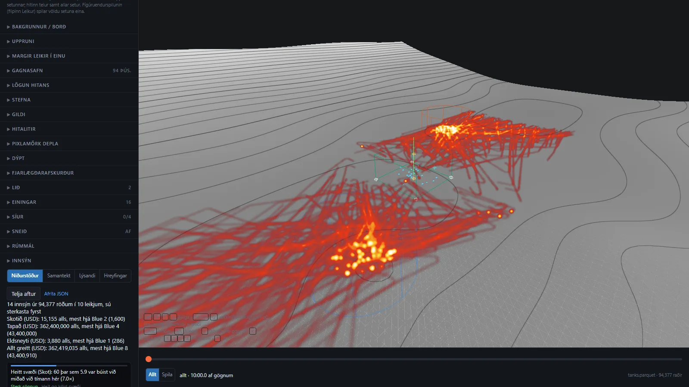
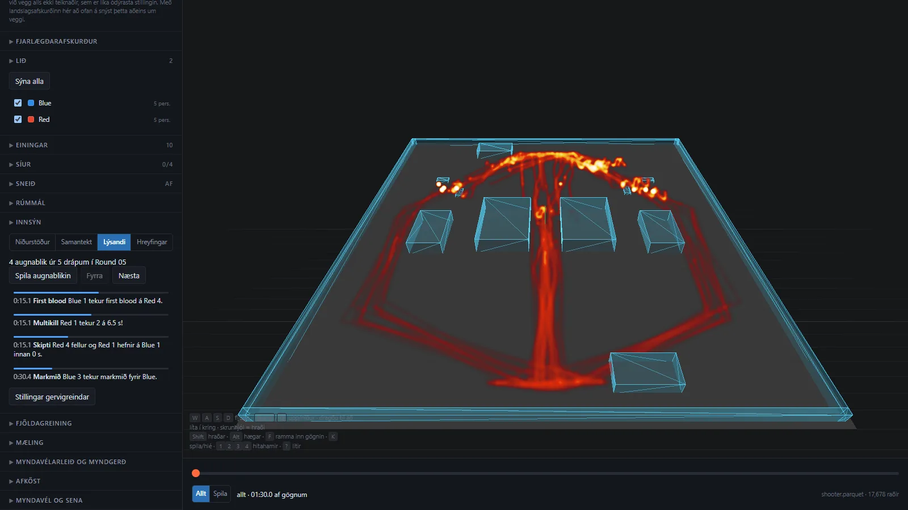

# Innsýn

**Innsýn** leitar í hlöðnum gögnunum að því sem sker sig úr - sterkum stöðum, banvænu landi, gildrum við upphaf, flöskuhálsum, leikmönnum langt umfram jafningja sína - og segir þér, það sterkasta fyrst, ásamt gögnunum sem styðja það. Notaðu það til að læra á einni mínútu hvar leik var unnið eða tapað. Það getur síðan skrifað samantekt, og í einni endurspilun getur það starfað sem lýsandi sem hoppar á stóru augnablikin.

Allt er talið í vafranum þínum. Ekkert fer af tölvunni þinni nema þú kveikir á ytri gervigreind (sjá [Ytri gervigreind](#external-ai)).

Hlutinn **Innsýn** er í hliðarstiku flipanna Hitakort og Leikur. Hann hefur þrjá flipa: **Niðurstöður**, **Samantekt** og **Lýsandi**.

## Niðurstöður {#findings}

1. Hladdu gögnum og opnaðu **Innsýn**. Ýttu á **Finna innsýn** ("Tel… n%" sýnir framvinduna).
2. Lestu listann. Hver niðurstaða hefur styrkstiku, setningu, hversu góð gögnin eru (*Sterk gögn*, *Góð gögn* eða *Nokkur gögn*), hvaða greiningartól fann hana, og flokk farartækis þar sem það skiptir máli.
3. **Smelltu á niðurstöðu**: skoðarinn beitir síum hennar, flýgur myndavélinni að staðnum og hoppar að tímanum, og opnar upplýsingarnar: áhrifin með 95% öryggisbili, p- og q-gildin, taldu gögnin, og **Rúmmál hér**, sem teiknar [rúmmál](volumes.md) utan um staðinn.
4. **Endurheimta síur** setur síurnar þínar aftur. **Afrita JSON** afritar alla skýrsluna.

Talningin notar núverandi síur, földu hópana og valinn leik yfir allt tímabilið. Þegar þú breytir síunum síðar segir athugasemd það; ýttu þá á **Telja aftur**.

Línurnar efst á listanum (til dæmis heildarfjárhæðirnar) draga saman öll gögnin á undan niðurstöðunum.

### Greiningartólin {#the-detectors}

| Greiningartól | Hvað það finnur | Þarfnast í gögnunum |
|---|---|---|
| **Valdastöður** | Staðir með mun betri hlutfall dráps á móti dauða en restin af kortinu, og *öruggt land* þar sem fáir deyja miðað við tímann sem varið er | atburði dráps og dauða |
| **Heit og köld svæði** | Staðir þar sem tegund atburðar (skot, högg, yfirtökur ...) gerist mun oftar eða sjaldnar en tíminn sem varið er þar spáir fyrir um | atburðadálk |
| **Opið land og skjól** | Dauðsföll á opnu svæði við nálæga rúmfræði borðsins, og hægt þegar hreyfingin er hröð | dauðsföll; þrívítt borð fyrir rúmfræðihlutann |
| **Spawns** | Sterkir upphafsstaðir, gildrur við upphaf, öruggir upphafsstaðir, tími þar til fyrsta snerting | tíma og persónur |
| **Flokkur eftir stað** | Flokkur farartækis, eða leikmenn á móti gervigreind, sem standa sig mun betur eða verr á svæði | dráp og flokk farartækis eða dálk leikmanns/gervigreindar |
| **Leikmenn** | Leikmenn sem drepa eða deyja mun oftar eða sjaldnar en aðrir í sama flokki | persónur og dráp |
| **Flöskuhálsar og hliðarleiðir** | Flöskuhálsar (mun fleiri yfirferðir en landið í kring) og hliðarleiðir (sjaldan notaðar, en leiða til dráps) | persónur |
| **Gildi** | *Dýrt land* og *Tekjuland* | [gildisdálkar](value-weighting.md) |

Greiningartól sem geta ekki keyrt á gögnunum eru talin upp neðst með ástæðunni.

### Hvernig niðurstöður eru raðaðar {#how-findings-are-ranked}

Sérhver staður eða hópur er prófaður gegn restinni af kortinu (nákvæm tvíliðuprófun eða hlutfallspróf). Falsk-uppgötvunartíðnin er haldin í 5% (Benjamini-Hochberg). Tilviljun getur litið út eins og mynstur; þetta heldur fölskum viðvörunum í lágmarki: meðal niðurstaðnanna sem sýndar eru er búist við að í mesta lagi um einn af hverjum tuttugu sé tilviljun. Áhrif af fáum atburðum eru dregin að "engum áhrifum" áður en raðað er. Í mesta lagi 60 niðurstöður eru skráðar, og sérhvert greiningartól fær nokkra staði nálægt toppnum.

## Samantekt {#debrief}

Flipinn **Samantekt** skrifar niðurstöðurnar upp sem stuttan texta: upphaf, skýrasta niðurstaðan, ein fyrir taktík, ein fyrir jafnvægi, hinar flokkaðar eftir greiningartóli, og hversu margar byggja á veikari gögnum. Hver málsgrein hefur tölusetta hnappa sem sýna niðurstöðurnar hennar. **Afrita texta** afritar hann.

Innbyggði sögumaðurinn virkar án nettengingar, á þínu tungumáli. Valið **Linsa** fyrir ofan hann (sjá [Þekkingarlinsan](knowledge.md)) ræður hvaða heimildir málsgreinarnar vísa í.

### Ytri gervigreind {#external-ai}

**Stillingar gervigreindar** leyfir líkani af gervigreind að eigin vali að skrifa samantektina í staðinn:

| Stilling | Merking |
|---|---|
| **Þjónustuaðili** | Anthropic (Claude), OpenAI (ChatGPT), OpenRouter, Ollama (staðbundið), LM Studio (staðbundið), llama.cpp-þjónn (staðbundið), eða hvaða OpenAI-samhæfður endapunktur sem er |
| **Grunnslóð**, **Líkan** | Fyllt inn af þjónustuaðilanum; **Telja upp líkön** spyr þjóninn |
| **API-lykill** | Sendur aðeins á grunnslóðina. Aldrei skráður, aldrei vistaður í útsýnum, útflutningi eða `.3dheat`-skrám. Flestir staðbundnir þjónar þurfa engan. |
| **Muna lykilinn í þessum vafra** | Sjálfgefið slökkt: lykillinn gleymist þegar síðunni er lokað |
| **Nota ytri gervigreind** | Sjálfgefið slökkt |
| **Senda nöfn spilara** | Sjálfgefið slökkt: leikmenn eru sendir sem P1, P2 ... |

Skrifaðu síðan valfrjálsa spurningu og ýttu á **Skrifa með gervigreind**. Aðeins niðurstöðurnar og tölur þeirra eru sendar - aldrei línur gagnanna þinna. Svarið streymir inn; tilvitnaðar niðurstöður verða að hnöppum.

## Lýsandi {#caster}

Fyrir **einn leik** (veldu einn ef margir eru hlaðnir) finnur **Lýsandi** augnablikin sem vert er að horfa á: fyrsta blóð, margföld dráp, skipti, lokasóknir, sveiflur í markmiðum, endurkomur, áberandi leikmenn, langskot.

- Smelltu á augnablik: sýnin skiptir yfir í endurspilunina, hoppar rétt fyrir það, flýgur þangað og fylgir leikmanninum.
- **Spila augnablikin** spilar hvert þeirra til enda og heldur áfram; **Fyrra** / **Næsta** fara á milli þeirra.
- Með ytri gervigreind kveikt skrifar **Lýsing frá gervigreind** lýsingu út frá listanum yfir augnablikin (tegundir, tímar, nöfn eða gervinöfn, lið, flokkar, fjarlægðir).

Það þarfnast persóna og dráps/dauða (eða yfirtöku) atburða; `other`/`victim`-dálkur gerir skipti og langskot möguleg.

## Þekkingarlinsan {#knowledge-lens}

Hægt er að lesa niðurstöðu í gegnum **linsu** af viðurkenndri þekkingu: hernaðarkenningu, loft- og sjóorrustum, borgarhernaði, leikjahönnun og rafíþróttum (eða *Sjálfvirkt*, valið af einingunum í gögnunum). Opnuð niðurstaða sýnir þá næstu færslu **kenningar og heimilda** og **sögulega hliðstæðu**, með tilvísunum, og **Mælingar linsunnar** reiknar mælingar úr þeim heimildum á gögnunum (Lanchester-aðlaganir, skiptihlutföll, hlutföll herafla, skotsvið, lykilland, skipti, frumkvæði). Samantektin og gervigreindarbeiðnin innihalda þær. Allt um þetta: [Þekkingarlinsan](knowledge.md).

Mælingar linsunnar mæla líka hvernig leikmenn haga sér sem hópur og sem heild - röðun og hringsnúning, hjarðstýringu á leiðum, akreinar og slóðir, þröng, leiðtoga og fylgjendur, eftirbáta, brotpunktinn undir tapi, áhættu eftir að líf tapast, raðir, samkomulag um kaup og viðbrögð við skotum sem berast - hver miðað við sitt eigið viðmiðunarlíkan: [Hópahegðun](collective-behaviour.md).

## Gögnin sem gera innsýn mögulega {#data-that-makes-insights-work}

- staðsetningar með **tíma**, **persónu** og **liðsdálk**;
- **atburðadálk** með drápum og dauðsföllum (`kill`, `death`), og öðrum (`hit`, `fire`, `capture` ...);
- **dálk annars aðila** (`other`, `victim`) fyrir skipti og stefnur;
- **farartækis- eða tegundardálk** fyrir flokka; `ai`-dálk fyrir leikmenn á móti gervigreind;
- **lotu-/leiks-/umferðardálk** þegar margir leikir eru til.

[Sýnigögnin](demo-data.md) hafa þá alla.
