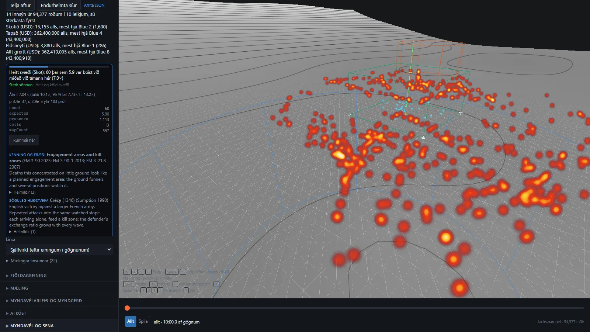

# Þekkingarlinsan

Þegar [Innsýn](insights.md) finnur eitthvað útskýrir þessi hluti það með hugmyndum úr hernaðarsögu, leikjahönnun og íþróttagreiningu, og nefnir bókina eða greinina sem það kemur úr. Notaðu hann til að læra *hvers vegna* mynstur skiptir máli, ekki bara að það sé til.

## Prófaðu {#try-it}

1. Hladdu gögnum og opnaðu **Innsýn**, ýttu síðan á **Finna innsýn**.
2. Smelltu á niðurstöðu til að opna hana.
3. Lestu **Kenning og fræði** og **Söguleg hliðstæða**; allar heimildirnar eru felldar undir.
4. Breyttu **Linsu** (til dæmis í *Hernaðarkenning*) til að lesa sömu niðurstöðu í gegnum annan bókmenntaflokk.

## Hvernig þetta virkar {#how-it-works}

Innsýnarspjaldið metur niðurstöður sínar eins og fagmaður myndi gera: í gegnum hernaðarkenningu og aðgerðagreiningu, sögulegar orrustur, og bókmenntir um leikjahönnun, borðahönnun og greiningar. Það gerir það án nettengingar, út frá safnaðri þekkingargrunni í skoðunartækinu, og afhendir sama efni ytri líkani þegar það skrifar samantektina.

## Það sem spjaldið sýnir {#what-the-panel-shows}

- **Linsa** velur bókmenntaflokkinn sem niðurstöðurnar eru lesnar í gegnum: *Sjálfvirkt* (valið eftir tegundum eininga í gögnunum: loftför, skip, landfarartæki, fótgöngulið), *Hernaðarkenning*, *Loftbardagi*, *Sjóher*, *Borgir*, *Leikjahönnun og jöfnun*, *Rafíþróttir*. Færslur utan valinnar linsu eru felldar út.
- Hver opnuð niðurstaða sýnir sína næstu færslu í **kenningu og fræði** og sína næstu **sögulegu hliðstæðu**, með heimildunum allt felldum undir.
- **Mælingar linsunnar** telja upp mælitölur aðgerðagreiningar reiknaðar út frá sömu röðum (hér fyrir neðan), hver með merkingu sinni og heimildum.
- **Samantektin** bætir við línum fyrir helstu niðurstöður og mælingar linsunnar: "Kenning og fræði: ..." og "Söguleg hliðstæða: ...", hver með tilvísunum höfundar-árs og heimildunum felldum undir.
- **Skrifa með gervigreind** sendir mikilvægustu færslurnar (samantekt, lærdóm, niðurstöðurnar sem þær tengjast, allar heimildir) með skýrslunni, og biður líkanið um að vitna í þær eftir auðkenni - `{concept.lanchester-square}` - og nota engar aðrar heimildir.

Heitin eru þýdd; þekkingin sjálf er á ensku.

## Mælingar linsunnar {#lens-metrics}

Reiknaðar í innsýnarvinnsluferlinum, í sömu yfirferð yfir raðirnar og greinarnar (`src/insights/lensMetrics.ts`). Hver er felld út þegar gögnin geta ekki borið hana.

| Mæling | Hvað hún mælir | Þarf |
|---|---|---|
| Lanchester-aðlögun | Tap hvorrar hliðar á 20 s fresti, aðhvarfað á lífstyrk beggja hliða (Poisson, quasi-likelihood villur); veldisvísarnir á styrk óvinar og eigin styrk, prófaðir gegn ferningslögmálinu (miðað skot) og línulega lögmálinu (svæðisskot) | tími, lið, dráp og dauðsföll |
| Skiptihlutfall | Dráp á dauðsfall eftir hlið og stað; hlutdeild dauðsfalla á þeim banvænasta jarðarbletti sem hefur 5% af tímanum, samanborið við hlutdeildina sem tilviljun ein gefur með þeim fjölda dauðsfalla; Gini-stuðull dauðsfalla yfir tíma; Moran's I á dauðsfallatíðni | dráp og dauðsföll |
| Staðbundið styrkhlutfall | Vinveittar og óvinaeiningar á lífi innan drægis hvers dráps (drægið sett út frá gögnunum: tvöfalt miðgildi fjarlægðar í næsta óvin); hlutdeild dráp þeirrar hliðar sem er staðbundið yfirsterkari, og umframhluti hennar umfram það sem fjöldinn einn spáir | tími, lið, persónur |
| Skotsvið | Sjónsvið fjölfarnustu drápsstaða á 2,5D hindrunarfleti (landfræði borðs upp að veggjahæð, eða jörðin sem var gengin) miðað við meðalstað, og röðunarfylgni sjónsviðs og hlutdeildar dráps | staðsetningar; hlaðið borð gerir það skarpara; ekki fyrir loft |
| Orkuástand | Sértæk orka (hæð auk þeirrar hæðar sem hraðinn gæti keypt) loftdrápara og loftfórnarlamba, borið saman með Mann-Whitney-prófinu | flokkar loftfara, tími, hæð |
| Lykilland | Hversu oft hver staður er meðal þriggja fjölfarnustu drápsstaða leiks | nokkrir leikir |
| Gagnkvæmur stuðningur (skipti) | Dauðsföll sem liðsfélagi svarar með drápi innan drægis og 5 s | tími, lið |
| Fyrsta högg | Viðureignir - dráp flokkuð eftir leik, eftir 20 s kyrrð og eftir þrjú drægi í fjarlægð - sem sú hlið vinnur sem skoraði fyrst | tími, lið |
| Salvumódel | Salvujafna Hughes aðlöguð að 20 s tímabilum skipa í snertingu: skip sett úr leik á hvert árásarskip, og bjargað á hvert varnarskip; Lanchester-aðlögun á skipum ein | skipaflokkar, tími, lið |
| Bardagaskilvirkni | Dráp á hverja einingarklukkustund í bardaga hvorrar hliðar og hlutfall þeirra tveggja stærstu (bardagaskilvirknisgildi í skilningi Dupuy) með 95% bili, og hlutdeild hvorrar hliðar í drápum við jafnan staðbundinn fjölda | tími, lið |
| Drægi viðureigna | Fjarlægð í næsta óvin við dráp, við skot og við fyrsta skot hvers lífs (greining til viðureignar), eftir gerð einingar | tími, lið; skot þar sem gögnin hafa þau |
| Drápskeðja | Sekúndur frá síðasta skoti drepandans til drápsins, og frá fyrsta skoti bardagans til drápsins | tími; skot eða eldatburðir |
| Þétting eða dreifing | Á hverju 20 s tímabili: dreifing tveggja stærstu hliðanna og hlutdeild dráp sem þéttari hliðin tekur | tími, lið |
| Flug | Eftir hlið: flug (flugtök, eða tilkomur loftfara), lendingar, loftför töpuð og dráp eftir loftfari; tapshlutfall og dráp á flug | flokkar loftfara; flugtök eða tilkomur |

Gögn með umferðum bæta við mælingum um návígi og rafíþróttir - líkur á sigri í umferð, virði aðgerða, opnunareinvígi, skipti, peeker gegn haldara, miðun, krossskot, hjálparbúnað, mannlegt forskot, klemmur, uppstillingar, eftir uppsetningu sprengju, banvæna trekt og áhrif leikmanns: sjá [Návígi og umferðir](close-quarters.md).

Brautir og lið bæta við mælingum á hópahegðun úr hópavísindum, hópahreyfingu, atferlishagfræði og herfræði sálfræði - samstillingu og hringsnúning, leiðarhjarð, akreinar og slóðir, þröng, leiðtoga og fylgjendur, dregna aftur úr, brotpunkt, áhættu eftir töp, rákir, kaupsamkomulag og bælingu, hvert með sitt eigið núllmódel: sjá [Hópahegðun](collective-behaviour.md).

Vopn, tálbeitur og byggingar teljast ekki sem einingar. Þar sem vopnaraðir nefna einingu sem skýtur þau (dálkur `Shooter` eða `Launcher`, eins og gögn úr Tacview hafa), er skotið skráð á þá einingu, pöruð við heiti hennar eða hlutaauðkenni.

## Hvernig niðurstöður mætast bókmenntunum {#how-findings-meet-the-literature}

Færslur og niðurstöður mætast í gegnum **mynstraflokkun** (`src/insights/knowledge/patterns.ts`): þéttingu, staðbundna yfirburði, miðaðan og svæðisbundinn eld, flöskuhálsa, drápssvæði, skotsvið, öfugan hallu, árás á hlið, gagnkvæman stuðning, orkuforskot, þrýsting við uppkomu, jafnvægi og svo framvegis. Hver greinategund og hver mæling linsunnar segir hvaða mynstur tölur hennar sýna (`src/insights/lens.ts`); hver þekkingarfærsla segir hvaða mynstur hún fjallar um, með vigt. Mikilvægi færslu fyrir niðurstöðu er vigtuð skörun, skalað eftir því hversu vel svið færslunnar (land, loft, sjór, borg) passar við gögnin og eftir eigin styrk niðurstöðunnar. Rökin sem birt eru eru tölur niðurstöðunnar í einni setningu, á eftir lærdómi færslunnar.

## Heimildaskrá {#catalogue}

Hvert mynstur, hugtak, aðferð, söguleg dæmi, hönnunarregla og rannsókn, með heimildaskránni: sjá [Þekkingarskrána](knowledge-catalogue.md).

## Fyrir forritara {#for-developers}

### Að bæta við færslum {#adding-entries}

1. Veldu skrána eftir gerð: `concepts.ts` og `concepts-more.ts`, `methods.ts`, `cases.ts`, `cases-land.ts`, `cases-air-sea.ts`, `cases-esports.ts`, `design.ts` (hönnunarreglur) eða `studies.ts` í `src/insights/knowledge/`.
2. Gefðu henni nýtt auðkenni `<gerð>.<slug>` (aldrei nota gamalt aftur), linsurnar hennar, svið, og mynstrin sem hún fjallar um með vigtum 0..1. Bættu mynstri við `patterns.ts` aðeins þegar niðurstaða getur sýnt það, og tengdu það frá niðurstöðu eða mælingu í `lens.ts`.
3. Skrifaðu samantektina og lærdóminn **með þínum eigin orðum**. Tilvitnanir aðeins úr verkum í almenningseign (`pd: true` í heimildinni), og stuttar.
4. Vitnaðu: bættu nýjum verkum við `refs.ts` með höfundum, ári, titli og útgefanda (tímarit með árgangi og blaðsíðum); vefslóð eða DOI þar sem til er opinber skráning.
5. Keyrðu `npx vitest run src/insights/lens.test.ts` (einstök auðkenni, þekkt mynstur, heimildir sem finnast, tilvitnanir í almenningseign, dæmi með dagsetningu og niðurstöðu) og `node tools/knowledge-doc.mjs` til að endurnýja [skrána](knowledge-catalogue.md).
