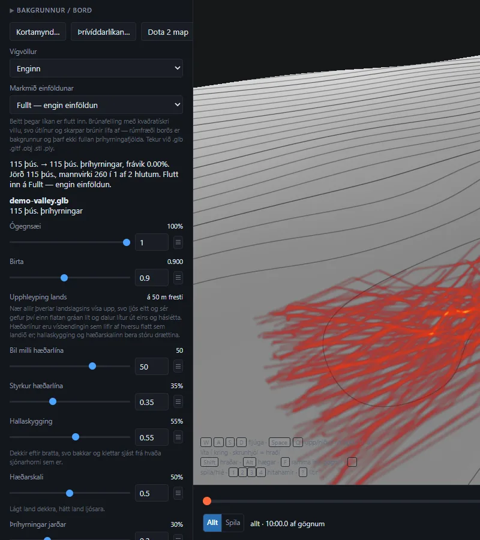

# Borð og bakgrunnsform

Borð er þrívíði staðurinn þar sem leikurinn fór fram - kort, bær, braut. Settu eitt á bak við gögnin og þú sérð *hvar* hitinn er. Spjaldið **Bakgrunnur / borð** (sjá [Orðasafn](glossary.md) fyrir "borð") gefur þér þrjár tegundir samhengis:

- **kortamynd**, staðsett með tveimur akkerum - sjá [Kortamyndir](map-images.md);
- **þrívítt borð** - `.glb`, `.gltf`, `.obj`, `.stl` eða `.ply` - skipt í jörð, mannvirki og vatn og einfaldað við innlestur - sjá [Þrívíð borð](model-levels.md) og [Útlit borðs](level-appearance.md);
- **bakgrunnur heimsins** - fyrir upptöku sem segir hvar á jörðinni hún er (Tacview ACMI-skrá), raunverulegt landslag, vegi, vatn, flugvelli og byggingar, sótt úr opnum gögnum - sjá [Bakgrunnur heimsins](world-backdrop.md).

Þegar ekkert er hlaðið er sviðið dökkt með hnitaneti og lituðum ásum (**Hnitanet** og **Ásar** í [Myndavél og sena](camera.md)), og spjaldið segir *Ekkert hlaðið — senan sýnir hnitanet og ása. Bættu við kortamynd eða möskva borðs til að gefa hitanum samhengi.*

Borðið er sameiginlegt fyrir alla þrjá flipana: braut sem hlaðin er í flipanum Kappakstursgreining er sama borð og hitakortið sýnir.

## Settu borð á bak við gögnin þín {#put-a-level-behind-your-data}

1. Hladdu gögnunum fyrst ([Hvernig gögn eru sett inn](getting-data-in.md)), svo borðið sé stillt að þeim.
2. Opnaðu **Bakgrunnur / borð** í hliðarstikunni.
3. Ýttu á **Kortamynd…** fyrir mynd eða **Þrívíddarlíkan…** fyrir þrívítt borð, og veldu skrána. Fyrir upptöku úr raunheiminum notaðu **Raunheimur sem bakgrunnur** eða **Vígvöllur** í staðinn.
4. Bíddu þar til framvindulínan klárast. Stórt líkan er fyrst einfaldað (sjá **Markmið einföldunar** hér að neðan).
5. Ýttu á **F** í sýninni til að ramma allt inn. Notaðu **Ógegnsæi** og **Birta** þar til hitinn sker sig úr borðinu.
6. Ýttu á **Vista í safn** ef þú ætlar að nota borðið aftur ([Borðasafn](level-library.md)).

## Hvað borð gerir fyrir hitann {#what-a-level-does-for-the-heat}

- Það **hylur**: gagnapunktar á bak við það eru dekkaðir eftir yfirborði, og gagnapunktar á bak við landslagið eru faldir ([Dýpt og útilokun](depth-and-culling.md)). Án borðs er engin hulning.
- Það er **skorið** af [Sneiðinni](slice.md) og, með *Skera borðið líka*, af [útilokun eftir fjarlægð](depth-and-culling.md#distance-culling), ásamt hitanum.
- Það er eina atriðið sem [dýptarskerpa](camera.md#depth-of-field) mýkir, auk hnitanetsins og kassanna.
- Þrívítt borð **víkkar fjarlæga plan myndavélarinnar** þegar það er stærra en gögnin: nær og fjær eru stillt út frá gagnasafninu, og útflutt kort sem er nokkra kílómetra á breidd væri annars alveg á bak við fjarlæga planið og skildi eftir tóma sýn. Fjarlæga planið verður 3 × lárétt útbreiðsla borðsins þegar það er stærra, nærplanið færist með því (að minnsta kosti fjær / 100.000) til að halda dýptarnákvæmninni sem hulningin byggir á, og flughraðinn er hækkaður í að minnsta kosti útbreiðsla / 12. Það er aðeins víkkað, aldrei þrengt.

## Spjaldið, að ofan og niður {#the-panel-top-to-bottom}

| Hluti | Nánar |
|---|---|
| **Kortamynd…**, **Þrívíddarlíkan…** | Hlaðið inn einu; það kemur í stað núverandi borðs. |
| **Raunheimur sem bakgrunnur**, **Gleyma kortareitum** | Aðeins fyrir gagnasafn með landfræðilegri tilvísun: byggir raunverulega staðinn undir því sem borð, eða eyðir sóttum kortareitum. [Bakgrunnur heimsins](world-backdrop.md) |
| **Markmið einföldunar** | Þríhyrningafjárhagsáætlunin fyrir næsta innlestur líkans: *Fullt — engin einföldun* (sjálfgefið), *Hátt — 8 millj. þríhyrninga*, *Miðlungs — 3 millj. þríhyrninga*, *Lágt — 800 þús. þríhyrninga*, *Útlína — 100 þús. þríhyrninga*. [Þrívíð borð](model-levels.md#simplification) |
| Framvinda og **Hætta við** | Meðan afkóðað er eða líkan flutt inn. |
| Innlestursathugasemd | Þríhyrningar fyrir og eftir, skiptingin í jörð / mannvirki / vatn, smáatriðastigið sem var notað. |
| Heiti og stærð | `width×height px · x × z m/px` fyrir mynd, `N þríhyrningar (úr M)` fyrir líkan. |
| **Ógegnsæi**, **Birta** | Báðar tegundir. |
| Stýringar myndar | **Afmetta**, **Snúa norðri/suðri við**, **Staðsetning** (tvö akkeri), **Laga að mörkum gagnanna**, **Hæð**. [Kortamyndir](map-images.md) |
| Stýringar líkans | Landhæðir, vatn, jarðþríhyrningar, vírgrind, áferð, fanguð litur, mannvirki, flokkun hluta. [Útlit borðs](level-appearance.md) |
| **Vista í safn**, **Fjarlægja** | [Borðasafn](level-library.md); Fjarlægja tekur borðið úr hleðslu. |
| **Safn** | Borð sem eru geymd í þessum vafra. [Borðasafn](level-library.md) |

## Síður í þessum hluta {#pages-in-this-section}

- [Kortamyndir](map-images.md)
- [Þrívíð borð](model-levels.md) - snið, hlutar, flokkun, einföldun, áferð
- [Útlit borðs](level-appearance.md) - hver stjórn fyrir þrívítt borð
- [Borðasafn](level-library.md)
- [Bakgrunnur heimsins](world-backdrop.md) - raunverulegi heimurinn undir upptöku, úr opnum gögnum

Hvernig borð eru tekin úr leikjum og vélum er verk aðskildu útflutningsverkfæranna (sjá [README](https://github.com/Holdi601/3DHeat/blob/main/README.md) geymslunnar); samningurinn sem þau skrifa eftir er tekinn saman í [Þrívíð borð](model-levels.md#the-exporter-contract).
