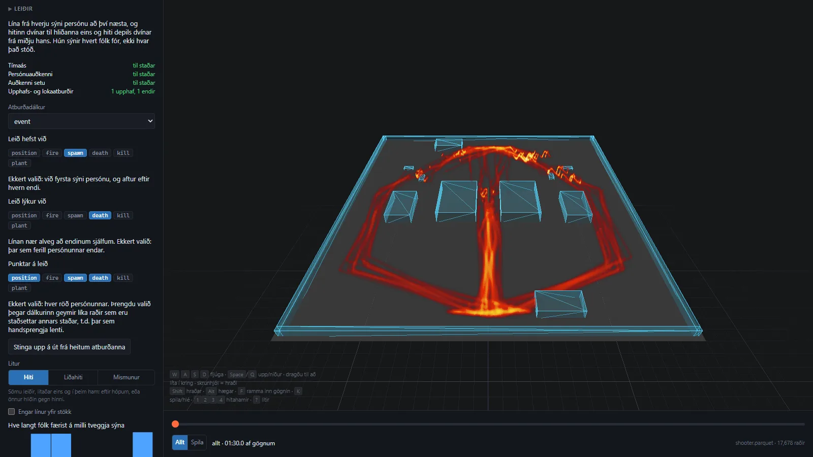

# Línuhiti

Hiti sýnir hvar fólk stóð. Línur sýna leiðirnar sem það gekk.

**Línur** (takki 4) er línuhiti: ein lína frá hverju sýni [persónu](glossary.md) að þeirri næstu, dreifð með sama dofnun og [sprite](glossary.md) hefur - þvert yfir línuna í stað þess að vera í kringum punkt. Hún sýnir hvert fólk *fór* frekar en hvar það stóð: gangur sem er farinn einu sinni sést jafn vel og herbergi sem er dvalið í, og hratt spilari með strjál sýni tengist í samfellda leið í stað punktaslóðar. Hún þarf persónudálk og tímadálk.

## Hvernig á að nota hana {#how-to-use-it}

1. Ýttu á `4` (eða veldu **Línur** í hamastikunni).
2. Opnaðu **Leiðir** og athugaðu græna gátlistann: tímaás og persónuauðkenni verða að vera til staðar.
3. Ýttu á **Stinga upp á út frá heitum atburðanna** til að fylla inn hvar leiðir byrja og enda.
4. Lestu tölfræðilínuna: "N leiðir, M þeirra ná enda".
5. Ef línur stökkva yfir kortið, stilltu **Lengsta skref** (sjá [Stökkmörkin](#the-jump-limit)).

Lína hefur aðeins merkingu milli upphafs og enda, svo **Leiðir**-spjaldið segir hvað afmarkar leið. Allt frá [Reglunum um leið](#the-rules-of-a-route) og áfram eru smáatriði sem þú mátt sleppa.

## Leiðaspjaldið {#the-routes-panel}

Birtist fyrir ofan hitaspjöldin í Línu-ham.

### Hvað gögnin hafa {#what-the-data-has}

Gátlisti, grænn þegar atriðið er til staðar, gulur þegar ekki:

| Lína | Staða |
|---|---|
| **Tímaás** | *til staðar* / *vantar - þarf* |
| **Persónuauðkenni** | *til staðar* / *vantar - þarf* |
| **Auðkenni setu** | *til staðar* / *engin - allar raðir eru ein lota* |
| **Upphafs- og lokaatburðir** | *N upphöf, M lok* / *enginn valinn - heil spor* (grænt aðeins með atburðadálki og að minnsta kosti einu upphafi og einu lokum) |

### Stýringar {#controls}

| Stýring | Merking |
|---|---|
| **Atburðadálkur** | Flokksdálkur þar sem gildin eru atburðir (spawn, death, position, ...). *Enginn - heil spor*: spor hverrar persónu í hverri lotu er ein leið, brotin þar sem sporið hefur bil. Aðeins dálkar sem geymdir eru til síunar við hleðslu eru boðnir. |
| **Leið hefst við** | Atburðagildi sem hefja leið (spawn, respawn, deploy). Enginn valinn: leið byrjar við fyrsta sýni persónunnar, og aftur eftir hvern endi. |
| **Leið lýkur við** | Atburðagildi sem enda leið (death, extraction, teleport). Línan nær upp að endaröðinni sjálfri. Enginn valinn: leið endar þar sem spor persónunnar endar. |
| **Punktar á leið** | Atburðagildi sem raðirnar liggja eftir leiðinni. Enginn valinn: sérhver röð persónunnar. Þrengdu það þegar dálkurinn geymir líka raðir sem eru annars staðar, eins og þar sem sprengja lenti. |
| **Stinga upp á út frá heitum atburðanna** | Fyllir listana þrjá út frá heitum gildanna (hér fyrir neðan). |
| **Litur** | *Hiti*, *Liðahiti* eða *Mismunur*. Sömu leiðir í litavali þess hams: hver hópur í sínum lit, eða önnur hlið gegn hinni, með hópalistanum, skiptingunni og skölunum sem virka eins og í þeim hömum. Sjálfgefið *Hiti*. Liðahiti og mismunur þurfa hópdálk. |
| **Engar línur yfir stökk** / **Lengsta skref** | Næsta sýni persónu sem er lengra í burtu er endurlífgun, fjarflutningur eða fall en ekki staður sem hún fór á, svo engin lína tengir þau tvö. Fyllist út við hleðslu þegar gögnin sýna greinilegt bil (hér fyrir neðan), og er slökkt þegar þau gera það ekki. Virkar með eða án atburðadálks. |
| Tölfræðilína | `N leiðir, M þeirra ná enda, K hlutar`, uppfærð nokkrum sinnum á sekúndu. |

Hver listi er röð af rofamerkjum, eitt fyrir hvert gildi, algengasta fyrst; bendill á merki sýnir fjölda raða þess. Mest 120 gildi eru boðin (*N fleiri gildi ekki sýnd*).

Þegar annar atburðadálkur er valinn er tillagan notuð ef hún velur sama dálk, og listarnir byrja tómir annars.

### Tillagan {#the-suggestion}

Við hverja hleðslu, og við **Stinga upp á út frá heitum atburðanna** ([`suggestLineSettings`](https://github.com/Holdi601/3DHeat/blob/main/src/data/lines.ts)):

- **Atburðadálkur:** fyrsti geymdi flokksdálkurinn sem heitir `event`, `eventname` eða `eventtype`; annars `kind`, `type` eða `action`; annars hver sem inniheldur *event*, *kind*, *action* eða *type*.
- **Upphöf:** gildi sem innihalda *spawn, deploy, join, enter, start, begin, respawn, revive, land/landed/landing, drop* - nema þau passi líka við lokaorð.
- **Lok:** gildi sem innihalda *death, died, dead, kill/killed, eliminat…, extract, evac, teleport, leave, left, disconnect, quit, exit, end, finish, downed* - nema gildin `kill` og `kills` (drápið er það sem drepandinn gerir, ekki endi leiðar hans).
- **Punktar:** gildi sem eru nákvæmlega *position, location, player location, move, movement, tick, sample* eða *pos*; þegar eitthvað af þeim finnst eru upphöf og lok líka bætt í punktana. Þegar ekkert finnst eru punktar auðir (sérhver röð).

### Stökkmörkin {#the-jump-limit}

Þar sem fólk stekkur falla lengdir skrefanna í tvo hópa með nánast engu á milli: það sem persóna fer á milli tveggja sýna, og breidd kortsins. Við hleðslu ([`suggestMaxJump`](https://github.com/Holdi601/3DHeat/blob/main/src/data/lines.ts)) eru skrefin talin í hverri tvöföldun á ferningi lengdar þeirra, allt að 16 milljónum, og mörkin fara í miðju fyrsta bilsins fyrir ofan miðgildið sem er að minnsta kosti ein tvöföldun á lengd breitt, heldur undir 0,02% skrefa í hverju bili og hefur skref handan þess. Án slíks bils er ekkert skorið, því þá væri ekki hægt að greina stökk frá hraðskreiðum bíl; að kveikja á mörkunum handvirkt byrjar þá á tíunda hluta af ská gagnanna.

Línuritið fyrir ofan mörkin sýnir hversu löng skrefin eru í raun, með línu við mörkin: stikurnar hægra megin við hana eru ekki teiknaðar. Báðir ásar eru lógaritmískir, því stökkin geta verið hundraðasti hluti skrefanna og þúsund sinnum lengri. Bendill á stiku sýnir bil hennar og hlutdeild; smellur á línuritið setur mörkin þar. Undir því er hlutdeild skrefa yfir mörkunum.

## Reglurnar um leið {#the-rules-of-a-route}

Raðirnar eru raktar í tímaröð, fyrir hverja persónu ([`buildLines`](https://github.com/Holdi601/3DHeat/blob/main/src/data/lines.ts)):

1. Raðir [sameiginlegs heitis](sessions-persons-groups.md#names-worn-by-several-things-at-once) eru alveg sleppt.
2. Þegar punktar eru valdir er röð sem er hvorki upphaf, endi né punktur sleppt.
3. Raðir eru raktar fyrir hverja persónu í hverri lotu, svo persóna sem lotur skarast í tímaröð hefur eina leið í hverri. Leið er lokað þegar fyrri röðin hafði enga eftirmynd (líftími hennar ([líftími](sessions-persons-groups.md#person)) er "enginn") - leið fer aldrei yfir mörk lotu eða bil sem hleðslan ákvað að hafi ekkert næsta sýni. Á hvaða leið röð er er reiknað einu sinni og geymt, 4 bæti á röð, svo breyting á lengsta skrefi endurtekur ekki þann hluta.
4. **Upphafsröð** lokar hvaða opinni leið sem er og opnar nýja þar.
5. Þegar upphöf eru valin er röð utan leiðar hunsuð. Án upphafa opnar sérhver röð sem er ekki endi utan leiðar eina.
6. Sérhver önnur röð innan leiðar bætir við **hluta** frá fyrri röð leiðarinnar að þessari.
7. **Endaröð** sem lengir leið lokar henni eftir hlutann sinn; sú leið telst *ná enda*.
8. Skref lengra en **Lengsta skref** lokar leiðinni þar sem hún var, og ný leið byrjar við fjarlæga enda, nema sú röð sé endi. Engin lína er teiknuð yfir það og tölfræðilínan telur það.

Hver hluti er geymdur á *enda*röðinni sinni, svo hlutarnir haldast í tímaröð, og [tímalínuglugginn](timeline.md), sýnishorninn, [síurnar](filters.md), sýnileiki hópa og formerki mismunarins virka á þá eins og á punkta. Sía gildir því um röðina sem hlutinn endar á.

## Spilun {#playback}

Í **Allt**-ham er hver leið teiknuð heil. Í **Spila**-ham er hver persóna punktur sem hreyfist á milli sýna sinna og dregur leið sína á eftir sér:

- hluti sem byrjar eftir leshausinn er ekki teiknaður;
- hlutinn sem persónan er í miðjunni á er teiknaður upp að innreiknaðri stöðu hennar, með endalokum við hausinn;
- hitinn dofnar yfir **halann**: með sögunni *Uppsafnað* er halinn ótakmarkaður og öll leiðin hingað til helst; með *Gluggi* dofnar hann í ekkert yfir *Bilið* (sjálfgefið 30 s). Með *Líftíma* er halinn líka *Bilið*, og í Línu-ham sýnir tímalínan *Bilið*-reitinn fyrir þá sögu líka (í stað *Varaaldur* og *Dofnun*, sem línuhiti notar ekki).

Meðan spilað er er hver rammi teiknaður heill í stað þess að safnast upp, því hausarnir hreyfast í hverjum ramma og hreyfanlegt meðaltal myndi dreifa hverjum þeirra í rák.

## Fyrir forritara {#for-developers}

### Minni {#memory}

Leiðirnar eru byggðar á aðalþræðinum þegar farið er í Línu-ham (eða leiðastillingar breytast) og losaðar þegar yfirgefið er: 5 bæti á röð í minni og 8 bæti á röð á skjákortinu (upphafsstaða hvers hluta, kvöntuð í 16 bita á ás innan rammans utan um gögnin, og fánar hans).

### Hvernig lína er teiknuð {#how-a-line-is-drawn}

Báðir bakendar teikna hvern hluta frá endaröð sinni sem **18 hornpunkta** ([`lineHeatVs`](https://github.com/Holdi601/3DHeat/blob/main/src/render/webgl2/shaders.ts) og WGSL-tvíburi hans):

- Hálfbreidd við hvern enda er [sprite-radíusinn](sprite-shape.md#sprite-radius) í fjarlægð þess enda, með pixlamörkunum beitt. Lína mjórri en 2,5 px er teiknuð 2,5 px breið með hitanum skalaðan niður til samræmis, svo þunnar línur hvorki hverfa né skína skærar.
- Hitinn dofnar **þvert yfir** línuna með sama skala og sprite - dofnun eða feril, miðju- og jaðarstyrkur.
- Hringlaga endalok eru teiknuð **aðeins** þar sem leið byrjar eða endar, svo samskeytin milli samliggjandi hluta kornist ekki í perlufesti.
- Rúmfræðin er byggð í skjárýmið og túlkuð línulega þar, svo dofnunin helst miðjuð á línunni hvernig sem hún fer inn í dýptina. Hluti sem fer yfir nærplanið er skorinn þar í stað þess að vera sleppt.

Punktahiti og línuhiti leggja mjög mismunandi hita á röð, svo mettunin er mæld aftur þegar skipt er á milli þeirra ([Litir og lýsing](colour-and-exposure.md#auto-exposure)).
