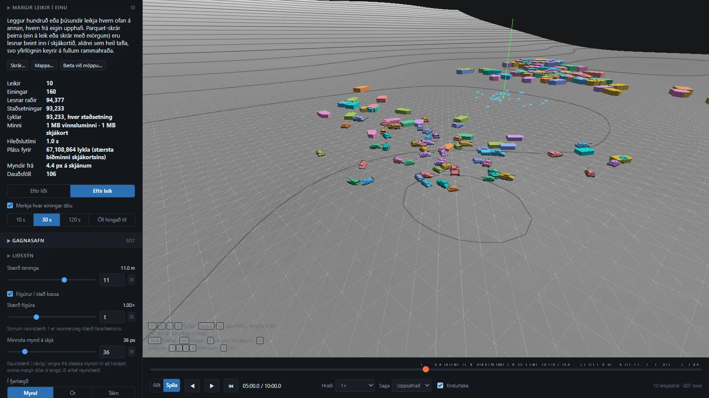

# Margir leikir í einu

**Margir leikir í einu** spilar marga leiki ofan á hvorn annan, svo þú sérð hvert leikmenn hvers leiks fara yfirleitt. Notaðu hann til að bera saman hundruð eða þúsundir leikja á einni mynd.

Hver leikur byrjar á sínu eigin upphafi og einingar hans hreyfast sem fígúrur. Skrárnar fara beint inn á skjákortið og engin heil tafla er byggð, svo hann spilast vel þar sem venjuleg hleðsla myndi klárast af minni.

## Hvernig þú notar hann {#how-to-use-it}

1. Opnaðu **Margir leikir í einu** í hliðarstiku Heatmap.
2. Ýttu á **Skrár…** (veldu margar skrár), **Mappa…** (mappa og undirmöppur hennar) eða **Bæta við möppu…** (bætir við það sem er hlaðið).
3. Skoðarinn skiptir yfir í fígúruyfirlagið og byrjar á upphafinu. Ýttu á **Spila**.

Hver skrá er einn leikur (eða geymir nokkra). Parquet-skrár og [`.3dheat`](container.md)-geymslur virka. Skrá þarf staðsetningu, tíma og einingadálk; nafn-, gerðar- og liðsdálkar eru geymdir. Aðrar skrár, og hliðarskrár breytanna (flug, skilaboð, atburðir, spjall, markmið), eru sleppt. Fyrir venjulega töflu, sjá [Að sækja gögn](getting-data-in.md).

## Stillingar {#settings}

| Stilling | Hvað hún gerir |
|---|---|
| **Eftir liði** / **Eftir leik** | Lita eftir hlið, eða lit fyrir hvern leik. |
| **Merkja hvar einingar dóu** | Merki þar sem hver eining dó, í 10 s, 30 s, 120 s, eða allt hingað til. |

Spjaldið sýnir hversu marga leiki, einingar, línur og staðsetningar voru lesnar, minnið sem var notað og hleðslutímann. *Rými fyrir* er hversu margar fleiri staðsetningar skjákortið gæti enn tekið við. *Fígúrur frá* er stærðin á skjánum þar sem undir henni er eining teiknuð sem lítil ör í stað fígúru sinnar.

Útlit fígúranna notar sömu stýringar og [endurspilun leiks](match-replay.md#figures): **Stærð fígúra**, **Minnsta mynd á skjá** og **Í fjarlægð**.

## Ábendingar {#tips}

- Þegar allt myndi ekki passa í minni eru staðsetningar grisjaðar (aðeins ein staðsetning á nokkurra metra fresti er geymd) og spjaldið segir frá því.
- Hitahamarnir virka líka á gögnum yfirlagsins.
- Fyrir tölfræði yfir þúsundir leikja án þess að teikna þá, sjá [Fjöldagreiningu](mass-analysis.md).
