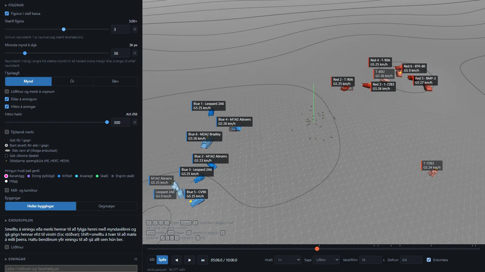
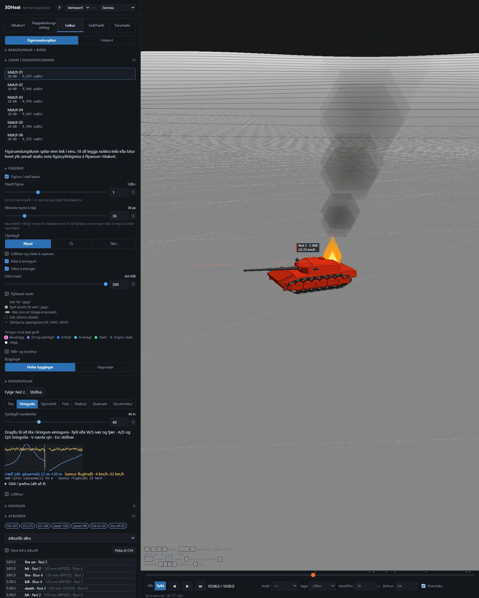
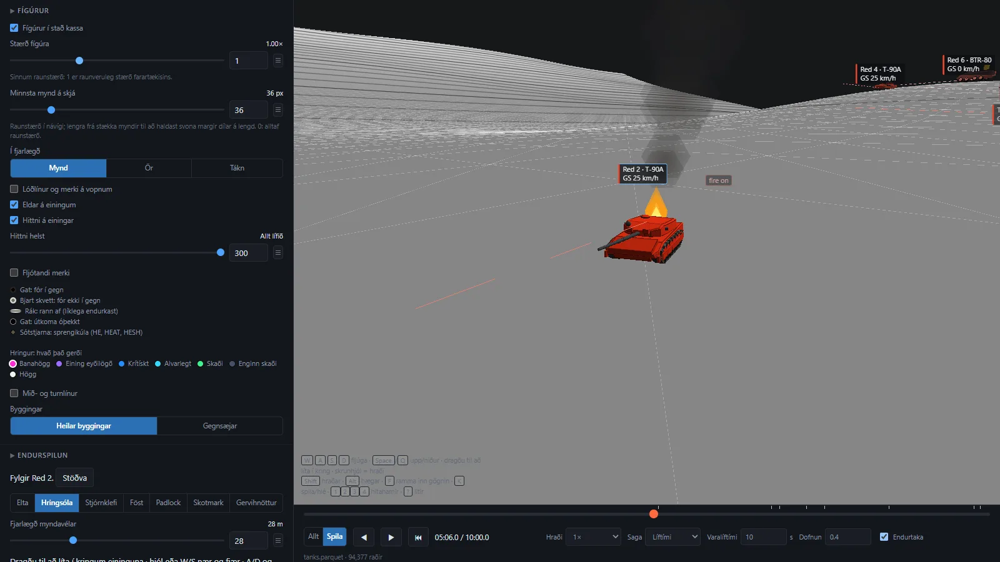
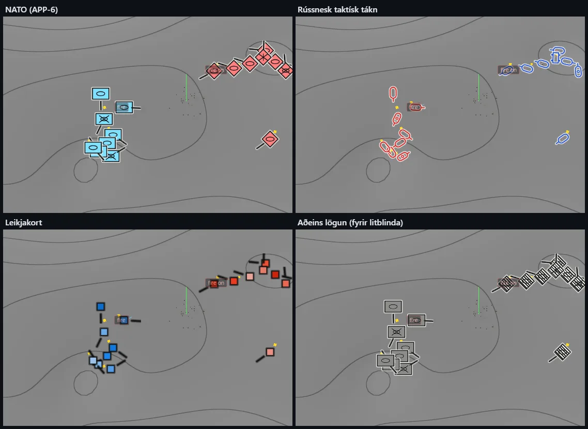
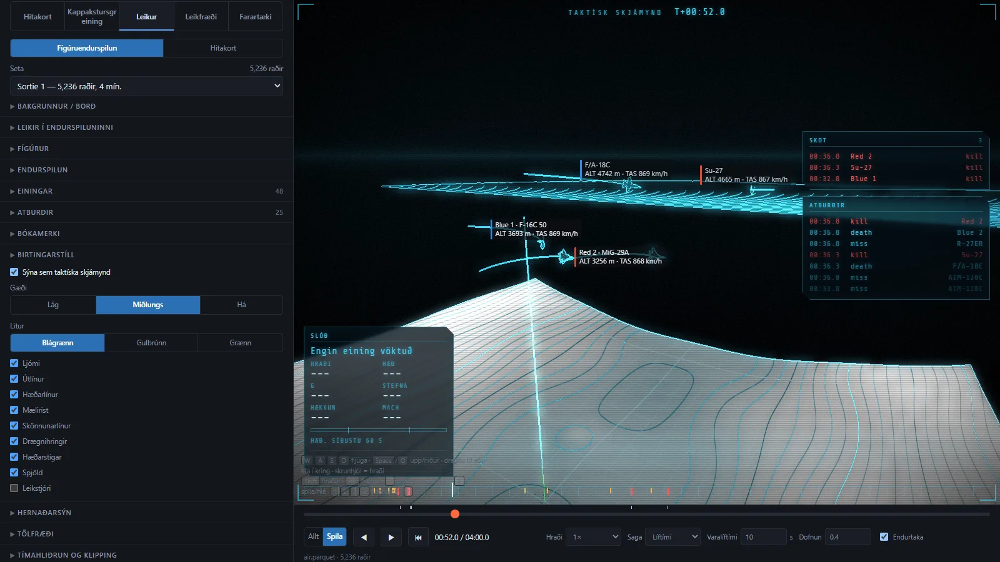
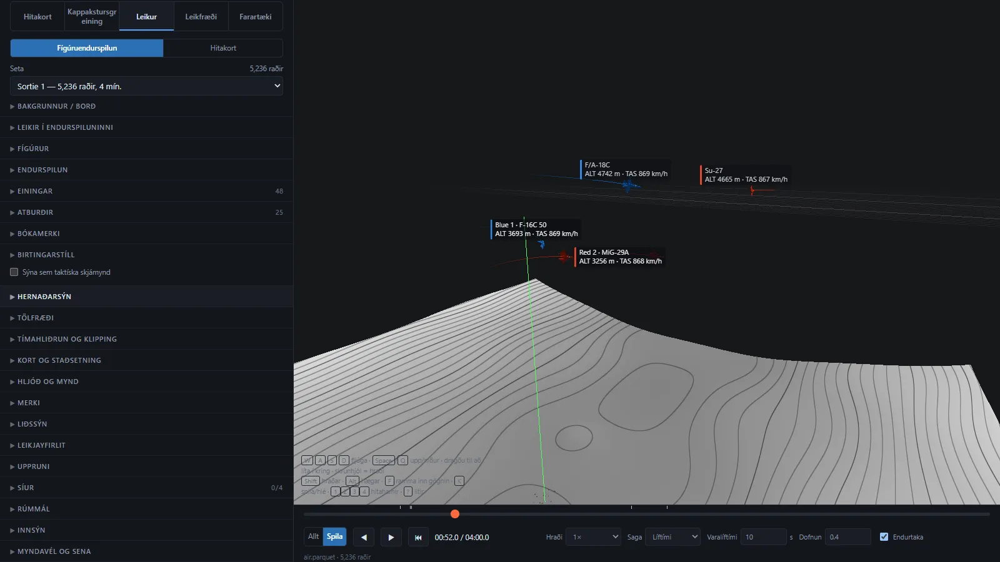

# Endurspilun leiks

Endurspilunin er kvikmynd af leiknum þar sem hver leikmaður er teiknaður sem það sem hann ók. Notaðu hana til að horfa á bardaga aftur, fylgja einni einingu og sjá hver hitti hvern.

Skot, hittni, eldar og flak eru teiknuð á einingarnar og markmiðin á borðinu. Myndavélar, merkingar og taktísk skjámynd hjálpa þér að lesa bardagann. Þekkir þú Tacview? [Samræmi við Tacview](tacview-parity.md) sýnir hvar hvert af verkfærunum er.

## Byrja endurspilun {#start-a-replay}

1. Hladdu upptöku með **Uppspretta → Skrár…** eða með því að sleppa henni á Uppsprettuspjaldið (hvaða tafla sem er með dálkinn **manneskja** og dálkinn **tími**, Tacview-skrá, umbreytt endurspilun, [`.3dheat`](container.md)-leikur). Sjá [Hvernig gögn eru sett inn](getting-data-in.md).
2. Opnaðu flipann **Leikur** og veldu **Fígúruendurspilun**, eða veldu **Fígúruyfirlögn** í valstiku Hitakortsflipans.
3. Undir **Leikir í endurspiluninni** veldu einn leik, alla í einu, eða nokkra.
4. Ýttu á **Spila** á tímalínunni (eða `K`). Dragðu tímalínuna til að stökkva.

Fígúrur koma í stað kassa fyrir hverja einingu þar sem nafn eða tegund er þekkt (sjá [Fígúrur](figures.md)). Gögn án nafna- eða tegundadálks eru teiknuð sem hermenn.

## Fígúrur {#figures}

| Stilling (hluti **Fígúrur**) | Sjálfgefið | Hvað hún gerir |
|---|---|---|
| **Fígúrur í stað kassa** | á | Slökkt teiknar einfalda kassa. |
| **Stærð fígúra** (sinnum raunstærð) | 1 | 1 er raunstærð; 0,25 til 20 sinnum (lógaritmískur kvarði). Stærra hjálpar úr fjarlægð. |
| **Minnsta mynd á skjá** | 36 px | Fígúrur í fjarlægð stækka til að vera þessi stórar, 0 til 200 px; 0 heldur raunstærð. |
| **Í fjarlægð**: Fígúra, Ör, Tákn | Fígúra | Hvað eining í fjarlægð verður. |
| **Tákn** | NATO (APP-6) | NATO (APP-6), rússnesk taktísk tákn, tákn úr **Leikjakorti**, eða **Aðeins lögun (fyrir litblinda)**. |
| **Stærð tákns**, **Mín hlið**, **Fjandsamlegt / Hlutlaust**, **Stefnustrik** | 28 px (12 til 64), sjálfvirkt, fjandsamlegt, á | Hvernig táknin líta út og hvaða hlið er vinveitt. |
| **Lóðlínur** | á | Lína frá hverri einingu beint niður á jörð, svo hæðir sjást í þrívídd. |
| **Lóðlínur og merki á vopnum** | slökkt | Línur niður á jörð og merki á eldflaugum og sprengjum. |
| **Eldar á einingum** | á | Eldtungur frá því að eining kviknar þar til slökkt er. |
| **Hittni á einingar** | á | Merki þar sem skot hittu (að neðan). **Hittni helst**: 1 til 300 sekúndur, eða **Allt lífið**. **Fljótandi merki**: merki sem eru teiknuð fyrir ofan yfirborðið. |
| **Mið- og turnlínur** | slökkt | Strikaðar: hvert leikmaðurinn horfir; heilar: hvert byssan miðar. |
| **Byggingar** | heilar | Heilar eða gegnsæjar byggingar, þegar borðið teiknar þær. |

### Tákn í fjarlægð {#symbols-at-a-distance}

Þegar eining væri minni en **Minnsta mynd á skjá**, getur hún orðið að tákni sem er læsilegt. Lögunin segir til um tegundina (til dæmis ávöl kassi með beltismerki fyrir brynvarin farartæki); liturinn segir til um hliðina. Opnaðu valmyndina **Tákn** til að breyta útlitinu.

### Höggmerki, flak og eldar {#hit-marks-wrecks-and-fires}

- **Höggmerki** sitja á yfirborðinu sem skotið mætti, í kvarða fígúrunnar. Útlitið segir til um hvað gerðist: gat (fór í gegn), björt skvetta (fór ekki í gegn), rispa (skoppaði af), sótstjarna (sprengikúla). Litaður hringur segir hvað það gerði: banaskot, eining eyðilögð, lykilhögg, alvarlegt, skaði, enginn skaði, hitt. Færðu bendilinn yfir merkið til að sjá heiti skotsins.
- Eyðilögð eining er teiknuð **sviðin** sem flak frá dauða sínum þar til hún lifnar við aftur eða er fjarlægð; táknið hennar er krossað út.
- **Eldar** brenna á einingu frá því að hún kviknar þar til slökkt er.
- **Turnar** snúast þangað sem gögnin segja að byssan miði (eða, án þeirra, þangað sem leikmaðurinn horfir).

### Vopn, gildrur og rekjur {#weapons-decoys-and-tracers}

Með **Vopn, skot og hittni** á (hlutinn Sýn liðs): eldflaugar, sprengjur og tundurskeyti fljúga sem eigin fígúrur með reykslóð; byssukúlur og skeljar eru rekjur; áhrif og sprengingar blossa upp. Rekja sem er teiknuð **strikuð** var reiknuð út frá hittni, því gögnin höfðu ekkert skot. Blys og flís eru teiknuð sem gildrur; þau eru falin á einingalistanum nema *Gildrur og skeljar* sé hakað við.

## Myndavélar {#cameras}

Smelltu á einingu eða merki hennar til að **fylgja** henni; hlutinn **Endurspilun** býður upp á **Elta**, **Hringsóla**, **Stjórnklefa** (með höfuðskjá, `H`), **Föst**, **Padlock**, **Skotmark** og **Gervihnött**. `V` skiptir á milli þeirra, **Fjarlægð myndavélar** segir til um hversu langt. Esc hættir.

- **Sýn á tvær einingar**: veldu **Skotmark** (eða smelltu á einingu með Ctrl/Alt) til að horfa á hana frá þeirri sem er fylgt; **Skipta** skiptir þeim.
- **Mæla**: Shift-smelltu á tvær einingar fyrir stefnu, drægni og hæðarmun á milli þeirra.
- **2D kort** (`M`): horn eða öll mynd, með slóðum og nöfnum.
- **Bókamerki** (`B`): vistaðu augnablikið og myndavélina; dráp, dauðsföll og merki upptökunnar sjálfrar eru líka á listanum.
- **Atburðir**: hver atburður í tímaröð; smellur stekkur þangað. `Page Up` / `Page Down` stökkva milli atburða; **Gera hlé á atburði** stöðvar við hvern þeirra.

## Hernaðarsýn {#tactical-display}

Hlutinn **Hernaðarsýn** teiknar, fyrir enga einingu, þær sem eru valdar, allar, eða eina tegund (loftför, á landi, skip, vopn): hraðavigra og leiðina framundan, nef- og lyftulínur, ratsjárkeilur, læsingar, gagnatengingar, bardagasvæði og -línur, sjónlínur, hvert leikmenn horfa (sjónkeilur), miðun turna og myndavélina eins og hún var tekin upp.

### Útlit skjámyndar {#display-style}

`T` (eða rofinn **Sýna sem taktíska skjámynd**) skiptir yfir í útlit eins og ratsjárskjá: glóð, útlínur, hæðarlínur, mælingarnet, skannalínur, drægnishringir, hæðarstigar, spjöld með dráp og atburðum, og **Leikstjóri** sem færir myndavélina að atburðum af sjálfsdáðum.

## Markmið {#objectives}

Þegar leikur kemur með markmiðum sínum, teiknar hlutinn **Markmið** þau á borðinu: landvinningasvæði (með eiganda og framvindu landvinninga), upphafsstaði, flugvelli, svæði og sprengjuskotmörk, þar sem hvert lag er hægt að kveikja og slökkva á, með merkingum. Þau sjást í gegnum jörðina. Þegar nokkrar leikjastillingar eru hlaðnar síar **Hamur** leikina eftir stillingu. Markmiðin koma úr leikjaskrá umbreytis sem liggur við upptökuna eða inni í [`.3dheat`](container.md)-íláti.

Rainbow Six Siege-leikir koma með sprengjustaðina sína: tvö herbergi hvers staðar eru teiknuð á gólfið sitt sem útlínur með nöfnum sínum, fundin út frá því hvar leikmennirnir stóðu meðan leikurinn nefndi herbergið; staður á kortinu sem var ekki spilaður í leiknum kemur úr töflu breytisins yfir staði sem hringur. Í endurspiluninni lýsist staður lotunnar við spilunarstöðuna í gulbrúnu, hinir haldast gráir. Þeir eru hluti af laginu fyrir yfirtökusvæði.

## Merkingar og tölfræði {#labels-and-statistics}

- **Merkingar**: reglur fyrir hverja tegund (**Valdar**, **Loftför**, **Land**, **Skip**, **Vopn**, **Gervigreind**): sýndar eða ekki, hvaða gildi, og **Forgangur** fyrir það hver fær plássið þegar merkingar skarast. **Halda merkjum aðskildum** færir merki við hlið einingarinnar þegar það myndi hylja aðra, og sleppir því þar sem ekkert pláss er. **Stærð merkja** er 60 til 250%. **Aftur í nafn, farartæki, hæð og hraða** endurstillir reglurnar.
  - Einingar á landi byrja með nafni, farartæki og hraða.
  - Loftför byrja með nafni, farartæki, hæð og hraða.
  - Skip byrja með nafni, farartæki, hraða og stefnu.
  - Færðu bendilinn yfir einingu til að sjá öll gildi hennar.
- **Tölfræði**: fyrir hvert lið og einingu: dráp, dauðsföll, skot, hittni, hlutfall hittni, flugtök, lendingar, tími á lofti, hámarkshraði, hæð og G, vegalengd. Útflutningur í CSV.
- **Gröf**: gildi einingar yfir tíma, tvær einingar bornar saman, eða eitt gildi borið saman við annað.

## Margir leikir í einu {#many-matches-at-once}

Til að leggja hundruð eða þúsundir leikja hvern yfir annan, sjá [Margir leikir í einu](many-matches.md). Nánari upplýsingar um fígúrur (reykur, eldur, aðrar tímasettar brellur): [Fígúrur í fígúruyfirlögninni](figure-replay.md). Listi yfir Tacview-eiginleika: [Samræmi við Tacview](tacview-parity.md), undirsíða þessarar.
