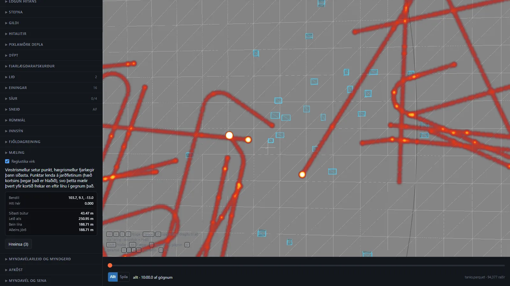

# Mæling

**Mælikvarði** breytir músinni í reglustiku og segir þér hversu annasamur reiturinn undir bendlinum er. Notaðu hann til að finna hversu langt er á milli tveggja staða, eða hversu mikil umferð er á einum stað.

## Prófaðu {#try-it}

1. Opnaðu **Mælikvarði** í hliðarstikunni og hakaðu við **Reglustika virk**.
2. Smelltu með vinstri takka á þrjá staði á kortinu. Hver smellur setur punkt.
3. Lestu **Leið alls** (lengd allrar leiðarinnar) og **Síðasti bútur** (síðasta bútinn).
4. Hægrismelltu til að fjarlægja síðasta punktinn, eða ýttu á **Clear (3)** til að fjarlægja alla.

| Aðgerð | Áhrif |
|---|---|
| Vinstri smellur | Setur punkt þar sem bendillinn mætir jarðfletinum. Smellur sem færði sig meira en 4 pixla milli ýtingar og sleppingar er myndavélardráttur, ekki punktur. |
| Hægri smellur | Fjarlægir síðasta punktinn. |
| Hreyfing | Staða bendilsins og hitinn undir honum uppfærist í rauntíma. |

Myndavélin virkar áfram á meðan reglustikan er á: að draga lítur enn í kring, og lyklarnir fljúga enn. Á meðan reglustikan er á tekur hún alla smelli, svo [smella-til-að-velja](camera.md#click-to-pick) bíður þar til hún er slökkt.

**Jarðflöturinn** er hæð [kortamyndarinnar](map-images.md) þegar kortamynd er hlaðin, annars lægsta Y gagnasafnsins (0 án hennar). Punktarnir lenda á honum, svo reglustikan mælir þvert yfir kortið, ekki eftir línu gegnum það. Með 3D-borði er flöturinn samt lægsta Y gagnasafnsins, ekki yfirborð borðsins - fyrir punkt á raunverulegu yfirborði skaltu slökkva á reglustikunni og smella á hann ([smella-til-að-velja](camera.md#click-to-pick)), sem les hnitin af þríhyrningum borðsins sjálfs.

## Útlestrar {#readouts}

| Lína | Merking |
|---|---|
| **Bendill** | Heimshnit X, Y, Z punktsins undir bendlinum, á fletinum. |
| **Hiti hér** | Hversu mikill hiti er á pixlinum undir bendlinum. Hærri tala þýðir meiri umferð á þeim stað. Þetta er gildið sem litastiginn fær áður en mettunarpunkturinn deilir því, svo þú getur borið það saman við [Mettunarpunktinn](colour-and-exposure.md#saturation-point). |
| **Síðasti bútur** | Fjarlægð frá síðasta punkti að bendlinum (eða á milli síðustu tveggja punkta). |
| **Leið alls** | Lengd fjölstrikslínunnar gegnum alla punktana og bendilinn. |
| **Bein lína** | Þrívíð fjarlægð frá fyrsta punkti að bendlinum (eða síðasta punkti). |
| **Aðeins jörð** | Sama, aðeins á X og Z. |
| **Clear (N)** | Fjarlægir alla punkta. |

Vegalengdir birtast í sentímetrum undir 1 einingu, metrum undir 1.000, kílómetrum yfir það - miðað við að ein heimseining sé metri ([Ásar, einingar og tími](axes-units-and-time.md#unit-scale)). Hnit eru heimshnit, líka þegar ás er [snúinn við til birtingar](camera.md#invert-world-axis).

Punktarnir og línan á milli þeirra eru teiknuð sem yfirlag í sýninni, stærð þeirra miðast við bil reitanetsins. Punktar reglustikunnar eru ekki vistaðir í sýnum; þeir haldast þegar þú hleður öðrum gögnum.

## Fyrir forritara {#for-developers}

**Hiti hér** er lesinn af GPU í mesta lagi á 120 ms fresti, því lestur á einum pixli stöðvar leiðsluna. Hann notar sömu leið og `engine.readHeatProbe()`: deilt með ávinningnum sem rammanum var skrifaður með, svo á hálffleytisöfnunarleiðinni (`?heat=f16`) er hann í sömu einingum og á 32 bita marki ([Hálffleytisöfnun](half-float-accumulation.md)).
