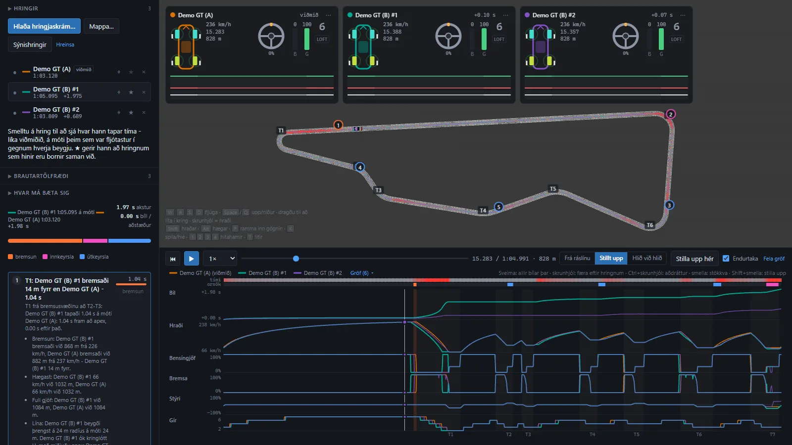

# Kappakstursgreining

Þú keyrðir sömu braut tvisvar. Flipinn **Kappakstursgreining** spilar báðar ferðirnar saman í 3D, sýnir hvar einn hringur var hægari og segir þér hvers vegna. Engir hringir enn? Ýttu á **Sýnishringir**.

Flipinn ber saman tvo eða fleiri hringi af einni braut. Hann deilir striganum, myndavélinni og líkani brautarinnar (**Bakgrunnur / borð**) með hitakortinu; allt annað er hans eigið: eigin hliðarstika og eigin stika undir sýninni. Orð eins og *hringur*, *viðmiðun* og *toppur beygju* eru í [orðasafninu](glossary.md).

Þessi síða er kort yfir flipann. Hver hluti hefur sína eigin síðu:

| Síða | Hvað hún nær yfir |
|---|---|
| [Hleðsla hringja](race-loading-laps.md) | öll skráarsnið, möppur og brautir, bílanöfn, sýnishringir, listi hringja, viðmiðun og brennidepill |
| [Endurspilun og þrívíð sviðsmynd](race-replay-and-scene.md) | stjórnstikan, þrjár endurspilunarstillingar, röðun bíla, eltimyndavélin, línur, kort, bílar, merkingar, speglaðir heimar |
| [Línurit og HUD](race-charts-and-hud.md) | fjarlægðarlínuritin, línuritsvalið, bendill og aðdráttur, bílspjöldin, rásatöflurnar |
| [Atburðir í stýringu bíls](race-control-events.md) | læsingar, spól, ofurstýring, snúningar, undirstýring, högg, árekstrar, ABS/TC, handbremsa, loft - hvernig hvert er fundið, með hverjum þröskuldi |
| [Greining beygju fyrir beygju](race-corner-analysis.md) | samræming eftir fjarlægð, beygjur og hlutar, tímareikningur beygju, hver orsök og röðin sem þær eru reyndar í, lögun línunnar og ráðin |
| [Bílasnið og samanburður](race-car-profiles.md) | hvað hver bíll getur, mælt út frá hringjum hans; *Bílar bornir saman*; hvað bíllinn ræður í hverri beygju |
| [Brautartölfræði](race-course-statistics.md) | margir hringir af einni braut: mistök eftir beygju og tegund, mistakakortið, útflutningurinn á hitakorti, afkastatakmörk |
| [Kappakstursgreining: aðferðin](race-analytics.md) | rannsóknin á bak við reglurnar, með heimildum |
| [Aðrir kappakstursleikir](other-games.md) | hvað skoðunartækið gerir við hringi úr hverjum leik: slaki og reki reiknaður þar sem leikurinn sendir þá ekki, speglaðir heimar, aukarásirnar |

## Skjárinn {#the-screen}

**Hliðarstikan**, ofan til niður (hlutar má fella saman):

1. **Hringir** - hlaða, lista, sýna/fela, viðmiðun, brennidepill, elta.
   Sjá [Hleðslu hringja](race-loading-laps.md).
2. **Brautartölfræði** - aðeins frá þremur hlöðnum hringjum.
   Sjá [Brautartölfræði](race-course-statistics.md).
3. **Hvar má bæta sig** - niðurstöður hringsins í brennidepli, beygju fyrir beygju.
   Sjá [Greining beygju fyrir beygju](race-corner-analysis.md).
4. **Beygja fyrir beygju** (eða *Beygja fyrir beygju - flokkur X* með nokkrum flokkum) - hraðasti hringurinn gegnum hverja beygju og lína hans. Birtist með tveimur eða fleiri hringjum.
5. **Stjórn á bílnum** - læsingar, rennsli, ýtingar og högg hringsins í brennidepli.
   Sjá [Atburðir í stýringu bíls](race-control-events.md).
6. **Bílar bornir saman** (eða **Bíllinn** með einum bíl) - sjá [Bílasnið og samanburður](race-car-profiles.md).
7. **Sýn** - hvaða kort er málað á brautina og hvað er teiknað.
   Sjá [Endurspilun og þrívíð sviðsmynd](race-replay-and-scene.md).
8. Sameiginlegu spjöldin **Borð** og **Myndavél og sena** (líkan brautarinnar, öfug ás, myndavél) - skjalfest með hitakortinu og [Myndavél](camera.md).

**Sýnin** sýnir brautina, ekna línurnar, kortið, bílana, merkingar festar á brautina, og allt að sex bílspjöld efst til vinstri (sjá [Línurit og HUD](race-charts-and-hud.md)). Án hlaðinna hringja stendur: "Engir hringir hlaðnir - Slepptu tveimur eða fleiri hringjaskrám hér, eða hladdu sýnishringjunum úr hliðarstikunni."

**Stikan undir sýninni** geymir spilunarstjórnina og, nema hún sé falin, fjarlægðarlínuritin.

## Fljótleg byrjun {#quick-start}

1. Opnaðu flipann **Kappakstursgreining** (við hliðina á **Hitakort** efst í hliðarstikunni).
2. Settu hringi inn. Ýttu á **Sýnishringir** til að sjá hvað flipinn gerir við þrjá tilbúna hringi. Fyrir þína eigin hringi skaltu fyrst taka þá upp ([skráarsnið og upptökutæki](race-loading-laps.md#file-formats)), og ýta síðan á **Hlaða hringjaskrám…** eða **Mappa…**, eða sleppa skrám eða möppum á sýnina.
3. Hraðasti heili hringurinn verður viðmiðunin; hægasti annar hringurinn er í brennidepli. Smelltu á hvaða hring sem er í listanum til að setja hann í brennidepil; ★ gerir hring að viðmiðun.
4. Lestu **Hvar má bæta sig**. Smelltu á niðurstöðu: bílarnir eru raðaðir 40 m fyrir hana, myndavélin rammar hana inn, endurspilunin spilar í gegnum hana og mælingarnar opnast.
5. Færðu bendilinn yfir línuritin til að færa hvern bíl á þann metra; Shift+smellur raðar þeim upp þar.

## Lyklaborð {#keyboard}

Meðan flipinn Kappakstur er opinn:

| Takki | Gerir |
|---|---|
| **K** | spila / gera hlé á endurspilun |
| **Home** | aftur á upphaf endurspilunar |
| tölutakkar | ekkert (í hitakortinu skipta þeir um hami) |

Takkar sem eru skrifaðir í textareit eða fellilista eru hunsaðir. Myndavélartakkarnir virka eins og í hitakortinu (**W A S D**, **Bil** upp, **Q** niður, **Shift** hraðar, **Alt** hægar, mús til að líta; allt í [Myndavél](camera.md)); **F** rammar hlaðna hringi (eins og hleðsla hringja gerir).

## Margir hringir {#many-laps}

- Allir hlaðnir hringir eru greindir og taldir; tugir taka eina eða tvær sekúndur.
- Umfram **8** hringi (`SHOW_ALL_UP_TO`) eru hringir sem bætast við aðeins teiknaðir þegar þeir eru viðmiðunin, hringurinn í brennidepli, eða besti hringur flokks hans. *Sýna alla* / *Aðeins þá sem eru skoðaðir* skipta.
- Umfram **10** sýnilega bíla (`PLAIN_PAST`) eru hringirnir sem ekki er horft á (ekki brennidepillinn, bíllinn sem er elt eða viðmiðunin) teiknaðir með línum þynntum í punkt á 6 m fresti í stað 1,5 m, og bílarnir einfaldir.
- Línuritin teikna mest **8** hringi; HUD sýnir mest **6** spjöld.
- Brautartölfræðin birtist frá **3** hringjum.

Nánar: [Brautartölfræði](race-course-statistics.md#performance-with-many-laps).

## Sjálfgefnar sýnstillingar {#default-view-settings}

| Stilling | Sjálfgefið |
|---|---|
| Kort | Tímakort |
| Ekin lína, Bílar, Dekk og fjöðrun, Merkingar, Braut úr hringjunum | kveikt |
| Öll gildi á spjöldunum | slökkt |
| Stærð bíls | 1× |
| Línurit | sýnd |
| Endurspilunarhamur | Frá línunni |
| Hraði endurspilunar | 1× |
| Lykkja | kveikt |

Engar af þessum eru vistaðar; endurhleðsla byrjar frá sjálfgefnu. Það sem er munað í vafranum: tungumálið, og bílanöfnin sem lærð eru úr hringjaskrám (sjá [Hleðslu hringja](race-loading-laps.md#car-names)).

## Fyrir forritara {#for-developers}

### Hvað gerist þegar hringir eru hlaðnir {#what-happens-when-laps-are-loaded}

Í hvert sinn sem safn hringja, viðmiðunin eða tungumálið breytist er öll greiningin unnin aftur (`analyse` í [`src/race/analysis.ts`](https://github.com/Holdi601/3DHeat/blob/main/src/race/analysis.ts)):

1. Afleiddum rásum er bætt við hvern hring þar sem leikurinn sendir þær ekki: rekhorn, hjólaslaki út frá hraða hjóla, í lofti, laus jörð, snúningshraði ([`derive.ts`](https://github.com/Holdi601/3DHeat/blob/main/src/race/derive.ts)).
2. Viðmiðunin er valin og sérhver hringur er varpaður á leið hennar og endurtekinn á 2 m fresti ([`align.ts`](https://github.com/Holdi601/3DHeat/blob/main/src/race/align.ts)).
3. Hvort heimur leiksins er speglaður er reiknað út frá hringjunum ([`handedness.ts`](https://github.com/Holdi601/3DHeat/blob/main/src/race/handedness.ts)).
4. Beygjur eru fundnar á viðmiðuninni og raðaðar í hluta frá einu hemlunarsvæði til þess næsta ([`segments.ts`](https://github.com/Holdi601/3DHeat/blob/main/src/race/segments.ts)).
5. Fyrir hvern bíl: umslag hans (grip, hemlun, tog eftir hraða), snið hans, dekkjaferlar hans ([`envelope.ts`](https://github.com/Holdi601/3DHeat/blob/main/src/race/envelope.ts), [`profile.ts`](https://github.com/Holdi601/3DHeat/blob/main/src/race/profile.ts), [`control.ts`](https://github.com/Holdi601/3DHeat/blob/main/src/race/control.ts)).
6. Fyrir hvern hring og hluta: hvað hann gerði (hemlunarpunktur, hægasti punktur, full gjöf, ...) og línan sem hann ók ([`line.ts`](https://github.com/Holdi601/3DHeat/blob/main/src/race/line.ts)).
7. Fyrir hvern hring: stjórnunaratburðir hans, hver lagður á hringinn sem hann er borinn saman við þar.
8. Fyrir hvern hring og hluta: tímareikningurinn gegn samanburðarhringnum og niðurstaðan í orðum.
9. Tímakortið og orsakakortið fyrir hvern hring.

Textarnir eru framleiddir á núverandi tungumáli; tungumálaskipti keyra greininguna aftur (og endurnefna sýnishringina). Villa í greiningunni birtist undir **Hringir**-hnöppunum sem villa og hringirnir haldast hlaðnir.

### Frumskrár {#source-files}

| Skrá | Hlutverk |
|---|---|
| `src/race/adapters.ts`, `ibt.ts` | lestur hringjaskráa |
| `src/race/lap.ts`, `carNames.ts`, `synthetic.ts` | hringjagerðin, nefnging, sýnishringir |
| `src/race/derive.ts`, `handedness.ts` | afleiddar rásir, speglaðir heimar |
| `src/race/align.ts`, `segments.ts`, `line.ts` | fjarlægðarás, beygjur, línur |
| `src/race/analysis.ts` | bornar saman beygjur, orsakir, niðurstöður |
| `src/race/envelope.ts`, `profile.ts` | hvað bíll getur |
| `src/race/control.ts`, `impacts.ts` | stjórn á bíl, högg og árekstrar |
| `src/race/stats.ts` | margir hringir |
| `src/race/replay.ts`, `scene.ts`, `glyph.ts`, `geometry.ts` | endurspilun og teiknun |
| `src/race/schema.ts`, `graphs.ts` | rásatöflan, línur línuritanna |
| `src/ui/race/*` | hliðarstikan, línuritin, HUD, merkingarnar |
| `src/state/raceStore.ts` | ástand flipans og endurspilunarklukkan |
