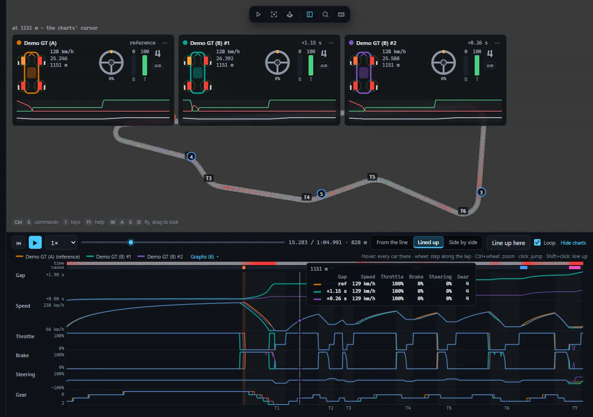

# Línurit og HUD

Línuritin raða hringjunum þínum upp metra fyrir metra, svo þú sjáir hvar einn ökumaður bremsaði seinna eða sleppti gjöfinni fyrr. Spjöldin efst til vinstri í sýninni sýna hvað hver bíll og ökumaður er að gera núna.

## Línuritin {#the-charts}

Allir hringir á einum fjarlægðarás - metrar eftir viðmiðuninni (sjá [einn fjarlægðarás](race-corner-analysis.md#one-distance-axis)) - þannig að sami x-gildi er sami staður á brautinni fyrir alla hringi. Einn hringur er settur á línurit einn sér (og spilast); annar hringur af sömu braut er settur á línurit gegn honum. Þegar enginn hringur er hlaðinn (eða greiningin mistókst) segir svæðið: "Línurit birtast þegar hringur er hlaðinn; hladdu öðrum af sömu braut til að bera þá tvo saman."

### Hvað er á þeim {#what-is-on-them}

- **Skýringin**: litur og merki hvers hrings á línuritinu, viðmiðunin merkt "(viðmiðun)"; "+N í viðbót teiknaðir, ekki á línuriti" þegar fleiri hringir eru sýnilegir en eru á línuritinu; **Línurit (N) ▾**; **Allur hringurinn** meðan aðdráttur er; ein lína með vísbendingu.
- **Tvær ræmur** efst, fyrir hringinn í brennidepli:
  - *tími*: [tímakortið](race-replay-and-scene.md#time-map-where) sem ræma, rautt þar sem tapast, grænt þar sem unnist;
  - *orsök*: hvert tap hans sem stika yfir staðnum þar sem orsökin er, í lit orsakarinnar; bendill á stiku sýnir titil hennar og kostnað.
- **Beygjubönd**: skyggt band frá innkeyrslu hverrar beygju að útkeyrslu hennar (eins og hún fannst á viðmiðuninni) og heiti hennar (`T1` …) undir ásnum við toppinn.
- **Valin niðurstaða**: band í orsakalit hennar yfir bilinu sínu.
- **Línurnar** (grafin), ein fyrir hverja valda rás, hver með heiti sínu og efsta og neðsta gildi bilsins vinstra megin, núllínu þar sem bilið fer yfir núll. Hver hringur er lína í sínum lit: hringurinn í brennidepli 2 px breið og ógegnsæ, viðmiðunin ógegnsæ, hinir 1,5 px á 75%. Bilalínan sleppir viðmiðuninni (hún er núll gagnvart sjálfri sér).
- **Bendillinn**: lóðrétt lína þar sem viðmiðunarbíllinn er (eða þar sem bendillinn er), og punktur fyrir hvern bíl á hverri línu nema bilinu - við bendilinn er hver bíll á sama metra; annars fjarlægð hvers bíls fyrir sig á klukku endursýningarinnar.

Mest **8** hringir eru settir á línurit: hringurinn í brennidepli, besti hringur flokksins og viðmiðunin fyrst, síðan hinir í hleðslurröð.

### Línurnar og hæðir þeirra {#rows-and-their-heights}

Línurnar deila hæð línuritsins eftir vigt, enginn lægri en 16 px:

| Lína | Vigt |
|---|---|
| Bil (að viðmiðuninni, sekúndur, með formerki) | 1,7 |
| Hraði (km/h) | 1,7 |
| einn pedali (gjöf, bremsa, kúpling) | 1 |
| stýri | 1,1 |
| gír | 0,8 |
| ljós (handbremsa, ABS …) | 0,55 |
| annað | 1 |

Rás með fast birtingarbil í töflunni (pedalar 0-100%) notar það; hinar eru lagaðar að sýnilegum hluta hringjanna. Heiti línu sem er of langt fyrir plássið (langt orð á öðru tungumáli) færir efsta gildið niður um línu þar sem línan er nógu há, og er skorið með sporbaugi þar sem hún er það ekki; fullt heiti birtist sem verkfæraábending.

### Sjálfgefnu línuritin {#the-default-graphs}

Þar til línurit eru valin: **bilið**, síðan hver rás sem taflan merkir `graph` og hringirnir hafa - gjöf, bremsa, kúpling, handbremsa, stýri, gír, hraði - nema pedali eða ljós sé sleppt nema einhver hringur færi það yfir 0,02 (kúpling sem aldrei er stigin er ekki línurit). Röðin er töflunnar.

### Línuritsvalið {#the-graph-picker}

**Línurit (N) ▾** opnar spjald fyrir ofan hnappinn:

- reitur fyrir síu (passar við heiti eða auðkenni rásar);
- **Sjálfgefið** (aftur í sjálfgefna safnið; verkfæraábendingin segir hversu mörg) og **Loka**;
- *Bil að viðmiðuninni*, síðan hver rás sem línurituðu hringirnir hafa, flokkuð (hreyfing, inntak, vél, hjálpartæki, dekk, bremsur, fjöðrun, hjól, annað, tímataka, staða), með gátreit hver; rás fyrir hvert hjól er ein lína með merki fyrir hvert hjól (FL, FR, RL, RR).

Gátreitur heldur röð töflunnar, sama í hvaða röð hakað er. Valið helst þar til **Sjálfgefið** er valið eða síðan er endurhlaðin. Rásir sem taflan þekkir ekki eru boðnar undir *annað*, nefndar eftir auðkenni þeirra ("brakeLinePress" → "Brake line press").

### Bendill, hjól, aðdráttur, smellur {#hover-wheel-zoom-click}

| Inntak | Gerir |
|---|---|
| bendill | hver bíll, spjald hans og inntök hans færast á þann metra; stöng merkir hann á brautinni; tafla sýnir gildi allra hringja á línuritinu á hverri línu þar (bil sýnt sem "ref" fyrir viðmiðunina); fyrir ofan spjöldin, "við N m - bendill línuritanna". Að fara af teikniflötnum skilar stjórninni til endursýningarinnar |
| hjól | færir endursýninguna eftir hringnum um 1/200 af sýnilega bilinu í hverju hjólstykki (Shift: 5×), og stöðvar endursýninguna; í aðdrætti fylgir sýnin bendlinum |
| Ctrl+hjól (Cmd+hjól) | zoomar fjarlægðarásinn um bendilinn, 1,25× út / 0,8× inn í hverju hjólstykki, aldrei þrengri en 40 m; aðdráttur út á allan hringinn lýkur aðdrættinum |
| hjól til hliðar | rennir meðan aðdráttur er (10% af bilinu fyrir hverjar 100 einingar af skrolli) |
| tvísmellur, **Allur hringurinn** | zoomar út |
| smellur | hoppar endursýningunni þangað sem viðmiðunin nær þeim metra |
| Shift+smellur | raðar bílunum upp þar (sjá [röðun](race-replay-and-scene.md#lining-up)) |

Línuritin teiknast aftur á núverandi tungumáli þegar það breytist.

Vísbendingalínan í skýringunni segir það sama í stuttu máli: "Bendill: allir bílar þar · hjól: færa eftir hringnum · Ctrl+hjól: aðdráttur · smellur: hoppa · Shift+smellur: raða upp".

## Bílspjöldin (HUD) {#the-car-cards-hud}

Efst til vinstri í sýninni, eitt spjald fyrir hvern sýnilegan hring - mest **6**, fyrstu sex sýnilegu hringirnir í hleðslurröð - á þeirri stundu sem endursýningin (eða bendill línuritanna) er á.

**Haus:** litur og merki hringsins; lifandi bilið - tími þessa hrings til að ná núverandi fjarlægð hans mínus tími viðmiðunarinnar til að ná sömu fjarlægð, "+0,48 s" - eða "viðmiðun"; **⋯** til að sýna eða fela hvert annað gildi (það sama og *Öll gildi á spjöldunum*). Spjald bílsins sem er elt er auðkennt.

**Bíllinn ofan frá:** útlína yfirbyggingar í lit hringsins með ör að framan, fjögur dekk (framdekkin snúin allt að 28° með stýrinu), hvert litað eftir hitastigi sínu, með sömu táknum og þrívíði bíllinn teiknaður flatur: sleðahringur, fjöðrunarstöng, hemlaglóð, slitband, álagsstika.

**Mælingar:** hraði í km/h, eigin tími hringsins, fjarlægð hans eftir viðmiðuninni.

**Inntök:**

- stýrishjól sem snýst eftir stýrisinntakinu (full beygja teiknuð sem 180°) með prósentunni undir;
- stika fyrir hvern pedala, frá vinstri til hægri eins og í pedalakassa - kúpling, bremsa, gjöf - hver með prósentu og stuttu heiti, í sínum lit (aðeins pedalar sem hringurinn hefur);
- gírinn (R fyrir afturábak, N fyrir hlutlausan);
- lítið ljós fyrir hverja kveikt/slökkt rás sem hringurinn hefur - handbremsu, ABS, TC, DRS, pit limiter, í lofti - kveikt í sínum lit meðan það er á (yfir helmingi bilsins síns);
- mælir fyrir hverja rás með stigum: bremsujöfnun, ABS- og TC-stillingar, hleðsla, eldsneyti.

**Inntakssporið:** síðustu **6 sekúndur** af hverjum pedala (ein braut, hver í sínum lit) og stýrinu (sín eigin braut, miðjuð), sem endar á þessari stundu - það sem ökumaðurinn gerði á leiðinni inn í hana. Allt að 160 punktar.

**Öll gildi** (⋯ eða *Öll gildi á spjöldunum*): hvert annað skalargildi sem hringurinn hefur á þessari stundu, síðan hver rás fyrir hvert hjól sem fjögur gildi (FL FR RL RR), nefnd úr rásatöflunni eða úr eigin heiti rásarinnar, raðað eftir flokki.

## Fyrir forritara {#for-developers}

Kóði: [`src/ui/race/RaceBar.tsx`](https://github.com/Holdi601/3DHeat/blob/main/src/ui/race/RaceBar.tsx),
[`src/race/graphs.ts`](https://github.com/Holdi601/3DHeat/blob/main/src/race/graphs.ts),
[`src/ui/race/RaceHud.tsx`](https://github.com/Holdi601/3DHeat/blob/main/src/ui/race/RaceHud.tsx),
[`src/race/schema.ts`](https://github.com/Holdi601/3DHeat/blob/main/src/race/schema.ts).

### Rásatöflan {#the-channel-table}

`CHANNELS` í [`src/race/schema.ts`](https://github.com/Holdi601/3DHeat/blob/main/src/race/schema.ts) er eini staðurinn þar sem rás er lýst: eining hennar, hvort hún er eitt gildi á sýni eða eitt á hvert hjól (geymt sem `name.FL` …), flokkur hennar, birtingarbil, hvernig hún er teiknuð á bílnum (`glyph`), hvernig hún birtist á spjaldinu (`input`: `pedal`, `steering`, `gear`, `lamp`, `level`), hvort hún er sjálfgefið línurit, hvort hún stekkur frekar en blandast (gír, fánar), og hvernig hún er sýnd (kvarði, eining, tölustafir). Merki og stutt heiti eru skilaboð á hverju tungumáli (`race.channel.<name>.label` / `.short`).

Rásir með teikningu eða sjálfgefnu línriti:

| Rás | Eining | Teiknuð sem | Sjálfgefið línurit |
|---|---|---|---|
| `throttle`, `brake`, `clutch` | 0..1 | pedali (grænn, rauður, …), sýndur í % | já |
| `handbrake` | 0..1 | ljós | já |
| `steer` | -1..1, hægri jákvætt | stýrishjól | já |
| `gear` | - | gír | já |
| `speed` | m/s, sýnt km/h | - | já |
| `absActive`, `tcActive`, `drs`, `pitLimiter`, `airborne` | 0..1 | ljós | - |
| `brakeBias`, `absLevel`, `tcLevel`, `boost`, `fuel` | - | mælir | - |
| `tireTemp` (fyrir hvert hjól) | °C, birting 40-130 | litur dekks | - |
| `tireTempInner/Middle/Outer` | °C | - | - |
| `slipRatio`, `slipAngle` (fyrir hvert hjól) | eins og leikurinn skalar það, birting ±1,5 | sleðahringur | - |
| `combinedSlip`, `slipIndex` (fyrir hvert hjól) | birting 0-1,5, 0-1 | sleðahringur | - |
| `suspension` (fyrir hvert hjól) | 0..1 | fjöðrunarstöng | - |
| `brakeTemp` (fyrir hvert hjól) | °C, birting 100-900 | hemlaglóð | - |
| `tireWear` (fyrir hvert hjól) | 0..1 | slitband | - |
| `wheelLoad` (fyrir hvert hjól) | N, birting 0-12 000 | álagsstika | - |

Aðrar í töflunni (á línuriti og á lista, ekki teiknaðar): `latAcc`, `longAcc`, `vertAcc`, `yaw`, `pitch`, `roll`, `yawRate`, `latVel`, `longVel`, `vertVel`, `bodySlip` (rekhorn), `loose`, `lateral` (frávik frá viðmiðuninni), `rpm`, `power`, `torque`, `waterTemp`, `oilTemp`, `tirePressure`, `camber`, `padLife`, `discLife`, `suspensionM`, `wheelSpeed`, `wheelSurfaceSpeed`, auk `time`, `distance`, `x`, `y`, `z`.

**Rás sem er ekki í töflunni** er samt lesin, sett á línurit (undir *annað*) og sýnd á spjöldunum, merkt eftir eigin heiti. **Til að gefa henni rétt heiti, einingu og teikningu** skaltu bæta einni færslu við töfluna (og merkingarskilaboðunum við hvert `src/i18n/locales/<tungumál>/race-channels.json`). Ný *gerð* af hjólateikningu er ein færsla í `WHEEL_GLYPHS` (glyph.ts) og tvíburi hennar `CARD_GLYPHS` (RaceHud.tsx); báðar eru tegundaðar eftir gerðinni, svo smíðin mistekst þar til báðar eru til. `src/race/extensible.test.ts` athugar að óþekktar rásir nái á línuritin, að hvert tákn í töflunni sé hægt að teikna og að ljósin kvikni.
