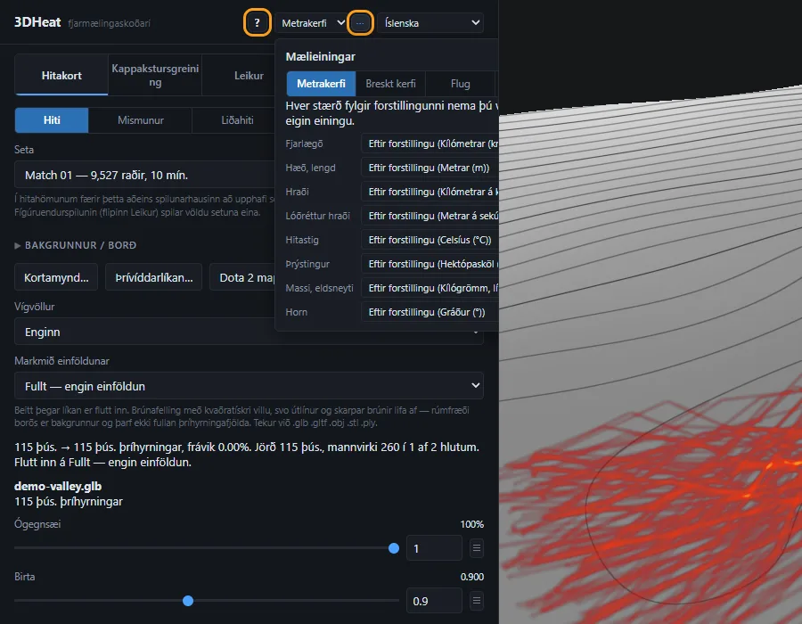
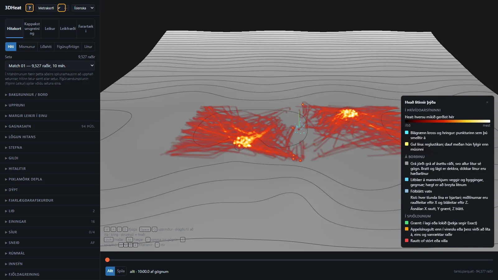

# Stillingar, einingar og lyklar

Litlu stýringarnar efst í hliðarstikunni breyta því hvernig skoðarinn talar við þig: tungumálið, einingarnar (metrar eða fet, km/klst eða hnútar) og hjálparham sem útskýrir litina. Valið þitt er munað í vafranum þínum.

## Hausinn {#the-header}

Efst í hliðarstikunni:

| Stjórn | Hvað hún gerir |
|---|---|
| **?** | Hjálparhamur: hvað hver litur þýðir (líka `?` eða `F1`) |
| **Einingar**-valmynd | Metrakerfi, Breskt kerfi, Flug eða Siglingar |
| **...**-hnappur við hlið **Einingar** | Opnar "Veldu mælieiningu fyrir hverja stærð": eina fellivalmynd fyrir hverja stærð |
| **Tungumál**-valmynd | Tungumál skoðarans: [40 tungumál](languages.md), eða tungumál vafrans |

Tölur sem þú skrifar í reit mega nota annaðhvort punkt eða komma (`0.35` eða `0,35`). Skoðarinn les hvort tveggja og sýnir tölur eins og tungumál skoðarans skrifar þær.

## Einingar {#units}

1. Veldu forstillingu í valmyndinni **Einingar**. Allar stærðir skipta saman.
2. Til að breyta aðeins einni stærð, smelltu á **...**-hnappinn við hliðina á henni og veldu einingu fyrir hana. Valmyndin sýnir þá `*` á eftir forstillingunni.
3. Stærð sem þú stillir ekki fylgir forstillingunni. Veldu "Eftir forstillingu" til að fara til baka.

| Stærð | Metrakerfi (sjálfgefið) | Breskt kerfi | Flug | Siglingar |
|---|---|---|---|---|
| Vegalengd | km | mi | NM | NM |
| Hæð, lengd | m | ft | ft | m |
| Hraði | km/klst | mph | kt | kt |
| Lóðréttur hraði | m/s | ft/min | ft/min | m/s |
| Hitastig | °C | °F | °C | °C |
| Þrýstingur | hPa | inHg | hPa | hPa |
| Massi, eldsneyti | kg, l | lb, gal | lb, gal | t, m³ |
| Horn | gráður | gráður | gráður | gráður |

Aðrar einingar sem þú getur valið fyrir eina stærð: vegalengd km, mi, NM; hraði km/klst, m/s, kt, mph; lóðréttur hraði m/s, ft/min, m/min; hitastig °C, °F, K; þrýstingur hPa, inHg, mmHg, psi; massi kg, lb, t; horn gráður eða NATO-mil (6400 á hring). Einingarnar eru þær sömu alls staðar í skoðaranum: merkingar, spjöld, línurit, tölfræði.

## Hjálparhamur {#help-mode}

Ýttu á `?` eða `F1`, eða smelltu á hnappinn **?**. Hann sýnir *Hvað litirnir þýða*: skýringar á þrívíðu sýninni, hitaskölunum, liðslitum, litum borðsins, stöðulitum spjaldanna, leikspjaldinu og kappakstursglugganum. Hann helst á þar til þú slekkur á honum. Í flipanum Leikur útskýrir hann líka liti leikspjaldsins.

## Það sem vafrinn man {#what-the-browser-remembers}

Þessar stillingar eru geymdar í vafranum þínum á milli heimsókna (ekkert er sent neitt):

- tungumálið, einingarnar og hjálparhaminn;
- stillingar endurspilunar á fígúrum, táknum, merkingum, myndavél og taktískri skjámynd;
- spilunarhraðann og speglun;
- bókamerki eftir upptöku, rúmmál eftir gagnasafni, lög markmiða;
- stillingar ytri gervigreindar (lykillinn aðeins ef þú hakar við *Muna lykilinn í þessum vafra*).

Hitastillingar, síur og hamurinn byrja upp á nýtt við hverja hleðslu. Allur listinn, sjálfvirkt búinn til: [Vistaðar stillingar](ref-settings-storage.md).

## Lyklar sem skoðarinn heldur frá vafranum {#keys-the-viewer-keeps-from-the-browser}

Lota með miklum gögnum tekur tíma að hlaðast, svo skoðarinn kemur í veg fyrir að vafrinn henti henni óvart:

- `Ctrl`/`Cmd` + stafir sem myndu prenta, vista, opna, endurhlaða, loka eða opna nýja glugga gera ekkert utan textareita; `F1`, `F3`, `F5`, `F6` og `F7` gera ekkert.
- Að loka eða endurhlaða flipanum þegar gögn eða borð eru hlaðin spyr fyrst.
- Í öllum skjá læsir skoðarinn lyklunum sem hann notar (W, T, N, S, R, P, Q, Esc), svo vafrinn taki þá ekki.

Nákvæmi listinn: [Lyklar í vafra](ref-browser-keys.md). Allir lyklar skoðarans: [Yfirlit yfir lyklaborð og mús](keyboard-reference.md).
