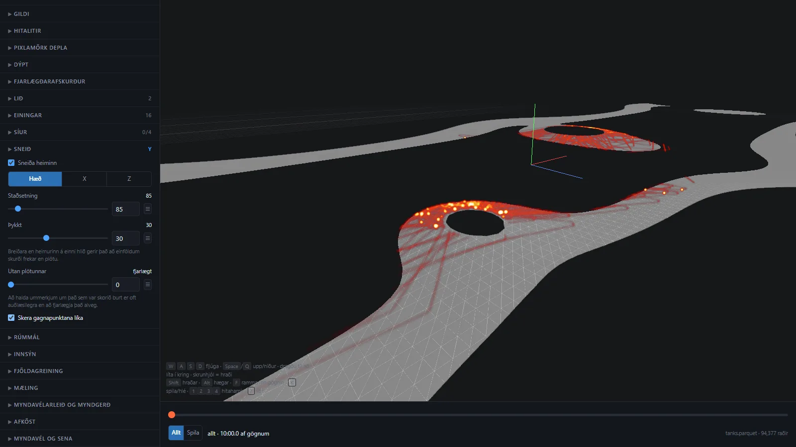

# Sneið

**Sneið** sker heiminn eins og sneið af köku, svo þú getir séð inn í byggingar. Notaðu hann þegar veggir fela áhugaverðan hita, til dæmis til að sjá eina hæð í byggingu.

## Prófaðu {#try-it}

1. Hladdu borði og nokkrum gögnum, og opnaðu **Sneið**.
2. Hakaðu við **Sneiða heiminn**. Ásinn er **Hæð**.
3. Dragðu **Staðsetning** upp og niður: platan færist í gegnum borðið.
4. Gerðu **Þykkt** þunna fyrir grunnmynd hæðar, eða breiða fyrir „allt fyrir neðan hérna“.
5. Hafðu **Utan plötunnar** á 0 til að fjarlægja restina, eða hækkaðu það til að halda daufu ummerki.



Platan sker **borðgeometríu og gagnapunkta saman** - ef aðeins borðið væri skorið sæti hitinn eftir á fljótandi þar sem bygging hans var. Hún er mótpartur [dýptarhulunnar](depth-and-culling.md): þegar borðið fer rétt með það sem er á bak við það, er innra byggingarinnar líka falið. Spjaldið birtist þegar eitthvað er til að sneiða (gagnasafn eða 3D-borð); höfuðlína þess sýnir ásinn meðan hann er á, annars *off*.

```
side view         Position = where the slab is
 ----------       Thickness = how tall the slab is
 | floor 3 |
 |=========|  <--- slab (kept)
 | floor 2 |  <--- outside: removed (or faint)
 | floor 1 |
 ----------
```

## Stýringar {#controls}

| Stýring | Sjálfgefið | Merking |
|---|---|---|
| **Sneiða heiminn** | slökkt | Kveikir á plötunni. Meðan staðsetningin er enn á upphafsgildinu 0 og þykktin á upphafsgildinu 500, færir kveikt þær á miðju ássins og 15% af spönn hans. |
| Axis | **Hæð** | *Height* (Y), *X* eða *Z*. Að skipta um ás færir plötuna á miðju nýja ássins. |
| **Staðsetning** | miðjan | Miðja plötunnar, í heimseiningum, yfir spönn ássins (500 þrep). |
| **Þykkt** | 15% af spönninni | Frá 1/500 af spönninni upp í tvöfalda spönn, í lógaritmískum þrepum. Sýnir *past the world* þegar hún er jafnbreið spönninni: þá nær önnur hliðin út fyrir heiminn og þetta er venjulegur skurður en ekki plata. |
| **Utan plötunnar** | 0, *removed* | Hversu mikið af því sem er utan plötunnar helst sýnilegt, 0-100%. Dauft ummerki þess sem var skorið burt er oft auðveldara að lesa en að fjarlægja það alveg. |
| **Skera gagnapunktana líka** | á | Slökkt skilur hitann heilan, svo hann sést í gegnum skurðinn - gagnlegt til að sjá hvað er fyrir ofan og neðan plötuna. |

Spönn ássins er spönn 3D-borðsins þegar eitt er hlaðið, annars spönn gagnasafnsins.

Sneiðin er óháð [fjarlægðarklippingu](depth-and-culling.md#distance-culling), sem sker eftir sjónstefnunni frekar en heimsás; þær tvær sameinast. Breyting á hvaða sneiðistillingu sem er endurræsir hitasöfnunina.

## Fyrir forritara {#for-developers}

Platan er prófuð á heimsstöðu hverrar línu í hnútaskyggjaranum: lína utan hennar hefur framlag sitt margfaldað með *Outside*-gildinu, svo við 0 er hún hafnað áður en nokkur bútur er teiknaður. Borðskyggjararnir beita sama prófi á hvern bút jarðar, mannvirkja og vatns.
