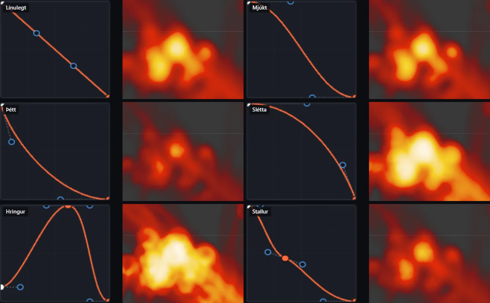

# Lögun sprite-mynda

Hver röð er teiknuð sem kringlótt sprite sem snýr alltaf að myndavélinni. Stærð hennar og sniðið frá miðju hennar að jaðrinum - **skalinn** - ráða því hvort heitur blettur lítur út eins og þéttur depill, mjúkt ský, diskur eða hringur. Þessar stillingar eru í hlutunum **Lögun hitans** og **Pixlamörk depla** á hliðarstikunni, og gilda um [Hiti](heat.md), [Mismunur](difference.md), [Liðahiti](team-heat.md) og, sem hálfbreidd línu, [Línuhiti](line-heat.md).

Ef þú breytir einhverri þeirra endurræsir það uppsöfnunina (flötinn þarf að teikna upp aftur með nýju lögununni).

Hugsaðu um hvern depil sem mjúkan ljósblett. Lítill blettur sýnir stakar stöður; stór blettur sameinar nágrannana í ský. Lögunin ræður hversu mjúkur jaðarinn er.



## Radíus sprites {#sprite-radius}

Radíus spritesins í **heimseiningum** (merkt metrar). Sjálfgefið 6, og við hverja hleðslu er það lárétt útbreiðsla gagnanna / 120 - nógu stórt til að nærliggjandi sýni eftir leið sameinist í bönd í stað þess að lesast sem hárlína. Lógaritmískur sleði 0,05-2000, handfangið dregst upp í 50.000.


Hlutir langt í burtu líta minni út, svo sprite minnkar á skjánum eftir fjarlægð. Í samsíða varpinu er það alls staðar eins, sem er hluti af ástæðunni fyrir því að samsíða sýnin er rétta sýnin til að bera heita bletti saman ([Myndavél og stýringar](camera.md#projection)).

## Pixlamörk {#pixel-clamps}

**Pixlamörk depla** (sjálfgefið lokað) takmarka radíus á skjánum eftir umbreytinguna hér að ofan.

| Stilling | Sjálfgefið | Svið (sleði) | Hvers vegna |
|---|---|---|---|
| **Lágm. pixlaradíus** | 1 px | 0-16 (512) | Heldur fjarlægum gögnum frá því að hverfa undir eina pixla. |
| **Hám. pixlaradíus** | 96 px | 2-1024, lógaritmískt (8192) | Vörn gegn ofteikningu. Sprite sem þekur N pixla kostar N blöndunaraðgerðir, svo ótakmarkaður radíus nálægt myndavélinni er það sem breytir hraðri ramma í hæga. Yfir hæð sýnisins hættir það að takmarka nokkuð. |

**Sami þéttleiki við hvaða aðdrátt sem er** (í hlutanum Lögun hitans, sjálfgefið á) vinnur með mörkunum. Sprite sem mörkin gera stærra (langt í burtu) eða minna (nálægt) heldur þeim hita sem raunveruleg stærð þess myndi bæta við, svo litur þýðir sama fjölda raða á hverja flatarmálseiningu jarðar við hvaða aðdrátt sem er. Ef það er slökkt bætir takmarkaður sprite við fullri þyngd sinni í takmarkaðri stærð sinni, og myndin breytist þegar þú flýgur inn.

## Miðjustyrkur og jaðarstyrkur {#centre-and-edge-intensity}

Hitinn sem sprite bætir við á nákvæmri miðju sinni (**Styrkur í miðju**, sjálfgefið 1, 0-10, sleði 1000) og á jaðrinum (**Styrkur á jaðri**, sjálfgefið 0, -2-10, sleði 1000). Gildi skalans *t* (1 í miðju, 0 á jaðri, mótað af dvínuninni eða ferlinum hér að neðan) blandar á milli þeirra (formúluna er að finna undir [Fyrir forritara](#for-developers)).

**Neikvæður jaðarstyrkur** lætur jaðarinn draga frá, sem grefur kaldan hring í kringum hvern heitan blett og skerpir þyrpingar hverja gegn annarri. Sýnileiki felur í sér [falið á bak við](depth-and-culling.md) og [sneiðina](slice.md); dvínun er [Líftíma](timeline.md#history)-dvínunin; formerki er ±1 í [Mismunur](difference.md).

## Skalalögun: Dvínun eða ferill {#ramp-shape-falloff-or-curve}

**Lögun skalans** skiptir á milli tveggja leiða til að móta *t* yfir spritið. Þar sem *d* er fjarlægðin frá miðju (0) að jaðri (1):

### Dvínun {#falloff}

Birt þegar *Dvínun* er valið (sjálfgefið).

- **Dvínun** (sjálfgefið 1,6, 0,1-8, sleði 64): `t = (1 - d) ^ falloff`. 1 er beinn línulegur skali; hærra dregur hitann að miðjunni og þéttir heita blettinn; undir 1 flatar hann út í disk.
- **Mjúkur skali** (sjálfgefið á): beitir S-laga smoothstep-ferli á *t*, svo spritið dofnar út við jaðarinn í stað þess að enda á sýnilegri brún.

### Ferlaritillinn {#the-curve-editor}

Birt þegar *Ferill* er valið. Bókstaflegt þversnið sprites: fjarlægð frá miðju þvert yfir (*miðja* vinstra megin, *jaðar* hægra megin), hiti upp. Ferillinn er stykkjavís þriðja stigs Bézier-ferill í gegnum stjórnpunkta, hver með tveimur handföngum.

| Aðgerð | Áhrif |
|---|---|
| Tvísmella á myndritið | Bætir punkti við þá fjarlægð (haldið milli 0,02 og 0,98), á ferlinum og með halla ferilsins þar, svo það breytir engu fyrr en þú dregur hann. |
| Draga punkt | Færir hann. Hæðir haldast milli 0 og 1. |
| Draga lítinn hring | Beygir hlutann við hliðina á honum (færir það handfang). |
| Alt-smella eða hægri smella á punkt | Fjarlægir hann. Endapunktarnir tveir verða ekki fjarlægðir. |
| Forstillingarhnappur | Skiptir ferlinum út fyrir forstillinguna. |

Endapunktarnir eru fastir í miðju og á jaðri; hæð þeirra er samt þín.

**Forstillingar** ([`curve.ts`](https://github.com/Holdi601/3DHeat/blob/main/src/state/curve.ts)):

| Forstilling | Lögun | Notkun |
|---|---|---|
| **Línulegt** | Bein lína frá 1 niður í 0 | Eins og *Dvínun* 1 með *Mjúkum skala* slökktum. |
| **Mjúkt** | S-ferill | Sjálfgefni ferillinn; það sem *Mjúkur skali* gefur við dvínun 1. |
| **Þétt** | Brött kjarni, langur daufur faldur | Strjál gögn. |
| **Slétta** | Flöt, síðan hröð niðurfelling | Lesst sem diskur frekar en klessa. |
| **Hringur** | 0,15 í miðju, 1 við 62% radíussins, 0 á jaðri | Holur sprite: sýnir hvar leiðir fara um frekar en hvar þær stoppa. |
| **Stallur** | Tveggja þrepa dvínun, 0,45 við 35% | Aðskilur þéttan kjarna frá umhverfi sínu. |

## Fletja á jarðflöt {#flatten-onto-ground-plane}

**Fletja á jarðflöt** (sjálfgefið slökkt) hunsar hæð hverrar raðar og teiknar allan hita í einni hæð - lægsta Y gagnasafnsins - klassíska 2D-kortahitakortið. Með því á er dýptarhulun og *Fela á bak við landslag* slökkt (hver punktur myndi þá sitja nákvæmlega á því yfirborði sem hann er prófaður gegn), og Dýptarhlutinn segir það.

## Fyrir forritara {#for-developers}

### Formúlur {#formulas}

Radíus á skjánum í pixlum: `radius × P[1][1] / w × viewport height / 2`, þar sem `P` er varpfylkið og `w` er sýndardýpt punktsins.

Hitinn sem sprite bætir við:

```
heat added = mix(edge, centre, t) × sample weight × sign × fade × visibility
```

### Ferillinn {#the-curve}

Handföng eru klemmd lárétt að sínum eigin hluta, svo ferillinn er alltaf fall af fjarlægð: að draga handfang langt framhjá næsta punkti jafnar það út við hann í stað þess að brjóta ferilinn til baka, sem myndi gera niðurstöðuna háða því hvaða rót lausn fann.

### Hvernig ferillinn er teiknaður {#how-the-curve-is-drawn}

Ferillinn er brenndur í 256 færslna töflu í hvert sinn sem hann breytist, hlaðinn upp sem 16 bita float-áferð, og sýnaður í hverju búthluta með línulegri síun og hálfum texel-innskoti svo báðir endar haldist nákvæmir. Að leysa Bézier fyrir x krefst ítrunar, sem á ekkert erindi í heitustu skyggingu forritsins, og töfluflettingin er líka ódýrari en `pow()` sem dvínunin notar. 16 bita í stað 8 bita því 8 bitar sýna rendur þegar þúsundir sprita hafa lagst saman; 16 bita hálfur float er síanlegur í grunn-WebGL2 þar sem 32 bitar þurfa viðbót.
