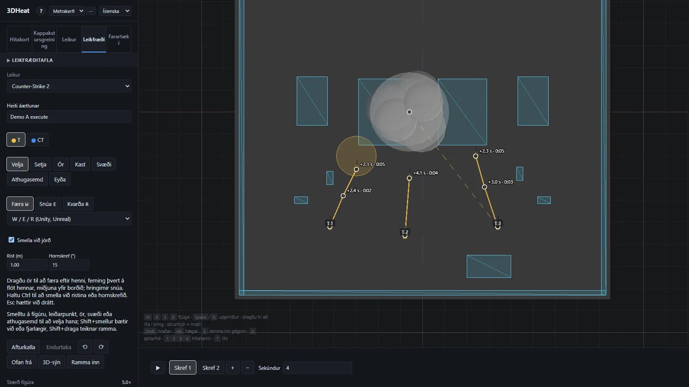

# Taktíkartafla

Flipinn **Leikfræði** er teikniborð fyrir liðsáætlun: þú setur litlar fígúrur á kort, teiknar örvar fyrir hvert þær fara og ýtir á spilun til að sjá það gerast. Notaðu hann til að skipuleggja umferð eða árás áður en þú spilar. Hann deilir striganum, myndavélinni og [borðinu](levels.md) með hinum flipunum og engu öðru. Áætlun er ekki gögn og teiknar engan hita.

## Fyrsta áætlunin þín {#your-first-plan}

1. Opnaðu flipann **Leikfræði**. Veldu **Leik** (til dæmis Counter-Strike 2) og, fyrir Valorant, ýttu á **Hlaða Valorant-kortum** og veldu **Kort**. Eða hladdu [borði](levels.md) fyrst.
2. Veldu **Hlið** (hún ræður litnum) og ýttu á **Ofan frá**.
3. Veldu **Staður**, veldu fígúru í **Fígúrur** (notaðu **Leita að fígúrum** til að finna hana) og smelltu á kortið. Settu tvær eða þrjár.
4. Veldu **Ör**, smelltu á fígúru, smelltu á hverja leið sem hún á að fara, og ýttu á **Enter** til að ljúka örinni.
5. Ýttu á **+** undir sýninni til að bæta við skrefi 2. Hver fígúra byrjar þar sem ör hennar endaði. Teiknaðu fleiri örvar þar.
6. Ýttu á **▶** (eða `K`) til að spila áætlunina frá sýnda skrefinu til loka.
7. Gefðu áætluninni nafn í **Heiti áætlunar** og ýttu á **Vista**.

## Að byrja áætlun {#starting-a-plan}

| Stýring | Hvað hún gerir |
|---|---|
| **Leikur** | Velur hliðarnar og fígúrurnar sem spjaldið býður: Counter-Strike 2 (T, CT; leikmenn og hjálpartæki), Valorant (Árás, Vörn; leikmenn og almennir hæfileikar), Battlefield, Squad, Arma (fótgöngulið, landfarartæki, loftför, bátar), DCS / War Thunder / IL-2 (þotur, skrúfuflugvélar, þyrlur, loftvarnir, jörð, skip, vopn) og Annað. Áætlun sem þegar hefur fígúrur heldur hliðum sínum þegar leiknum er breytt. |
| **Heiti áætlunar** | Nafnið sem áætlunin er vistuð undir. |
| **Kort**, **Hlaða Valorant-kortum** | Þegar Valorant er valið: **Hlaða Valorant-kortum** sækir lista yfir kort frá [valorant-api.com](https://valorant-api.com); **Kort** setur síðan smákort valda kortsins sem borð, rammað ofan frá. Myndin er sótt þegar hún er valin og aldrei send með forritinu. Tilkynning Riot birtist meðan hún er á skjánum (sjá neðar). |
| **Hlið** | Hliðin sem næsta fígúra, ör eða svæði tilheyrir; hún fær lit hliðarinnar. |

Án borðs er borðið flötur á jörðu. Hlaðið borði undir **Borð** til að skipuleggja á raunverulegu korti: CS2-korti sem er flutt út með CS2-verkfærinu, borði úr safninu eða kortamynd.

## Verkfæri {#tools}

| Verkfæri | Smellur | Athugasemdir |
|---|---|---|
| **Velja** | Fígúra, leiðarpunktur, ör, svæði eða athugasemd er valin með smelli. | Shift+smellur bætir við eða tekur út; Shift+dráttur teiknar kassa utan um það sem bæta á við. Valið fær umbreytingarhandfang (sjá neðar); `Delete` eða `Backspace` eyðir því. `M` færir valdu fígúruna á næsta smell. |
| **Staður** | Setur valdu fígúruna niður. | Fígúra er valin í **Fígúrur**-spjaldinu (með **Leita að fígúrum**). Ef ekkert er valið snýr `R` næstu fígúru um 15° áður en hún er sett (`Shift+R` í hina áttina). |
| **Ör** | Hver smellur bætir við punkti; Enter, tvísmellur eða hægrismellur lýkur henni, Esc hendir henni. | **Færa**, **Árás** (breiðari haus) eða **Fylgjast með** (þunn lína í augnhæð). Ör sem byrjar á fígúru er leið þeirrar fígúru í þessu skrefi: þegar hún er spiluð gengur fígúran hana, og næsta skref byrjar þar sem hún endaði. |
| **Kast** | Kastarinn, síðan hvar það lendir. | Brotin bogi frá öðru til hins, og valið hjálpartæki (reykur, blossi, molotov, ...) birtist þar sem það lendir og stendur þar frá þessu skrefi áfram. |
| **Svæði** | Miðjan, síðan jaðarinn. | Diskur í lit hliðarinnar. |
| **Athugasemd** | Hvar athugasemdin fer; biður um texta hennar. | Birtist sem nál, og textinn yfir henni. |
| **Eyða** | Fígúra, ör, svæði eða athugasemd. | Tekur hana burt frá þessu skrefi áfram; á fyrsta skrefi sínu tekur hún hana alveg burt. |

**Afturkalla** og **Endurtaka** (`Ctrl+Z`; `Ctrl+Y` eða `Ctrl+Shift+Z`) fara skref fyrir skref í gegnum hverja breytingu. Lína undir áætluninni sýnir hversu margar fígúrur, örvar og skref hún hefur. **Ofan frá** horfir beint niður (samsíða varpað), **3D-sýn** skiptir aftur yfir í sjónarhorn, **Rammi** rammar áætlunina inn, eða borðið þegar áætlunin er tóm.

**Stærð fígúra** breytir stærð allra fígúra á borðinu; 1× er rétt stærð, sem að ofan séð er nokkrir pixlar fyrir manneskju.

## Færa, snúa og kvarða {#moving-turning-and-scaling}

Allt á borðinu er hægt að færa eins og í þrívíðum ritli: fígúrur, hjálpartæki, merki, stakir leiðarpunktar og heilar örvar, svæði og athugasemdir. Það sem er valið fær handfang í miðjunni:

| Hamur | Lyklar | Handföng |
|---|---|---|
| **Færa** | W (eða G) | Ör fyrir hvern ás (X rautt, Y grænt og upp, Z blátt) færir eftir honum; ferningur færir þvert á flötinn sinn; miðjan færir yfir borðið undir bendlinum. |
| **Snúa** | E (eða R) | Hringur fyrir hvern ás snýr um hann. Hringir stakrar fígúru eru hennar eigin snúningur, halli og velta; hópur snýst um ása heimsins um miðju sína. |
| **Kvarða** | R (eða S) | Dreifir eða þjappar valinu frá miðju sinni eftir ási eða í allar áttir; radíus svæðis vex með því. |

**Lyklar** skipta á milli W / E / R (Unity, Unreal) og G / R / S (Blender). Lyklarnir velja háttinn aðeins þegar eitthvað er valið, annars fljúga þeir myndavélinni. Þannig þýðir `R` **Kvarða** með W / E / R lyklunum og **Snúa** með G / R / S lyklunum meðan eitthvað er valið, og snýr næstu fígúru sem á að setja þegar ekkert er valið. Allir lyklar borðsins eru taldir upp í [yfirliti yfir lyklaborð](keyboard-reference.md#tactics-board). Haltu **Ctrl** inni meðan þú dregur til að smella færslu á **Hnitanet** (metrar) eða snúningi á **Hornskref**. **Smella við jörð** (kveikt sjálfgefið) setur færðar manneskjur, farartæki, merki, leiðarpunkta og svæði á yfirborð borðsins. Loftför og þyrlur halda hæð sinni, og dráttur eftir Y-örinni smellir aldrei. Að draga í handfang færir aldrei myndavélina. **Esc** hættir drætti, og sérhver breyting er eitt skref í Afturkalla.

Leiðarpunktar birtast sem punktar á örvum skrefsins sem sýnt er: smelltu á einn til að velja hann, dragðu hann til að færa hann, Delete til að taka hann burt. Hlutinn **Valdar** sýnir stöðu valsins í metrum, snúning, halla og veltu fígúru í gráðum og radíus svæðis, hvert með innslætti.

## Tímataka {#timing}

Leið fígúru er tímasett: hver hluti tekur þá lengd sína yfir borðið - tekin sýni á yfirborðinu á tveggja metra fresti, svo hæð eða stigi milli tveggja punkta telst - á hraða **hams** hreyfingarinnar fyrir þá fígúru í þeim leik, auk allrar **bið** við leiðarpunkt. Fótgöngulið skríður, krýpur, gengur (hljóðlaust), hleypur eða sprettur; farartæki og bátar skríða, fara varlega, eðlilega eða þjóta; loftför og þyrlur fljúga hægt, á siglingahraða, á bardagahraða eða hámarki. Háttur sem leikurinn hefur ekki (CS2 hefur ekki sprett) tekur þann næsta sem hann hefur. Hvernig brekka hægir fer eftir leiknum: í CS2 og Valorant telst aðeins láréttu fjarlægðin, eins og í leikjunum. Herhermar hægja á fótgönguliði upp brekku (gönguformúla Toblers) og farartækjum eftir halla.

Hraðinn kemur úr töflum fyrir hvern leik með sínum heimildum (sjá [Hraði hreyfinga](tactics-speeds.md)): CS2 eftir vopninu sem haldið er á, úr vopnaskilgreiningum leiksins; Valorant eftir vopni; Battlefield, Squad, Arma og loftleikirnir eftir tegund og flokki farartækis. **Hreyfist sem** velur snið fígúru (vopn, tegund farartækis); **Eigin (m/s)** yfirskrifar hvaða hátt sem er fyrir þá fígúru. Hamir eru nefndir eins og borðið sýnir þá: *Skríða*, *Krjúpa*, *Ganga (hljóðlaust)*, *Hlaupa*, *Sprettur*; *Varlega*, *Eðlilega*, *Þjóta*; *Hægt*, *Siglt*, *Bardagi*, *Hámark*.

Hver leiðarpunktur sýnir tímann frá þeim síðasta og tímann frá upphafi áætlunarinnar ("+3,9 s · 0:12"). Leið valdrar fígúru listar hvern hluta með hamnum, lengd og tíma, biðinni og komunni. **Komur** undir **Tímataka** setur hverja fígúru með leið á eina tímalínu, fyrsta koma efst. Með **Spila í rauntíma** (kveikt sjálfgefið) varir skref þar til hægasta leiðin kemur og hver fígúra hreyfist á sínum eigin hraða; **Sekúndur** er þá minnsta lengd skrefsins. **Borðseiningar á metra** segir í hverju borðið er: 39,37 fyrir CS2-kort (einingar leiksins), 1 fyrir metrakort.

## Berðu saman við leikgögn {#compare-with-match-data}

**Hlaða leikjaskrám…** les CS2-leikjatöflur kortsins (Parquet-skrár CS2-verkfærisins, eins margar og vilja; aðeins dálkarnir sem þarf, í bakgrunni); **Nota hlaðin gögn** tekur gögnin sem eru hlaðin í skoðunartækinu. Síðan:

- **Fyrsta koma á kortinu** litar kortið eftir tímanum frá upphafi lotu sem leikmaður kom fyrst á hvern stað. Hnappurinn **Hraðast** sýnir þann fljótasta yfir allar lotur, **Dæmigert (miðgildi)** miðlotuna, - grænt snemma, rautt seint - fyrir aðra hliðina eða báðar. Það sýnir hvað er mögulegt og hvenær.
- Valin leið er borin saman við það sem leikmenn náðu frá upphafi hennar (eða frá upphafi lotunnar) til loka hennar, hver endi er diskur með settum radíus: "Hraðast séð 14,2 s, p10 15,0 s, miðgildi 18,3 s yfir 41 ferðir; áætlun þín 15,1 s".
- Hraðinn sem leikmenn fóru í raun - hlaup, gangur, krjúpa - úr göngu- og hnykkjudálkum taflnanna, í m/s.

## Skref {#steps}

Stikan fyrir neðan sýnina heldur skrefunum. Áætlun byrjar með einu; **+** bætir við einu, og hver fígúra byrjar þar sem leið hennar í síðasta skrefi endaði; **−** tekur burt það sem sýnt er. **Sekúndur** er hve lengi sýnt skref tekur þegar það er spilað. **▶** (K) spilar frá sýnda skrefinu til loka: fígúrur með leið ganga hana, fígúrur sem færðar eru á nýjan stað í næsta skrefi renna þangað, hinar standa. Meðan skref er sýnt er staðsetning hverrar fígúru í næsta skrefi teiknuð sem daufur draugur, og örvar síðasta skrefs daufar undir þessu.

## Vistun {#saving}

Hlutinn **Skrá** hefur **Vista**, **Opn** og **Hreinsa**. **Vista** skrifar áætlunina sem `<nafn>.h3dplan.json` (venjulegt JSON: hliðar, skref, fígúrur með stað í hverju skrefi, örvar, svæði, athugasemdir); **Opn** les hana aftur. Skrá af annarri útgáfu, eða skrá sem er ekki áætlun, er hafnað með ástæðunni. **Hreinsa** tæmir áætlunina; Afturkalla skilar henni.

## Fígúrur {#figures}

Sérhver fígúra er smíðuð af skoðunartækinu sjálfu: einfaldar lögun í birtri stærð gerðarinnar, með einkennum sem greina hana frá nágrönnunum - beltishjól og turn skriðdreka, byssur, eldflaugar og ratsjár loftvarnarfarartækis, vængjagrunnur loftfars, hali og hreyflar, snúningsblöð þyrlu og stuttir vængir. Ekkert er tekið úr leik. Hönnun sem leikur fann upp er sýnd sem almenna fígúran af sínum flokki. Sjá [Fígúrur](figures.md#which-figure-a-unit-gets) um hvernig gögn finna sína fígúru.

## Tilkynning Riot {#riots-notice}

Valorant-kort eru sýnd samkvæmt stefnu Riot Games "Legal Jibber Jabber", sem leyfir frjálsum samfélagsverkefnum að nota þau og biður um þessa tilkynningu hvar sem þau birtast: *3DHeat var búið til samkvæmt stefnu Riot Games "Legal Jibber Jabber" með eignum sem Riot Games á. Riot Games styður ekki þetta verkefni og ábyrgist það ekki.* Hæfileikarnir á borðinu eru almenn form, ekki list Riot.
