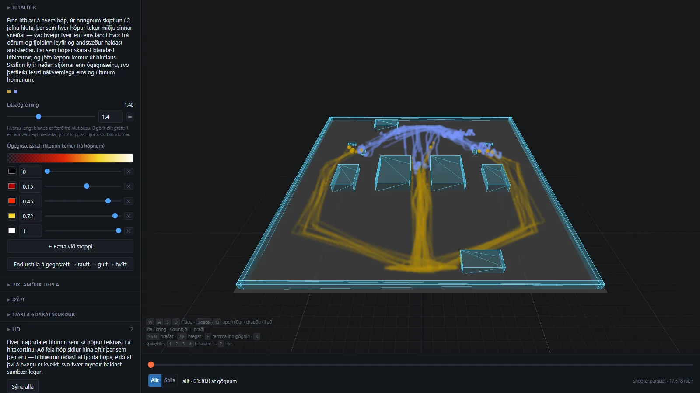

# Liðahiti

Liðahiti sýnir hvar hvert lið var, hvert lið í sínum lit. Þar sem lið skarast blandast litirnir.

**Liðahiti** (takki 3) er þéttnisvið [Hita](heat.md) með hvern [hóp](glossary.md) fyrir sig með sinn eigin litatón. Þar sem hópar skarast blandast tónar þeirra; jöfn barátta verður hlutlaus. Ógegnsæi ber þéttnina áfram alveg eins og í hinum hömunum, svo myndin svarar *hversu mikið* og *hverra* í einu. Hann þarf hópdálk.

Þetta er ekki [fígúru-yfirlagið](box-replay.md): það teiknar eina fígúru á hverja persónu; þetta er hitasvið litað eftir sama dálki.

## Hvernig þú notar hana {#how-to-use-it}

1. Ýttu á `3` (eða veldu **Liðahiti** í hamstikunni).
2. Opnaðu **Hitalitir**. Litasýnin sýna lit hvers hóps; haltu músinni yfir sýni til að sjá nafn liðsins.
3. Ef allt virðist grátt, hækkaðu **Litaaðgreining**.
4. Afhakaðu hóp í [Lista liða](teams-list.md) til að taka hann út; hinir litirnir haldast þar sem þeir voru.

## Stýringar {#controls}

Í hlutanum **Hitalitir**:

| Stýring | Sjálfgefið | Merking |
|---|---|---|
| Sýni | | Litur hvers hóps, fyrir fyrstu 12 hópana, síðan *+N more*. Haltu músinni yfir til að sjá heiti hópsins og litinn. |
| **Litaaðgreining** | 1,4 | Hversu langt blöndu er ýtt frá hlutleysi, 0-4. 0 gerir allt grátt; 1 er hið sanna meðaltal; yfir um 2 fara björtustu blöndurnar út fyrir sýnilegt svið og eru klipptar eftir rás, sem færir tón þeirra til. |
| **Ógegnsæisskali (liturinn kemur frá hópnum)** | sjálfgefni hitastiginn | Aðeins **alfa** stigans er notuð hér: gegnsætt þar sem ekkert er, ógegnsætt efst. Litir hans eru hunsaðir. |

Hópur sem merkimiði hans þýðir „enginn hópur“ (`0`, tómt, `none`, `unknown`, `null` eða `-1`) er teiknaður grár.

Allar hinar hitastýringarnar - lögun, mettun, svörun, lágmarkshiti, dýpt, klipping - virka eins og í [Hita](heat.md).

[Listi liða](teams-list.md) sýnir lit hvers hóps fyrir liðahita sem sýni sitt í þessum ham. Að fela hóp skilur liti allra annarra hópa eftir þar sem þeir voru: tónar koma úr heildarfjölda hópa, ekki úr því hvað er kveikt á, svo tvær myndir haldast samanburðarhæfar.

## Fyrir forritara {#for-developers}

### Litaspjaldið {#the-palette}

Úr [`colors.ts`](https://github.com/Holdi601/3DHeat/blob/main/src/render/colors.ts):

- Litir búa á **Oklab**-litaplaninu við fasta birtu (0,7) og litstyrk (0,115), svo hver hópur er jafnbjartur og rauður hópur les ekki sem heitari en blár.
- Með *n* hópum er tónhringurinn skiptur í *n* jafna hluta og hópur *i* tekur **miðju** hlutans síns, `(i + 0,5) / n` af snúningi. Sérhverjir tveir hópar eru jafn langt frá hvor öðrum og fjöldinn leyfir, og andstæður haldast andstæður hver sem fjöldinn er.
- Mest **16** ólíkir tónar eru notaðir. Með fleiri hópum eru auðkenni sett með endurtekinni helmingun (auðkenni með snúnum bitum: 0, ½, ¼, ¾, ⅛, …) svo nágrannaauðkenni deili ekki tón; hópar umfram 16 deila því óhjákvæmilega.
- Hópur sem merkimiði hans þýðir „enginn hópur“ - `0`, tómt, `none`, `unknown`, `null` eða `-1`, án tillits til stafastærðar - er teiknaður **hlutlaust grár** í stað þess að taka sneið af hringnum. Aðeins fyrsti slíkur merkimiði í hópalistanum er meðhöndlaður svona.

Sjálfgefin aðgreining er 1,4 en ekki 1, því við 1 er blanda af fimm jafndreifðum tónum *grá*: rétt og ólæsileg. Aðeins yfir 1 heldur jöfnum skiptingum heiðarlegum en gerir 60/40 skiptingu sýnilega.

### Hvernig það virkar {#how-it-works}

Hitamarkið hefur fjórar rásir í þessum ham. Hver sprite leggur þéttni sína *v* við fyrstu rásina og *v* × Oklab-hnit hóps síns *a* og *b* við þá annarri og þriðju. Við samsetningu er blanda bildilsins meðalgildi vegið eftir þéttni: *a* = G / R, *b* = B / R, skalað með litaaðgreiningunni og breytt í sRGB við birtu spjaldsins. Með því að deila með safnaðri þéttni helst liturinn óháður því hversu mikil gögnin eru, og þess vegna virkar sérhver þéttnistýring áfram aðeins á ógegnsæið.

Fjögurra rása markið kostar fjórfalt meira GPU-minni en eins rásar hitamarkið við sömu upplausn.
