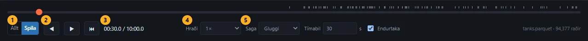

# Tímalína og spilun

Stikan undir myndinni er eins og myndbandsspilari: þú getur spilað gögnin eins og kvikmynd, gert hlé, hoppað til og breytt hraðanum.

Stikan undir sýninni er tímalínan ([`Timeline.tsx`](https://github.com/Holdi601/3DHeat/blob/main/src/ui/Timeline.tsx)). Hún ákveður hvaða línur eru sýnilegar á hverri stundu. Hún þarfnast tímadálks; án hans er öll stikan óvirk, sýnin helst í **Allt**, og hliðarstikan segir *Enginn tímadálkur í þessum gögnum — tímalínan er óvirk og allir gagnapunktar eru sýndir í einu.*

## Allt og Spila {#all-and-play}

Tvær efstu stillingar, því þær svara ólíkum spurningum.

- **Allt** (sjálfgefið við hverja hleðslu) hunsar spilunarhausinn algjörlega og sýnir sérhverja línu sem stenst síurnar. Þetta er sýnin "hvar gerist þetta", og hún er ekki það sama og að draga haus á endann. Rennihnappurinn er óvirkur og klukkan sýnir `all ·  of data`.
- **Spila** keyrir gögnin sem hraðmynd. Rennihnappurinn, spilunarstýringarnar og sögustillingarnar birtast.

Að velja **Allt** stöðvar líka spilun.

## Stýringarnar {#the-controls}

| Stjórn | Sjálfgildi | Merking |
|---|---|---|
| Rennihnappur | upphafið | Spilunarhausinn. Dragðu til að fara á stað; 20.000 skref yfir bilið. |
| **Allt** / **Spila** | Allt | Sjá hér að ofan. |
| ▶ / ❚❚ | í hléi | Spila eða gera hlé; einnig `K`. |
| ◀ **Spila afturábak (J)** | | Spilar gögnin í öfugri röð. Birtist aðeins í stillingunni **Fígúruyfirlögn**; sami takki `J` virkar þar líka (sjá [Lyklaborð](#keyboard)). |
| ⏮ | | Aftur á upphaf bilsins. |
| Klukka | | `liðið / samtals` sem `mm:ss.s` (eða `h:mm:ss`), og, þegar tímadálkurinn er algildur tímastimpill, tími dagsins á spilunarhausnum sem `HH:MM:SSZ` (UTC). |
| **Hraði** | 1× | Sekúndur gagnasafnsins á hverja raunsekúndu. Valmyndin hefur 17 þrep frá 0,01× til 1800× (0,01, 0,02, 0,05, 0,1, 0,25, 0,5, 1, 2, 4, 8, 16, 32, 64, 128, 256, 600, 1800), auk **Sérsniðið…**: skrifaðu hvaða hraða sem er frá 0,001× til 3600× (til dæmis 0,3 eða 12) og ýttu á Enter; Esc heldur núverandi hraða. Síðasti hraði er geymdur fyrir næstu heimsókn (sjá [Vistaðar stillingar](ref-settings-storage.md)). |
| **Saga** | Uppsafnað | Hvað telst sýnilegt á spilunarhausnum: *Uppsafnað*, *Gluggi* eða *Líftími* (hér að neðan). |
| **Tímabil** (Gluggi; í stillingunni Línur einnig Líftími) | 30 s | Lengd gluggans sem endar á spilunarhausnum; að minnsta kosti 0,01 s. Í [Línuhita](line-heat.md#playback) er það lengd halans. |
| **Varalíftími** (aðeins Líftími, ekki í stillingunni Línur) | 10 s | Hversu lengi gagnapunktur án næsta sýnis af sömu manneskju helst sýnilegur. |
| **Dofnun** (aðeins Líftími, ekki í stillingunni Línur) | 0,4 | Hlutfall af líftíma hvers gagnapunkts sem fer í að dofna út, 0-1. |
| **Endurtaka** | kveikt | Í lok byrjar aftur; slökkt stöðvast í lokin. |
| Hægri hlið | | Heiti gagnasafnsins. |

**Bilið** er tímabil gagnasafnsins - eða, í [fígúruyfirlögninni](box-replay.md) með valda lotu, tímabil þeirrar lotu.

## Saga {#history}

Í stillingunni Spila:

- **Uppsafnað** - allt frá upphafi bilsins upp að spilunarhausnum. Hitinn byggist upp meðan á spilun stendur.
- **Gluggi** - fast tímabil sögu sem endar á spilunarhausnum (*Tímabil*).
- **Líftími** - hver gagnapunktur lifir þar til **næsta sýni sömu manneskju** (í sömu lotu), svo nákvæmlega ein staðsetning á manneskju er núverandi á hverri stundu. Gagnapunktur þar sem manneskjan birtist aldrei aftur - dauði, aftenging, lok skráarinnar - hefur ekkert næsta sýni, og lifir í *Varalíftími* í stað þess að hverfa strax eða vara að eilífu. Gagnapunktar **dofna út** á síðasta *Dofnun*-hluta líftíma síns í stað þess að poppast burt: með einu lifandi sýni á hverja manneskju myndi gagnapunktur sem hverfur milli tveggja ramma láta allan flötinn blikka á sýnatíðninni. *Dofnun* 0 endurheimtir harða skurðinn.

Líftími þarfnast bæði tímadálks og dálks fyrir manneskju; án þess fellur sagan aftur í Uppsafnað við hleðslu. Í [Línuhita](line-heat.md#playback) ræður sagan hversu lengi hali leiðar er sýnilegur; í [fígúruyfirlögninni](box-replay.md) er *Varalíftími* hversu lengi manneskja án frekari sýna er haldið.

## Hegðun spilunar {#playback-behaviour}

Úr myndalykkjunni ([`engine.ts`](https://github.com/Holdi601/3DHeat/blob/main/src/render/engine.ts)):

- Spilunarhausinn færist áfram um *tíma ramma × hraði*. Tími ramma er takmarkaður við 0,1 s, svo að skipta um flipa hendir ekki hausnum í annan stað.
- Ef spilað er á endanum á bilinu byrjar spilunin frá upphafi, eins og í miðlunarspilara. Við hverja hleðslu er hausinn settur á upphaf, svo fyrsta ýtingin á spila spilar.
- Í lok bilsins hoppar hausinn aftur á upphaf (Endurtaka kveikt) eða stöðvast þar og spilun endar (Endurtaka slökkt).
- Rennihnappurinn les spilunarhaus vélarinnar beint í hverjum ramma; forritsástandið uppfærist við leit, ræsingu, stöðvun og endurtekningar.
- Að velja lotu í lotuvalinu leitar á upphaf þeirrar lotu.

## Af hverju spilunin er mjúk og ódýr {#why-playback-is-smooth-and-cheap}

Línur eru geymdar raðaðar eftir tíma, svo tímagluggi er tvær tvíundarleitir í tímadálkinum: að færa spilunarhausinn hreyfir tvær heiltölur og snertir engar línur, og kostnaður spilunar fylgir fjölda lína í glugganum, ekki stærð gagnasafnsins.

Hvernig hitinn helst stöðugur á meðan glugginn hreyfist fer eftir sögunni ([Söfnun](accumulation.md)):

- **Uppsafnað** vex aðeins, svo hver rammi bætir aðeins við þeim línum sem urðu sýnilegar frá þeim síðasta, með fullri þyngd. Flöturinn byggist upp einátta og hlé breytir engu, því það er ekkert eftir sem kemur. (Að meta aftur í staðinn myndi láta hvern ramma lýsa upp annað handahófskennt úrtak og dofna það síðan, sem lítur út eins og bylgjur sem blossa upp og hverfa.)
- **Gluggi** og **Líftími** breytast raunverulega í hverjum ramma og eru metin aftur, blönduð sem veldisvísismeðaltal (vog 0,34 fyrir nýja rammann), sem er óhlutdrægt í jafnvægi og miklu rólegra en að byrja upp á nýtt.
- Í stillingunni Líftími eru þær línur sem koma til greina frá *spilunarhaus - max(lengsta bil í gögnunum, Varalíftími)* upp að spilunarhausnum; skyggingin fellir síðan niður hverja línu sem líftími hennar er búinn og beitir dofnuninni.

Að skipta á milli Allt og Spila, eða breyta sögunni, endurræsir söfnunina.

## Lyklaborð {#keyboard}

| Takki | Áhrif |
|---|---|
| `K` | Spila / gera hlé |
| `J` | Spila afturábak; ef ýtt er aftur er gert hlé (aðeins Fígúruyfirlögn) |
| `L` | Spila áfram; ef ýtt er aftur er gert hlé (aðeins Fígúruyfirlögn) |

`J` og `L` setja líka tímalínuna í **Spila**. Takkarnir eru hunsaðir á meðan textareitur eða valmynd hefur fókus. Í flipanum Kappakstursgreining stjórnar `K` í staðinn endurspilun þess flipa.
