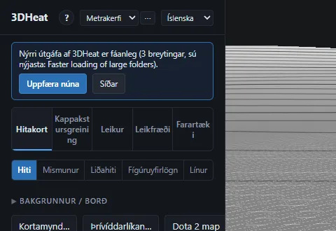

# Uppfærslur

Skoðunartækið segir þér þegar nýrri útgáfa er til, og uppfærir sig aðeins þegar þú segir já. Ekkert er breytt á tölvunni þinni án svars þíns.

## Uppfærðu skoðunartækið {#update-the-viewer}

1. **Á síðunni.** Þegar nýrri útgáfa er til birtist reitur undir nafninu efst í hliðarstikunni: "Nýrri útgáfa af 3DHeat er til". Smelltu á **Uppfæra núna**. Síðan endurhleðst af sjálfu sér þegar henni er lokið. **Síðar** felur reitinn þar til þú endurhleður síðuna.
2. **Ef það segir að keyra restart.bat**, lokaðu þjónsglugganum (svarta glugganum sem `start.bat` opnaði) og tvísmelltu á `restart.bat`.
3. **Þegar þú ræsir skoðunartækið.** `start.bat` athugar líka. Ef nýrri útgáfa er til spyr það **Uppfæra núna? [Y/N]**. Ýttu á `Y` til að uppfæra. Ýttu á `N`, eða bíddu í 60 sekúndur án svars, til að ræsa útgáfuna sem þú ert með.



Afrit með þínum eigin breytingum er aldrei uppfært fyrir þig; reiturinn segir aðeins að uppfærsla bíði og biður um að þú festir eða geymir breytingarnar þínar og keyrir `git pull`. Afrit sem var ekki sett upp með git (til dæmis zip-skrá) sýnir ekkert.

Hvernig athugunin virkar, skref fyrir skref:

```
síða ---(eftir 4 s, síðan á 6 klst. fresti)---> þróunarþjónn ---> git fetch
   á eftir?  nei  -> ekkert birtist
             já   -> þínar eigin breytingar eða færslur?  já -> segir þér það eitt
                                                       nei  -> [Uppfæra núna] -> git pull
                                                               -> endurhleðsla, eða "keyrðu restart.bat"
```

## Öryggisreglurnar {#the-safety-rules}

- **Aðeins áfram** (`git pull --ff-only`): uppfærsla sameinar, endurskrifar eða skrifar aldrei neitt yfir.
- **Engar staðbundnar breytingar**: afrit með óvistuðum breytingum á raktum skrám (`git status --porcelain --untracked-files=no` er ekki tómt) er aldrei uppfært sjálfvirkt - vinna einhvers er ekki uppfærslu að skrifa yfir. Því er aðeins sagt að uppfærsla bíði. Óraktar skrár (gögn, útflutningar) teljast ekki sem breytingar.
- **Engar staðbundnar færslur**: afrit með færslum sem efri útgáfan hefur ekki ("klofið") er ekki uppfært - áfram-uppfærsla getur ekki fært það upp, og sameining er fyrir `git pull` handvirkt. Síðan og `start.bat` segja það bæði með sömu orðum, og `start.bat` ræsir útgáfuna sem þar er.
- **Aðeins frá síðunni sjálfri**: beiðni þróunarþjónsins um uppfærslu verður að bera sérsniðinn haus og, þegar vafrinn sendir `Origin`, koma frá hýsingu þjónsins sjálfs (sjá hér fyrir neðan).
- Aðeins git-afrit með efri grein er nokkurn tíma uppfært; allt annað (afrit án `.git`, enginn git uppsettur, kyrrstæð smíð) er látið í friði og segir ekkert.

## Hvað start.bat gerir {#what-startbat-does}

`start.bat` (tvísmelltu á það; glugginn er þjónninn) gerir, í þessari röð:

1. Finnur Node.js - í `PATH`, annars í `%ProgramFiles%\nodejs`, `%ProgramFiles(x86)%\nodejs` eða `%LOCALAPPDATA%\Programs\nodejs` - og býðst til að setja það upp með `winget install -e --id OpenJS.NodeJS.LTS` þegar það vantar (spurt, Y/N; eftir það þarf að opna gluggann aftur svo Windows taki nýja `PATH`).
2. **Uppfærslur**, þegar git er uppsett og mappan hefur `.git`:
   - `git fetch --quiet` (ekkert net eða enginn efri grein: sleppt þegjandi);
   - telur `git rev-list --count HEAD..@{u}`; ekkert á eftir: ekkert sagt;
   - staðbundnar breytingar: "Nýrri útgáfa af 3DHeat er til (N breytingar), en þetta afrit hefur staðbundnar breytingar, svo það er ekki uppfært. Festu þær eða geymdu, keyrðu síðan git pull." - og ræsir útgáfuna sem þar er;
   - færslur þess eigin (`git rev-list --count @{u}..HEAD` ekki 0): "Nýrri útgáfa af 3DHeat er til (N breytingar), en þetta afrit hefur færslur sem nýjasta útgáfan hefur ekki, svo það er ekki uppfært. Uppfærðu það með git pull." - og ræsir útgáfuna sem þar er;
   - annars "Nýrri útgáfa af 3DHeat er til (N breytingar)." og spurninguna **Uppfæra núna? [Y/N]**. `N`, eða ekkert svar í 60 sekúndur, prentar "Ekki uppfært; ræsi útgáfuna sem þú ert með." og ræsir útgáfuna sem þar er. Við `Y`: "Uppfæri...", segir hvort `package.json` eða `package-lock.json` breytast, keyrir `git pull --ff-only` (ef það mistekst enn - til dæmis vegna nets: "Uppfærslan gekk ekki eftir; ræsi útgáfuna sem þú ert með."), síðan `git submodule update --init` (fastfestu verkfærin, sjá [Viðhald skjalanna](maintaining.md#the-tools-under-exporters)), síðan `npm install` þegar skrár pakkans breyttust og `node_modules` er til, og "Uppfært."
3. Neitar að ræsa annan þjón: þegar eitthvað hlustar nú þegar á gátt **5273** segir það það og vísar á `restart.bat` / `stop.bat`.
4. Við fyrstu keyrslu (enginn `node_modules`) spyr það áður en það sækir háðu einingarnar (um 300 MB í `node_modules\`, ekkert kerfisvítt).
5. Ræsir þróunarþjóninn á `127.0.0.1:5273` (`--strictPort`) og opnar vafrann þegar hann er tilbúinn.

`restart.bat` stöðvar þjóninn (eftir gátt) og keyrir `start.bat` aftur, svo það spyr sömu spurningarinnar. `stop.bat` stöðvar hann einungis.


## Fyrir forritara {#for-developers}

### Meðan hann keyrir: uppfærsluleiðin {#while-it-runs-the-update-route}

Þróunarþjónninn (Vite-viðbótin `heat3d-self-update` í `vite.config.ts`) þjónar `/__heat3d/update`. Hún er aðeins til á þróunarþjóninum - ekki í kyrrstæðri smíð og ekki í `vite preview`.

**`GET /__heat3d/update`** svarar hvort afritið er á eftir:

```json
{ "checkout": true, "upstream": "origin/main", "behind": 3, "ahead": 0, "dirty": false, "latest": "the newest commit's subject" }
```

- `checkout: false` þegar mappan er ekki git-afrit;
- keyrir `git fetch --quiet` **í mesta lagi á 30 mínútna fresti** (beiðnir þar á milli svara út frá því sem var sótt síðast);
- `behind` / `ahead` úr `git rev-list --count HEAD..@{u}` / `@{u}..HEAD`, `dirty` úr `git status --porcelain --untracked-files=no`, `latest` er efni nýjustu færslu efri greinarinnar;
- án efri greinar: `upstream: null` og `behind: 0`.

**`POST /__heat3d/update/apply`** færir afritið upp:

1. Hafnað með `403 { ok: false, reason: "forbidden" }` nema beiðnin hafi hausinn `X-Heat3d-Update: 1` og, þegar hún ber `Origin`, sé hýsing þess uppruna sú sama og `Host` beiðninnar. Form frá annarri síðu getur ekki sent sérsniðinn haus án CORS-forkönnunar, sem þessi þjónn veitir aldrei.
2. Ekkert að gera (ekki afrit, enginn efri grein, ekki á eftir): `{ ok: true, updated: false }`.
3. Staðbundnar breytingar: `{ ok: false, reason: "dirty" }`; staðbundnar færslur: `{ ok: false, reason: "diverged" }`.
4. Annars: skráir skrárnar sem breytast (`git diff --name-only HEAD @{u}`), `git pull --ff-only` (2 mín. tímamörk), `git submodule update --init` (bilun hunsuð), `npm install` þegar `package.json` eða `package-lock.json` breyttust (15 mín. tímamörk), og svarar `{ ok: true, updated: true, restart }` - `restart` segir af hverju keyrandi þjónninn getur ekki tekið uppfærsluna upp: `"dependencies"` þegar þær voru settar upp aftur, `"config"` þegar aðeins `vite.config`-skrá breyttist, `false` þegar engin endurræsing þarf.
5. Villandi git- eða npm-skipun svarar `{ ok: false, reason: "<villan, allt að 300 stafir>" }`.

Svör eru JSON með `Cache-Control: no-store`. Þjónninn hlustar aðeins á `127.0.0.1`, svo leiðin er ekki aðgengileg af netinu.

### Tilkynningin á síðunni {#the-notice-in-the-page}

`UpdateBanner`, undir nafninu efst í hliðarstikunni:

- Hún spyr leiðina **4 sekúndum** eftir að síðan hleðst (ekki fyrstu sekúndurnar: síðan á eftir að hlaða gagnasafni og ræsa skjákortið) og aftur **á 6 klukkustunda fresti** meðan síðan er opin.
- Hún sýnir **ekkert** þegar engin slík leið er til (kyrrstæð smíð), mappan er ekki git-afrit, eða ekkert er nýrra - tilkynning við hverja ræsingu er eitthvað sem fólk lærir að hunsa.
- Á eftir, án staðbundinna breytinga: "Nýrri útgáfa af 3DHeat er til (N breytingar, nýjust: <efni>)." með **Uppfæra núna** og **Síðar** (*Síðar* felur hana þar til síðan er endurhlaðin).
- Á eftir, með staðbundnum breytingum: sama setning og "Þetta afrit hefur staðbundnar breytingar, svo það er ekki uppfært sjálfvirkt; festu eða geymdu þær, keyrðu síðan git pull." - enginn hnappur.
- **Uppfæra núna** sendir á `/apply` ("Uppfæri..."). Síðan:
  - "Uppfært. Síðan endurhleðst." - og hún endurhleðst 1,5 s síðar (þjónninn þjónar þegar nýju skránum);
  - þegar háðu einingarnar voru settar upp aftur: "Uppfært. Háðu einingarnar breyttust: lokaðu þjónsglugganum og keyrðu **restart.bat** til að ljúka."
  - þegar aðeins stillingar þjónsins breyttust: "Uppfært. Stillingar þjónsins breyttust: lokaðu þjónsglugganum og keyrðu **restart.bat** til að ljúka."
  - ekkert til að sækja eftir allt saman (`updated: false` - afritið var fært upp á meðan, til dæmis af `start.bat`): "Ekkert að uppfæra: þetta afrit er þegar nýjasta útgáfan." - og engin endurhleðsla;
  - hafnað: setningin um *óhreint*, eða "Þetta afrit hefur færslur sem nýjasta útgáfan hefur ekki; uppfærðu það með git pull.", eða "Uppfærslan gekk ekki eftir: <ástæða>".
