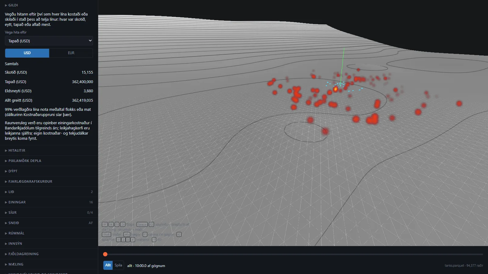

# Gildisvigtun

Hvert skot, skotfæri, tapað farartæki og lítri af eldsneyti hefur verð. Skoðarinn reiknar út hvað hver lína kostaði eða skilaði og getur vegið hitann eftir því, svo kortið sýnir **hvert peningarnir fóru** í stað þess hvar línurnar eru.

## Hvernig þú notar hana {#how-to-use-it}

1. Hladdu gögn með atburðum (skotum, drápum, dauðsföllum) og heitum farartækja eða vopna.
2. Opnaðu **Gildi** í Heat-hliðarstikunni.
3. Veldu **Vega hita eftir**, til dæmis *Lost (USD)*. Hitinn bætir nú við verði hverrar línu í stað 1.
4. Lestu **Samtals**: summu hvers gildisdálks fyrir það sem er sýnt (síur og tímaglugginn gilda).
5. Þar sem verðin eru raunverulegir peningar birtist rofi **USD / EUR**.

Veldu auðu fyrstu færsluna í valmyndinni til að telja línur aftur.

## Hvað má vega {#what-can-be-weighed}

Gildisdálkarnir eru lagðir við við hleðslu, einn fyrir hverja tegund og gjaldmiðil:

| Tegund | Línur sem hann lendir á | Hvernig hann er verðlagður |
|---|---|---|
| **Skotið** | skot og skotflaugar | vopnið, annars meðaltal fyrir tegund skotfæris |
| **Eytt** | kaup, endurfæðing | peningadálkar leiksins (til dæmis kaupvalmynd skotleiks) |
| **Tapað** | dauðsföll, eyðilagt | eigið farartæki, annars meðaltal flokks þess |
| **Eyðilagt** | dráp | farartæki skotmarksins |
| **Veittur skaði** | högg | hlutdeild af verði skotmarksins |
| **Eldsneyti** | staðsetningar | eldsneyti notað, úr eldsneytisdálki eða metið út frá flokki og tíma |
| **Allt greitt** | | fired + spent + lost + fuel |
| **Unnið sér inn** | verðlaun | verðlaunadálkar leiksins sjálfs (`earn_…`) |
| **Nettó** | | earned mínus paid; teiknað sem hiti með formerki (jákvætt halli þar sem meira var unnið, neikvætt þar sem meira var greitt) |

Dálkaheitin eru `cost_<kind>_<currency>`, `earn_<currency>` og `net_<currency>`. Breytir sem þekkir gjaldmiðil leiksins sjálfs (til dæmis endurspilunarbreytir sem skrifar í innleiknar einingar) gengur fyrir innbyggðu verðtöflunum.

## Verðtöflurnar {#the-price-tables}

| Tafla | Gjaldmiðill |
|---|---|
| Raunheimur herinn: eldflaugar, sprengjur, skot, mótaðgerðir, flugvélar, þyrlur, landfarartæki, skip, eldsneyti | USD (EUR = USD × 0,92, fasti `EUR_PER_USD` í [`cost.ts`](https://github.com/Holdi601/3DHeat/blob/main/src/data/cost.ts); það er ekki lifandi gengi) |
| Kaupvalmyndir skotleikja og dráparverðlaun | einingar leiksins |
| Skriðdreka- og skipaleikir | einingar leiksins |
| Herkænskuleikir (nokkrar auðlindir) | ein dálkur á hverja auðlind auk einnar samsettrar |
| Stríðsleikir | stig |

Leikurinn er þekktur af heitum í gögnunum. Verð í raunheimi koma úr opinberum heimildum (fjárlagaskjölum, alfræðiritum) eða eru merkt sem áætlanir; þau eru ekki leiðrétt vegna verðbólgu. Listi yfir sjálfvirkt mynduðu töflurnar er á [Verðtöflum](ref-value-tables.md).

## Áætlanir {#estimates}

Auka flokksdálkurinn **Cost source** segir hvernig hver lína var verðlögð: `table`, `class average`, `estimate` eða `none`. Value-hlutinn sýnir hvaða hlutfall verðlagðra lína eru meðaltöl eða áætlanir. Til að halda aðeins nákvæmlega verðlögðum línum, taktu af *estimate* og *class average* undir **Cost source** í [Síum](filters.md).

## Hvar annars gildið birtist {#where-else-value-shows}

- [Innsýn](insights.md): niðurstöður *Costly ground* og *Earning ground*.
- [Sundurliðun](breakdown.md): Earned, Lost og Net peningar eftir liði, leikmanni eða vopni.
- [Rúmmál](volumes.md): gildisdálkar í tölfræðinni og samanburðinum.
