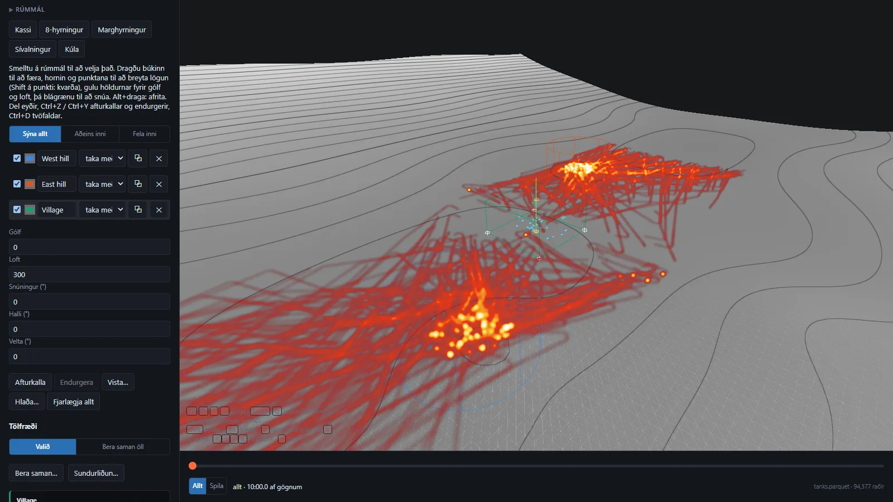
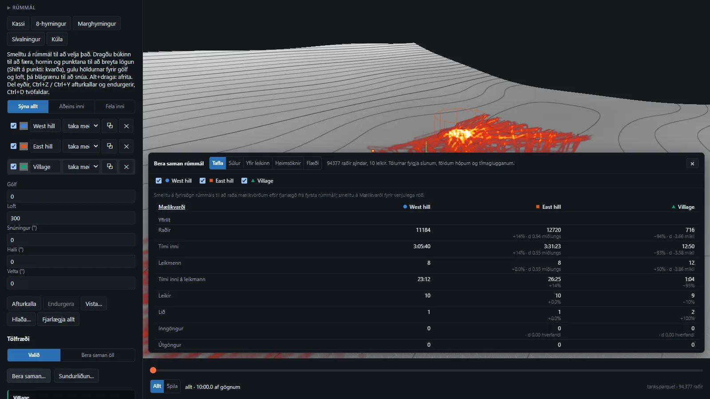
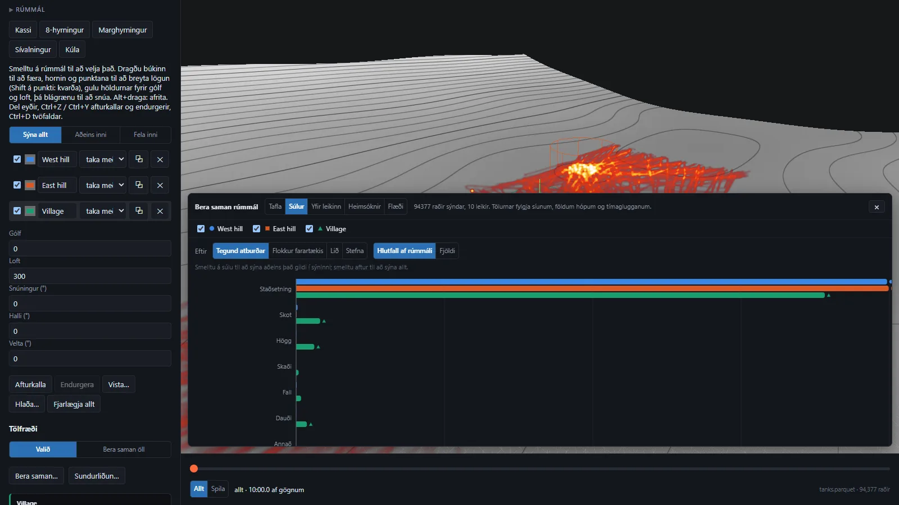

# Rúmmál og samanburður

**Rúmmál** er ósýnilegur kassi (eða sívalningur, eða kúla) sem þú teiknar utan um stað, til að spyrja: hvað gerðist hér inni? Notaðu það til að telja dráp við brú, bera saman tvær hæðir, eða sýna aðeins virknina á einu svæði.

```
 ofanfrá                  Þú teiknar form ->  sýnin telur
 +------------+           það sem er inni:
 |   ( A )    |            línur, leikmenn, dráp, tími ...
 |        [B] |           Berðu A saman við B, hlið við hlið.
 +------------+
```



Rúmmál mæla það sem gerist inni í þeim, sía sýnina niður á þau, flytja út línur þeirra, og má bera saman hlið við hlið. Sjá líka [orðasafnið](glossary.md) fyrir línu, manneskju og leik.

## Teiknaðu rúmmál {#draw-a-volume}

1. Opnaðu **Rúmmál** í hliðarstikunni.
2. Veldu verkfæri og teiknaðu í 3D-sýninni eða á 2D-kortinu. Gólf og þak byrja út frá gögnunum undir. Esc hættir við.
3. Smelltu á rúmmálið til að velja það; **Tölfræði** þess birtist.

| Verkfæri | Hvernig á að teikna |
|---|---|
| **Kassi** | Dragðu ferning (Shift: jafnhliða). Smellur setur sjálfgefinn kassa. |
| **n-hyrningur** | Dragðu frá miðjunni (Shift heldur honum jöfnum). *Horn* stillir n, frá 3 til 64 (sjálfgefið 8, svo hnappurinn sýnir **8-hyrningur**). |
| **Marghyrningur** | Smelltu á hornin; lokaðu með tvísmelli, Enter eða smelli á fyrsta hornið. Backspace fjarlægir síðasta hornið. |
| **Sívalningur** | Dragðu radíusinn. |
| **Kúla** | Dragðu radíusinn; hún hvílir á jörðinni. |

## Breyta {#edit}

- Smelltu á rúmmál til að velja það. Dragðu líkamann til að færa það, hornin til að móta það (Shift á horni skalar).
- **Gulu** handföngin stilla gólf og þak, **bláa** handfangið snýr því.
- Alt+drag afritar, Del fjarlægir, Ctrl+Z / Ctrl+Y afturkalla og endurtaka, Ctrl+D afritar. **Fjarlægja allt** eyðir öllum rúmmálum.
- Nákvæm gildi: Gólf, Þak, Snúningur / Halli / Veltur (kassar), Radíus (kúlur, sívalningar).

Sérhver rúmmálslína hefur gátreit fyrir sýnileika, lit, heiti, **taka með** eða **útiloka**, afrita og eyða. Rúmmál eru vistuð í vafranum fyrir hvert gagnasafn, og **Vista...** / **Hlaða...** skrifa og lesa skrána `volumes.json`.

## Síaðu sýnina {#filter-the-view}

| Sía | Áhrif |
|---|---|
| **Sýna alla** (sjálfgefið) | Rúmmálin mæla aðeins. |
| **Aðeins inni** | Hiti, endurspilun og [greining á hittum](hit-analysis.md) teikna aðeins það sem er inni í teknu rúmmálunum og utan útilokaðra. |
| **Fela inni** | Öfugt. |

Skjásían tekur allt að 8 rúmmál með 64 útlínupunktum samtals; "!" merkir rúmmál umfram það. Tölfræði og útflutningur telja það samt.

## Tölfræði {#statistics}

Svæðið **Tölfræði** fylgir síunum, tímaglugganum og földum hópum. *Valið* sýnir valda rúmmálið, *Bera saman öll* setur hvert rúmmál hlið við hlið. Það sýnir:

- **Raðir inni (sýndar)** og **Raðir inni (öll gögn)**, **Leikmenn**, **Lið**, **Leikir**, **Tími inni**, **Inngöngur / útgöngur**, **Hámarkshiti**, **Meðalhiti**, **Rúmmál / grunnflötur** og **Hvenær**-súlurit;
- **Sigurhlutfall**, þar sem gögnin segja hver vann ([úrslitadálkar](data-formats.md#outcome-columns)): af lotunum með leikmann inni, þar sem lota hvers leikmanns er talin einu sinni, hluturinn sem hlið hans vann - togaður að hlutfallinu yfir allt sem er sýnt um 4 lotur, eins og [sundurliðunin](breakdown.md) gerir - með unnum og spiluðum lotum og heildarhlutfallinu;
- fyrir hvern dálk: flokka með **Lyfting** (hlutdeild inni deilt með hlutdeild í öllum sýndum gögnum), og tölur með bili, miðgildi og 5.-95. hundraðshlutamörkum.

**Tölfræði sem CSV / JSON** vistar þær. **Flytja út gögnin inni** skrifar línurnar inni sem CSV eða Parquet (*Aðeins sýndu raðirnar* er kveikt sjálfgefið), eitt rúmmál eða öll með dálki sem segir hvaða rúmmál heldur hverri línu.

## Berðu rúmmál saman {#compare-volumes}

Með tvö eða fleiri sýnileg rúmmál, ýttu á **Bera saman…**.

1. Teiknaðu þrjú rúmmál, til dæmis Vesturhæð, Austurhæð og Þorpið.
2. Ýttu á **Bera saman…** undir Tölfræði.
3. Í **Tafla** les þú mismun hvers gildis frá fyrsta rúmmálinu.
4. Skiptu yfir í **Súlur** til að sjá hlutdeildirnar sem súlur.



| Sýn | Sýnir |
|---|---|
| **Tafla** | Raðir, tími inni, leikmenn, leikir, lið, inngöngur, útgöngur, heimsóknir, lengd heimsókna, dráp, dauðsföll, dráp á hvern dauða, dráp á mínútu, tími á hvern leikmann, gildisdálkar; flokkað eftir atburðum, flokki farartækis, leikmanni eða gervigreind, liði og stefnu. Hvert gildi sýnir mismun sinn frá fyrsta rúmmálinu og stærðaráhrif (hverfandi, lítil, meðal, mikil). Smelltu á haus rúmmáls til að raða eftir fjarlægð frá því fyrsta. |
| **Súlur** | Fjöldi eða hlutdeildir eftir atburði, flokki, leikara, liði eða stefnu. Smelltu á súlu til að sía sýnina niður á hana. |
| **Yfir leikinn** | Eitt línurit á hvert rúmmál yfir mínútur leiksins: viðvera, raðir eða dráp. Smelltu til að hoppa þangað. |
| **Heimsóknir** | Kassa- og fiðluritum af því hversu lengi heimsóknir standa (lógaritmískur kvarði). |
| **Flæði** | Hvert ferlar fara eftir að hafa yfirgefið hvert rúmmál: umbreytingafylki eða flæðisbönd. |



## Ábendingar {#tips}

- Byrjaðu á niðurstöðu: í [Innsýn](insights.md) bætir **Rúmmál hér** við sívalningi utan um stað niðurstöðunnar.
- **Sundurliðun...** opnar [Sundurliðunina](breakdown.md) fyrir valda rúmmálið: hver og hvað gengur best inni í því.
- [Stefnuhiti](directional-heat.md) getur teiknað stefnurnar inni í valda rúmmálinu.
- [Flipinn Farartæki](hit-analysis.md#restrict-to-an-area) notar sömu rúmmál sem svæðissíu sína.
