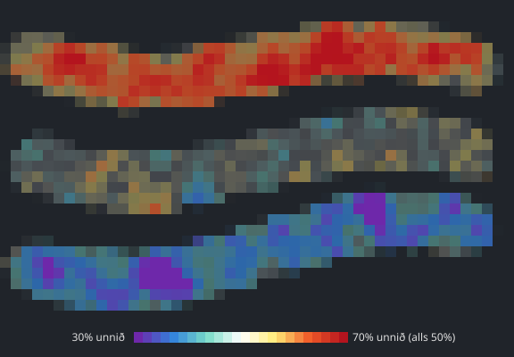

# Sigurhlutfall: hve oft staður, leið eða leikflétta vinnur

Hvar leikmaður stendur, hvaða leið hann fer, hvar hann kastar búnaði sínum - og hve oft hlið hans vinnur svo lotuna. **Sigurhlutfallskortið** litar hvern stað eftir hlut raðanna þar sem tilheyra lotum sem hlið raðarinnar vann, borið saman við hlutinn yfir allt sem er sýnt: heitt þar sem hann er hærri, kalt þar sem hann er lægri, ekkert þar sem hann er sá sami.

*Myndin sýnir tilbúin gögn: þrjár leiðir á tómu borði, með 68%, 50% og 33% af röðum sínum í unnum lotum.*

Það þarf gögn sem segja hver vann: [úrslitadálkana](data-formats.md#outcome-columns) (`won`, `matchWon`, `roundEndReason`). Breytar CS2 og War Thunder skrifa þá, Tacview-breytirinn fyrir herferðir DCS-þjóns ([DCS-þjónar](tacview-acmi.md#dcs-servers-who-won-and-how-each-sortie-ended)); hvaða skrá sem er getur haft þá.

## Prófaðu {#try-it}

1. Hladdu inn leikjum með úrslitadálki og ýttu á `2` (**Mismunur**).
2. Í **Mismunaskipting** ýtirðu á **Sigurhlutfall í lotum** (eða **Sigurhlutfall í leikjum**). Það setur unnu loturnar á **+** og þær töpuðu á **−** og skiptir spjaldinu yfir í **Hlutur +**.
3. Lestu litina. Spjaldið segir heildarhlutinn: *Alls eru 52,0% af 1.200.000 röðum á +.*
4. Þrengdu það með [síunum](filters.md): ein hlið (T eða CT), ein tegund atburða (*Staðsetning* fyrir hvar fólk stóð, *Skot* eða *Skot á loft* fyrir hvaðan það skaut eða kastaði), ein kaup, eitt kort.

Staður sem er heitur með *Staðsetning*-röðum er staður þar sem þeir sem héldu honum unnu oftast lotuna. Með *Fall*-röðum er það staður þar sem fellingarnar sem þar urðu leiddu til unninna lota.

## Stillingarnar {#the-settings}

| Stilling | Hvað hún gerir | Sjálfgefið |
|---|---|---|
| **Mismunur** / **Hlutur +** | mismunurinn sjálfur, eða hlutur +-hliðarinnar af röðunum á hvorri hlið | Mismunur |
| **Fullur litur við** | hve langt fyrir ofan eða neðan heildarhlutinn staður er sýndur í fullum lit, í prósentustigum | ± 20 prósentustig |
| **Fæstar raðir til að lita stað** | staður með færri raðir er ekki litaður; hann birtist smám saman frá helmingnum af því | 12 |
| **Tog að heildarhlutnum (raðir)** | hver staður byrjar með þetta margar raðir á heildarhlutnum, svo staður með 3 raðir, allar unnar, er ekki sýndur sem 100% | 12 |

Allar þrjár virka á fullgerðu myndina: að draga þær endurræsir aldrei uppsöfnunina.

Hluturinn á við hvaða skiptingu sem er, ekki aðeins sigra: *Hlutur +* með skiptingu eftir hlið sýnir hvar T-hliðin var stærri hluti viðverunnar, og með skiptingu eftir skrám tveggja korta hvar raðir annarrar skrárinnar vega meira en hinnar.

## Raðir, ekki lotur {#rows-not-rounds}

Kortið telur raðir. Leikmaður sem stendur á einum stað í tuttugu sekúndur bætir við röð fyrir hvert sýni, allar úr einni lotu, svo vitnisburðurinn á stað eru raðirnar nálægt honum, ekki loturnar. Þess vegna eru lágmarkið og togið í röðum, og þess vegna eru þau stærri en ein lota gefur.

Fyrir loturnar sjálfar:

- **[Sundurliðun](breakdown.md)** á punkti, sýninni eða rúmmáli: *Sigrar %* telur lotu hvers leikmanns einu sinni, togaða að heildarhlutfalli staðarins á sama hátt (4 lotur).
- Tölfræði í **[Rúmmál](volumes.md)**: *Sigurhlutfall* - loturnar með leikmann inni í rúmmálinu, hver einu sinni, togaðar að hlutfallinu yfir allt sem er sýnt, með fjöldanum.

## Úrslitasíur {#outcome-filters}

Spjaldið [Síur](filters.md) sýnir úrslitadálkana strax á eftir dálkum skoðarans sjálfs: **Úrslit lotu** og **Úrslit leiks** (*Hvað sem er*, *Unnið*, *Tapað*) og **Hvernig lotan endaði** (Útrýming, Sprengjan sprakk, Sprengjan aftengd, Tíminn rann út, Uppgjöf, Jafntefli, Markmið, Svæðum haldið, Miðar tapaðir, Öll farartæki töpuð), á tungumáli skoðarans.

## Fyrir forritara {#for-developers}

Hitaumferðin skrifar þrjár summur í fjögurra rása markið sem liðahiti notar: hitann `R = Σ|v|`, hita +-hliðarinnar `P` og `S = Σ v²/w`, þar sem `w` er vægi umferðarinnar (úrtaksvægi sinnum rammamögnun). Samsetningin les hlutinn `P/R` (kjarnavegið meðaltal) og raðirnar sem hann byggir á, `n = R²/S` (virk úrtaksstærð Kish), togar hlutinn að heildarhlutnum, `p = (n·P/R + m·r0)/(n + m)`, og litar `p - r0` yfir bilið á mismunaskölunum.

`n` deilir út hverjum þætti sem raðirnar við díl eiga sameiginlegan - rammamögnuninni, úrtaksvæginu, flatarvægi klippts sprite - svo myndin er sú sama við hvaða aðdrátt og úrtaksþéttleika sem er, og rammar af hverri k-tu röð renna saman í heildina án þess að litirnir hoppi. Heildarhluturinn kemur úr talningu örgjörvans eftir hliðum, haldið upp á tíundahluta úr prósenti; ekkert er lesið til baka úr skjákortinu. Útreikningurinn og prófanir hans: [`render/rateMap.ts`](https://github.com/Holdi601/3DHeat/blob/main/src/render/rateMap.ts) og prófið hans.

Það kostar það sama og liðahiti: fjögurra rása markið fjórfaldar blöndunarbandbreidd hitaumferðarinnar, aðeins á meðan kveikt er á *Hlutur +*.
