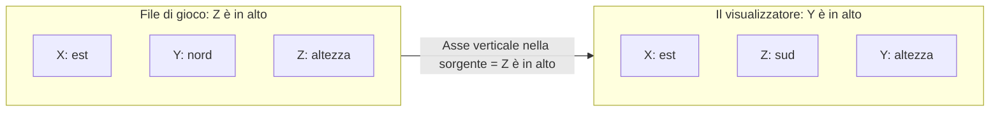

# Assi, unità e tempo

I giochi e le mappe non concordano su quale sia l'alto, su quanto sia lunga un'unità e su come si scrive il tempo. Questa pagina mostra le tre impostazioni che fanno stare, scalare e scorrere i tuoi dati nel modo giusto.

Se la tua mappa sta in piedi come un muro invece di giacere come un pavimento, cambia **Asse verticale nella sorgente**.

Con un **Asse verticale nella sorgente** sbagliato la mappa sta in piedi come un muro; con quello giusto giace come un pavimento.

## Il mondo in cui disegna il visualizzatore {#the-world-the-viewer-draws-in}

Il mondo del visualizzatore è **Y in alto**: X e Z sono il piano del terreno, Y è l'altezza. La maggior parte dei motori di gioco è **Z in alto**: per loro X e Y sono il terreno e Z è l'altezza. Alcuni motori sono anche specchiati (mano sinistra). La mappatura dice come trasformare gli assi del file in quelli del visualizzatore. (Tecnicamente il visualizzatore è a mano destra, la convenzione di three.js.)

### Asse verticale {#up-axis}

**Asse verticale nella sorgente** nella [Mappatura delle colonne](column-mapping.md):

| Impostazione | File (x, y, z) diventa mondo (X, Y, Z) |
|---|---|
| *Z è in alto (la maggior parte dei motori di gioco)* - il predefinito | (x, **z**, **y**): la Z del file diventa l'altezza e la Y del file diventa la Z del mondo |
| *Y è in alto (convenzione della grafica)* | (x, y, z) invariato |

Per i dati con Z in alto i tre array vengono rietichettati invece che copiati ([`remapAxesInPlace`](https://github.com/Holdi601/3DHeat/blob/main/src/data/ingest.ts)), il che fa risparmiare centinaia di megabyte nei caricamenti grandi. La stima si fa dal campione: la colonna tra Y e Z con la dispersione minore è quella in alto.

### Inversioni {#flips}

**Inverti X**, **Inverti Y**, **Inverti Z** negano l'asse *del file* con quel nome, prima della rietichettatura - quindi con Z in alto, *Inverti Y* nega ciò che finisce come Z del mondo. Un'inversione cambia i dati caricati: le coordinate mostrate dal [righello](measure.md), dalla sezione e dalla posa della telecamera sono quelle invertite.

Per disegnare un mondo specchiato nel verso giusto **senza** cambiare i dati, usa invece **Telecamera e scena → Inverti asse del mondo** ([Telecamera](camera.md#invert-world-axis)). È la scelta migliore per i giochi il cui mondo è a mano sinistra, perché ogni coordinata mostrata dagli strumenti resta quella del gioco.

### Scala delle unità {#unit-scale}

**Scala delle unità** moltiplica ogni posizione. *1 (m)* imposta 1, *0,01 (cm→m)* imposta 0,01 (le unità di Unreal Engine sono centimetri, quindi usa 0,01; le unità del motore Source sono pollici, quindi usa 0,0254; nessuna delle due sono metri), e la casella accetta qualsiasi valore. Uno 0 digitato o un valore che non è un numero viene sostituito con 1.

Il visualizzatore indica le distanze in metri (raggio dello sprite, distanze di culling, righello, velocità di volo), il che è vero solo quando l'unità del mondo scalata è un metro. Nulla si rompe quando non lo è; le etichette semplicemente dicono "m" qualunque sia l'unità.

## Tempo {#time}

### Unità di tempo {#time-units}

Regola pratica: valori come 17000000000 (dieci cifre o più) sono un timestamp Unix; valori come 0, 0,25, 0,5 sono secondi dall'inizio.

| Unità di tempo (etichetta del menu) | Letta come | Ora dell'orologio mostrata |
|---|---|---|
| *Secondi (relativi)* | valore × 1 s | no |
| *Millisecondi (relativi)* | valore × 0,001 s | no |
| *Microsecondi (relativi)* | valore × 10^-6 s | no |
| *Nanosecondi (relativi)* | valore × 10^-9 s | no |
| *Timestamp Unix (s)* | secondi dal 1970-01-01 UTC | sì |
| *Timestamp Unix (ms)* | millisecondi dal 1970-01-01 UTC | sì |
| *Stringa di data ISO-8601* | testo come `2026-03-14T18:02:11.250Z`, analizzato con `Date.parse` del browser | sì |

Con un'unità assoluta (le ultime tre) il dataset mantiene l'istante dell'orologio della sua riga più antica, e la linea temporale mostra accanto alla testina l'ora UTC corrente (`HH:MM:SSZ`).

**Le colonne `TIMESTAMP` e `DATE` di Parquet** si decodificano in istanti reali, quindi la loro impostazione di unità viene ignorata e il pannello lo dice. Una colonna `DATE` è un giorno intero: ogni riga di un giorno condivide un unico istante e la riproduzione salta un giorno alla volta, cosa che il pannello segnala.

**Le stringhe ISO-8601 funzionano sia in CSV sia in Parquet.** Una colonna di tempo testuale con l'unità ISO viene analizzata una volta per ogni stringa distinta; se nessuna si analizza, il caricamento fallisce con *Nessun timestamp ISO-8601 analizzabile nella colonna del tempo mappata.* - e la mappatura già si rifiuta di partire quando nessuno dei valori campionati si analizza. Una colonna `TIMESTAMP` di Parquet viene letta come timestamp qualunque sia l'unità impostata, e una colonna numerica di Parquet con l'unità ISO viene letta come millisecondi Unix. Una colonna di tempo testuale con un'unità numerica viene rifiutata prima del caricamento: ogni valore risulterebbe NaN.

### Come viene memorizzato il tempo {#how-time-is-stored}

Mentre i file vengono uniti, i tempi sono secondi a 64 bit, così un epoch assoluto conserva il dettaglio sotto il secondo. Quando tutti i file sono dentro, il tempo più antico dell'intera selezione diventa 0 e ogni riga memorizza secondi a 32 bit a partire da esso. Un float a 32 bit ha 24 bit di mantissa: intervalli fino a circa un giorno e mezzo si risolvono meglio di 1/100 s, intervalli di mezzo anno fino a circa un secondo. Una riga il cui tempo manca o non è un numero viene collocata a 0, cioè all'inizio.

Le righe vengono poi ordinate per tempo, ed è questo che rende economica la linea temporale: una finestra temporale si trova con due ricerche binarie (vedi [Campionamento e budget](sampling-and-budgets.md)).

### Tempo trascorso contro orologio {#elapsed-time-versus-wall-clock}

Una colonna di tempo come `match_time` o `round_time` conta dall'inizio di ciascuna partita. Sceglierla mette ogni partita su un unico asse condiviso - utile per confrontare ciò che accade al minuto 3 di ogni partita - e il pannello lo fa notare. Una colonna di orologio mostra le partite nell'ordine in cui sono avvenute davvero, sovrapposte dove si sono sovrapposte.

## Direzione dello sguardo {#look-direction}

La direzione dello sguardo è usata solo dal [replay a scatola](box-replay.md) (i raggi di ogni scatola). È memorizzata come due angoli, imbardata e beccheggio, in radianti.

- Le **colonne di imbardata / beccheggio** vengono lette così come sono, convertite dai gradi quando si sceglie *Gradi*. Non vengono adattate all'asse verticale né alle inversioni.
- Le **colonne del vettore di direzione** passano per la stessa rietichettatura e le stesse inversioni delle posizioni, poi diventano imbardata = atan2(x, -z) e beccheggio = atan2(y, √(x² + z²)) in assi del mondo, così il raggio punta dove guarda la scatola anche in un mondo di origine specchiata.

Se le colonne di imbardata/beccheggio risultano puntare nel verso sbagliato dopo un'inversione, un vettore di direzione o angoli adattati, la correzione è quella.
