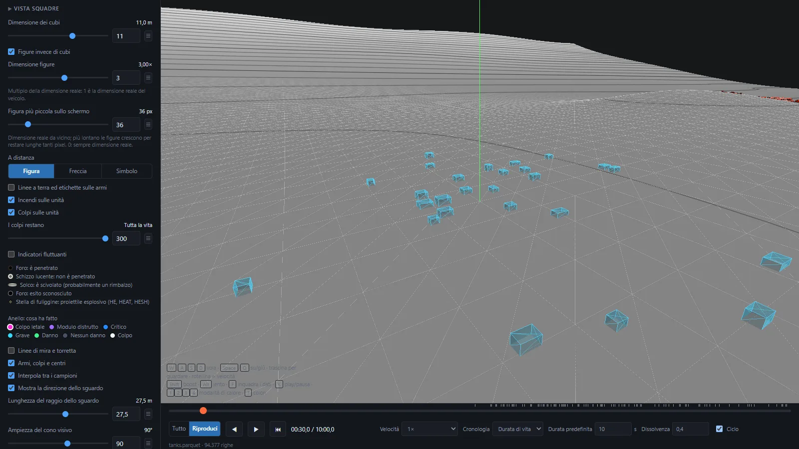

# Figure sovrapposte (replay a scatola)

Un piccolo film: una figura per ogni persona, che si muove mentre scorre il tempo, con una scia alle spalle.

La modalità si chiama **Figure sovrapposte** nella barra delle modalità. Questa pagina si chiamava un tempo "replay a scatola", perché prima che esistessero le figure ogni persona era una scatola; "replay di figure" e "replay a scatola" significano la stessa cosa. **Figure sovrapposte** non ha un tasto numerico: si sceglie nella barra delle modalità. Disegna una figura (o scatola) per [persona](glossary.md), che si muove lungo la [linea temporale](timeline.md), con raggi di sguardo e scie facoltativi. È riproduzione più che densità: *chi era dove, quando*. Richiede una colonna della persona; senza una colonna del tempo ogni campione viene disegnato in una volta.

## Come si usa {#how-to-use-it}

1. Carica dati con una colonna della persona e una colonna del tempo.
2. Scegli **Figure sovrapposte** nella barra delle modalità.
3. Porta la linea temporale su **Riproduci** e premi play (`K`).
4. Apri **Vista squadre** per cambiare la **Lunghezza della scia**, la dimensione delle figure o i raggi di sguardo.

In questa modalità non viene disegnato nessun calore, e il budget adattivo degli sprite è inattivo.

Di default ogni persona viene disegnata come la figura di ciò che è, invece che come una scatola - vedi [Figure](figures.md) per la figura assegnata a ciascuna unità, e [Replay della partita](match-replay.md) per le etichette, la telecamera che segue, la misura tra due unità e l'elenco degli eventi.

## Il pannello Vista squadre {#the-team-viewer-panel}

Mostrato al posto dei pannelli del calore in questa modalità.

| Comando | Predefinito | Intervallo (rotella) | Significato |
|---|---|---|---|
| **Figure invece di cubi** | attivo | | Ogni persona come la figura di ciò che è: un soldato a piedi, il carro o l'aereo che i dati indicano. Ciò che i dati non dicono resta una scatola. |
| **Dimensione figure** | 1× | | 1× è la dimensione reale. |
| **Figura più piccola sullo schermo** | 36 px | 0 = sempre dimensione reale | Dimensione reale da vicino; a distanza le figure crescono per restare lunghe questi pixel. |
| **Armi, colpi e centri** | attivo | | Armi in volo con fumo, traccianti, impatti, colpi e uccisioni. I traccianti dedotti da un colpo sono tratteggiati. |
| **Dimensione dei cubi** | dimensione dell'entità, oppure estensione / 500, al caricamento | 0,05-200 m, logaritmico (5000) | Lunghezza dello spigolo di ogni scatola. Vedi [dimensione dell'entità](sessions-persons-groups.md#entity-size). |
| **Interpola tra i campioni** | attivo | | Tra due campioni della stessa persona nella stessa sessione, colloca la scatola in proporzione tra di essi. Mai attraverso il confine di una sessione. |
| **Mostra la direzione dello sguardo** | attivo | | Un raggio da ogni scatola lungo la direzione dello sguardo della persona (richiede le [colonne dello sguardo](axes-units-and-time.md#look-direction)). |
| **Lunghezza del raggio dello sguardo** | dimensione dell'entità × 4, oppure estensione / 200, al caricamento | 0,5-500 m, logaritmico (20.000) | Mostrato mentre la direzione dello sguardo è attiva. |
| **Lunghezza della scia** | 8 s | 0-300 s (86.400); 0 = spenta | Secondi di storia disegnati dietro ogni persona. |
| **Disegna ogni campione grezzo** | spento | | Una scatola per ogni campione memorizzato nella finestra invece di una scatola interpolata per persona. Sottocampionato per restare interattivo. |

I suggerimenti nel pannello spiegano che l'interpolazione e le scie uniscono i campioni solo all'interno di una sessione e, quando il caricamento ha [nomi condivisi](sessions-persons-groups.md#names-worn-by-several-things-at-once), quanti nomi vengono disegnati come campioni singoli.

## La sessione in riproduzione {#the-session-being-played}

Con una colonna della sessione, il selettore **Sessione** in cima alla barra laterale ([Sessioni](sessions-persons-groups.md#the-session-picker)) decide quale partita viene riprodotta. Al caricamento viene scelta la più attiva. Solo le righe di quella sessione diventano scatole e scie, e la linea temporale scorre sull'arco di quella sessione invece che sull'intero dataset. *Tutte le sessioni* riproduce ogni sessione insieme, senza mai unire i campioni tra sessioni.

## Cosa viene disegnato e quando {#what-is-drawn-when}

Da [`TrackCursor`](https://github.com/Holdi601/3DHeat/blob/main/src/data/tracks.ts):

**Scatole in diretta** (modalità Riproduci, campioni grezzi spenti). Per ogni persona visibile, il suo ultimo campione al o prima della testina:

- Se la persona ha un campione successivo, è nella stessa sessione, e il nome non è condiviso, la scatola viene collocata tra i due campioni in proporzione al tempo, con l'imbardata interpolata per il giro più corto e il beccheggio in modo lineare (quando *Interpola* è attivo).
- Altrimenti la scatola resta all'ultimo campione per la **Durata predefinita** della linea temporale (predefinita 10 s) e poi viene tolta, così i giocatori eliminati non restano lì.

**La modalità Tutto** ignora la testina e disegna ogni campione nell'intervallo come scatola.

**Campioni grezzi** disegna una scatola per ogni campione memorizzato nella finestra: l'*Arco* con la storia *Finestra*, altrimenti tutto fino alla testina. Al massimo 65.536 scatole; con più campioni, viene disegnato ogni *k*-esimo.

**Scie** (quando la lunghezza della scia è sopra 0 e i campioni grezzi non sono disegnati): una linea tra ogni coppia di campioni consecutivi di una persona negli ultimi *lunghezza della scia* secondi fino alla testina, che sfuma dall'80% di opacità alla trasparenza con l'età. Una scia si ferma a un cambio di sessione e non viene disegnata per i nomi condivisi. Al massimo 131.072 vertici; con più, le righe vengono saltate in modo uniforme.

**Chi è visibile:** una persona è nascosta quando il suo gruppo è deselezionato nell'[Elenco delle squadre](teams-list.md) (il suo gruppo è quello della sua prima riga), quando un filtro di gruppo lo esclude, o quando il pannello [Entità](entities.md) ha una selezione che non lo comprende. I [filtri](filters.md) di colonna non si applicano alle scatole.

## Colori {#colours}

Una famiglia di tonalità per gruppo e una sfumatura per membro, così un'occhiata dice da che parte sta qualcuno ([`teamMemberColor`](https://github.com/Holdi601/3DHeat/blob/main/src/render/colors.ts)). Le tonalità dei gruppi si alternano in una lista fissa di dieci - blu, rosso, verde, ambra, viola, ciano, magenta, lime, arancio, indaco - e i membri di un gruppo si distribuiscono tra luminosità 42-76% e saturazione 90-65%.

## Note {#notes}

- La figura sovrapposta ricostruisce le sue figure solo quando cambia qualcosa; un fotogramma inattivo ridisegna le ultime.
- La riga *Cubi* della [sovrapposizione delle statistiche](performance-and-stats.md) conta le scatole sullo schermo.
- La figura sovrapposta viene disegnata nella stessa scena del livello, quindi la [profondità di campo](camera.md#depth-of-field) sfoca le scatole ma mai il calore.
