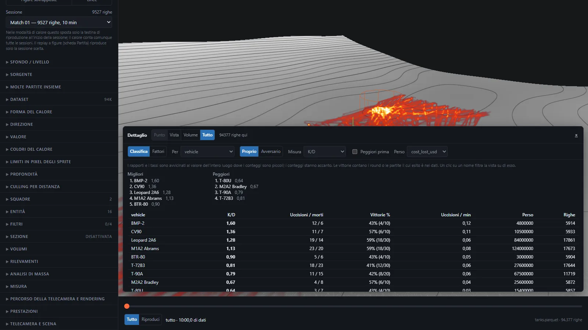
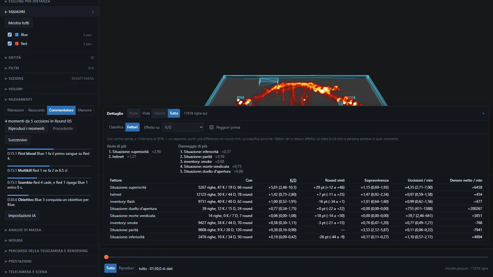

# Dettaglio: chi e cosa va meglio dove

Il **Dettaglio** risponde a una domanda: in questo luogo, quale veicolo, giocatore o arma rende di più? Usalo per trovare il carro che vince al ponte, o per vedere se indossare un elmetto aiuta davvero.

Classifica ciò che accade in un luogo (un punto scelto, la vista, un volume o tutto ciò che è mostrato) per qualsiasi categoria, e misura ogni fattore di stato con e senza.

## Provalo {#try-it}

1. Carica una partita con uccisioni e morti, e apri **Volumi**.
2. Disegna un volume attorno al luogo che ti interessa e selezionalo.
3. Premi **Dettaglio...** sotto Statistiche.
4. Sotto **Per**, scegli *Veicolo*, e scegli la misura *K/D* (uccisioni per morte).
5. Leggi la lista, dal migliore. Premi **Peggiori prima** per invertirla. Clicca un nome per filtrare la vista su di esso; clicca di nuovo per lasciarlo.

## Aprirlo {#open-it}

| Da | Regione con cui parte |
| --- | --- |
| **Dettaglio...** in [Volumi](volumes.md) (Statistiche) | il volume selezionato |
| **Dettaglio qui** sulla scheda del punto, dopo un clic su un punto | una sfera attorno a quel punto (**Raggio**, predefinito 3% della dimensione dei dati) |
| il pannello di divisione **Differenza** | la vista |

L'intestazione cambia la regione: **Punto**, **Vista** (ciò che la telecamera vedeva all'ultimo conteggio; **Conta di nuovo** dopo averla spostata), **Volume** (ne scegli uno) oppure **Tutto**. Il conteggio avviene in sottofondo; la riga di stato dice quante righe ci sono nella regione.

## Classifica {#ranking}

Scegli cosa classificare e una misura:

| Misura | Cos'è |
| --- | --- |
| A, B | righe di ciascun lato della mappa di differenza, divise come le divide il calore |
| A / B, A - B, A / (A + B) | i due strati uno contro l'altro |
| K/D | uccisioni contro morti |
| Vittorie % | round (o partite) vinti, dove i dati dicono chi ha vinto |
| Uccisioni / min | uccisioni al minuto presenti (lacune dei campioni di movimento) |
| Guadagnato, Perso, Denaro netto | somme delle colonne `earn_*` e `cost_*`; un selettore sceglie la valuta |

Uccisioni, morti, presenza, vittorie e denaro contano ogni riga che la vista mostra nel luogo, su entrambi i lati della divisione o su nessuno.

I rapporti e i tassi vengono tirati verso il valore di tutto il luogo dove i conteggi sono piccoli, così 2 uccisioni in 1 vita non finiscono in cima alla lista. I conteggi sono mostrati accanto ad essi.

Puoi classificare per i gruppi, i giocatori e le partite, qualsiasi colonna di categoria (un veicolo, un'arma, una parte, un tipo di acquisto, un agente o un kit), qualsiasi colonna numerica per intervalli (corazza, il valore di un equipaggiamento), la **classe** di una colonna d'arma (fucile, cecchino, mitra, pistola...) e quanti pezzi di **utilità** contiene una colonna lista come `inventory`.

**Proprio** classifica per il valore proprio della riga. **Avversario** classifica per il valore dell'altra parte: l'arma della vittima in caso di uccisione, quella dell'assassino in caso di morte (richiede una colonna `other` / `victim` che li nomini).

## Stato al momento {#state-at-the-time}

Il valore di una riga è il suo se la riga non registra nulla (una riga evento senza equipaggiamento) oppure se è una morte (la cui colonna arma può nominare l'arma dell'assassino); altrimenti è ciò che la stessa persona portava per ultimo prima nella partita.

## Fattori: con contro senza {#factors-with-against-without}

Passa da **Classifica** a **Fattori**, scegli **Effetto su**, e leggi *Aiuta di più* e *Danneggia di più*:

L'effetto di ciascun fattore su K/D, round vinti, sopravvivenza (minuti per morte), uccisioni al minuto e denaro netto al minuto, con un intervallo del 95%: i rapporti come x, i round vinti come differenza di punti. La classifica tira ogni stima verso nessun effetto in base alla sua incertezza, quindi un fattore raro ha bisogno di un effetto chiaro per salire in cima; l'intervallo mostrato è quello non tirato.

I dati con round aggiungono le **situazioni** da combattimento ravvicinato ([Combattimento ravvicinato e round](close-quarters.md)), calcolate una volta per dataset: *accecato* (la `state_flashed` della riga, oppure un flash nemico entro 15 m negli ultimi 3 s), *morte vendicata*, *duello di apertura*, e *uomo in più*, *numeri pari* o *uomo in meno* (giocatori vivi dal lato della riga contro il nemico). Una morte conta nella situazione in cui si trovava la sua vittima poco prima.

Al massimo 256 fattori vengono misurati in un unico passaggio.

## Per gli sviluppatori {#for-developers}

### Tirare i campioni piccoli {#pulling-small-samples}

Il valore di classifica è `(n + m*r0) / (d + m)`: `n` e `d` sono i conteggi, `r0` il rapporto di tutto il luogo e `m` il peso di quella prior.

### Per gli autori di convertitori: nominare le colonne dei fattori {#for-converter-authors-naming-factor-columns}

Un convertitore aggiunge un fattore nominando la sua colonna:

| Colonna | Fattore |
| --- | --- |
| `state_<name>` numero | attivo mentre è diverso da zero (`state_scoped`, `state_suppressor`) |
| `state_<name>` categoria | un fattore per valore (`state_ammo` = AP, HE...) |
| `active_<name>` | lo stesso, per qualcosa attivato o usato di recente: un'abilità, un ultimate, un gadget, un potenziamento (`active_ult`, `active_stim`) |
| colonna lista (`inventory`, `loadout`, `perks`, `abilities`, `attachments`, `modules`, `buffs`, `debuffs`, `upgrades`, oppure un nome `state_`/`active_` che finisce in `s`) | un fattore per oggetto di un valore `a\|b\|c` |
| flag dell'equipaggiamento già comuni (`helmet`, `defuser`, `armor`, `scoped`, `airborne`, `duck`, `flashed`...) | attivi mentre sono diversi da zero |
| `ammoType`, `shellType`, `ammoName` | il colpo sparato per ultimo |

Risultati: una colonna `won` 0/1 (il lato della riga ha vinto il round o la partita) e una colonna `round`, le [colonne di esito](data-formats.md#outcome-columns); dove un file ha sia `won` sia `matchWon`, *Vittorie %* conta i round. Denaro: `earn_<currency>` e `cost_<kind>_<currency>`; un reddito per tipo soltanto (`earn_round_cs2`, le ricompense esatte di round di un convertitore) sostituisce solo il reddito di quel tipo del modello dei costi (`round` copre anche piazzamenti e disinneschi), e il modello valuta il resto.

La mappatura carica da sola queste colonne, accanto alla lista propria del file: ogni colonna `state_*`, `active_*`, `won`, `round` e lista, eccetto quelle che le statistiche di un file Parquet mostrano con un solo valore per tutto (ogni colonna caricata occupa 4 byte per riga).
