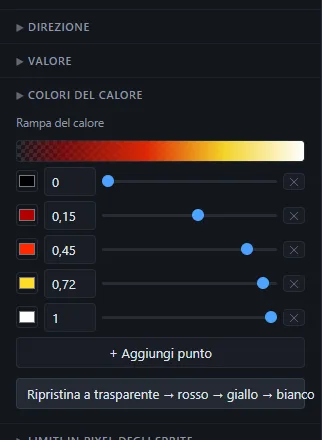

# Colore ed esposizione

Questi comandi decidono quanta quantità di calore riceve quale colore. **Punto di saturazione** è quanto calore conta come bianco incandescente.

## Correzioni rapide {#quick-fixes}

- Tutto è bianco: alza **Punto di saturazione**, oppure premi **Esposizione automatica dal campo**.
- Non si vede niente: abbassa **Punto di saturazione**, oppure premi **Esposizione automatica dal campo**.
- Si vedono solo pochi puntini: alza **Calore minimo**.

Ogni comando di questa pagina agisce quando il calore viene trasformato in colore. Quindi trascinarne uno ridisegna subito e **non fa mai ripartire l'accumulo**.

## Punto di saturazione {#saturation-point}

**Punto di saturazione** (sezione Forma del calore): il calore accumulato che corrisponde alla cima della rampa di colori (con la risposta *Lineare*; per le altre vedi sotto). Cursore logaritmico 0,1-4000, la maniglia arriva fino a 10.000.000, perché il calore accumulato cresce con il numero di righe. Predefinito 24; a ogni caricamento viene prima una **stima analitica**, poi **misurato** dall'immagine.

Sbagliarlo è la differenza tra una mappa di calore e uno schermo vuoto (o bianco). Non si può ricavare in modo affidabile: i dati di telemetria si raggruppano così tanto - uno spawn, una porta, un punto stretto - che il rapporto tra densità di picco e densità media cambia di un ordine di grandezza tra un dataset e l'altro e tra un'angolazione della telecamera e l'altra.

## Esposizione automatica {#auto-exposure}

**Esposizione automatica dal campo** misura il campo che lo shader ha prodotto davvero. Ignora i pixel vuoti, prende il 98° percentile di quelli illuminati e lo porta all'85% del percorso verso il punto di saturazione. Così la cima della rampa resta per i picchi reali.

Il pannello poi mostra *misurato il X% del fotogramma; 98° percentile R posto vicino alla cima della rampa*. Con la risposta *Saturante*, un valore all'85% del punto di saturazione finisce a circa il 57% della rampa, non all'85%.

Viene eseguita anche **automaticamente**:

- 8 fotogrammi disegnati dopo il caricamento di un dataset;
- 8 fotogrammi dopo che i [filtri](filters.md) cambiano (filtrare ogni posizione fino a cento eventi cambia la densità di ordini di grandezza);
- 8 fotogrammi dopo il passaggio tra calore a punti e [calore a linee](line-heat.md), o dopo aver cambiato quali percorsi disegna il calore a linee, perché una linea deposita molto meno calore per campione di quanto faccia uno sprite.

Quando non c'è niente di illuminato, la misura automatica lascia invariata la saturazione. Il pulsante ricorre alla stima analitica e dice *niente di illuminato da misurare — usata la stima analitica*.

### Segui la vista {#follow-the-view}

**Segui la vista** (sezione Forma del calore, attivo di default) rimisura l'esposizione ogni volta che la telecamera si ferma. Così una regione in cui si vola usa tutta la rampa di colori, invece della scala misurata per l'intera mappa. Le piccole variazioni vengono ignorate e la scala scorre invece di saltare. Funziona nelle quattro modalità di calore, non nella figura sovrapposta.

Disattivalo per bloccare la scala e confrontare luoghi su un'unica scala. Anche trascinare **Punto di saturazione** a mano la blocca.

## Risposta alla densità {#density-response}

**Risposta alla densità** - come *k* (calore / saturazione) si mappa sulla rampa:

| Risposta | Formula | Uso |
|---|---|---|
| **Saturante** (predefinita) | t = 1 - e^(-k) | Si avvicina alla cima della rampa in modo asintotico, come fanno gli sprite traslucidi sovrapposti. Niente si appiattisce mai sul bianco pieno, per cui è il default sicuro sui dati non conosciuti. |
| **Lineare** | t = k | L'unica mappatura in cui lo stesso colore significa lo stesso conteggio. Usala per confrontare due dataset o due intervalli di tempo. |
| **Log** | t = log₂(1 + 7k) / 3 | Comprime una coda lunga, così un punto caldo estremo non appiattisce tutto il resto in fondo alla rampa. Schiarisce le zone rade. |

## Calore minimo {#minimum-heat}

**Calore minimo** (predefinito disattivato, 0-100%): ogni pixel che ha un minimo di calore viene portato almeno a questo punto della rampa. Alzalo, e abbassa il raggio dello sprite, per vedere *dove è mai successo qualcosa*: i singoli dati diventano ben visibili invece di restare appena sopra il trasparente. Lascialo spento quando giudichi la densità, perché appiattisce per costruzione il fondo della rampa. La soglia (k > 0,0001) fa restare vuoti i pixel davvero vuoti.

## L'editor della rampa {#the-ramp-editor}

Nella sezione **Colori del calore**. L'etichetta dice a cosa serve la rampa: *Rampa del calore* in Calore e Linee, *Positiva (squadre additive)* in Differenza, *Rampa di opacità (il colore viene dal gruppo)* in [Calore per squadra](team-heat.md), dove si usa solo la sua alfa.



La barra in alto mostra in anteprima la rampa. Sotto, una riga per ogni punto:

| Parte | Significato |
|---|---|
| Campione di colore | Il colore del punto (il selettore colori del browser). |
| Numero | La posizione del punto lungo la rampa, da 0 a 1 (0 = nessun calore). |
| Cursore | L'opacità del punto, 0-100%. |
| ✕ | Rimuove il punto; disattivato quando ne restano solo due. |

**+ Aggiungi punto** aggiunge un punto a metà strada tra gli ultimi due, con il colore e l'opacità dell'ultimo punto. **Ripristina a trasparente → rosso → giallo → bianco** ripristina il predefinito.

I punti possono essere in qualsiasi ordine; vengono ordinati quando la rampa viene costruita. L'**alfa** è ciò che miscela il calore sulla scena, ed è per questo che l'estremo zero della rampa predefinita è completamente trasparente.

### Le rampe predefinite {#the-default-ramps}

| Posizione | Positiva (Calore, Linee, Differenza +) | Negativa (Differenza −) |
|---|---|---|
| 0,00 | nero, alfa 0 | nero, alfa 0 |
| 0,15 | rgb(180, 0, 0), alfa 0,55 | rgb(0, 170, 60), alfa 0,55 |
| 0,45 | rgb(255, 40, 0), alfa 0,85 | rgb(0, 190, 200), alfa 0,85 |
| 0,72 | rgb(255, 220, 40), alfa 0,95 | rgb(40, 80, 255), alfa 0,95 |
| 1,00 | bianco, alfa 1 | rgb(170, 60, 255), alfa 1 |

## Mentre la telecamera si muove {#while-the-camera-moves}

Quando la telecamera si muove, l'accumulo riparte a ogni fotogramma. Con **Disegna ogni riga a ogni fotogramma** attivo (predefinito), ogni fotogramma in movimento è comunque esatto. Disattivandolo, un fotogramma in movimento mostra una stima a campione - grumi più luminosi, scalati per peso - che converge all'immagine vera e più liscia quando ti fermi. È previsto; vedi [Accumulo](accumulation.md).

## Per gli sviluppatori {#for-developers}

### Il passaggio di composizione {#the-composite-pass}

Dopo che il calore è stato accumulato, il valore di ogni pixel viene trasformato in colore in un unico passaggio di composizione ([`COMPOSITE_FS`](https://github.com/Holdi601/3DHeat/blob/main/src/render/webgl2/shaders.ts)). I passi sono:

```
k = |heat| / saturation point
t = response(k)                         clamped to 0..1
if minimum heat > 0 and k > 0.0001:  t = minimum + (1 - minimum) × t
colour, alpha = ramp(t)                  (the negative ramp when heat < 0, Difference only)
pixel = mix(scene, colour, alpha)
```

### La stima analitica {#the-analytic-estimate}

**La stima analitica** ([`estimateSaturation`](https://github.com/Holdi601/3DHeat/blob/main/src/data/calibrate.ts)) presuppone che le righe si distribuiscano sull'impronta X-Z dei dati: calore medio = righe × (π r² / area dell'impronta) × 1/3 × intensità al centro (1/3 è la media sul disco di una rampa lineare), per un rapporto ipotizzato picco/medio di 25, limitato a 0,1-1.000.000. Deve solo essere giusta entro un ordine di grandezza.

### Misura {#metering}

[`exposure.ts`](https://github.com/Holdi601/3DHeat/blob/main/src/render/exposure.ts):

1. il bersaglio del calore viene letto dalla GPU, sottocampionato a non più di 40.000 valori;
2. i pixel vuoti (calore ≤ 0,0001) vengono scartati - gran parte di un campo di calore è vuota, e mediarli nel risultato sottoesporrebbe tutto, come un esposimetro puntato su uno sfondo nero;
3. il 98° percentile dei pixel illuminati è il riferimento;
4. il punto di saturazione diventa riferimento / 0,85, così il riferimento sta all'85% del percorso verso il punto di saturazione e la cima della rampa resta per i picchi reali.

### La tabella dei colori {#the-colour-table}

La rampa viene fissata in una tabella RGBA 256 × 2 (la rampa positiva nella prima riga, la negativa nella seconda) ([`buildColorLut`](https://github.com/Holdi601/3DHeat/blob/main/src/render/colors.ts)). I colori vengono interpolati in luce lineare e memorizzati come sRGB; l'opacità viene interpolata in modo lineare.
