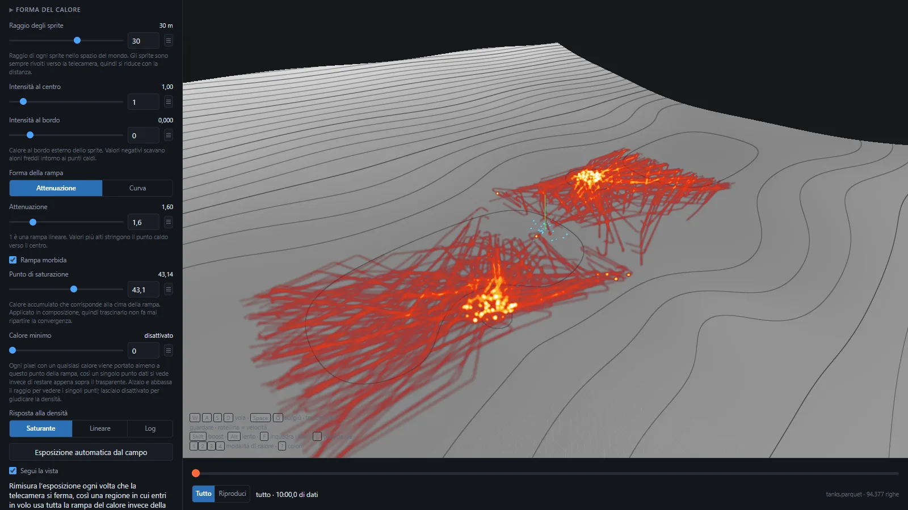
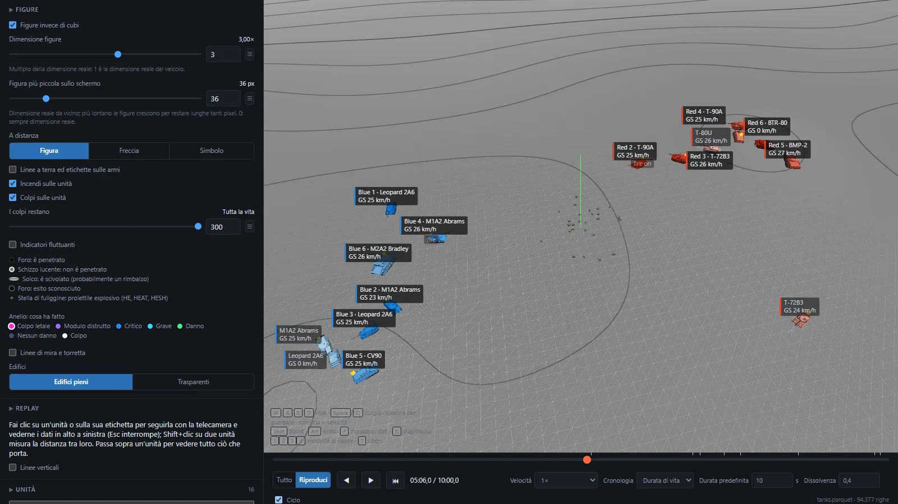

# Dati di esempio: prova il visualizzatore in cinque minuti



Non hai ancora dati tuoi? Il repository ne crea alcuni. Tutto è inventato: una valle, un cortile e partite di tre stili di gioco fittizi, con giocatori chiamati *Blue 1* o *Red 3*. Tutte le immagini di questo sito sono state fatte con questi dati.

## Crearli {#make-it}

```bash
node tools/demo-data.mjs
```

Scrive in `tools/.shots/demo/`:

| File | Cosa contiene |
|---|---|
| `demo-valley.glb` | una valle di 12 km con due colline e un villaggio, come livello 3D |
| `demo-yard.glb` | un cortile recintato di 160 m con edifici, come livello 3D |
| `tanks.parquet` | 10 partite di carri, 8 contro 8: movimento, colpi, colpi a segno con il punto sullo scafo, fuochi, uccisioni, relitti, mira della torretta, vincitori |
| `tanks/match-NN.parquet` | le stesse partite, un file per partita, per [molte partite insieme](many-matches.md) |
| `air.parquet` | un combattimento aereo 4 contro 4 con missili, flare, uccisioni e mancati |
| `shooter.parquet` | 12 round di 5 contro 5 a piedi: colpi, uccisioni, un piazzamento, crediti guadagnati e spesi, elmetti e utility |
| `mass/` | una cartella di piccole partite `.3dheat`, per l'[analisi di massa](mass-analysis.md) |
| un insieme di giri di gara | due giri della stessa auto su un percorso inventato, per [Analisi di gara](race-analysis.md) |

Ogni tabella indica le proprie colonne nel suo piè di pagina, quindi si carica senza alcuna mappatura.

## Provarli {#try-it}

1. Avvia il visualizzatore (`start.bat` su Windows, oppure `npm install` una volta e poi `npm run dev` su qualsiasi sistema) e apri `http://127.0.0.1:5273/`.
2. **Sfondo / livello → Modello 3D…** e scegli `demo-valley.glb`.
3. **Sorgente → File…** e scegli `tanks.parquet`.
4. Premi `F` per inquadrare i dati. Vedi il [calore](heat.md) di dieci partite.
5. Prova la barra delle modalità: **Differenza** (Blue contro Red), **Calore per squadra**, **Linee**.
6. Apri **Rilevamenti** (nella barra laterale Mappa di calore): trova i punti dove si è sparato, colpito e distrutto molto più che altrove, intorno alle due colline.
7. Apri la scheda **Partita**; sotto **Partite nel replay** scegli *Match 01*; premi **Riproduci** sulla linea temporale: il [replay](match-replay.md).



Per lo sparatutto carica `demo-yard.glb` e `shooter.parquet`; per il combattimento aereo `air.parquet` (le figure si vedono meglio con **Dimensione figure** 4, un cursore nel pannello **Vista squadre** della barra laterale Mappa di calore).

## Le schermate {#the-screenshots}

Le immagini del sito sono create da questi dati con uno script, in una qualsiasi delle lingue del visualizzatore:

```bash
node tools/demo-data.mjs
HEAT3D_FIGURE_PACK=none npx vite --port 5321 --strictPort --host 127.0.0.1   # PowerShell: $env:HEAT3D_FIGURE_PACK="none"; npx vite ...
node tools/docs-shots.mjs --lang en
```

Il server delle schermate gira senza un pacchetto figure locale: si mostra quindi solo il catalogo pubblico delle figure. Le immagini vanno in `docs/assets/img/<lang>/`. Vedi [Manutenzione della documentazione](maintaining.md).
