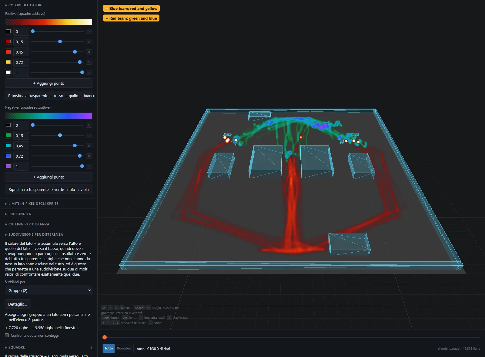

# Differenza

Rosso dove la squadra A era di più, verde-blu dove era di più la squadra B, niente dove erano pari.

**Differenza** (tasto 2) è calore con segno. Le righe di una popolazione aggiungono calore; le righe di un'altra lo sottraggono. Dove le due si sovrappongono in modo pari il risultato è zero e completamente trasparente; dove una domina si mostra nei colori di quella parte - per impostazione calda (trasparente → rosso → giallo → bianco) per il lato **+** e fredda (trasparente → verde → blu → viola) per il lato **−**.

## Come si usa {#how-to-use-it}

1. Premi `2` (o scegli **Differenza** nella barra delle modalità).
2. Apri **Suddivisione per differenza** nella barra laterale.
3. Scegli cosa **Suddividi per**: di solito *Gruppi*.
4. Metti un gruppo (o un valore) su **+** e un altro su **−**.
5. Leggi i colori: il caldo indica il lato +, il freddo il lato −. Il pannello avvisa se un lato non ha righe (vedi [Messaggi che potresti vedere](#messages-you-may-see)).

*Quali* due popolazioni è tutta la questione, quindi la suddivisione può essere su
qualunque colonna tenuta, non solo sui gruppi. Le righe che cadono su **nessuno** dei
due lati vengono **lasciate fuori**, non contate come zero: è questo che fa sì che una
suddivisione su due di molti valori confronti esattamente quei due, e si combina con i
[filtri](filters.md) - filtra fino a una sola mappa, poi suddividi quella per versione.

La modalità richiede due lati: una colonna di gruppo con almeno due gruppi, oppure una
suddivisione su una colonna tenuta per il filtraggio. Sui dati con meno di due gruppi, un
caricamento parte con una suddivisione per colonna - prima la colonna *Source file* di un
caricamento di più file, altrimenti la prima colonna di categoria con due valori, altrimenti
la prima colonna numerica con un'ampiezza - così *confronta due caricamenti* funziona anche
sui dati senza gruppi. Solo i dati senza nulla di questo lasciano la modalità non
disponibile; lo stesso vale per una suddivisione per colonna che non lascia nulla su un lato.

## Il pannello Suddivisione per differenza {#the-difference-split-panel}

Mostrato in modalità Differenza, sotto i pannelli di calore.

**Suddividi per** offre:

| Opzione | Mostrato come | Regola della suddivisione |
|---|---|---|
| Gruppi | *Gruppo (N)* (quando c'è una colonna di gruppo) | Ogni gruppo su +, − o nessuno, impostato nell'[Elenco delle squadre](teams-list.md) |
| Una colonna di categoria | *colonna (N valori)* | Valori su +, − o nessuno |
| Una colonna numerica | *colonna (numerica)* | Un intervallo di valori per ogni lato |
| Il file di origine | *Source file - confronta due caricamenti* (quando sono stati caricati più file) | File su +, − o nessuno |

Vengono proposte solo le colonne tenute con *Conserva per il filtraggio* al caricamento.

### Confronta quote, non conteggi {#compare-shares-not-counts}

**Confronta quote, non conteggi** (predefinito disattivato) pesa ogni lato con uno diviso per il suo numero di righe, così un lato con cinque volte le righe non vince solo per i numeri. Il colore mostra allora dove ciascun lato è proporzionalmente più comune dell'altro. Usalo quando i due lati hanno quantità di dati molto diverse, per esempio due sessioni di durata diversa.

### Messaggi che potresti vedere {#messages-you-may-see}

Il pannello avvisa quando l'immagine non è una vera differenza:

| Messaggio | Significato |
|---|---|
| *N + / M −* (o *N + / M − / K non usati*) | Quanti valori ci sono su ogni lato (e su nessuno dei due). |
| Nessuna riga nella finestra è sul lato **+** | Viene disegnato solo il lato **−**. Sposta la finestra della linea del tempo o cambia la suddivisione. |
| Nessuna riga nella finestra è sul lato **−** | Viene disegnato solo il lato **+**. |
| Nessun valore è su nessuno dei due lati | La differenza non disegna nulla. Metti almeno un valore su **+** o **−**. |
| *colonna* non può essere suddivisa in questo modo | La colonna scelta non si adatta alla suddivisione. Scegli di nuovo la colonna. |
| La colonna di suddivisione non è entrata nella memoria della GPU per N di M blocchi | Quelle righe non vengono disegnate. Alza il budget della GPU in Prestazioni → Budget delle risorse, oppure carica meno righe. |

### Per gruppo {#by-group}

Il pannello indica soltanto l'[Elenco delle squadre](teams-list.md), dove ogni gruppo ha un pulsante **+** e uno **−**. A ogni caricamento la prima metà dei gruppi (arrotondata per eccesso) va su +, il resto su −; **Dividi equamente** nell'Elenco delle squadre fa di nuovo lo stesso. Un gruppo su nessuno dei due lati, o nascosto con la sua casella, non contribuisce nulla.

### Per valori di categoria {#by-category-values}

| Parte | Significato |
|---|---|
| `a + / b − / c non usati` | Quanti valori ci sono su ogni lato e su nessuno dei due. |
| **Svuota** | Mette ogni valore su nessuno dei due lati. |
| Elenco dei valori | Ogni valore con un pulsante **+** e uno **−** (clicca di nuovo quello attivo per toglierlo da quel lato). Un valore vuoto è elencato come *(mancante)*. |
| Nota sul limite | Vengono elencati solo i primi 200 valori: *Mostro i primi 200 di N valori. Una colonna così larga è meglio restringerla prima con un filtro, oppure suddividerla per intervallo se i suoi valori sono ordinati.* |

Scegliere la colonna mette il suo primo valore su + e il secondo su −. Quando nessuno dei
due lati ha valori, la suddivisione ricade sui gruppi invece di mostrare un riquadro vuoto.
*Source file* funziona allo stesso modo, un valore per file - è così che si confrontano due
esportazioni, due prove o due versioni.

### Per intervallo {#by-range}

| Parte | Significato |
|---|---|
| Suggerimento | Il minimo e il massimo della colonna. |
| **Intervallo positivo (+)**, **da** / **a** | Le righe con un valore in questo intervallo, inclusi entrambi gli estremi, sommano. |
| **Intervallo negativo (−)**, **da** / **a** | Le righe in questo intervallo sottraggono. |
| **Suddividi a metà** | Imposta + su [minimo, metà] e − su [metà, massimo] - è anche ciò che fa scegliere la colonna. |

Un valore in entrambi gli intervalli conta come +. Gli intervalli non devono coprire la
colonna; i valori su nessuno dei due vengono lasciati fuori. *I primi due minuti contro gli
ultimi due* è una suddivisione per intervallo su una colonna simile a un tempo.

## Colori {#colours}

La sezione **Colori del calore** mostra in questa modalità due editor di rampa: **Positiva (squadre additive)** e **Negativa (squadre sottrattive)**, ognuno con il suo pulsante di ripristino (*Ripristina trasparente → rosso → giallo → bianco*, *Ripristina trasparente → verde → blu → viola*). Il composito prende il valore assoluto del calore netto attraverso il [punto di saturazione e la risposta](colour-and-exposure.md), e sceglie la rampa negativa dove il netto è sotto zero. Vedi [Colore ed esposizione](colour-and-exposure.md#the-ramp-editor).

Usa la risposta di densità *Linear* quando conta la dimensione della differenza: è l'unica risposta in cui un colore uguale significa un conteggio uguale.

## Per gli sviluppatori {#for-developers}

Ogni riga riceve un segno di +1, -1 o 0 nel vertex shader ([`POINT_HEAT_VS`](https://github.com/Holdi601/3DHeat/blob/main/src/render/webgl2/shaders.ts)); uno 0 scarta la riga prima che venga disegnato qualunque frammento.

- Per gruppo, il segno viene da una tabella di gruppi di 4.096 voci indicizzata dall'id di gruppo della riga (l'id di gruppo viaggia nel quarto canale del texel di posizione della riga).
- Per categoria, il segno viene da una seconda tabella di 4.096 voci, riempita per ogni valore di categoria, e il valore della riga viene letto dalla texture di filtro della colonna; un valore oltre la fine della tabella viene scartato su entrambi i backend.
- Per intervallo, il valore della riga viene confrontato con i due intervalli.

Cambiare la suddivisione riavvia l'accumulo.

**I gruppi nascosti restano nascosti con ogni suddivisione.** Con una suddivisione per colonna la tabella dei gruppi non porta più i segni; contiene 1 per un gruppo mostrato e 0 per uno nascosto ([`frameSignTables`](https://github.com/Holdi601/3DHeat/blob/main/src/render/filterTables.ts)), e entrambe le tabelle arrivano allo shader insieme - due righe di una stessa texture di segni su WebGL2, due metà di un unico buffer di archiviazione su WebGPU. Una riga viene disegnata solo quando il suo gruppo è mostrato *e* il suo valore di colonna è su un lato. Quindi un gruppo deselezionato nell'[Elenco delle squadre](teams-list.md), o lasciato fuori dal focus di lato della scheda Partita, non contribuisce nulla, qualunque sia il modo in cui la differenza viene suddivisa.
