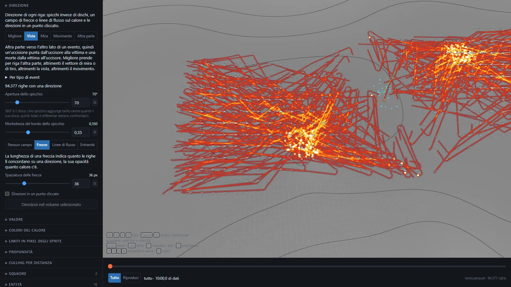

# Calore direzionale

Il calore semplice dice **dove** succedono le cose. Il calore direzionale dice anche **in che direzione**: in che verso guardavano le persone, miravano, si muovevano, o dove si trovava l'altra parte di uno scontro.

Uno sprite normale è un disco intero (360 gradi). Con un'**Apertura dello spicchio** di 70 gradi, lo stesso sprite diventa uno spicchio stretto che punta nella direzione in cui era rivolta la riga, e aggiunge lo stesso calore totale.

## Come si usa {#how-to-use-it}

1. Carica dati con una direzione (vedi [Cosa dà a una riga una direzione](#what-gives-a-row-a-direction)).
2. Scegli **Calore**, **Differenza** o **Calore per squadra** nella barra delle modalità.
3. Apri la sezione **Direzione** nella barra laterale.
4. Scegli una **fonte** (quale direzione usare), poi attiva il disegno:
   - abbassa **Apertura dello spicchio** sotto i 360° per disegnare ogni riga come uno spicchio che punta nella sua direzione invece che come un disco;
   - scegli un **Campo** per disegnare frecce o linee di flusso sopra il calore;
   - spunta **Direzioni in un punto cliccato** e clicca sul calore per ottenere un grafico polare di quel punto.

La riga di stato dice quante righe hanno una direzione dalla fonte scelta.

## Impostazioni {#settings}

| Impostazione | Predefinito | Cosa fa |
|---|---|---|
| Fonte: **Migliori**, **Vista**, **Mira**, **Movimento**, **Altra parte** | Migliori | Quale direzione riceve ogni riga. *Migliori* prende, per riga, l'altra parte, altrimenti la mira, altrimenti la vista, altrimenti il movimento. |
| **Per tipo di evento** | come sopra | Una fonte diversa per ogni tipo di evento, per esempio *Altra parte* per le uccisioni e *Vista* per le posizioni. Mostrato quando i dati hanno una colonna evento con al massimo 40 valori. |
| **Apertura dello spicchio** | 360° | 360° è il disco normale (spento). Un valore più piccolo è uno spicchio più stretto. Uno spicchio aggiunge tanto calore quanto il suo disco, così i totali e le differenze restano confrontabili. |
| **Morbidezza del bordo dello spicchio** | 0,35 | 0 è uno spicchio dal bordo netto, 1 un ventaglio morbido. |
| **Campo**: Nessun campo, Frecce, Linee di flusso, Entrambi | Nessun campo | Frecce: la lunghezza di una freccia è quanto le righe lì concordano su una direzione, la sua opacità quanto calore c'è. Le frecce compaiono solo dove c'è calore. |
| **Spaziatura delle frecce** | 28 px | Distanza tra le frecce sullo schermo. |
| **Anima le linee di flusso** | attivo | Le linee di flusso scorrono quando sono attive. |
| **Direzioni in un punto cliccato** | spento | Clicca sul calore per vedere le direzioni lì (sotto). |
| **Direzioni nel volume selezionato** | | Lo stesso grafico per tutto ciò che è dentro il [volume](volumes.md) selezionato. |

## Il grafico polare in un punto {#the-polar-chart-at-a-spot}

Con **Direzioni in un punto cliccato** attivo, clicca sul calore. Le righe vicine a quel punto (entro 1,5 raggi di sprite) vengono raccolte in una rosa di 24 settori da 15°:

- petali **arancio**: direzioni in uscita (verso dove puntano le righe);
- petali **blu**: direzioni in entrata (da dove sono arrivate);
- l'**area** di un petalo cresce con il suo conteggio; una freccia mostra la direzione principale;
- le linee sotto il grafico danno il rilevamento principale, quanto fortemente concordano le righe (R, da 0 a 1), la dispersione in gradi e il numero di righe.

0° è in alto nel grafico, che è il mondo −Z (nord per le registrazioni Tacview). Il punto è segnato anche nella vista 3D con una freccia e un anello.

## Cosa dà a una riga una direzione {#what-gives-a-row-a-direction}

| Fonte | Necessita nei dati |
|---|---|
| Vista | una colonna di imbardata (mappata come direzione dello sguardo): `yaw`, `heading`, `azimuth`, `view_yaw`, `rot_z` |
| Mira | coppie di numeri come `aim_x`/`aim_y`, `shot_x`/`shot_y`, `fire_x`/`fire_y`, `hit_dir_x`/`hit_dir_y` (un `…_z` facoltativo) |
| Movimento | niente di extra: il passo dal campione precedente della stessa persona (al massimo 10 s prima, stessa sessione) |
| Altra parte | una colonna che nomina l'altra parte di un evento (`other`, `victim`, `target`, `killer`, `attacker`, `shooter`, `other_player` ...) i cui valori sono nomi di persone; un'uccisione punta da chi uccide alla vittima, una morte dalla vittima a chi l'ha uccisa |

## Suggerimenti {#tips}

- Gli spicchi hanno bisogno di una certa dimensione sullo schermo; sotto pochi pixel vengono disegnati di nuovo come dischi.
- Usa *Altra parte* sulle righe di uccisione per vedere **da dove** sono stati vinti gli scontri, e *Vista* sulle righe di posizione per vedere **dove guarda la gente**.
- Con **Differenza**, gli spicchi dei due lati puntano nelle proprie direzioni, così le linee di tiro contese risaltano.
