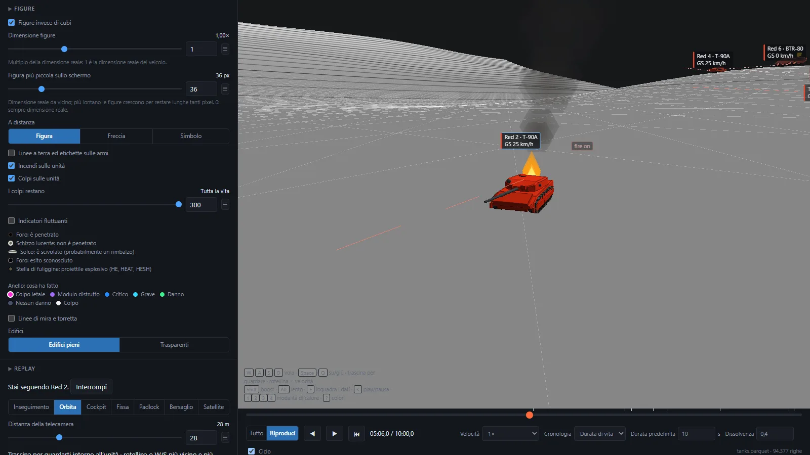

# Figure

Una **figura** è un piccolo modello 3D di ciò che un'unità è davvero: un carro, un jet, una nave, un soldato. Il [replay](match-replay.md) disegna ogni unità come la sua figura in dimensione reale, invece di un semplice cubo.

Ci sono circa 2.000 veicoli, aerei, navi, armi e soldati con nome, tutti costruiti dal visualizzatore stesso.

## Cosa c'è nel catalogo {#what-is-in-the-catalogue}

| Ambito | Esempi |
|---|---|
| Persone | soldato in piedi, accovacciato, a terra; cecchino, anticarro, medico, equipaggio |
| Terra | carri armati, veicoli da combattimento per la fanteria, difesa aerea, artiglieria, camion e auto, treni e tram |
| Aria | caccia, aerei d'attacco, bombardieri, trasporti, elicotteri, dai biplani ai jet moderni |
| Mare | navi da guerra per classe, portaerei, sottomarini, barche, mercantili |
| Armi | missili, razzi, bombe, siluri, flare e chaff |
| Marcatori | granate fumogene, flash e incendiarie, bombe piazzate, bandiere, punti di comparsa, punti di passaggio |
| Combattimento ravvicinato | soldati con giubbotto portapiastre e fucile d'assalto, mitraglietta, fucile a pompa, DMR, LMG, pistola o scudo; droni, telecamere, filo spinato, scudi, rinforzi delle pareti, barricate, cariche da breccia, trappole, finestre, granate, il disinnescatore |

## Come sono fatte le figure {#how-the-figures-are-made}

- **Costruite da dimensioni pubbliche.** La maggior parte delle figure è creata dal costruttore di figure del visualizzatore a partire da numeri pubblici: lunghezza, larghezza, altezza, ruote, torretta e cannone, ali e coda. La loro forma viene poi regolata su fotografie pubbliche, disegni e dimensioni pubblicate. Non vengono usati i modelli di nessun gioco.
- **Modelli gratuiti.** Alcune figure usano modelli 3D gratuiti (CC0 o CC BY) dove sono più fedeli, a volte combinati con lo scafo costruito. Gli autori delle opere CC BY sono citati in [Crediti delle figure](figure-credits.md); le opere CC0 non richiedono credito e non sono elencate lì.
- Ogni figura ha una versione completa, una grossolana e una lontana (livelli di dettaglio, LOD), così se ne possono disegnare migliaia insieme.

## Quale figura riceve un'unità {#which-figure-a-unit-gets}

Il visualizzatore guarda le colonne proprie dei dati:

1. **Nomi** - le colonne chiamate *Name*, *Vehicle*, *Unit*, *Unit type*, *Model*, *Aircraft*, *Plane*, *Tank*, *Ship*, *Craft*, *Loadout*, *Kit* o *Figure* - vengono confrontate con il catalogo: esattamente, tramite circa 4.000 alias (id di unità di diversi giochi), per il più lungo inizio noto (`F-16C_50` è l'F-16C), oppure per il nome di figura più corto che inizia così.
2. Un nome la cui figura non corrisponde al **tipo** dell'unità non viene usato (un camion chiamato *Typhoon* non è il caccia).
3. **Tipi** - colonne chiamate *Type*, *Class*, *Kind*, *Category*, *Icon*, *Role* o *Domain* - danno una figura di classe: tag Tacview (`Air+FixedWing`, `Ground+Heavy+Armor+Vehicle+Tank`, `Sea+Watercraft+Warship`, `Weapon+Missile`), icone delle mappe o parole semplici (tank, helicopter, infantry).
4. I dati senza nessuno dei due sono dati di persone: ognuno è un soldato.

Quindi il modo più semplice per avere le figure giuste è una colonna `vehicle` con i nomi reali, oppure una colonna `type` con i tag Tacview.

**La mia unità appare come un cubo o un soldato.** Aggiungi una colonna `vehicle` con il nome reale, oppure una colonna `type` con un tag Tacview. Passa il mouse sull'unità per vedere quale nome è stato trovato. I dati che hanno tali colonne ma non dicono nulla su un'unità lasciano un cubo; i dati senza nessuna delle due vengono disegnati come soldati.

## Figure da combattimento ravvicinato (Rainbow Six Siege) {#close-quarters-figures-rainbow-six-siege}

Le tabelle scritte come quelle del lettore di replay di Rainbow Six Siege (colonne `operator`, `pawn`, `primaryClass`, `side`) ricevono figure proprie:

- **I giocatori** sono il loro operatore: ognuno dei 78 operatori ha una figura propria, alta circa 1,8 m, con i suoi vestiti. Due o tre colori per giacca, pantaloni ed equipaggiamento seguono il suo solito aspetto pubblico (nero, oliva, sabbia, grigio urbano, bianco, blu navy, con equipaggiamento rosso, arancione o verde acqua). Ha anche forme proprie, un terzo più grandi del vero dove devono vedersi dall'alto: il copricapo (elmetti, una visiera o un elmetto pesante, berretti con visiera, berretti di lana, baschi, un cappello a tesa larga o di pelliccia, cappucci, sciarpe, capelli), il viso (occhiali protettivi, una maschera antigas, occhiali, una maschera, la barba, occhiali a tre lenti), una corporatura leggera, media o pesante (quelli pesanti sono larghi, con grandi spallacci e un colletto), un cappotto lungo o un completo, una tuta ghillie, quello che porta sulla schiena (un martello, cariche, droni, taniche, un serbatoio di carburante, un tubo lanciatore, una balestra, pannelli, un disturbatore, uno scudo) o sul braccio (un lanciatore, un braccio di metallo), il suo scudo (uno alto, uno antisommossa, uno con luci) e un colore di accento sulle spalle. Tiene la classe della sua arma primaria. Un operatore che il visualizzatore non conosce è un semplice soldato con portapiastre nel colore della squadra.
- **La fazione** si vede separata dai vestiti: un anello a terra sotto ogni operatore, **ambra per l'attacco, ciano chiaro per la difesa**, con il colore della squadra dentro, e fasce sul braccio e sulla testa dello stesso colore. Una colonna `stance` (stand, crouch, prone) dà loro la posizione; senza, stanno in piedi.
- **Distinguibili alla distanza del replay:** disegnati alti 48 pixel, dall'alto e di tre quarti, due operatori qualsiasi della stessa fazione si distinguono per una netta differenza di colore o per una forma diversa (verificato dai test del visualizzatore).
- **Le etichette** indicano il giocatore e l'operatore giocato in quel momento, con il ruolo dell'operatore come simbolo: ✸ breccia pesante, ⚒ breccia leggera, ➤ ingresso, ✦ fragger, ✚ supporto, ⬟ scudo, ◉ informazioni, ◇ flessibile, ↺ guardia del fianco, ⚓ ancora, ✕ trappolatore, ⇄ roamer, ↯ anti-gadget, ▣ anti-breccia.
- **I droni** sono un drone a due ruote da lanciare, largo circa 30 cm. Ognuno è una traccia a sé, con il nome del suo proprietario ("Ash · drone 2").
- **I gadget piazzati** stanno dove sono stati messi, da quel momento fino alla fine del round. Ognuno è la figura di ciò che fa: una telecamera, filo spinato, uno scudo dispiegabile, una carica da breccia, una carica da breccia pesante, una piccola carica adesiva, una trappola a terra, una claymore con il suo laser d'innesco, una finestra a senso unico, un pannello corazzato, una granata, una bombola di gas, un disturbatore, un sensore, una barriera laser, una cassa di rifornimenti. Una sola figura serve per tutti i gadget che fanno lo stesso lavoro. Un gadget di cui i dati non dicono il tipo è un piccolo dispositivo con una luce.
- **Il disinnescatore** sta dove è stato piazzato per i suoi 45 secondi.

Ogni drone e ogni gadget diventa una traccia a sé quando il file viene caricato. Così la figura del giocatore resta sul suo corpo. Gli operatori sono forme semplificate secondo le loro descrizioni e illustrazioni pubbliche (cosa indossano, il dispositivo che è la loro abilità). I gadget hanno la forma di ciò che fanno. Sono tutti progetti propri del visualizzatore alla dimensione reale dell'oggetto (una claymore larga circa 22 cm, un pannello grande come una porta di 1 m per 2,1 m), non modelli del gioco.

## Impostazioni {#settings}

La sezione **Figure** della barra laterale del replay imposta la dimensione, la dimensione minima sullo schermo, cosa diventano le unità lontane (figura, freccia, simbolo) e gli effetti disegnati su di esse. Vedi [Replay della partita](match-replay.md#figures). Fumo, fuoco e altri effetti a tempo: [Figure nelle figure sovrapposte](figure-replay.md).

## Un pacchetto locale di figure opzionale {#an-optional-local-figure-pack}

Puoi tenere sulla tua macchina un pacchetto opzionale di figure tue. Le sue figure prendono il posto delle figure del catalogo con gli stessi nomi. Non fa mai parte del repository né di una build pubblicata; senza di esso non cambia nulla.
