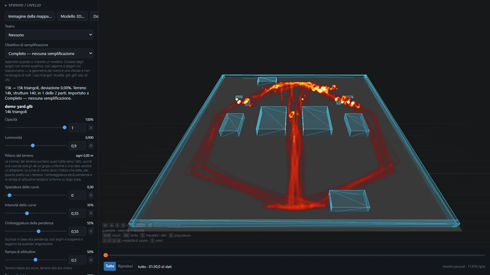
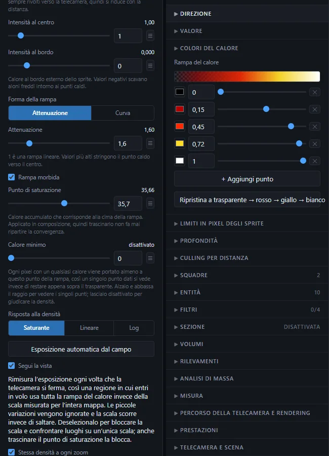

# Calore

Il calore dipinge i luoghi dove è successo molto: rosso dove è successo poco, bianco incandescente dove è successo molto. Risponde alla domanda "dove succede questa cosa, e quanto".

**Calore** (tasto 1) è la modalità predefinita. Ogni [riga](glossary.md) visibile contribuisce con uno [sprite](glossary.md) rotondo rivolto verso la telecamera; gli sprite sovrapposti si sommano in un buffer in virgola mobile; la somma viene mappata su una rampa di colori - per impostazione predefinita trasparente → rosso → giallo → bianco - e disegnata sopra la scena.

L'immagine mostra il calore di un round di sparatutto su un livello con edifici: i punti caldi sono nelle stanze e sulle scale, non solo a terra.

## Come si usa {#how-to-use-it}

1. Carica i dati e premi `1` (oppure scegli **Calore** nella barra delle modalità).
2. Se tutto è bianco o vuoto, premi **Esposizione automatica dal campo** nella sezione **Forma del calore**.
3. Cambia **Raggio degli sprite** finché i puntini vicini si uniscono in fasce: più piccolo mostra i singoli punti, più grande mostra le aree.
4. Apri **Colori del calore** per cambiare i colori, oppure **Profondità** per far sì che colline e muri nascondano il calore dietro di sé.

Gli stessi pannelli modellano [Differenza](difference.md), [Calore per squadra](team-heat.md) e [Calore lineare](line-heat.md); si differenziano per ciò che viene aggiunto (con segno, colorato, o lungo linee), non per come.

## I pannelli e i loro predefiniti {#the-panels-and-their-defaults}

Ogni comando è spiegato nella sua pagina; la colonna Dettagli rimanda ad essa. I cursori hanno accanto una casella in cui digitare e una maniglia di trascinamento (la piccola presa a destra: trascina su o giù; più lontano è più veloce; Maiusc per il controllo fine). Dove il binario di un cursore finisce prima di un limite reale, la maniglia può spingersi oltre fino al *limite della rotella* indicato qui. I valori indicati come *al caricamento* vengono ricalcolati per ogni nuovo dataset.

### Forma del calore (aperta) {#heat-shape-open}

| Comando | Predefinito | Intervallo (limite della rotella) | Dettagli |
|---|---|---|---|
| **Raggio degli sprite** | 6 m; al caricamento estensione / 120 | 0,05-2000 m, logaritmico (50.000) | [Forma dello sprite](sprite-shape.md#sprite-radius) |
| **Intensità al centro** | 1 | 0-10 (1000) | [Forma dello sprite](sprite-shape.md#centre-and-edge-intensity) |
| **Intensità al bordo** | 0 | -2-10 (1000) | [Forma dello sprite](sprite-shape.md#centre-and-edge-intensity) |
| **Forma della rampa** | *Attenuazione* | *Attenuazione* / *Curva* | [Forma dello sprite](sprite-shape.md#ramp-shape-falloff-or-curve) |
| **Attenuazione** (solo con Attenuazione) | 1,6 | 0,1-8 (64) | [Forma dello sprite](sprite-shape.md#falloff) |
| **Rampa morbida** (solo con Attenuazione) | attivo | | [Forma dello sprite](sprite-shape.md#falloff) |
| Editor della curva (solo con Curva) | predefinito *Morbida* | | [Forma dello sprite](sprite-shape.md#the-curve-editor) |
| **Punto di saturazione** | 24; al caricamento una stima, poi misurato | 0,1-4000, logaritmico (10.000.000) | [Colore ed esposizione](colour-and-exposure.md#saturation-point) |
| **Calore minimo** | spento (0) | 0-100% | [Colore ed esposizione](colour-and-exposure.md#minimum-heat) |
| **Risposta alla densità** | *Saturante* | *Saturante* / *Lineare* / *Log* | [Colore ed esposizione](colour-and-exposure.md#density-response) |
| **Esposizione automatica dal campo** | | pulsante | [Colore ed esposizione](colour-and-exposure.md#auto-exposure) |
| **Segui la vista** | attivo | | Rimisura l'esposizione ogni volta che la telecamera si ferma, così una regione in cui entri usa tutta la rampa di colori. Le piccole variazioni vengono ignorate e la scala scorre. Deselezionalo, oppure trascina **Punto di saturazione**, per bloccare la scala e confrontare luoghi su un'unica scala. [Colore ed esposizione](colour-and-exposure.md#follow-the-view) |
| **Stessa densità a ogni zoom** | attivo | | Un colore significa lo stesso numero di righe per area di terreno, da qualunque distanza ti trovi. Uno sprite che i limiti in pixel ingrandiscono (da lontano) o rimpiccioliscono (da vicino) mantiene il calore che aggiungerebbe alla sua dimensione reale, così un'immagine esposta da lontano non sbiadisce quando ci voli dentro. Spento, uno sprite limitato aggiunge il suo peso pieno alla sua dimensione limitata. [Forma dello sprite](sprite-shape.md#pixel-clamps) |
| **Appiattisci sul piano del terreno** | spento | | [Forma dello sprite](sprite-shape.md#flatten-onto-ground-plane) |

### Colori del calore (chiusa) {#heat-colours-closed}

| Comando | Predefinito | Dettagli |
|---|---|---|
| Campioni dei gruppi e **Separazione dei colori** (solo Calore per squadra) | 1,4 | [Calore per squadra](team-heat.md) |
| Editor della **Rampa del calore** (*Positiva (squadre additive)* in Differenza, *Rampa di opacità* in Calore per squadra) | trasparente → rosso → giallo → bianco | [Colore ed esposizione](colour-and-exposure.md#the-ramp-editor) |
| **Ripristina a trasparente → rosso → giallo → bianco** | | |
| Rampa **Negativa (squadre sottrattive)** (solo Differenza) | trasparente → verde → blu → viola | [Differenza](difference.md#colours) |

### Limiti in pixel degli sprite (chiusa) {#sprite-pixel-clamps-closed}

| Comando | Predefinito | Intervallo (limite della rotella) | Dettagli |
|---|---|---|---|
| **Raggio minimo in pixel** | 1 px | 0-16 (512) | [Forma dello sprite](sprite-shape.md#pixel-clamps) |
| **Raggio massimo in pixel** | 96 px | 2-1024, logaritmico (8192) | [Forma dello sprite](sprite-shape.md#pixel-clamps) |

### Profondità (aperta) {#depth-open}

| Comando | Predefinito | Dettagli |
|---|---|---|
| **Nascondi dietro il terreno** | attivo | [Profondità e culling](depth-and-culling.md#hide-behind-terrain) |
| **Nascosto dietro la geometria** | 0,8 (*80% più scuro*) | [Profondità e culling](depth-and-culling.md#hidden-behind-geometry) |

### Culling per distanza (chiusa) {#distance-culling-closed}

| Comando | Predefinito | Intervallo (limite della rotella) | Dettagli |
|---|---|---|---|
| **Vicino** | spento (0) | 0,5-5000 m, logaritmico, il fondo della corsa = spento (200.000) | [Profondità e culling](depth-and-culling.md#distance-culling) |
| **Lontano** | spento (0) | 1-200.000 m, logaritmico, in basso = spento (10.000.000) | [Profondità e culling](depth-and-culling.md#distance-culling) |
| **Taglia su un piano** | attivo | | [Profondità e culling](depth-and-culling.md#distance-culling) |
| **Taglia anche il livello** | attivo | | [Profondità e culling](depth-and-culling.md#distance-culling) |

Tasti: `[` e `]` spingono dentro e fuori il limite lontano, `\` lo attiva o disattiva ([Profondità e culling](depth-and-culling.md#keyboard)).

### Direzione e Valore {#direction-and-value}

Altre due sezioni stanno sotto Forma del calore. **Direzione** disegna ogni riga come uno spicchio e aggiunge frecce: vedi [Calore direzionale](directional-heat.md). **Valore** pesa il calore in base a quanto ha costato o fruttato ogni riga: vedi [Ponderazione dei valori](value-weighting.md).

## Cosa viene salvato {#what-is-saved}

Le impostazioni del calore descritte sopra non vengono memorizzate tra una sessione e l'altra: ricaricare la pagina ripristina i predefiniti. Due cose restano nel browser: l'ultima velocità di riproduzione (`heat3d.speed`, vedi [Linea temporale e riproduzione](timeline.md)) e le impostazioni delle figure lontane della [sovrapposizione di figure](box-replay.md) (stile dei simboli, dimensione, segni dei colpi e così via). Lo stesso vale per la lingua, gli [assi del mondo invertiti](camera.md#invert-world-axis), i nomi delle auto ricordati dalla scheda gara e la [libreria dei livelli](level-library.md). L'elenco completo è in [Impostazioni salvate](ref-settings-storage.md).
