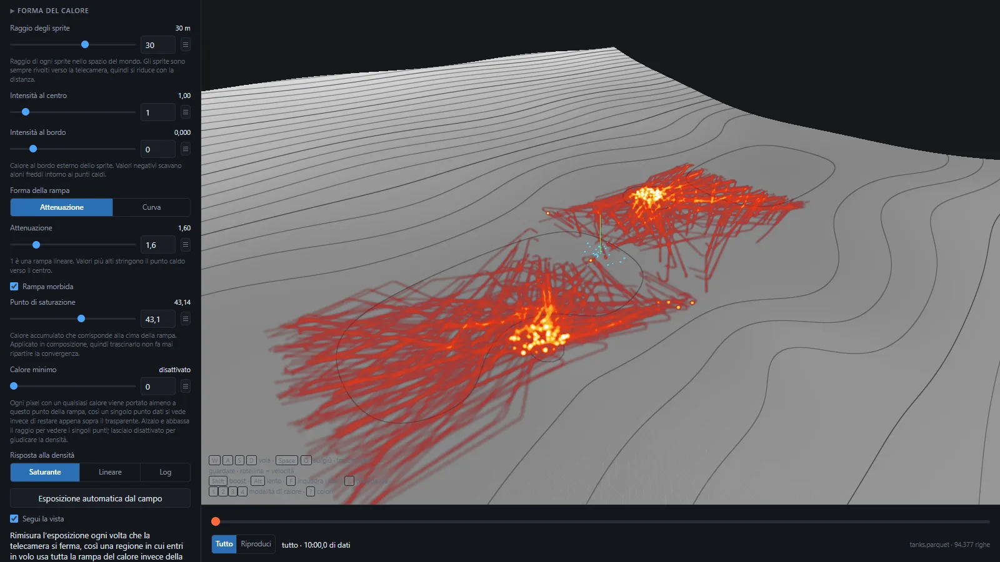
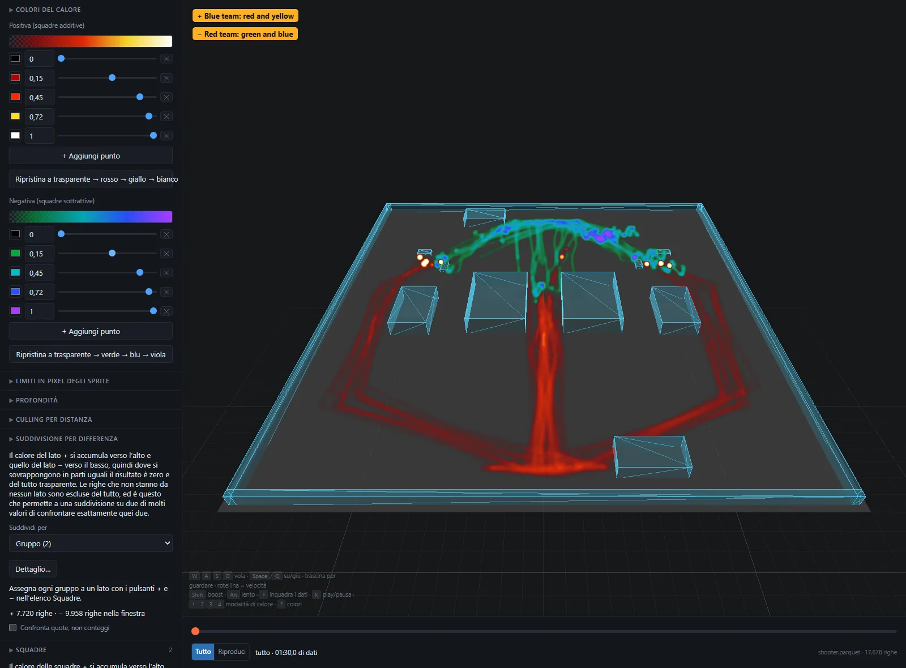
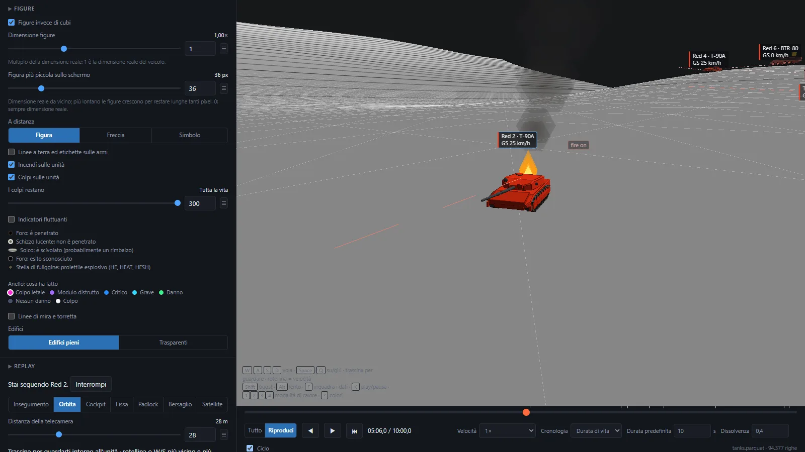
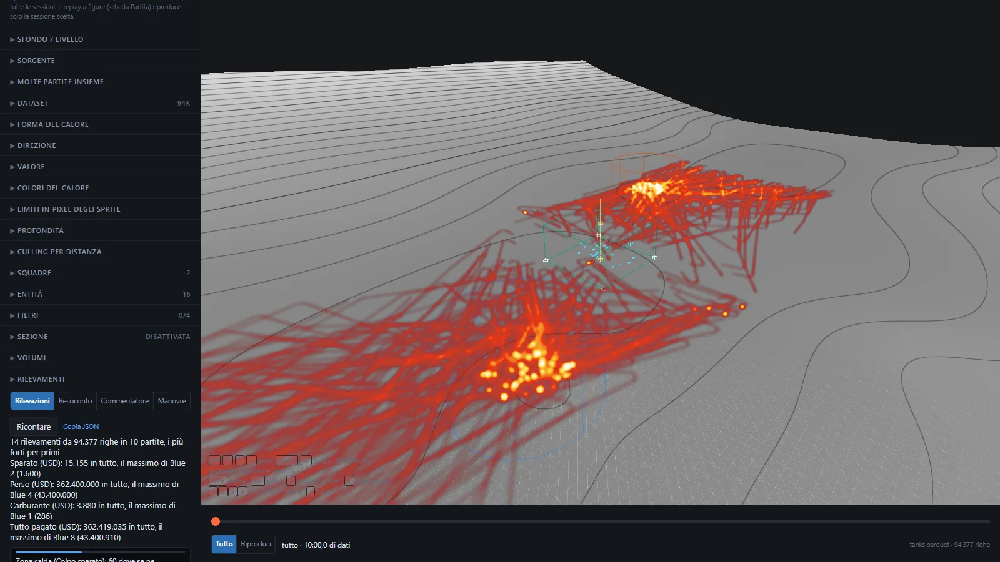
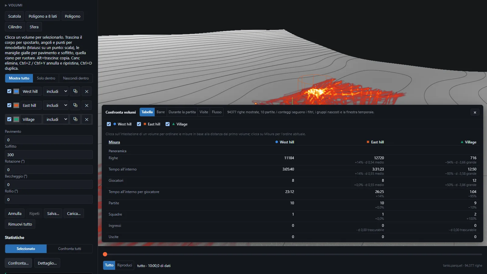
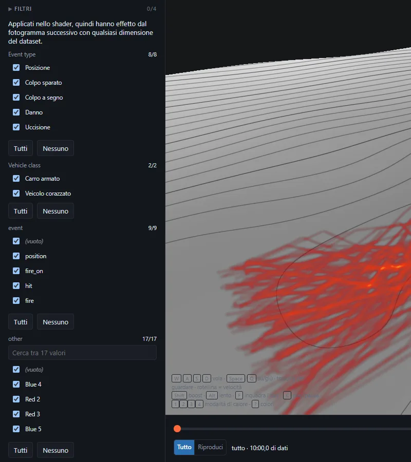
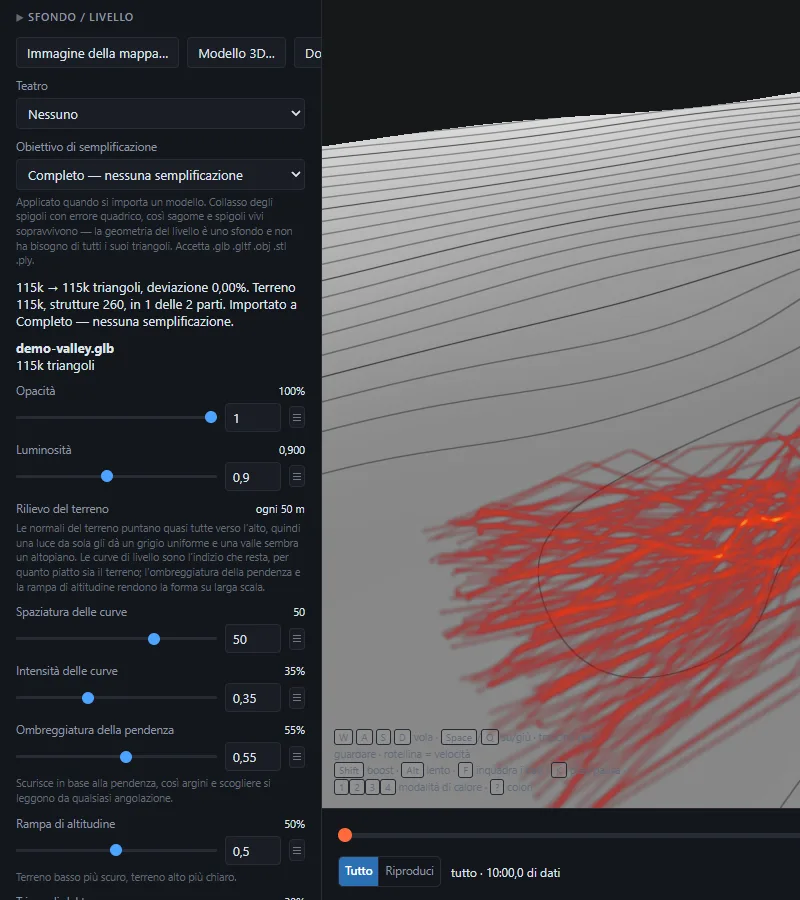

{: width="720" }

# 3DHeat

3DHeat mostra dove sono successe le cose in un gioco - dove sono andati, hanno combattuto e sono caduti i giocatori - come colori luminosi in cui puoi volare, oppure come piccole figure 3D che rigiocano la partita.

Carica le posizioni - CSV, Parquet, registrazioni Tacview, replay convertiti, un solo file, una cartella o migliaia di partite - e guardale come una **mappa di calore in cui puoi volare**, come **figure che rigiocano la partita**, come linee lungo i percorsi seguiti dalle persone, oppure come una popolazione contro un'altra. Trova da solo ciò che spicca, e funziona interamente nel tuo browser: non viene caricato nulla da nessuna parte. 3DHeat e tutti i suoi strumenti sono gratuiti e open source, con licenza [MIT](https://github.com/Holdi601/3DHeat/blob/main/LICENSE).



**Sei nuovo?** Crea i [dati di esempio](demo-data.md) e segui i suoi sette passi. Ogni immagine di questo sito è stata fatta con essi.

## Cosa fa {#what-it-does}

| | |
|---|---|
|  | **[Modalità di calore](heat-modes.md)** - calore, [differenza](difference.md) (rosso dove un lato ne ha fatto di più, verde-blu dove ne ha fatto di più l'altro), [calore per squadra](team-heat.md), [calore lineare](line-heat.md); [calore direzionale](directional-heat.md) con cunei, campi di frecce e grafici polari; calore [pesato per valore](value-weighting.md): quanto costano armi, veicoli e carburante. |
|  | **[Replay della partita](match-replay.md)** - ogni unità come la [figura](figures.md) di ciò che è, simboli NATO o russi da lontano, missili e traccianti, segni dei colpi, relitti, fuochi, torrette, obiettivi, telecamere in stile Tacview e display tattico; [molte partite insieme](many-matches.md). |
|  | **[Rilevamenti](insights.md)** - posizioni forti, terreno mortale, trappole di spawn, strozzature e giocatori in evidenza, trovati e ordinati con le prove; un resoconto scritto, facoltativamente da un'IA a tua scelta; un commentatore per una partita; la [lente della conoscenza](knowledge.md). |
|  | **[Volumi](volumes.md)** - disegna scatole, prismi, cilindri e sfere, filtra su di essi, conta ciò che succede dentro, esportalo e confronta i luoghi affiancati; il [dettaglio](breakdown.md) di chi e cosa rende meglio in un luogo. |
|  | **[Filtri](filters.md)** - per tipo di evento, giocatore o IA, classe di veicolo, valore, qualsiasi colonna, nella scheda grafica a qualsiasi dimensione dei dati. |
|  | **[Livelli](levels.md)** - immagini di mappe, livelli 3D fatti con gli [strumenti per i dati](#related-repositories), semplificazione, lo [sfondo del mondo](world-backdrop.md) con il terreno reale per i dati di volo. |

Inoltre: la scheda [Analisi di gara](race-analysis.md) per i giri dei giochi di corse, la scheda [Partita](match-analysis.md) per i riepiloghi di Counter-Strike 2, la [Lavagna tattica](tactics-board.md) per i piani su un livello, l'[analisi dei colpi](hit-analysis.md) per veicolo, l'[analisi di massa](mass-analysis.md) di migliaia di partite, [percorsi della telecamera e video](camera-path-and-video.md), [40 lingue](languages.md), [unità metriche o imperiali](settings.md).

## Le schede {#the-tabs}

Le schede stanno in cima alla barra laterale, sotto il nome, il menu delle unità e della lingua.

| Scheda | A cosa serve |
|---|---|
| **Mappa di calore** | Qualsiasi tabella di posizioni: le modalità di calore, la sovrapposizione delle figure, filtri, volumi, rilevamenti, livelli, misure e video. |
| **Analisi di gara** | Due o più giri dello stesso percorso: dove si perde tempo, perché, e cosa cambiare. |
| **Partita** | Il replay a figure di una partita, e i riepiloghi delle partite di Counter-Strike 2. |
| **Tattica** | Piani su un livello: figure, percorsi, utility lanciate, aree e note in passi che si riproducono. |
| **Veicoli** | Dove è stata colpita ogni unità, da chi e con cosa. |

## Installare ed eseguire {#install-and-run}

3DHeat è gratuito da usare, modificare e condividere (licenza MIT), e lo sono anche tutti gli strumenti elencati in [Repository collegati](#related-repositories).

### Windows, il modo facile {#windows-the-easy-way}

La radice del repository contiene tre file batch.

| File | Cosa fa |
|---|---|
| `start.bat` | Avvia il visualizzatore. Trova Node.js anche quando non è nel `PATH` (cerca in `%ProgramFiles%\nodejs`, `%ProgramFiles(x86)%\nodejs` e `%LOCALAPPDATA%\Programs\nodejs`), e se Node.js manca propone di installare la release LTS con `winget install -e --id OpenJS.NodeJS.LTS`. Alla prima esecuzione chiede prima di scaricare le dipendenze (circa 300 MB in `node_modules\` dentro la cartella, nulla a livello di sistema). Si rifiuta di partire quando qualcosa è già in ascolto sulla porta 5273, e rimanda a `restart.bat`. Quando la cartella è una copia git senza modifiche locali e esiste una versione più recente, chiede se aggiornare (Y/N; senza risposta in 60 s mantiene questa versione; vedi [Aggiornamenti](updates.md)). Poi avvia il server di sviluppo su `http://127.0.0.1:5273/` e apre il browser. **La finestra è il server**: lasciala aperta; chiudila o premi Ctrl+C per fermarlo. |
| `restart.bat` | Esegue `stop.bat quiet`, poi `start.bat`. Serve solo dopo aver cambiato `vite.config.ts`, aggiunto una dipendenza, o quando il server si è bloccato - le modifiche al codice vengono ricaricate a caldo. |
| `stop.bat` | Ferma ciò che è in ascolto sulla porta 5273, tramite l'id del processo trovato con `netstat`, mai per nome dell'immagine, così gli altri processi Node.js della macchina restano intatti. Attende circa due secondi che il socket venga liberato. Con l'argomento `quiet` non si ferma alla fine. |

### A mano (qualsiasi sistema) {#by-hand-any-os}

```bash
git clone --recursive https://github.com/Holdi601/3DHeat.git
cd 3DHeat
npm install
npm run dev      # http://127.0.0.1:5273
```

La cartella `exporters/` contiene gli strumenti separati per i dati come submodule git, ciascuno con il proprio repository; dopo un clone semplice esegui `git submodule update --init`. Il visualizzatore stesso non ne ha bisogno per funzionare. `exporters/ext/` contiene i convertitori facoltativi (War Thunder, World of Tanks, World of Warships, replay di Squad; mappe di DCS e IL-2), ciascuno un progetto a sé.

Con tutto questo non arrivano dati di gioco: livelli, mappe e registrazioni vengono creati sulla tua macchina con gli strumenti, da giochi che possiedi.

### Script npm {#npm-scripts}

| Script | Cosa esegue |
|---|---|
| `npm run dev` | Il server di sviluppo Vite sulla porta 5273, legato a `127.0.0.1`. |
| `npm run build` | Controllo dei tipi (`tsc --noEmit`) e un bundle di produzione in `dist/`. |
| `npm run preview` | Serve il bundle di produzione. |
| `npm run typecheck` | Solo il controllo dei tipi. |
| `npm test` / `npm run test:watch` | Test unitari e di integrazione (vitest). |
| `npm run smoke` | Pilota l'app reale in Chromium senza interfaccia e verifica che il canvas abbia pixel colorati dai dati; le schermate vanno in `tools/.smoke/`. Richiede che il server di sviluppo sia attivo. |
| `npm run smoke:f16` | La stessa suite con `?heat=f16`, che forza il percorso di accumulo half-float (vedi [Accumulo half-float](half-float-accumulation.md)). |
| `npm run bench` | Benchmark di ingestione, scrive `tools/.smoke/ingest-bench.json`. |
| `npm run test:heavy` | Test che richiedono grandi file di dati reali; si saltano da soli quando i file mancano. |
| `npm run inspect -- <file.parquet>` | Stampa lo schema di un file Parquet e alcune righe (`tools/inspect-parquet.mjs`). |

### Cosa aggiunge il server di sviluppo {#what-the-dev-server-adds}

Il visualizzatore è una pagina web statica, ma il server di sviluppo (vedi `vite.config.ts`) aggiunge due rotte locali che una distribuzione statica di `dist/` non ha:

- `/__host/memory` riporta la RAM installata e libera della macchina e, dove può leggerla, la memoria della scheda grafica (da `nvidia-smi`, oppure su Windows dalla voce di registro dell'adattatore video). È ciò che permette ai [budget di memoria](memory-and-budgets.md) di usare cifre reali invece delle stime limitate del browser.
- `/__heat3d/update` controlla se la copia è indietro e può portarla al passo con un avanzamento veloce ([Aggiornamenti](updates.md)).

Il server si lega solo a `127.0.0.1`, quindi nessuna delle due rotte è raggiungibile dalla rete. Aprilo come `http://127.0.0.1:5273`: `localhost` può risolversi nel loopback IPv6 `::1`, dove non ascolta nulla. Non invia intestazioni di isolamento cross-origin (COOP/COEP): nulla nel visualizzatore usa `SharedArrayBuffer`, e i worker passano i dati per trasferimento, che non ne ha bisogno.

## Requisiti di browser e GPU {#browser-and-gpu-requirements}

- **Un browser con WebGPU o WebGL2.** WebGPU viene provato per primo (Chrome e Edge lo hanno); senza di esso si usa il backend WebGL2. WebGL2 deve offrire `EXT_color_buffer_float` (rendering su texture in virgola mobile), altrimenti il visualizzatore mostra "Impossibile inizializzare il renderer." Vedi [I due backend](backends.md). Il visualizzatore è sviluppato e testato in Chromium; gli altri browser non sono verificati.
- **Accelerazione hardware attiva.** Quando il browser disegna con la CPU (SwiftShader, llvmpipe, Microsoft Basic Render Driver e simili), un banner rosso in cima alla barra laterale lo dice e spiega come rimediare. Vedi [Rilevamento del rendering software](software-rendering.md).
- **Una GPU dedicata aiuta, ma non è obbligatoria.** Entrambi i backend chiedono l'adattatore ad alte prestazioni. La quantità di dati che può stare sulla GPU è un budget che puoi vedere e cambiare ([Memoria e budget](memory-and-budgets.md)).
- **Le funzioni facoltative** usano altre API del browser: il rendering video richiede WebCodecs `VideoEncoder` con VP9 o VP8 ([Percorso della telecamera e video](camera-path-and-video.md)); la semplificazione delle mesh dei livelli richiede WebAssembly; il trascinamento delle cartelle usa la File and Directory Entries API; la libreria dei livelli usa IndexedDB; i gamepad usano la Gamepad API.

## Mappa della documentazione {#documentation-map}

**Inizio**: [Dati di esempio](demo-data.md) · [Caricare i dati](getting-data-in.md) ([caricamento dei file](loading-files.md), [mappatura delle colonne](column-mapping.md), [assi, unità e tempo](axes-units-and-time.md), [sessioni, persone e gruppi](sessions-persons-groups.md), [Tacview](tacview-acmi.md), [convertitori](converters.md), [.3dheat](container.md), [memoria e budget](memory-and-budgets.md))

**Vedi**: [Modalità di calore](heat-modes.md) ([calore](heat.md), [forma dello sprite](sprite-shape.md), [colore ed esposizione](colour-and-exposure.md), [profondità e culling](depth-and-culling.md), [differenza](difference.md), [calore per squadra](team-heat.md), [calore lineare](line-heat.md), [figure sovrapposte](box-replay.md), [calore direzionale](directional-heat.md), [ponderazione dei valori](value-weighting.md)) · [Linea temporale](timeline.md) · [Livelli](levels.md) ([immagini delle mappe](map-images.md), [livelli 3D](model-levels.md), [aspetto](level-appearance.md), [libreria](level-library.md), [sfondo del mondo](world-backdrop.md), [le sue fonti](world-backdrop-sources.md)) · [Telecamera](camera.md) ([gamepad](gamepad.md), [tasti](keyboard-reference.md)) · [Percorso della telecamera e video](camera-path-and-video.md)

**Analizza**: [Filtri e strumenti](filters-and-tools.md) ([filtri](filters.md), [squadre](teams-list.md), [entità](entities.md), [sezione](slice.md), [misura](measure.md), [volumi](volumes.md), [dettaglio](breakdown.md)) · [Rilevamenti](insights.md) ([lente della conoscenza](knowledge.md)) · [Analisi di massa](mass-analysis.md)

**Replay**: [Replay della partita](match-replay.md) · [Molte partite insieme](many-matches.md) · [Figure](figures.md) ([nella sovrapposizione delle figure](figure-replay.md), [crediti](figure-credits.md)) · [Parità con Tacview](tacview-parity.md) · [Analisi dei colpi](hit-analysis.md)

**Altre schede**: [Analisi di gara](race-analysis.md) ([il metodo](race-analytics.md), [altri giochi](other-games.md)) · [Analisi della partita](match-analysis.md) · [Lavagna tattica](tactics-board.md) ([velocità](tactics-speeds.md))

**Il visualizzatore**: [Glossario](glossary.md) · [Impostazioni, unità e tasti](settings.md) · [Lingue](languages.md) · [Aggiornamenti](updates.md) · [Dettagli del rendering](rendering-internals.md) ([backend](backends.md), [accumulo](accumulation.md), [campionamento e budget](sampling-and-budgets.md), [half-float](half-float-accumulation.md), [memoria GPU](gpu-memory.md), [rendering software](software-rendering.md), [prestazioni e statistiche](performance-and-stats.md)) · [Formati dei dati](data-formats.md) · [Riferimento](reference.md) · [Manutenzione della documentazione](maintaining.md)

## Repository collegati {#related-repositories}

Il visualizzatore legge i dati; questi strumenti li producono. Ciascuno è un repository pubblico separato (MIT) con la propria documentazione. Nessuno di essi distribuisce dati di gioco: livelli, mappe e registrazioni vengono creati sulla tua macchina, da giochi che possiedi. Ogni lettore di gioco è un piccolo progetto a sé, con il proprio file di licenza, le proprie release e il proprio tracker delle segnalazioni, così può essere installato, aggiornato, mantenuto — o ritirato su richiesta di un titolare dei diritti — separatamente, senza toccare il visualizzatore o gli altri strumenti.

| Repository | Cosa fa | Utile per | Documentazione |
|---|---|---|---|
| [3DHeat-GameFiles](https://github.com/Holdi601/3DHeat-GameFiles) | Legge percorsi e livelli dagli archivi che i giochi distribuiscono (Forza Horizon, BeamNG, Assetto Corsa Rally; lettori per Unreal, Unity, Frostbite e Source 2) in glTF | un livello 3D sotto il tuo calore o replay | [sito](https://holdi601.github.io/3DHeat-GameFiles/) |
| [3DHeat-GameCapture](https://github.com/Holdi601/3DHeat-GameCapture) | Registra la telemetria dei giri dalle interfacce che i giochi di corsa pubblicano, e ricostruisce livelli dai video di gioco | giri per l'Analisi di gara; un livello dove non si possono leggere file | [sito](https://holdi601.github.io/3DHeat-GameCapture/) |
| [3DHeat-UnrealExporter](https://github.com/Holdi601/3DHeat-UnrealExporter) | Plugin per l'Unreal Editor che esporta un livello come un unico file glTF | livelli dei tuoi progetti Unreal | [sito](https://holdi601.github.io/3DHeat-UnrealExporter/) |
| [3DHeat-CS2](https://github.com/Holdi601/3DHeat-CS2) | Demo di Counter-Strike 2 in tabelle di calore e riepiloghi di partita, mappe CS2 in geometria | calore CS2, replay e la scheda Partita | [sito](https://holdi601.github.io/3DHeat-CS2/) |
| [3DHeat-Watcher](https://github.com/Holdi601/3DHeat-Watcher) | Registra il tuo gioco in background da ciò che i giochi pubblicano: telemetria, integrazioni dello stato di gioco, log, replay | le tue statistiche senza fare nulla a mano | [sito](https://holdi601.github.io/3DHeat-Watcher/) |
| [3DHeat-Ext-WarThunder](https://github.com/Holdi601/3DHeat-Ext-WarThunder) | Replay di War Thunder (`.wrpl`) in tabelle: tracce aeree e di terra, colpi, colpiti, uccisioni, torrette, obiettivi | replay di War Thunder, segni dei colpi e rilevamenti | [sito](https://holdi601.github.io/3DHeat-Ext-WarThunder/) |
| [3DHeat-Ext-WoT](https://github.com/Holdi601/3DHeat-Ext-WoT) | Replay di World of Tanks in tabelle: posizione di ogni veicolo, morti e uccisioni | calore e replay di World of Tanks | [sito](https://holdi601.github.io/3DHeat-Ext-WoT/) |
| [3DHeat-Ext-WoWs](https://github.com/Holdi601/3DHeat-Ext-WoWs) | Replay di World of Warships in tabelle: posizione di ogni nave e affondamenti | calore e replay di World of Warships | [sito](https://holdi601.github.io/3DHeat-Ext-WoWs/) |
| [3DHeat-Ext-Squad](https://github.com/Holdi601/3DHeat-Ext-Squad) | Demo dei server di Squad in tabelle: posizione, squadra e plotone di ogni giocatore | calore e replay di Squad | [sito](https://holdi601.github.io/3DHeat-Ext-Squad/) |
| [3DHeat-Ext-DCS](https://github.com/Holdi601/3DHeat-Ext-DCS) | Terreni di DCS World dalla tua installazione in livelli: terreno, strade, città, aeroporti, campi, acqua | registrazioni di DCS e Tacview sul loro terreno reale | [sito](https://holdi601.github.io/3DHeat-Ext-DCS/) |
| [3DHeat-Ext-IL2](https://github.com/Holdi601/3DHeat-Ext-IL2) | Mappe di IL-2 Great Battles in livelli | registrazioni di IL-2 sulla loro mappa | [sito](https://holdi601.github.io/3DHeat-Ext-IL2/) |

## Struttura del codice, in breve {#source-layout-briefly}

| Cartella | Contenuto |
|---|---|
| [`src/data/`](https://github.com/Holdi601/3DHeat/tree/main/src/data) | Scelta dei file, ingestione CSV e Parquet, mappatura automatica, validazione, modello della memoria, costruttore del dataset, lettura dei modelli, classificazione, semplificazione, libreria dei livelli |
| [`src/render/`](https://github.com/Holdi601/3DHeat/tree/main/src/render) | Il ciclo dei fotogrammi (`engine.ts`), campionamento, entrambi i backend, telecamera, gamepad, misura, percorso della telecamera, registrazione video |
| [`src/state/`](https://github.com/Holdi601/3DHeat/tree/main/src/state) | Lo stato dell'applicazione (`store.ts`) con ogni valore predefinito, i tipi di dominio (`types.ts`), la curva dello sprite |
| [`src/ui/`](https://github.com/Holdi601/3DHeat/tree/main/src/ui) | I pannelli della barra laterale, la linea temporale, le sovrapposizioni |
| [`src/race/`](https://github.com/Holdi601/3DHeat/tree/main/src/race), [`src/match/`](https://github.com/Holdi601/3DHeat/tree/main/src/match) | Le schede Analisi di gara e Partita |
| [`src/i18n/`](https://github.com/Holdi601/3DHeat/tree/main/src/i18n) | Traduzioni |
| [`src/insights/`](https://github.com/Holdi601/3DHeat/tree/main/src/insights) | Rilevamenti: rilevatori, resoconto, commentatore, provider IA, lente della conoscenza |
| [`src/mass/`](https://github.com/Holdi601/3DHeat/tree/main/src/mass) | Analisi di massa su molte partite |
| [`src/volumes/`](https://github.com/Holdi601/3DHeat/tree/main/src/volumes) | Volumi, le loro statistiche, esportazione e confronto |
| [`src/breakdown/`](https://github.com/Holdi601/3DHeat/tree/main/src/breakdown) | Dettaglio e fattori |
| [`src/overlay/`](https://github.com/Holdi601/3DHeat/tree/main/src/overlay) | La sovrapposizione di molte partite |
| [`src/figures/`](https://github.com/Holdi601/3DHeat/tree/main/src/figures) | Il catalogo delle figure e il suo costruttore |
| [`src/vehicle/`](https://github.com/Holdi601/3DHeat/tree/main/src/vehicle) | Analisi dei colpi (scheda Veicoli) |
| [`src/tactics/`](https://github.com/Holdi601/3DHeat/tree/main/src/tactics) | La lavagna tattica |
| [`src/world/`](https://github.com/Holdi601/3DHeat/tree/main/src/world) | Lo sfondo del mondo |
| [`src/units/`](https://github.com/Holdi601/3DHeat/tree/main/src/units) | Unità di misura |
