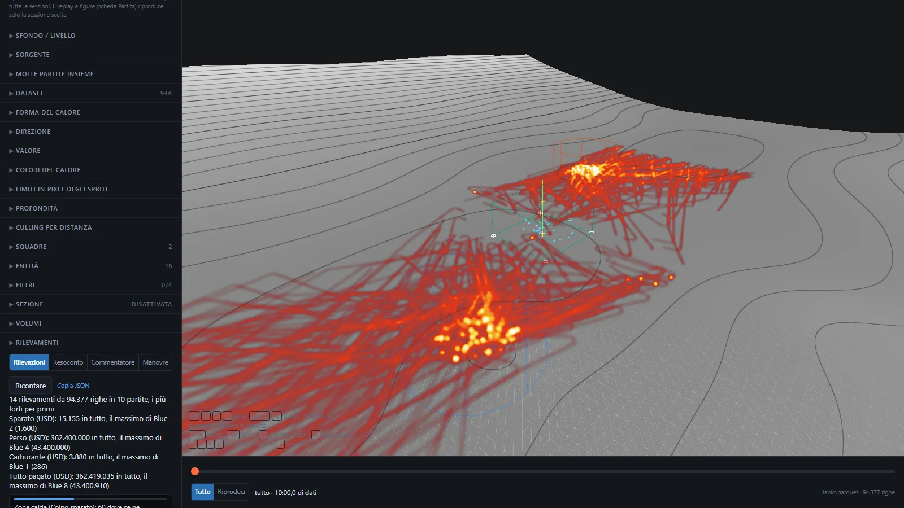
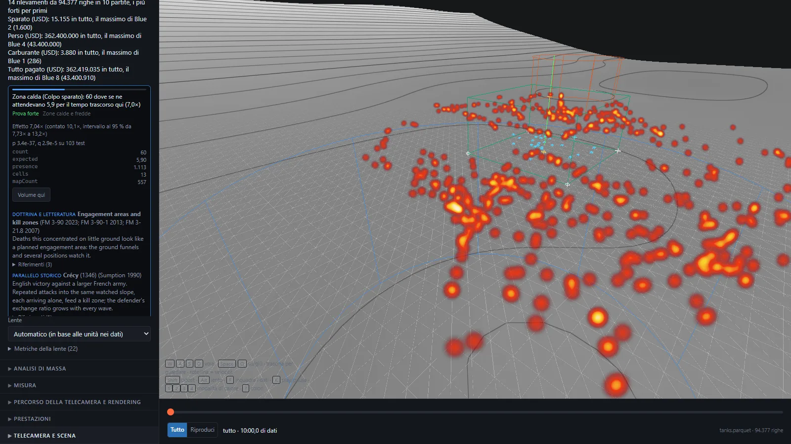
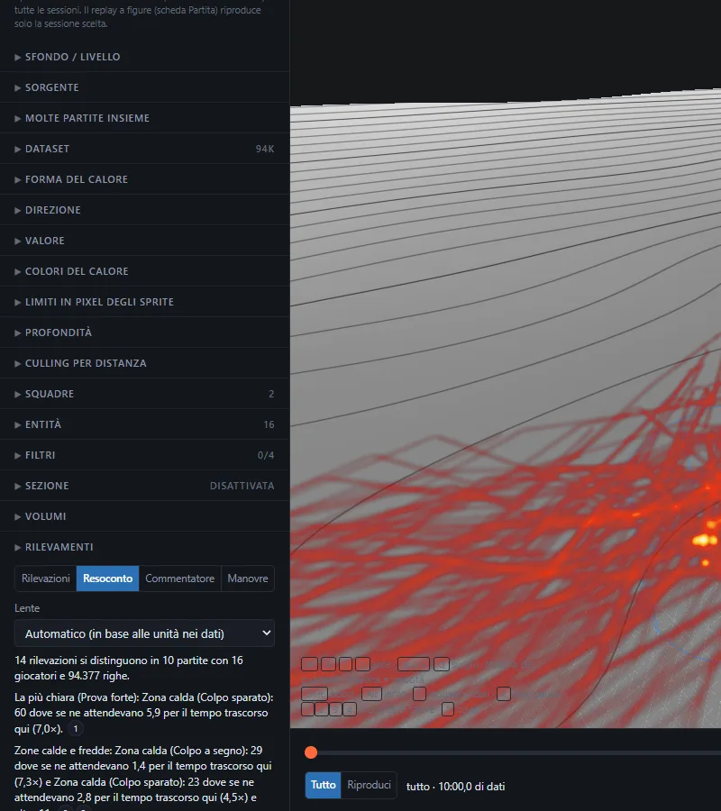
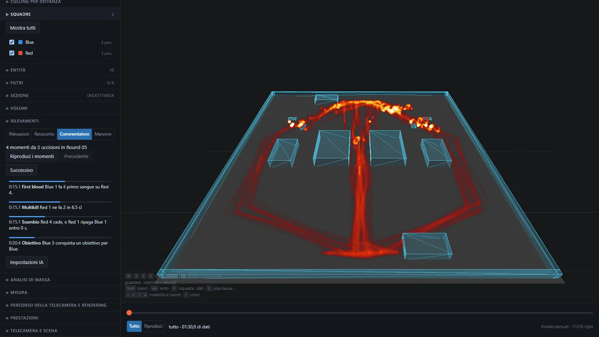

# Rilevamenti

**Rilevamenti** cerca nei dati caricati ciò che spicca - posizioni forti, terreno mortale, trappole di spawn, punti di strozzatura, giocatori molto sopra i loro pari - e te lo dice, il più forte per primo, con le prove. Serve a capire in un minuto dove una partita è stata vinta o persa. Può poi scrivere un resoconto e, in un singolo replay, fare da commentatore che salta ai momenti importanti.

Tutto viene contato nel tuo browser. Nulla lascia il tuo computer, a meno che tu non attivi un'IA esterna (vedi [IA esterna](#external-ai)).

La sezione **Rilevamenti** si trova nella barra laterale delle schede Mappa di calore e Partita. Ha tre schede: **Rilevazioni**, **Resoconto** e **Commentatore**.

## Rilevazioni {#findings}

1. Carica i dati e apri **Rilevamenti**. Premi **Trova rilevamenti** ("Conteggio… n%" mostra l'avanzamento).
2. Leggi l'elenco. Ogni rilevazione ha una barra di forza, una frase, quanto sono buone le prove (*Prove forti*, *Prove buone* o *Qualche prova*), quale rilevatore l'ha trovata e la classe di veicolo, dove conta.
3. **Clicca una rilevazione**: il visualizzatore applica i suoi filtri, porta la telecamera sul luogo e salta all'ora, e apre i dettagli: l'effetto con il suo intervallo al 95%, i valori p e q, le prove contate, e **Volume qui**, che disegna un [volume](volumes.md) intorno al luogo.
4. **Ripristina filtri** rimette i tuoi filtri. **Copia JSON** copia l'intero rapporto.

Il conteggio usa i filtri attuali, i gruppi nascosti e la partita scelta su tutto l'intervallo di tempo. Se poi cambi i filtri, una nota lo segnala; premi **Conta di nuovo**.

Le righe in cima all'elenco (per esempio i totali di denaro) riassumono l'intero dataset prima delle rilevazioni.

### I rilevatori {#the-detectors}

| Rilevatore | Cosa trova | Richiede nei dati |
|---|---|---|
| **Posizioni di forza** | Luoghi con odds uccisioni-su-morti molto migliori del resto della mappa, e *terreno sicuro* dove muoiono in pochi per il tempo trascorso | eventi di uccisione e di morte |
| **Zone calde e fredde** | Luoghi dove un tipo di evento (colpi, colpiti, catture ...) accade molto più o molto meno spesso di quanto preveda il tempo passato lì | una colonna evento |
| **Terreno aperto e copertura** | Morti allo scoperto contro geometria vicina del livello, e lente contro movimento veloce | morti; un livello 3D per la parte di geometria |
| **Spawn** | Spawn forti, trappole di spawn, spawn sicuri, tempo al primo contatto | tempo e persone |
| **Classe per luogo** | Una classe di veicolo, o giocatori contro IA, che fanno molto meglio o peggio in una zona | uccisioni più una colonna di classe di veicolo o di giocatore/IA |
| **Giocatori** | Giocatori che uccidono o muoiono molto più o meno di altri nella stessa classe | persone e uccisioni |
| **Strozzature e fianchi** | Punti di strozzatura (molti più attraversamenti del terreno intorno) e percorsi di fianco (usati raramente, ma che portano a uccisioni) | persone |
| **Valore** | *Terreno costoso* e *Terreno che rende* | [colonne di valore](value-weighting.md) |

I rilevatori che non possono girare sui dati sono elencati in fondo con il motivo.

### Come vengono ordinate le rilevazioni {#how-findings-are-ranked}

Ogni luogo o gruppo viene confrontato con il resto della mappa (test binomiali esatti o test di frequenza). Il tasso di false scoperte (false discovery rate) è tenuto al 5% (Benjamini-Hochberg). Il caso può sembrare uno schema; questo mantiene bassi i falsi allarmi: tra le rilevazioni mostrate, ci si aspetta al massimo circa una su venti dovuta al caso. Gli effetti basati su pochi eventi vengono tirati verso "nessun effetto" prima dell'ordinamento. Vengono elencate al massimo 60 rilevazioni, e ogni rilevatore ottiene qualche luogo vicino alla cima.

## Resoconto {#debrief}

La scheda **Resoconto** scrive le rilevazioni come un breve testo: un'introduzione, la rilevazione più chiara, una per la tattica, una per l'equilibrio, le altre raggruppate per rilevatore, e quante poggiano su prove più deboli. Ogni paragrafo ha pulsanti numerati che mostrano le sue rilevazioni. **Copia il testo** lo copia.

Il narratore integrato funziona offline, nella tua lingua. Il selettore **Lente** qui sopra (vedi [La lente della conoscenza](knowledge.md)) decide quale letteratura citano i paragrafi.

### IA esterna {#external-ai}

**Impostazioni IA** lascia che un modello di IA a tua scelta scriva invece il resoconto:

| Impostazione | Significato |
|---|---|
| **Provider** | Anthropic (Claude), OpenAI (ChatGPT), OpenRouter, Ollama (locale), LM Studio (locale), server llama.cpp (locale), oppure qualsiasi endpoint compatibile con OpenAI |
| **URL di base**, **Modello** | Compilati dal provider; **Elenca i modelli** chiede al server |
| **Chiave API** | Inviata solo all'URL di base. Mai registrata, mai salvata in viste, esportazioni o file `.3dheat`. La maggior parte dei server locali non ne ha bisogno. |
| **Ricorda la chiave in questo browser** | Disattivato di default: la chiave viene dimenticata quando la pagina si chiude |
| **Usa un'IA esterna** | Disattivato di default |
| **Invia i nomi dei giocatori** | Disattivato di default: i giocatori vengono inviati come P1, P2 ... |

Poi scrivi una domanda facoltativa e premi **Scrivi con l'IA**. Vengono inviate solo le rilevazioni e i loro numeri - mai le righe dei tuoi dati. La risposta arriva a pezzi; le rilevazioni citate diventano pulsanti.

## Commentatore {#caster}

Per **una partita** (sceglierne una se ne sono caricate diverse), il **Commentatore** trova i momenti che vale la pena guardare: primo sangue, multi-uccisioni, scambi, clutch, cambi di obiettivo, rimonte, giocatori in evidenza, tiri da lontano.

- Clicca su un momento: la vista passa al replay, salta poco prima, vola lì e segue il giocatore.
- **Riproduci i momenti** riproduce ciascuno fino alla fine e passa oltre; **Precedente** / **Successivo** scorrono tra di essi.
- Con un'IA esterna attiva, **Commento dell'IA** scrive un commento dalla lista dei momenti (tipi, orari, nomi o pseudonimi, squadre, classi, distanze).

Richiede persone ed eventi di uccisione/morte (o di cattura); una colonna `other`/`victim` rende possibili gli scambi e i tiri da lontano.

## Lente della conoscenza {#knowledge-lens}

Una rilevazione può essere letta attraverso una **lente** di conoscenza consolidata: dottrina militare, combattimento aereo e navale, operazioni urbane, game design ed esport (o *Auto*, scelta dalle unità nei dati). Una rilevazione aperta mostra allora la voce più vicina di **dottrina e letteratura** e un **parallelo storico**, con riferimenti, e **Metriche della lente** calcola sui dati misure tratte da quella letteratura (adattamenti di Lanchester, rapporti di scambio, rapporti di forza, campi di tiro, terreno chiave, scambi, iniziativa). Il resoconto e il prompt dell'IA le includono. Tutto su questo: [La lente della conoscenza](knowledge.md).

Le metriche della lente misurano anche come si comportano i giocatori come folla e come gruppo - allineamento e vagare, guida dei percorsi, corsie e tracce, affollamento, leader e seguaci, ritardatari, il punto di rottura sotto perdite, rischio dopo una vita persa, serie, accordo sugli acquisti e risposta al fuoco in arrivo - ciascuno confrontato con il proprio modello nullo: [Comportamento collettivo](collective-behaviour.md).

## Dati che rendono utili i rilevamenti {#data-that-makes-insights-work}

- posizioni con **time**, una colonna **person** e una colonna **team**;
- una colonna **event** con uccisioni e morti (`kill`, `death`), e altri (`hit`, `fire`, `capture` ...);
- una colonna **other party** (`other`, `victim`) per gli scambi e le direzioni;
- una colonna **vehicle** o **type** per le classi; una colonna `ai` per giocatori contro IA;
- una colonna **session** / **match** / **round** quando ci sono più partite.

I [dati di esempio](demo-data.md) li hanno tutti.
