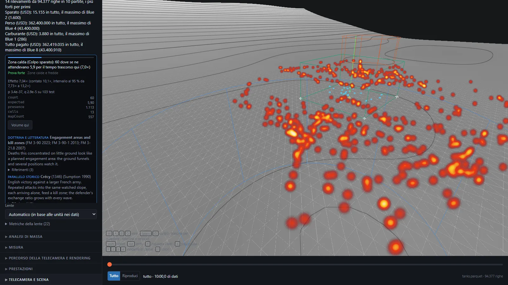

# La lente della conoscenza

Quando [Rilevamenti](insights.md) trova qualcosa, questa parte lo spiega con idee
della storia militare, del game design e dell'analisi dello sport, e indica il
libro o l'articolo da cui viene. Usala per capire *perché* un modello conta, non
solo che esiste.

## Provala {#try-it}

1. Carica dei dati e apri **Rilevamenti**, poi premi **Trova rilevamenti**.
2. Clicca un risultato per aprirlo.
3. Leggi **Dottrina e letteratura** e **Parallelo storico**; i riferimenti completi sono ripiegati sotto.
4. Cambia **Lente** (per esempio in *Dottrina militare*) per leggere lo stesso risultato con un altro corpo di letteratura.

## Come funziona {#how-it-works}

Il pannello Rilevamenti giudica i suoi risultati come farebbe un analista
professionista: attraverso la dottrina militare e la ricerca operativa, gli
scontri storici, e la letteratura del game design, del level design e
dell'analisi dei dati di gioco. Lo fa offline, da una base di conoscenza curata
nel visualizzatore, e consegna lo stesso materiale a un modello esterno quando
ne scrive il resoconto.

## Cosa mostra il pannello {#what-the-panel-shows}

- **Lente** sceglie il corpo di letteratura con cui si leggono i risultati: *Auto* (scelta in base ai tipi di unità nei dati: aerei, navi, veicoli di terra, fanteria), *Dottrina militare*, *Combattimento aereo*, *Navale*, *Urbano*, *Game design e bilanciamento*, *Esport*. Le voci fuori dalla lente scelta vengono lasciate fuori.
- Ogni risultato aperto mostra la sua voce più vicina di **dottrina e letteratura** e il suo **parallelo storico** più vicino, con i riferimenti completi ripiegati sotto.
- **Metriche della lente** elenca le misure di analisi operativa calcolate sulle stesse righe (sotto), ognuna con il suo significato e la sua letteratura.
- Il **Resoconto** aggiunge righe per i risultati principali e le metriche della lente: "Dottrina e letteratura: ..." e "Parallelo storico: ...", ognuna con le citazioni autore-anno e i riferimenti ripiegati sotto.
- **Scrivi con l'IA** invia le voci più pertinenti (riassunto, lezione, i risultati a cui si riferiscono, riferimenti completi) insieme al rapporto, e chiede al modello di citarle per id - `{concept.lanchester-square}` - e di non usare altre fonti.

Le etichette sono tradotte; la conoscenza è in inglese.

## Metriche della lente {#lens-metrics}

Calcolate nel worker dei rilevamenti, nello stesso passaggio sulle righe dei
rilevatori (`src/insights/lensMetrics.ts`). Ognuna viene lasciata fuori quando i
dati non possono sostenerla.

| Metrica | Cosa misura | Richiede |
|---|---|---|
| Adattamento di Lanchester | Le perdite di ogni parte ogni 20 s, regredite sulla forza viva di entrambe le parti (Poisson, errori di quasi-verosimiglianza); gli esponenti della forza nemica e propria, verificati contro la legge del quadrato (fuoco mirato) e la legge lineare (fuoco di area) | tempo, squadre, uccisioni e morti |
| Rapporto di scambio | Uccisioni per morte per parte e per luogo; la quota di morti sul terreno più letale che tiene il 5% del tempo, contro la quota che il solo caso dà con quel numero di morti; Gini delle morti rispetto al tempo; I di Moran dei tassi di morte | uccisioni e morti |
| Rapporto di forza locale | Unità amiche e nemiche vive entro il raggio di ingaggio di ogni uccisione (raggio ricavato dai dati: il doppio della distanza mediana dal nemico più vicino); la quota di uccisioni della parte localmente superiore, e il suo eccesso rispetto a quanto predicono i soli numeri | tempo, squadre, persone |
| Campi di tiro | Campi visivi dei luoghi di uccisione più frequentati su una superficie di ostruzione 2,5D (geometria del livello fino all'altezza dei muri, o il terreno percorso) rispetto al luogo medio, e la correlazione di rango tra vista e quota di uccisioni | posizioni; un livello caricato lo rende più preciso; non per l'aria |
| Stato energetico | Energia specifica (altezza più l'altezza che la velocità può comprare) di chi uccide e di chi viene ucciso in aria, confrontata con la statistica di Mann-Whitney | classi di aerei, tempo, altitudine |
| Terreno chiave | Quante volte ogni luogo è tra i tre luoghi di uccisione più frequentati di una partita | più partite |
| Supporto reciproco (scambi) | Morti a cui risponde un'uccisione di un compagno entro il raggio di ingaggio e 5 s | tempo, squadre |
| Primo colpo | Ingaggi - uccisioni raggruppate per partita, da 20 s di quiete e da tre raggi di ingaggio di distanza - vinti dalla parte che ha segnato per prima | tempo, squadre |
| Modello a salve | L'equazione a salve di Hughes adattata a periodi di 20 s di navi in contatto: navi messe fuori combattimento per nave attaccante, e salvate per nave difendente; un adattamento di Lanchester solo sulle navi | classi di navi, tempo, squadre |
| Efficacia di combattimento | Uccisioni per unità-ora in azione di ogni parte e il rapporto dei due più grandi (un valore di efficacia di combattimento nel senso di Dupuy) con il suo intervallo al 95%, e la quota di uccisioni di ogni parte a numeri locali pari | tempo, squadre |
| Raggi di ingaggio | Distanza dal nemico più vicino alle uccisioni, ai lanci e al primo colpo di ogni vita (dal rilevamento all'ingaggio), per tipo di unità | tempo, squadre; lanci dove i dati li hanno |
| Catena di uccisione | Secondi dall'ultimo lancio del killer all'uccisione, e dal suo primo colpo del combattimento all'uccisione | tempo; lanci o eventi di fuoco |
| Concentrazione o dispersione | In ogni periodo di 20 s, la dispersione delle due parti più grandi e la quota di uccisioni presa da quella più compatta | tempo, squadre |
| Sortite | Per parte: sortite (decolli, o comparse di aerei), atterraggi, aerei persi e uccisioni da aerei; tasso di perdita e uccisioni per sortita | classi di aerei; decolli o comparse |

I dati con round aggiungono le misure di combattimento ravvicinato ed esport -
probabilità di vincere il round, valore delle azioni, duelli di apertura, scambi,
chi si sporge contro chi tiene, mira, fuoco incrociato, utilità, vantaggio di
uomini, rimonte, schemi, dopo il piazzamento, imbuti letali e impatto del
giocatore: vedi [Combattimento ravvicinato e round](close-quarters.md).

Tracce e squadre aggiungono le misure di comportamento collettivo della scienza
delle folle, del moto collettivo, dell'economia comportamentale e della psicologia
militare - allineamento e girotondo, branco che segue la rotta, corsie e
scie, affollamento, guide e seguaci, ritardatari, il punto di rottura, rischio dopo
le perdite, serie, accordo sull'acquisto e soppressione, ognuna contro il suo
modello nullo: vedi [Comportamento collettivo](collective-behaviour.md).

Armi, esche ed edifici non vengono contati come unità. Dove le righe delle armi
indicano la loro unità di lancio (una colonna `Shooter` o `Launcher`, come hanno i
dati derivati da Tacview), il lancio viene attribuito a quella unità, riconosciuta
per nome o per id dell'oggetto.

## Come i risultati incontrano la letteratura {#how-findings-meet-the-literature}

Voci e risultati si incontrano attraverso una **tassonomia di schemi**
(`src/insights/knowledge/patterns.ts`): concentrazione, superiorità locale, fuoco
mirato e di area, colli di bottiglia, zone di uccisione, campi di tiro, pendio
inverso, attacco di fianco, supporto reciproco, vantaggio di energia, pressione
di comparsa, equilibrio e così via. Ogni tipo di rilevatore e ogni metrica della
lente indica quali schemi mostrano i suoi numeri (`src/insights/lens.ts`); ogni
voce della conoscenza indica a quali schemi si riferisce, con un peso. La
pertinenza di una voce per un risultato è la sovrapposizione pesata, scalata in
base a quanto il dominio della voce (terra, aria, mare, urbano) si adatta ai dati
e alla forza propria del risultato. La motivazione mostrata è il numero del
risultato in una frase, seguito dalla lezione della voce.

## Catalogo {#catalogue}

Ogni schema, concetto, metodo, caso storico, principio di design e studio, con la
bibliografia: vedi il [Catalogo della conoscenza](knowledge-catalogue.md).

## Per gli sviluppatori {#for-developers}

### Aggiungere voci {#adding-entries}

1. Scegli il file in base al tipo: `concepts.ts` e `concepts-more.ts`, `methods.ts`, `cases.ts`, `cases-land.ts`, `cases-air-sea.ts`, `cases-esports.ts`, `design.ts` (principi di design) o `studies.ts` in `src/insights/knowledge/`.
2. Dai un nuovo id `<tipo>.<slug>` (mai riusarne uno), le sue lenti, i suoi domini, e gli schemi a cui si riferisce con pesi da 0 a 1. Aggiungi uno schema a `patterns.ts` solo quando un risultato lo può mostrare, e mappalo da un risultato o da una metrica in `lens.ts`.
3. Scrivi il riassunto e la lezione **con parole tue**. Citazioni solo da opere di pubblico dominio (`pd: true` nel riferimento), e brevi.
4. Cita: aggiungi ogni nuova opera a `refs.ts` con autori, anno, titolo ed editore (rivista con volume e pagine); un URL o un DOI dove c'è una registrazione pubblica.
5. Esegui `npx vitest run src/insights/lens.test.ts` (id unici, schemi noti, riferimenti che si risolvono, citazioni di pubblico dominio, casi con data ed esito) e `node tools/knowledge-doc.mjs` per aggiornare il [catalogo](knowledge-catalogue.md).
