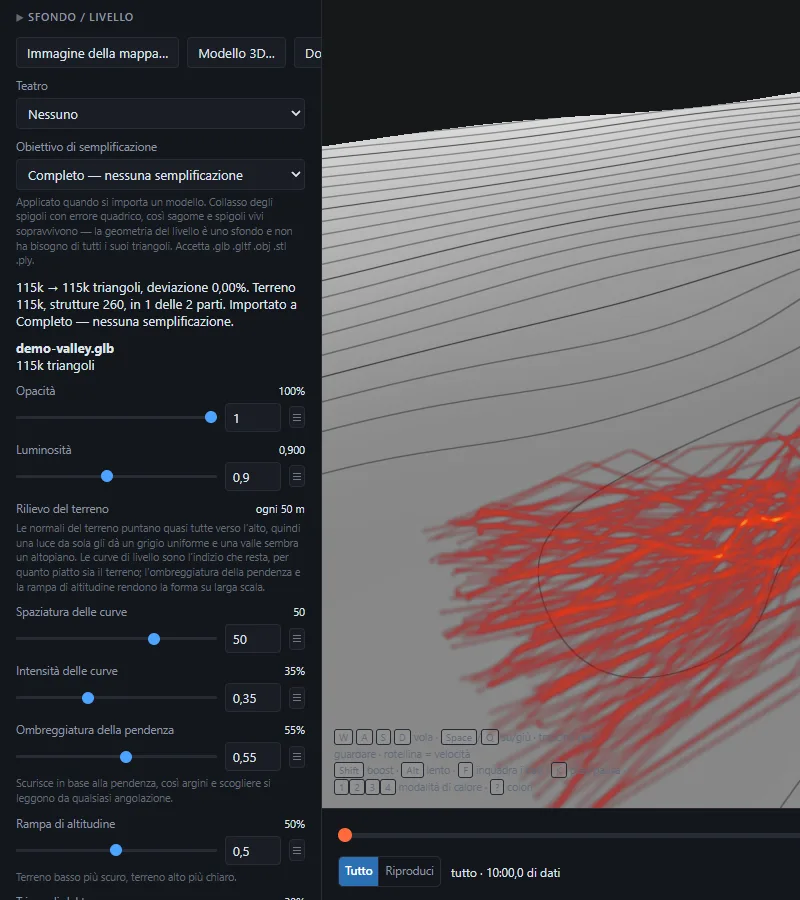

# Livelli e geometria di sfondo

Un livello è il luogo 3D in cui si è svolto il gioco - una mappa, una città, un circuito. Mettilo dietro i tuoi dati e puoi vedere *dove* si trova il calore. Il pannello **Sfondo / livello** (vedi [Glossario](glossary.md) per "livello") ti dà tre tipi di contesto:

- un'**immagine della mappa**, georeferenziata con due ancore - vedi [Immagini delle mappe](map-images.md);
- un **livello 3D** - `.glb`, `.gltf`, `.obj`, `.stl` o `.ply` - diviso in terreno, strutture e acqua e semplificato all'importazione - vedi [Livelli 3D](model-levels.md) e [Aspetto del livello](level-appearance.md);
- uno **sfondo del mondo reale** - per una registrazione che dice dove si trova sulla Terra (un file Tacview ACMI), il terreno reale, le strade, l'acqua, gli aeroporti e gli edifici, scaricati da dati aperti - vedi [Sfondo del mondo](world-backdrop.md).

Senza nulla caricato, la scena è scura con una griglia e assi colorati (**Griglia** e **Assi** in [Telecamera e scena](camera.md)), e il pannello dice *Nulla caricato - la scena mostra una griglia e degli assi. Aggiungi un'immagine della mappa o una mesh di livello per dare contesto al calore.*

Il livello è condiviso da tutte e tre le schede: un percorso caricato nella scheda Analisi di gara è lo stesso livello che mostra la mappa di calore.

## Mettere un livello dietro i tuoi dati {#put-a-level-behind-your-data}

1. Carica prima i tuoi dati ([Caricare i dati](getting-data-in.md)), così il livello viene adattato a essi.
2. Apri **Sfondo / livello** nella barra laterale.
3. Premi **Immagine della mappa…** per un'immagine o **Modello 3D…** per un livello 3D, e scegli il file. Per una registrazione del mondo reale, usa invece **Sfondo del mondo reale** o **Teatro**.
4. Aspetta che la riga di avanzamento finisca. Un modello grande viene prima semplificato (vedi **Obiettivo di semplificazione** sotto).
5. Premi **F** nella vista per inquadrare tutto. Usa **Opacità** e **Luminosità** finché il calore risalta sul livello.
6. Premi **Salva nella libreria** se userai di nuovo il livello ([Libreria dei livelli](level-library.md)).

## Cosa fa un livello per il calore {#what-a-level-does-for-the-heat}

- Fa da **occlusione**: i punti dati dietro di esso vengono attenuati superficie per superficie, e i punti dati dietro il terreno vengono nascosti ([Profondità e culling](depth-and-culling.md)). Senza livello non c'è occlusione.
- Viene **tagliato** dalla [Sezione](slice.md) e, con *Taglia anche il livello*, dal [culling per distanza](depth-and-culling.md#distance-culling), insieme al calore.
- È l'unica cosa, oltre alla griglia e alle scatole, che la [profondità di campo](camera.md#depth-of-field) sfoca.
- Un livello 3D **allarga il piano lontano della telecamera** quando è più grande dei dati: vicino e lontano vengono calibrati dal dataset, e una mappa esportata larga diversi chilometri altrimenti finirebbe interamente dietro il piano lontano lasciando una vista vuota. Il piano lontano diventa 3 × l'estensione orizzontale del livello quando questa è maggiore, il piano vicino si sposta con esso (almeno lontano / 100.000) per mantenere la precisione di profondità da cui dipende l'occlusione, e la velocità di volo viene alzata ad almeno estensione / 12. Viene solo allargato, mai ristretto.

## Il pannello, dall'alto in basso {#the-panel-top-to-bottom}

| Parte | Dettagli |
|---|---|
| **Immagine della mappa…**, **Modello 3D…** | Ne carica uno; sostituisce il livello attuale. |
| **Sfondo del mondo reale**, **Dimentica le tessere** | Solo per un dataset con un riferimento geografico: costruisce il luogo reale sotto di esso come livello, oppure cancella le tessere scaricate. [Sfondo del mondo](world-backdrop.md) |
| **Obiettivo di semplificazione** | Il budget di triangoli per la prossima importazione del modello: *Completo - nessuna semplificazione* (predefinito), *Alto - 8M*, *Medio - 3M*, *Basso - 800k*, *Silhouette - 100k*. [Livelli 3D](model-levels.md#simplification) |
| Avanzamento e **Annulla** | Durante la decodifica o l'importazione. |
| Nota di importazione | Triangoli prima e dopo, la divisione terreno / strutture / acqua, il livello di dettaglio usato. |
| Nome e dimensione | `larghezza×altezza px · x × z m/px` per un'immagine, `N triangoli (da M)` per un modello. |
| **Opacità**, **Luminosità** | Per entrambi i tipi. |
| Comandi dell'immagine | **Desatura**, **Inverti nord/sud**, **Posizionamento** (due ancore), **Adatta ai limiti dei dati**, **Altitudine**. [Immagini delle mappe](map-images.md) |
| Comandi del modello | Rilievo del terreno, acqua, triangoli del terreno, wireframe, texture, colore acquisito, strutture, classificazione delle parti. [Aspetto del livello](level-appearance.md) |
| **Salva nella libreria**, **Rimuovi** | [Libreria dei livelli](level-library.md); Rimuovi scarica il livello. |
| **Libreria** | I livelli memorizzati in questo browser. [Libreria dei livelli](level-library.md) |

## Pagine di questa sezione {#pages-in-this-section}

- [Immagini delle mappe](map-images.md)
- [Livelli 3D](model-levels.md) - formati, parti, classificazione, semplificazione, texture
- [Aspetto del livello](level-appearance.md) - ogni comando per un livello 3D
- [Libreria dei livelli](level-library.md)
- [Sfondo del mondo](world-backdrop.md) - il mondo reale sotto una registrazione, da dati aperti

Come ottenere i livelli dai giochi e dai motori è compito degli strumenti di esportazione separati (vedi il [README](https://github.com/Holdi601/3DHeat/blob/main/README.md) del repository); il contratto che scrivono è riassunto in [Livelli 3D](model-levels.md#the-exporter-contract).
