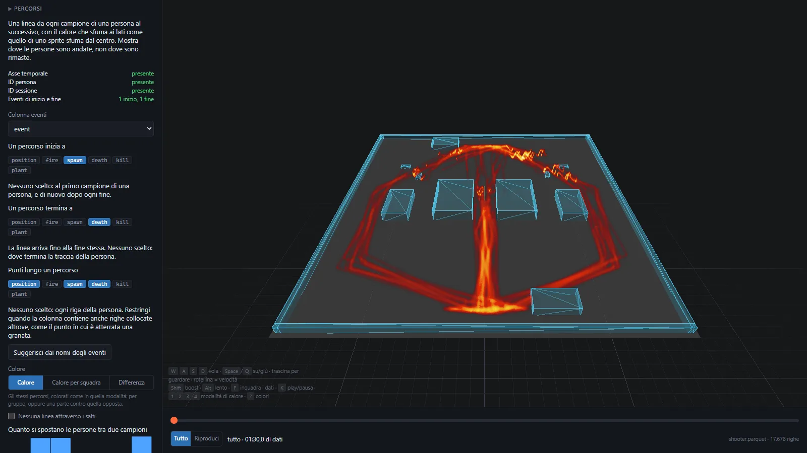

# Mappa di calore delle linee

Il calore mostra dove stavano le persone. Le linee mostrano i percorsi che hanno fatto.

**Linee** (tasto 4) è la mappa di calore delle linee: una linea da ogni campione di una [persona](glossary.md) al suo successivo, spalmata con la stessa attenuazione che ha una [sprite](glossary.md) - attraverso la linea invece che intorno a un punto. Mostra dove le persone *sono andate*, non dove stavano: un corridoio percorso una volta si vede quanto una stanza in cui si è accampati, e i campioni radi di un giocatore veloce si uniscono in un percorso continuo invece che in una scia punteggiata. Servono una colonna di persona e una colonna del tempo.

## Come si usa {#how-to-use-it}

1. Premi `4` (o scegli **Linee** nella barra delle modalità).
2. Apri **Percorsi** e controlla la lista verde: asse del tempo e id persona devono essere presenti.
3. Premi **Suggerisci dai nomi degli eventi** per riempire dove i percorsi iniziano e finiscono.
4. Leggi la riga delle statistiche: "N percorsi, M dei quali raggiungono una fine".
5. Se le linee saltano attraverso la mappa, regola **Passo più lungo** (vedi [Il limite dei salti](#the-jump-limit)).

Una linea ha senso solo tra un inizio e una fine, quindi il pannello **Percorsi** dice cosa limita un percorso. Tutto quello che c'è da [Le regole di un percorso](#the-rules-of-a-route) in poi è dettaglio che puoi saltare.

## Il pannello Percorsi {#the-routes-panel}

Mostrato sopra i pannelli di calore in modalità Linee.

### Cosa hanno i dati {#what-the-data-has}

Una lista di controllo, verde quando c'è, ambra quando no:

| Riga | Stati |
|---|---|
| **Asse del tempo** | *presente* / *mancante - necessario* |
| **ID persona** | *presente* / *mancante - necessario* |
| **ID sessione** | *presente* / *nessuna - tutte le righe sono una sola sessione* |
| **Eventi di inizio e fine** | *N inizi, M fini* / *nessuno scelto - tracce intere* (verde solo con una colonna eventi e almeno un inizio e una fine) |

### Comandi {#controls}

| Comando | Significato |
|---|---|
| **Colonna eventi** | Una colonna di categoria i cui valori sono eventi (spawn, morte, posizione, ...). *Nessuna - tracce intere*: la traccia di ogni persona in ogni sessione è un percorso, interrotto dove la traccia ha un buco. Vengono proposte solo le colonne tenute per il filtraggio al caricamento. |
| **Un percorso inizia a** | Valori di evento che iniziano un percorso (spawn, rinascita, sbarco). Nessuno scelto: un percorso inizia al primo campione di una persona, e di nuovo dopo ogni fine. |
| **Un percorso termina a** | Valori di evento che finiscono un percorso (morte, estrazione, teletrasporto). La linea arriva fino alla riga di fine stessa. Nessuno scelto: un percorso finisce dove finisce la traccia della persona. |
| **Punti lungo un percorso** | Valori di evento le cui righe stanno lungo il percorso. Nessuno scelto: ogni riga della persona. Restringilo quando la colonna contiene anche righe messe altrove, come dove è atterrata una granata. |
| **Suggerisci dai nomi degli eventi** | Riempie le tre liste dai nomi dei valori (sotto). |
| **Colore** | *Calore*, *Calore squadre* o *Differenza*. Gli stessi percorsi nella colorazione di quella modalità: ogni gruppo nella sua tinta, oppure una parte contro l'altra, con l'elenco dei gruppi, la divisione e le rampe che funzionano come in quelle modalità. Predefinito *Calore*. Calore squadre e differenza richiedono una colonna di gruppo. |
| **Nessuna linea attraverso i salti** / **Passo più lungo** | Il campione successivo di una persona più lontano di così è una rinascita, un teletrasporto o una caduta, non un posto dove è andata, quindi nessuna linea unisce i due. Viene riempito al caricamento quando i dati mostrano un buco chiaro (sotto), e spento quando non lo mostrano. Funziona con o senza una colonna eventi. |
| Riga statistiche | `N percorsi, M dei quali raggiungono una fine, K segmenti`, aggiornata alcune volte al secondo. |

Ogni lista è una fila di pillole a interruttore, una per valore, la più frequente per prima; passando sopra una pillola si vede il numero di righe. Vengono proposti al massimo 120 valori (*N altri valori non mostrati*).

Scegliere un'altra colonna eventi applica il suggerimento quando il suggerimento sceglie quella stessa colonna, e altrimenti parte con liste vuote.

### Il suggerimento {#the-suggestion}

A ogni caricamento, e su **Suggerisci dai nomi degli eventi** ([`suggestLineSettings`](https://github.com/Holdi601/3DHeat/blob/main/src/data/lines.ts)):

- **Colonna eventi:** la prima colonna di categoria tenuta chiamata `event`, `eventname` o `eventtype`; altrimenti `kind`, `type` o `action`; altrimenti qualunque colonna che contenga *event*, *kind*, *action* o *type*.
- **Inizi:** valori che contengono *spawn, deploy, join, enter, start, begin, respawn, revive, land/landed/landing, drop* - a meno che corrispondano anche a una parola di fine.
- **Fini:** valori che contengono *death, died, dead, kill/killed, eliminat…, extract, evac, teleport, leave, left, disconnect, quit, exit, end, finish, downed* - tranne i valori `kill` e `kills` (un'uccisione è qualcosa che fa il killer, non la fine del suo percorso).
- **Punti:** valori che sono esattamente *position, location, player location, move, movement, tick, sample* oppure *pos*; quando se ne trova uno, inizi e fini vengono aggiunti anche ai punti. Quando non se ne trova nessuno, i punti restano vuoti (ogni riga).

### Il limite dei salti {#the-jump-limit}

Dove le persone saltano, le lunghezze dei passi cadono in due gruppi con quasi nulla in mezzo: quanto percorre una persona tra due campioni, e la larghezza della mappa. Al caricamento ([`suggestMaxJump`](https://github.com/Holdi601/3DHeat/blob/main/src/data/lines.ts)) i passi vengono contati per raddoppio della loro lunghezza al quadrato, fino a 16 milioni, e il limite va nel mezzo del primo intervallo sopra la mediana che è largo almeno un raddoppio di lunghezza, tiene sotto lo 0,02% dei passi per classe, e ha passi oltre di sé. Senza un tale intervallo non viene tagliato nulla, perché non si distinguerebbe un salto da un'auto veloce; attivare il limite a mano parte allora da un decimo della diagonale dei dati.

Il grafico sopra il limite mostra quanto sono davvero lunghi i passi, con una linea al limite: le barre a destra non vengono disegnate. Entrambi gli assi sono logaritmici, perché i salti possono essere un centesimo dei passi e mille volte più lunghi. Passa sopra una barra per vederne l'intervallo e la quota; clicca il grafico per mettere lì il limite. Sotto, la quota dei passi oltre il limite.

## Le regole di un percorso {#the-rules-of-a-route}

Le righe vengono percorse in ordine di tempo, per persona ([`buildLines`](https://github.com/Holdi601/3DHeat/blob/main/src/data/lines.ts)):

1. Le righe di un [nome condiviso](sessions-persons-groups.md#names-worn-by-several-things-at-once) vengono saltate del tutto.
2. Con dei punti scelti, una riga che non è né inizio, né fine, né punto viene saltata.
3. Le righe vengono seguite per persona e per sessione, quindi una persona le cui sessioni si intrecciano nell'ordine del tempo ha un percorso in ciascuna. Un percorso si chiude quando la riga precedente non aveva successore (la sua [durata di vita](sessions-persons-groups.md#person) è "nessuna") - un percorso non attraversa mai un confine di sessione né un buco che il caricamento ha deciso non avere un campione successivo. Di quale percorso fa parte una riga si calcola una volta e si conserva, 4 byte a riga, così cambiare il passo più lungo non ripete quella parte.
4. Una riga di **inizio** chiude ogni percorso aperto e ne apre uno nuovo lì.
5. Con degli inizi scelti, una riga fuori da un percorso viene ignorata. Senza inizi, ogni riga non di fine fuori da un percorso ne apre uno.
6. Ogni altra riga dentro un percorso aggiunge un **segmento** dalla riga precedente del percorso a questa.
7. Una riga di **fine** che estende un percorso lo chiude dopo il suo segmento; quel percorso conta come *che raggiunge una fine*.
8. Un passo più lungo di **Passo più lungo** chiude il percorso dove si trova, e un nuovo percorso inizia dall'estremità lontana, a meno che quella riga sia una fine. Non viene disegnata nessuna linea attraverso di esso, e la riga delle statistiche lo conta.

Ogni segmento viene memorizzato sulla sua riga di *fine*, così i segmenti restano in ordine di tempo, e la finestra della [linea del tempo](timeline.md), il campionatore, i [filtri](filters.md), la visibilità dei gruppi e il segno della differenza funzionano su di loro come sui punti. Un filtro quindi si applica alla riga in cui finisce un segmento.

## Riproduzione {#playback}

In modalità **Tutto** ogni percorso viene disegnato intero. In modalità **Riproduci** ogni persona è un punto che si muove tra i suoi campioni, e disegna il suo percorso dietro di sé:

- un segmento che inizia dopo la testina non viene disegnato;
- il segmento in cui la persona si trova a metà viene disegnato fino alla sua posizione interpolata, con una chiusura di fine sulla testa;
- il calore sfuma sulla **coda**: con la cronologia *Cumulativo* la coda è illimitata e l'intero percorso fin lì resta; con *Finestra* sfuma fino a zero nel *Intervallo* (predefinito 30 s). Con *Durata di vita* la coda è anch'essa il *Intervallo*, e in modalità Linee la linea del tempo mostra il riquadro *Intervallo* anche per quella cronologia (al posto di *Durata di riserva* e *Dissolvenza*, che la mappa di calore delle linee non usa).

Durante la riproduzione ogni fotogramma viene disegnato intero invece che accumulato, perché le teste si muovono a ogni fotogramma e una media mobile sfumerebbe ognuna in una striscia.

## Per gli sviluppatori {#for-developers}

### Memoria {#memory}

I percorsi vengono costruiti sul thread principale quando si entra in modalità Linee (o cambiano le impostazioni dei percorsi) e liberati quando la si lascia: 5 byte per riga in memoria e 8 byte per riga sulla GPU (la posizione di inizio di ogni segmento, quantizzata a 16 bit per asse nel riquadro di delimitazione dei dati, e i suoi flag).

### Come viene disegnata una linea {#how-a-line-is-drawn}

Entrambi i backend disegnano ogni segmento dalla sua riga di fine come **18 vertici** ([`lineHeatVs`](https://github.com/Holdi601/3DHeat/blob/main/src/render/webgl2/shaders.ts) e il suo gemello WGSL):

- La semilarghezza a ogni estremità è il [raggio dello sprite](sprite-shape.md#sprite-radius) alla distanza di quell'estremità, con i limiti in pixel applicati. Una linea più stretta di 2,5 px viene disegnata larga 2,5 px con il suo calore scalato in proporzione, così le linee sottili né scompaiono né si schiariscono.
- Il calore si attenua **attraverso** la linea con la stessa rampa di una sprite - attenuazione o curva, intensità al centro e al bordo.
- Le chiusure tonde vengono disegnate **solo** dove un percorso inizia o finisce, così le giunzioni tra segmenti consecutivi non si sgranano in una fila di perle.
- La geometria viene costruita nello spazio dello schermo e interpolata linearmente lì, così l'attenuazione resta centrata sulla linea qualunque sia la profondità. Un segmento che attraversa il piano vicino viene tagliato lì invece che scartato.

Il calore dei punti e quello delle linee depositano quantità molto diverse di calore per riga, quindi la saturazione viene di nuovo misurata quando si passa dall'uno all'altro ([Colore ed esposizione](colour-and-exposure.md#auto-exposure)).
