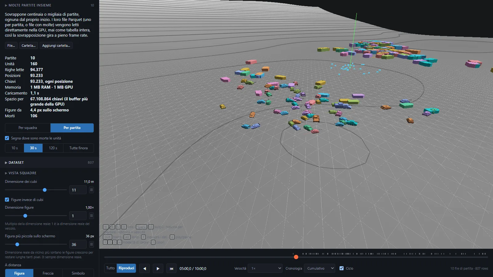

# Molte partite insieme

**Molte partite insieme** fa scorrere molte partite una sopra l'altra, così vedi dove di solito vanno i giocatori di ogni partita. Usala per confrontare centinaia o migliaia di partite in una sola immagine.

Ogni partita inizia dal proprio inizio e le sue unità si muovono come figure. I file vanno direttamente nella scheda grafica e non viene costruita nessuna tabella completa, quindi scorre senza intoppi dove un caricamento normale esaurirebbe la memoria.

## Come si usa {#how-to-use-it}

1. Apri **Molte partite insieme** nella barra laterale Mappa di calore.
2. Premi **File…** (scegli molti file), **Cartella…** (una cartella e le sue sottocartelle) oppure **Aggiungi cartella…** (aggiunge a ciò che è già caricato).
3. Il visualizzatore passa alla sovrapposizione delle figure e parte dall'inizio. Premi **Riproduci**.

Ogni file è una partita (o ne contiene diverse). Funzionano i file Parquet e i contenitori [`.3dheat`](container.md). Un file ha bisogno di una colonna di posizione, di tempo e di unità; le colonne di nome, tipo e lato vengono mantenute. Gli altri file, e i file accessori dei convertitori (volo, messaggi, eventi, chat, obiettivi), vengono saltati. Per una tabella normale, vedi [Caricare i dati](getting-data-in.md).

## Impostazioni {#settings}

| Impostazione | Cosa fa |
|---|---|
| **Per squadra** / **Per partita** | Colora per lato, oppure un colore per partita. |
| **Segna dove sono morte le unità** | Un segno dove è morta ogni unità, per 10 s, 30 s, 120 s, oppure tutte finora. |

Il pannello mostra quante partite, unità, righe e posizioni sono state lette, la memoria usata e il tempo di caricamento. *Spazio per* è quante altre posizioni la scheda grafica potrebbe ancora accettare. *Figure da* è la dimensione sullo schermo sotto la quale un'unità viene disegnata come una piccola freccia invece che con la sua figura.

L'aspetto delle figure usa gli stessi controlli del [replay della partita](match-replay.md#figures): **Dimensione figure**, **Figura più piccola sullo schermo** e **A distanza**.

## Consigli {#tips}

- Quando tutto non entrerebbe in memoria, le posizioni vengono diradate (ne viene tenuta solo una ogni pochi metri) e il pannello lo dice.
- Le modalità di calore funzionano anche sui dati della sovrapposizione.
- Per statistiche su migliaia di partite senza disegnarle, vedi [Analisi di massa](mass-analysis.md).
