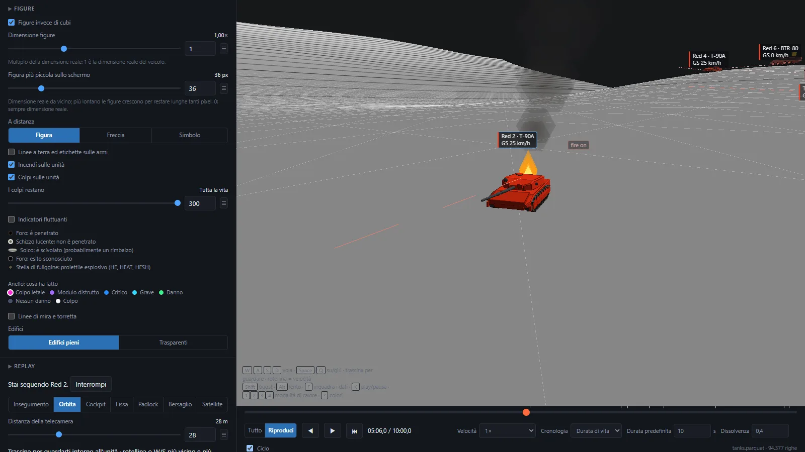
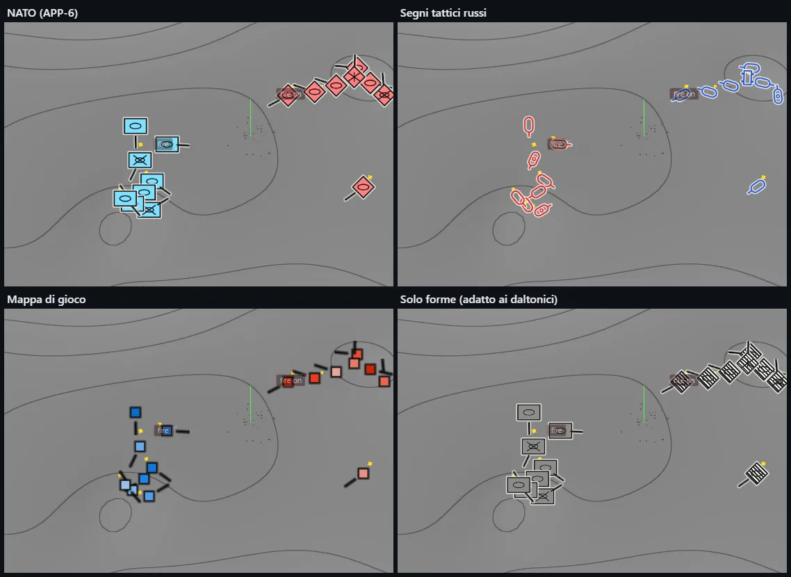
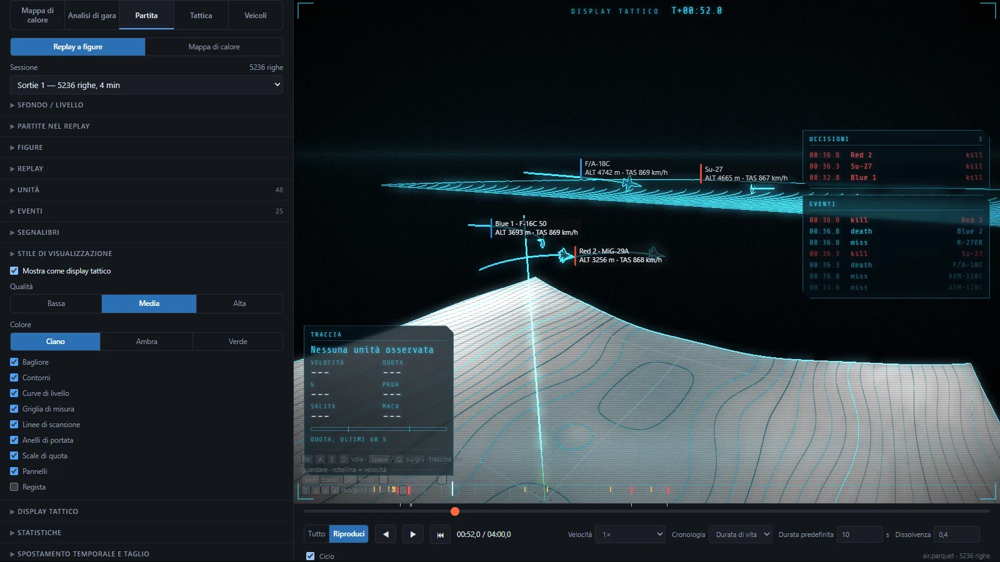
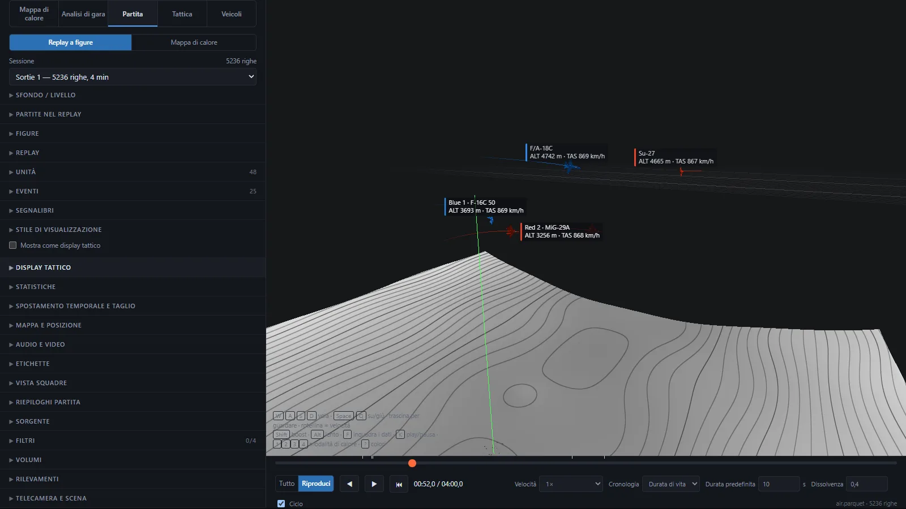

# Replay della partita

Il replay è un film della partita con ogni giocatore disegnato come il mezzo che guidava. Usalo per rivedere uno scontro, seguire un'unità e vedere chi ha colpito chi.

Colpi, impatti, fuochi e relitti sono disegnati sulle unità e sugli obiettivi del livello. Telecamere, etichette e un display tattico ti aiutano a leggere lo scontro. Conosci Tacview? [Parità con Tacview](tacview-parity.md) mostra dove si trova ciascuno dei suoi strumenti.

## Avviare un replay {#start-a-replay}

1. Carica una registrazione con **Sorgente → File…** oppure trascinandola nel pannello Sorgente (qualsiasi tabella con una colonna **person** e una colonna **time**, un file Tacview, un replay convertito, una partita [`.3dheat`](container.md)). Vedi [Caricare i dati](getting-data-in.md).
2. Apri la scheda **Partita** e scegli **Replay a figure**, oppure scegli **Figure sovrapposte** nella barra delle modalità della scheda Mappa di calore.
3. Sotto **Partite nel replay** scegli una partita, tutte insieme, o più di una.
4. Premi **Riproduci** sulla linea temporale (o `K`). Trascina la linea temporale per saltare.

Le figure sostituiscono i cubi per ogni unità il cui nome o tipo è noto (vedi [Figure](figures.md)). I dati senza una colonna di nome o di tipo vengono disegnati come soldati.

## Figure {#figures}

| Impostazione (sezione **Figure**) | Predefinito | Cosa fa |
|---|---|---|
| **Figure invece di cubi** | attivo | Disattivato disegna semplici cubi. |
| **Dimensione figure** (volte la dimensione reale) | 1 | 1 è la dimensione reale; da 0,25 a 20 volte (scala logaritmica). Più grande aiuta da lontano. |
| **Figura più piccola sullo schermo** | 36 px | Le figure lontane crescono per restare di questa dimensione, da 0 a 200 px; 0 mantiene la dimensione reale. |
| **A distanza**: Figura, Freccia, Simbolo | Figura | Cosa diventa un'unità lontana. |
| **Simboli** | NATO (APP-6) | NATO (APP-6), segnali tattici russi, icone della **Mappa di gioco**, oppure **Solo forme (adatto ai daltonici)**. |
| **Dimensione simbolo**, **La mia parte**, **Ostile / Neutrale**, **Tacche di rotta** | 28 px (12 a 64), automatico, ostile, attivo | Come appaiono i simboli e quale lato è amico. |
| **Linee verticali** | attivo | Una linea da ogni unità dritta a terra, così le altezze si leggono in 3D. |
| **Linee a terra ed etichette sulle armi** | disattivato | Linee a terra ed etichette su missili e bombe. |
| **Incendi sulle unità** | attivo | Fiamme dal momento in cui un'unità prende fuoco fino a quando viene spenta. |
| **Colpi sulle unità** | attivo | Segni dove sono arrivati i colpi (sotto). **I colpi restano**: da 1 a 300 secondi, oppure **Tutta la vita**. **Indicatori fluttuanti**: segni disegnati sopra la superficie. |
| **Linee di mira e torretta** | disattivato | Tratteggiate: dove guarda il giocatore; continue: dove punta il cannone. |
| **Edifici** | pieni | Edifici pieni o trasparenti, quando il livello li dipinge. |

### Simboli a distanza {#symbols-at-a-distance}

Quando un'unità sarebbe più piccola di **Figura più piccola sullo schermo**, può diventare un simbolo che resta leggibile. La forma indica il tipo (per esempio una scatola arrotondata con un segno di cingolo per le corazzate); il colore indica il lato. Apri il menu **Simboli** per cambiare lo stile.

### Segni dei colpi, relitti e fuochi {#hit-marks-wrecks-and-fires}

- I **Segni dei colpi** stanno sulla superficie che il colpo ha incontrato, alla scala della figura. Il loro aspetto dice cosa è successo: un foro (è passato), uno spruzzo luminoso (non è passato), un solco (è rimbalzato), una stella di fuliggine (proiettile esplosivo). Un anello colorato dice cosa ha fatto: colpo mortale, modulo distrutto, critico, grave, danno, nessun danno, colpito. Passa il mouse su un segno per il nome del colpo.
- Un'unità distrutta viene disegnata **carbonizzata** come relitto dalla sua morte fino a quando non rinasce o viene rimossa; il suo simbolo è barrato.
- I **fuochi** bruciano su un'unità dal momento in cui prende fuoco fino a quando viene spenta.
- Le **torrette** girano verso dove i dati dicono che punta il cannone (o, in mancanza, dove guarda il giocatore).

### Armi, esche e traccianti {#weapons-decoys-and-tracers}

Con **Armi, colpi e centri** attivo (sezione Vista squadre): missili, razzi, bombe e siluri volano come figure proprie con una scia di fumo; proiettili e colpi di cannone sono traccianti; gli impatti e le esplosioni lampeggiano. Un tracciante disegnato **tratteggiato** è stato ricostruito da un colpo, perché i dati non avevano lo sparo. Flare e chaff sono disegnati come esche; sono nascosti dall'elenco delle unità a meno che *Esche e proiettili* non sia spuntato.

## Telecamere {#cameras}

Clicca un'unità o la sua etichetta per **seguirla**; la sezione **Replay** offre **Inseguimento**, **Orbita**, **Cockpit** (con un display head-up, `H`), **Fissa**, **Padlock**, **Bersaglio** e **Satellite**. `V` le scorre, **Distanza della telecamera** imposta quanto è lontana. Esc si ferma.

- **Vista a due unità**: scegli un **Bersaglio** (oppure Ctrl/Alt-clic su un'unità) per guardarla dalla seguita; **Scambia** le inverte.
- **Misura**: Shift-clic su due unità per rilevamento, distanza e differenza di altezza tra loro.
- **Mappa 2D** (`M`): vista d'angolo o a schermo intero, con scie e nomi.
- **Segnalibri** (`B`): salva il momento e la telecamera; anche le uccisioni, le morti e i segni propri della registrazione sono elencati.
- **Eventi**: ogni evento in ordine di tempo; un clic vi salta. `Page Up` / `Page Down` saltano tra gli eventi; **Pausa sull'evento** si ferma a ciascuno.

## Display tattico {#tactical-display}

La sezione **Display tattico** disegna, per nessuna unità, per quelle selezionate, per tutte o per un tipo (velivoli, terra, navi, armi): vettori di velocità e il percorso davanti, linee del muso e della portanza, coni radar, aggancio, collegamenti dati, zone e linee di ingaggio, linee di vista, dove guardano i giocatori (coni di vista), la mira della torretta e la telecamera registrata.

### Stile del display {#display-style}

`T` (o l'interruttore **Mostra come display tattico**) cambia l'aspetto in uno stile da schermo radar: bagliore, contorni, curve di livello, una griglia di misura, linee di scansione, anelli di distanza, scale di altitudine, pannelli con uccisioni ed eventi, e un **Regista** che sposta la telecamera sugli eventi da solo.

## Obiettivi {#objectives}

Quando una partita arriva con i suoi obiettivi, la sezione **Obiettivi** li disegna sul livello: zone di cattura (con proprietario e avanzamento della cattura), spawn, aeroporti, aree e bersagli di bombardamento, ciascun livello attivabile separatamente, con etichette. Si vedono attraverso il terreno. Con più modalità di gioco caricate, **Modalità** filtra le partite per modalità. Gli obiettivi vengono dal file di partita di un convertitore accanto alla registrazione o dentro un contenitore [`.3dheat`](container.md).

## Etichette e statistiche {#labels-and-statistics}

- **Etichette**: regole per tipo (**Selezionate**, **Velivoli**, **Terra**, **Navi**, **Armi**, **IA**): mostrate o no, quali valori, e una **Priorità** per chi ottiene lo spazio quando le etichette si sovrappongono. **Tieni separate le etichette** sposta un'etichetta accanto alla sua unità quando coprirebbe un'altra, e la omette dove non c'è spazio. **Dimensione etichette** va dal 60 al 250%. **Torna a nome, veicolo, altitudine e velocità** ripristina le regole.
  - Le unità di terra partono con nome, veicolo e velocità.
  - I velivoli partono con nome, veicolo, altitudine e velocità.
  - Le navi partono con nome, veicolo, velocità e rotta.
  - Passa il mouse su un'unità per vedere ogni valore che ha.
- **Statistiche**: per squadra e unità: uccisioni, morti, colpi, colpiti, rapporto di colpi a segno, decolli, atterraggi, tempo in volo, velocità massima, altezza e G, distanza. Esportazione CSV.
- **Grafici**: i valori di un'unità nel tempo, due unità confrontate, oppure un valore contro un altro.

## Molte partite insieme {#many-matches-at-once}

Per sovrapporre centinaia o migliaia di partite, vedi [Molte partite insieme](many-matches.md). Dettagli sulle figure (fumo, fuoco e altri effetti a tempo): [Figure nelle figure sovrapposte](figure-replay.md). Elenco delle funzioni Tacview: [Parità con Tacview](tacview-parity.md), una pagina figlia di questa.
