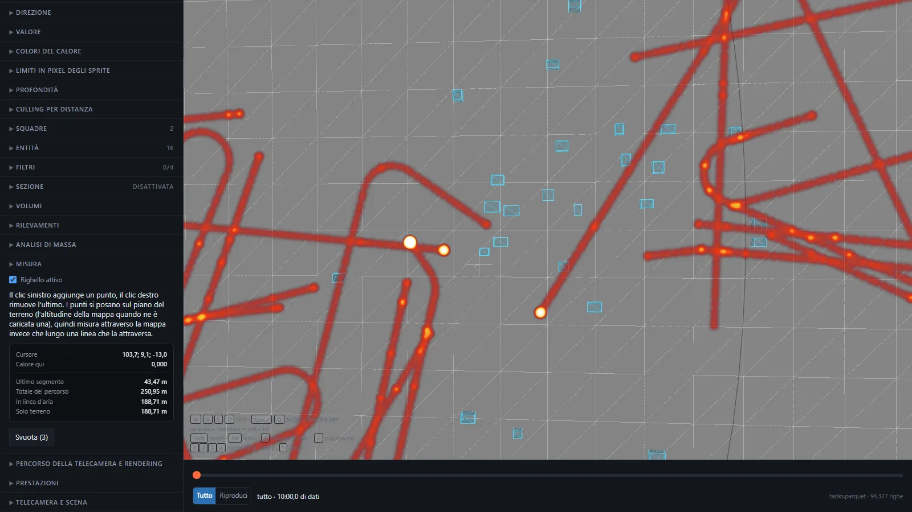

# Misura

**Misura** trasforma il mouse in un righello e ti dice quanto è affollato il punto sotto il cursore. Usalo per sapere quanto distano due luoghi, o quanto traffico passa in un punto.

## Provalo {#try-it}

1. Apri **Misura** nella barra laterale e spunta **Righello attivo**.
2. Clicca con il pulsante sinistro tre punti sulla mappa. Ogni clic lascia un punto.
3. Leggi **Totale del percorso** (la lunghezza dell'intero percorso) e **Ultimo segmento** (l'ultimo tratto).
4. Clicca con il pulsante destro per togliere l'ultimo punto, oppure premi **Svuota (3)** per toglierli tutti.

| Azione | Effetto |
|---|---|
| Clic sinistro | Lascia un punto dove il cursore incontra il piano del terreno. Un clic che ha spostato il mouse di più di 4 pixel tra la pressione e il rilascio è un trascinamento della telecamera, non un punto. |
| Clic destro | Toglie l'ultimo punto. |
| Movimento | La posizione del cursore e il calore sotto di esso si aggiornano in tempo reale. |

La telecamera continua a funzionare mentre il righello è attivo: trascinando si guarda ancora intorno, i tasti continuano a volare. Mentre il righello è attivo prende ogni clic, quindi [scegli con clic](camera.md#click-to-pick) aspetta che sia spento.

**Il piano del terreno** è l'elevazione della [immagine della mappa](map-images.md) quando è caricata un'immagine della mappa, altrimenti la Y più bassa del dataset (0 senza di essa). I punti vi cadono sopra, quindi il righello misura attraverso la mappa, non lungo una linea che la attraversa. Con un livello 3D il piano è comunque la Y più bassa del dataset, non la superficie del livello - per un punto sulla superficie reale, spegni il righello e cliccalo ([scegli con clic](camera.md#click-to-pick)), che legge le coordinate dai triangoli del livello stesso.

## Letture {#readouts}

| Riga | Significato |
|---|---|
| **Cursore** | X, Y, Z del mondo del punto sotto il cursore, sul piano. |
| **Calore qui** | Quanto calore c'è nel pixel del cursore. Un numero più grande significa più traffico in quel punto. È il valore che riceve la rampa di colore prima che il punto di saturazione lo divida, quindi puoi confrontarlo con il [Punto di saturazione](colour-and-exposure.md#saturation-point). |
| **Ultimo segmento** | Distanza dall'ultimo punto al cursore (o tra gli ultimi due punti). |
| **Totale del percorso** | Lunghezza della polilinea che passa per ogni punto e per il cursore. |
| **In linea d'aria** | Distanza 3D dal primo punto al cursore (o dall'ultimo punto). |
| **Solo terreno** | La stessa, solo su X e Z. |
| **Svuota (N)** | Toglie tutti i punti. |

Le distanze vengono mostrate in centimetri sotto 1 unità, in metri sotto 1.000, in chilometri sopra - supponendo che un'unità del mondo sia un metro ([Assi, unità e tempo](axes-units-and-time.md#unit-scale)). Le coordinate sono coordinate del mondo, anche quando un asse è [invertito per la visualizzazione](camera.md#invert-world-axis).

I punti e la linea tra di essi vengono disegnati come sovrapposizione nella vista, dimensionati in base alla spaziatura della griglia. I punti del righello non vengono salvati nelle viste; restano quando carichi altri dati.

## Per gli sviluppatori {#for-developers}

**Calore qui** viene letto dalla GPU al massimo ogni 120 ms, perché una lettura di un singolo pixel blocca la pipeline. Usa lo stesso percorso di `engine.readHeatProbe()`: diviso per il guadagno con cui è stato scritto il fotogramma, quindi sul percorso di accumulo a mezza precisione (`?heat=f16`) è nelle stesse unità che su un target a 32 bit ([Accumulo in mezza precisione](half-float-accumulation.md)).
