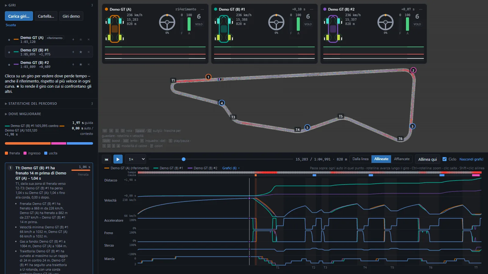

# Analisi di gara

Hai guidato due volte lo stesso tracciato. La scheda **Analisi di gara** riproduce insieme entrambe le guide in 3D, mostra dove un giro è stato più lento e ti dice perché. Nessun giro ancora? Premi **Giri demo**.

La scheda confronta due o più giri dello stesso percorso. Condivide con la mappa di calore il canvas, la telecamera e il modello del percorso caricato (**Sfondo / livello**); tutto il resto è suo: una propria barra laterale e una propria barra sotto la vista. Termini come *giro*, *riferimento* e *apice* sono nel [glossario](glossary.md).

Questa pagina è la mappa della scheda. Ogni parte ha la propria pagina:

| Pagina | Cosa copre |
|---|---|
| [Caricamento dei giri](race-loading-laps.md) | ogni formato di file, cartelle e percorsi, nomi delle auto, giri demo, l'elenco dei giri, riferimento e focus |
| [Replay e scena 3D](race-replay-and-scene.md) | la barra di trasporto, le tre modalità di replay, allineare le auto, la telecamera d'inseguimento, linee, mappe, auto, etichette, mondi specchiati |
| [Grafici e HUD](race-charts-and-hud.md) | i grafici a distanza, il selettore dei grafici, passaggio del mouse e zoom, le schede delle auto, la tabella dei canali |
| [Eventi di controllo dell'auto](race-control-events.md) | bloccaggi, pattinamento, sovrasterzo, testacoda, sottosterzo, colpi, incidenti, ABS/TC, freno a mano, aria - come ognuno viene rilevato, con ogni soglia |
| [Analisi curva per curva](race-corner-analysis.md) | allineamento per distanza, curve e segmenti, il bilancio di tempo di una curva, ogni causa e l'ordine in cui vengono provate, la forma della traiettoria e il consiglio |
| [Profili delle auto e confronto](race-car-profiles.md) | cosa sa fare ogni auto, misurato dai suoi giri; *Auto a confronto*; cosa decide l'auto in ogni curva |
| [Statistiche del percorso](race-course-statistics.md) | molti giri dello stesso percorso: errori per curva e per tipo, la mappa degli errori, l'esportazione della mappa di calore, i limiti di prestazione |
| [Analisi delle gare: il metodo](race-analytics.md) | la ricerca dietro le regole, con le fonti |
| [Altri giochi di corse](other-games.md) | cosa fa il visualizzatore con i giri di ogni gioco: scivolata e derapata ricavate dove un gioco non le invia, mondi specchiati, i canali extra |

## La schermata {#the-screen}

**Barra laterale**, dall'alto al basso (le sezioni possono essere ripiegate):

1. **Giri** - caricare, elencare, mostrare/nascondere, riferimento, focus, inseguimento. Vedi [Caricamento dei giri](race-loading-laps.md).
2. **Statistiche del percorso** - solo da tre giri caricati in su. Vedi [Statistiche del percorso](race-course-statistics.md).
3. **Dove migliorare** - le rilevazioni del giro a fuoco, curva per curva. Vedi [Analisi curva per curva](race-corner-analysis.md).
4. **Curva per curva** (oppure *Curva per curva - classe X* con più classi) - il giro più veloce attraverso ogni curva e la sua traiettoria. Mostrato con due o più giri.
5. **Controllo dell'auto** - bloccaggi, scivolate, spinte e colpi del giro a fuoco. Vedi [Eventi di controllo dell'auto](race-control-events.md).
6. **Auto a confronto** (oppure **L'auto** con una sola auto) - vedi [Profili delle auto e confronto](race-car-profiles.md).
7. **Vista** - quale mappa è dipinta sul tracciato e cosa viene disegnato. Vedi [Replay e scena 3D](race-replay-and-scene.md).
8. I pannelli condivisi **Livello** e **Telecamera e scena** (modello del percorso, inversione degli assi, telecamera) - documentati con la mappa di calore e in [Telecamera](camera.md).

**La vista** mostra il percorso, le linee guidate, la mappa, le auto, le etichette fissate al tracciato e fino a sei schede auto in alto a sinistra (vedi [Grafici e HUD](race-charts-and-hud.md)). Senza giri caricati dice: "Nessun giro caricato - trascina qui due o più file di giri, oppure carica i giri demo dalla barra laterale."

**La barra sotto la vista** contiene il trasporto del replay e, se non sono nascosti, i grafici a distanza.

## Avvio rapido {#quick-start}

1. Apri la scheda **Analisi di gara** (accanto a **Mappa di calore** in alto nella barra laterale).
2. Porta dentro dei giri. Premi **Giri demo** per vedere cosa fa la scheda con tre giri inventati. Per i tuoi giri, registrali prima ([formati dei file e registratori](race-loading-laps.md#file-formats)), poi premi **Carica giri…** o **Cartella…**, oppure trascina file o cartelle sulla vista.
3. Il giro completo più veloce diventa il riferimento; il giro più lento tra gli altri viene messo a fuoco. Clicca un giro nell'elenco per metterlo a fuoco; ★ rende un giro il riferimento.
4. Leggi **Dove migliorare**. Clicca una rilevazione: le auto vengono allineate 40 m prima di essa, la telecamera la inquadra, il replay la percorre e si aprono le misurazioni.
5. Passa sopra i grafici per spostare ogni auto a quel metro; Shift+clic per allinearle lì.

## Tastiera {#keyboard}

Mentre la scheda Analisi di gara è aperta:

| Tasto | Fa |
|---|---|
| **K** | riproduci / pausa del replay |
| **Home** | torna all'inizio del replay |
| tasti numerici | nulla (nella mappa di calore cambiano modalità) |

I tasti digitati in un campo di testo o in un menu a tendina vengono ignorati. I tasti della telecamera funzionano come nella mappa di calore (**W A S D**, **Spazio** su, **Q** giù, **Shift** più veloce, **Alt** più lento, mouse per guardarsi intorno; tutto in [Telecamera](camera.md)); **F** inquadra i giri caricati (come fa il caricamento dei giri).

## Molti giri {#many-laps}

- Tutti i giri caricati vengono analizzati e contati; decine richiedono uno o due secondi.
- Oltre **8** giri (`SHOW_ALL_UP_TO`), i giri aggiunti vengono disegnati solo quando sono il riferimento, il giro a fuoco o il giro migliore della classe del giro a fuoco. Gli interruttori *Mostra tutti* / *Solo quelli in esame* commutano.
- Oltre **10** auto visibili (`PLAIN_PAST`), i giri non guardati (non il fuoco, l'auto inseguita o il riferimento) vengono disegnati con linee diradate a un punto ogni 6 m invece di 1,5 m, e con auto semplici.
- I grafici disegnano al massimo **8** giri; l'HUD mostra al massimo **6** schede.
- Le statistiche del percorso compaiono da **3** giri.

Dettagli: [Statistiche del percorso](race-course-statistics.md#performance-with-many-laps).

## Impostazioni predefinite della vista {#default-view-settings}

| Impostazione | Predefinito |
|---|---|
| Mappa | Mappa dei tempi |
| Traiettorie percorse, Auto, Pneumatici e sospensioni, Etichette, Pista dai giri | attivo |
| Tutti i valori sulle schede | disattivato |
| Dimensione delle auto | 1× |
| Grafici | mostrati |
| Modalità replay | Dalla linea |
| Velocità replay | 1× |
| Ciclo | attivo |

Nulla di questo viene salvato; ricaricando si riparte dai valori predefiniti. Ciò che viene ricordato nel browser: la lingua e i nomi delle auto appresi dai file dei giri (vedi [Caricamento dei giri](race-loading-laps.md#car-names)).

## Per gli sviluppatori {#for-developers}

### Cosa succede quando vengono caricati i giri {#what-happens-when-laps-are-loaded}

Ogni volta che cambiano l'insieme dei giri, il riferimento o la lingua, l'intera analisi viene rifatta (`analyse` in [`src/race/analysis.ts`](https://github.com/Holdi601/3DHeat/blob/main/src/race/analysis.ts)):

1. Ai giri vengono aggiunti i canali derivati dove il gioco non li invia: angolo di deriva, scivolamento delle ruote dalle velocità delle ruote, in aria, terreno sciolto, velocità di imbardata ([`derive.ts`](https://github.com/Holdi601/3DHeat/blob/main/src/race/derive.ts)).
2. Il riferimento viene scelto e ogni giro viene proiettato sul suo percorso e ricampionato ogni 2 m ([`align.ts`](https://github.com/Holdi601/3DHeat/blob/main/src/race/align.ts)).
3. Si ricava dai giri se il mondo del gioco è specchiato ([`handedness.ts`](https://github.com/Holdi601/3DHeat/blob/main/src/race/handedness.ts)).
4. Le curve vengono trovate sul riferimento e raggruppate in segmenti, da una zona di frenata alla successiva ([`segments.ts`](https://github.com/Holdi601/3DHeat/blob/main/src/race/segments.ts)).
5. Per auto: il suo inviluppo (aderenza, frenata, spinta per velocità), il suo profilo, le sue curve degli pneumatici ([`envelope.ts`](https://github.com/Holdi601/3DHeat/blob/main/src/race/envelope.ts), [`profile.ts`](https://github.com/Holdi601/3DHeat/blob/main/src/race/profile.ts), [`control.ts`](https://github.com/Holdi601/3DHeat/blob/main/src/race/control.ts)).
6. Per giro e segmento: cosa ha fatto (punto di frenata, punto più lento, pieno gas, ...) e la traiettoria percorsa ([`line.ts`](https://github.com/Holdi601/3DHeat/blob/main/src/race/line.ts)).
7. Per giro: i suoi eventi di controllo dell'auto, ciascuno confrontato con il giro con cui viene paragonato in quel punto.
8. Per giro e segmento: il bilancio di tempo rispetto al suo giro di confronto e la rilevazione in parole.
9. La mappa dei tempi e la mappa delle cause per giro.

I testi sono prodotti nella lingua attuale; cambiare lingua rifà l'analisi (e rinomina i giri demo). Un errore nell'analisi viene mostrato sotto i pulsanti **Giri** come errore, e i giri restano caricati.

### File sorgente {#source-files}

| File | Ruolo |
|---|---|
| `src/race/adapters.ts`, `ibt.ts` | lettura dei file dei giri |
| `src/race/lap.ts`, `carNames.ts`, `synthetic.ts` | il tipo giro, i nomi, i giri demo |
| `src/race/derive.ts`, `handedness.ts` | canali derivati, mondi specchiati |
| `src/race/align.ts`, `segments.ts`, `line.ts` | asse delle distanze, curve, traiettorie |
| `src/race/analysis.ts` | curve confrontate, cause, rilevazioni |
| `src/race/envelope.ts`, `profile.ts` | cosa sa fare un'auto |
| `src/race/control.ts`, `impacts.ts` | controllo dell'auto, colpi e incidenti |
| `src/race/stats.ts` | molti giri |
| `src/race/replay.ts`, `scene.ts`, `glyph.ts`, `geometry.ts` | replay e disegno |
| `src/race/schema.ts`, `graphs.ts` | la tabella dei canali, le righe dei grafici |
| `src/ui/race/*` | la barra laterale, i grafici, l'HUD, le etichette |
| `src/state/raceStore.ts` | lo stato della scheda e l'orologio del replay |
